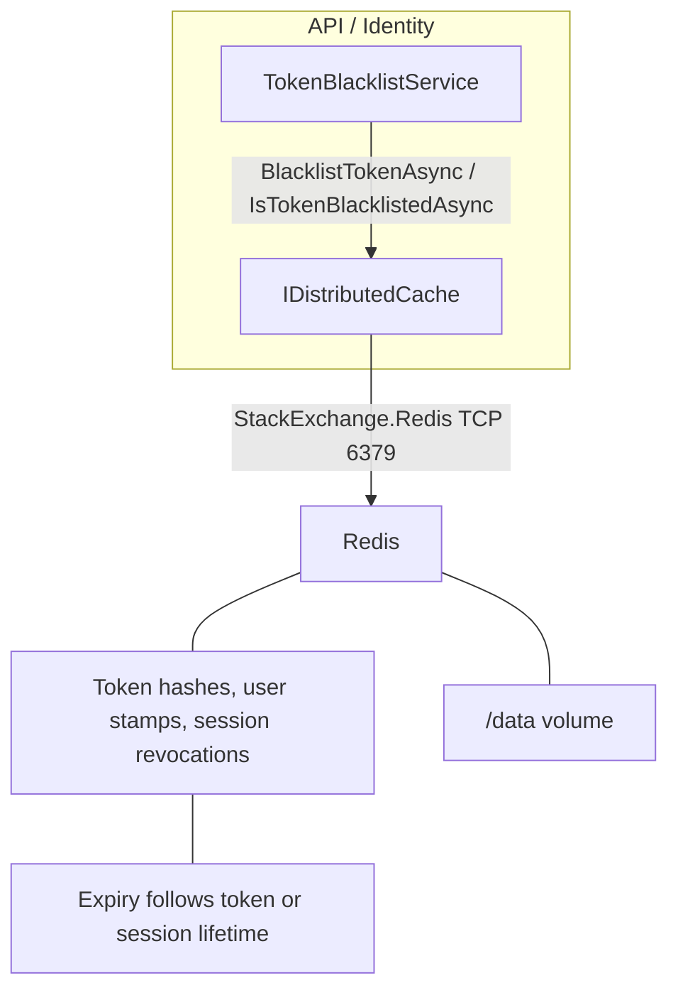
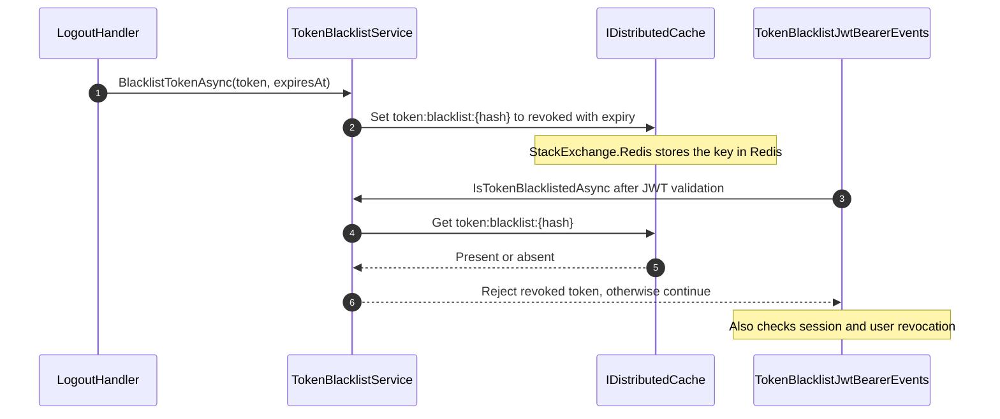

# Redis Cache Infrastructure

**Production-Ready Redis Configuration for StarterKit**

## Table of Contents
1. [Overview](#overview)
2. [Architecture](#architecture)
3. [Configuration](#configuration)
4. [Docker Setup](#docker-setup)
5. [Usage Examples](#usage-examples)
6. [Security](#security)
7. [Performance](#performance)
8. [Monitoring](#monitoring)
9. [Troubleshooting](#troubleshooting)

---

## Overview

### What is Redis?
Redis (Remote Dictionary Server) is an in-memory data structure store used as a distributed cache, message broker, and database.

### Why Redis in StarterKit?
We use Redis for:
- ✅ **JWT Token Blacklisting** - Fast token revocation (< 1ms lookups)
- ✅ **Distributed Caching** - Share cache across multiple API instances
- ✅ **Session Management** - Fast session storage and retrieval
- ✅ **Rate Limiting** - API throttling and abuse prevention (future)

### Key Benefits
- **Speed**: In-memory storage (< 1ms operations)
- **TTL Support**: Automatic key expiration (perfect for tokens)
- **Persistence**: Optional data persistence (RDB/AOF)
- **Scalability**: Supports millions of operations per second
- **Production Ready**: Used by Twitter, GitHub, Stack Overflow

---

## Architecture

### Redis in StarterKit Stack


*Figure: Redis stores revocation keys behind the distributed cache abstraction.*

### Data Flow: Token Blacklisting


*Figure: Logout blacklists the presented token and later authenticated requests check revocation.*

---

## Configuration

### Configuration Files Structure

```text
StarterKit/
├── src/
│   ├── Api/
│   │   ├── appsettings.json              # Development (localhost)
│   │   └── appsettings.Docker.json       # Docker environment
│   └── Shared/Shared.Core/
│       ├── Options/
│       │   └── RedisOptions.cs           # Configuration model
│       └── Extensions/
│           └── RedisExtensions.cs        # DI setup
├── docker-compose.yml                    # Redis service
├── docker-compose.override.yml           # Environment overrides
└── .env                                  # Development secrets
```

### RedisOptions Class

**Location:** `src/Shared/Shared.Core/Options/RedisOptions.cs`

**Properties:**

| Property | Type | Default | Description |
|----------|------|---------|-------------|
| `Host` | string | localhost | Redis server hostname |
| `Port` | int | 6379 | Redis server port |
| `Password` | string? | null | Redis password (dev only) |
| `PasswordSecretPath` | string | /run/secrets/redis_password | Docker secret path (prod) |
| `InstanceName` | string | StarterKit: | Key prefix for all entries |
| `Enabled` | bool | true | Enable/disable Redis |
| `UseSsl` | bool | false | Use SSL/TLS connection |
| `Database` | int | 0 | Database number (0-15) |
| `AbortOnConnectFail` | bool | false | Abort if connection fails |
| `ConnectTimeout` | int | 5000 | Connection timeout (ms) |
| `SyncTimeout` | int | 5000 | Sync operation timeout (ms) |

---

### Development Configuration

**File:** `src/Api/appsettings.json`

```json
{
  "Redis": {
    "Host": "localhost",
    "Port": 6380,
    "Password": "CHANGE_ME_REDIS_PASSWORD",
    "InstanceName": "StarterKit:",
    "Enabled": true,
    "UseSsl": false,
    "Database": 0,
    "AbortOnConnectFail": false,
    "ConnectTimeout": 5000,
    "SyncTimeout": 5000
  }
}
```

**Why port 6380?**
- Docker exposes Redis on `6380` externally
- API running on localhost connects to `localhost:6380`
- Inside Docker network, Redis uses internal port `6379`

**Password Source:** Environment variable `REDIS_PASSWORD` from `.env` file

---

### Docker Environment Configuration

**File:** `src/Api/appsettings.Docker.json`

```json
{
  "Redis": {
    "Host": "redis",
    "Port": 6379,
    "Password": null,
    "PasswordSecretPath": "/run/secrets/redis_password",
    "InstanceName": "StarterKit:",
    "Enabled": true,
    "UseSsl": false,
    "Database": 0,
    "AbortOnConnectFail": false,
    "ConnectTimeout": 5000,
    "SyncTimeout": 5000
  }
}
```

**Key Differences:**
- `Host`: `redis` (container name, not localhost)
- `Port`: `6379` (internal Docker network port)
- `Password`: `null` (uses Docker secret instead)

**Password Source:** Docker secret file at `/run/secrets/redis_password`

---

### Environment Variables Override

**File:** `docker-compose.override.yml`

```yaml
services:
  api:
    environment:
      - REDIS_HOST=redis        # Overrides appsettings Host
      - REDIS_PORT=6379         # Overrides appsettings Port
      # Password comes from Docker secret, NOT env var
```

**Resolution (single source of truth: `Shared.Core.Extensions.RedisConnectionConfiguration`, unit-tested):**

1. **`ConnectionStrings:redis` wins** when set - endpoint, password and TLS come from it. .NET Aspire injects it
   (`WithReference(redis)`; Aspire's Redis uses TLS), and the Docker secrets provider builds it from the
   `redis_password` secret.
2. **Otherwise Host & Port** from the `Redis` section, overridden by `REDIS_HOST` / `REDIS_PORT` outside Development.
3. **Password (only without a connection string):**
   - **Production** (or no environment set): Docker secret file at `Redis:PasswordSecretPath` (default
     `/run/secrets/redis_password`) - required, startup fails fast if missing or empty.
   - **Other environments:** `REDIS_PASSWORD` → fallback to `Redis:Password`.
4. **Client behaviour** (`AbortOnConnectFail`, `ConnectTimeout`, `SyncTimeout`) always comes from the `Redis`
   section, whatever the source of the endpoint.

**One connection per process.** `AddRedisCache` registers a singleton `IConnectionMultiplexer` that the cache
(`RedisCacheOptions.ConnectionMultiplexerFactory`), the `redis` readiness health check (`/health`) and other Redis
consumers (Identity TOTP replay guard, OTP store) share. Inject `IConnectionMultiplexer`; never `Connect` your own.

**Why this design?**
- ✅ Clear separation of concerns
- ✅ Password logic centralized in one place
- ✅ Secure production (Docker secrets, not env vars)
- ✅ Convenient development (.env file)

---

## Docker Setup

### Redis Service Configuration

**File:** `docker-compose.yml`

```yaml
services:
  redis:
    image: redis:7-alpine
    container_name: ${COMPOSE_PROJECT_NAME:-starterkit}-redis
    restart: unless-stopped

    # Security: Use Docker secrets for password
    secrets:
      - redis_password

    environment:
      TZ: ${TZ:-UTC}

    # External port mapping (for development access)
    ports:
      - "${REDIS_PORT:-6379}:6379"

    # Persistent storage
    volumes:
      - redis-data:/data

    # Network isolation
    networks:
      - backend

    # Health check
    healthcheck:
      test: ["CMD", "redis-cli", "--raw", "incr", "ping"]
      interval: 10s
      timeout: 5s
      retries: 5
      start_period: 10s

    # Logging
    logging:
      driver: "json-file"
      options:
        max-size: "10m"
        max-file: "3"

# Volumes
volumes:
  redis-data:
    driver: local
    name: ${COMPOSE_PROJECT_NAME:-starterkit}-redis-data

# Secrets
secrets:
  redis_password:
    file: ./secrets/redis_password.txt

# Networks
networks:
  backend:
    driver: bridge
```

### Setup Instructions

#### 1. Create Redis Password Secret

```bash
# Create secrets directory
mkdir -p secrets

# Generate secure password
openssl rand -base64 32 > secrets/redis_password.txt

# Or manually create
echo "YourSecureRedisPassword123!" > secrets/redis_password.txt

# Secure permissions (Linux/Mac)
chmod 600 secrets/redis_password.txt
```

#### 2. Update .env File (Development)

```bash
# .env
REDIS_PASSWORD=CHANGE_ME_REDIS_PASSWORD
REDIS_PORT=6380
```

#### 3. Start Redis Service

```bash
# Start Redis only
docker-compose up -d redis

# Check logs
docker-compose logs -f redis

# Verify health
docker-compose ps redis
```

#### 4. Test Connection

```bash
# From host machine (development)
redis-cli -h localhost -p 6380 -a "CHANGE_ME_REDIS_PASSWORD" PING
# Expected: PONG

# From inside Docker network
docker exec -it starterkit-redis redis-cli -a "$(cat secrets/redis_password.txt)" PING
# Expected: PONG
```

---

## Usage Examples

### 1. Register Redis in API

**File:** `src/Api/Program.cs` or `IdentityModule.cs`

```csharp
using Shared.Core.Extensions;

// Register Redis cache
builder.Services.AddRedisCache(builder.Configuration);

// Or with instance suffix for specific use case
builder.Services.AddRedisCache(
    builder.Configuration,
    instanceNameSuffix: "TokenBlacklist"
);
// This creates keys like: StarterKit:TokenBlacklist:access:{hash}
```

### 2. Direct IDistributedCache Usage

```csharp
using Microsoft.Extensions.Caching.Distributed;

public class MyService
{
    private readonly IDistributedCache _cache;

    public MyService(IDistributedCache cache)
    {
        _cache = cache;
    }

    // Store value with expiration
    public async Task SetUserSessionAsync(string userId, UserSession session)
    {
        var key = $"session:{userId}";
        var data = JsonSerializer.Serialize(session);
        var options = new DistributedCacheEntryOptions
        {
            AbsoluteExpirationRelativeToNow = TimeSpan.FromMinutes(30)
        };

        await _cache.SetStringAsync(key, data, options);
    }

    // Get value
    public async Task<UserSession?> GetUserSessionAsync(string userId)
    {
        var key = $"session:{userId}";
        var data = await _cache.GetStringAsync(key);

        if (string.IsNullOrEmpty(data))
            return null;

        return JsonSerializer.Deserialize<UserSession>(data);
    }

    // Remove value
    public async Task RemoveUserSessionAsync(string userId)
    {
        var key = $"session:{userId}";
        await _cache.RemoveAsync(key);
    }
}
```

### 3. Using RedisExtensions Helper Methods

```csharp
using Shared.Core.Extensions;

public class CachedDataService
{
    private readonly IDistributedCache _cache;
    private readonly ILogger<CachedDataService> _logger;

    public CachedDataService(
        IDistributedCache cache,
        ILogger<CachedDataService> logger)
    {
        _cache = cache;
        _logger = logger;
    }

    // Get from cache (with error handling)
    public async Task<Product?> GetProductAsync(Guid productId)
    {
        var key = $"product:{productId}";

        // Extension method handles errors gracefully
        return await _cache.GetFromCacheAsync<Product>(key, _logger);
    }

    // Set in cache with TTL
    public async Task CacheProductAsync(Product product, TimeSpan? ttl = null)
    {
        var key = $"product:{product.Id}";

        // Extension method handles serialization and errors
        await _cache.SetInCacheAsync(
            key,
            product,
            ttl ?? TimeSpan.FromMinutes(10),
            _logger
        );
    }

    // Remove from cache
    public async Task InvalidateProductAsync(Guid productId)
    {
        var key = $"product:{productId}";
        await _cache.RemoveFromCacheAsync(key, _logger);
    }
}
```

### 4. Token Blacklisting (Current Implementation)

**File:** `src/Modules/Identity/Identity/Services/Token/TokenBlacklistService.cs`

```csharp
using StackExchange.Redis;

public class TokenBlacklistService : ITokenBlacklistService
{
    private readonly IConnectionMultiplexer _redis;

    public TokenBlacklistService(IConnectionMultiplexer redis)
    {
        _redis = redis;
    }

    // Blacklist access token
    public async Task BlacklistTokenAsync(string token, DateTime expiresAt)
    {
        var db = _redis.GetDatabase();
        var tokenHash = ComputeHash(token);
        var ttl = expiresAt - DateTime.UtcNow;

        // Key: StarterKit:access:{hash}, Value: "1", TTL: 15 minutes
        await db.StringSetAsync(
            $"access:{tokenHash}",
            "1",
            ttl
        );
    }

    // Check if access token is blacklisted
    public async Task<bool> IsTokenBlacklistedAsync(string token)
    {
        var db = _redis.GetDatabase();
        var tokenHash = ComputeHash(token);

        return await db.KeyExistsAsync($"access:{tokenHash}");
    }

    // Blacklist refresh token
    public async Task BlacklistRefreshTokenAsync(string token, DateTime expiresAt)
    {
        var db = _redis.GetDatabase();
        var tokenHash = ComputeHash(token);
        var ttl = expiresAt - DateTime.UtcNow;

        // Key: StarterKit:refresh:{hash}, Value: "1", TTL: 7 days
        await db.StringSetAsync(
            $"refresh:{tokenHash}",
            "1",
            ttl
        );
    }

    // Check if refresh token is blacklisted
    public async Task<bool> IsRefreshTokenBlacklistedAsync(string token)
    {
        var db = _redis.GetDatabase();
        var tokenHash = ComputeHash(token);

        return await db.KeyExistsAsync($"refresh:{tokenHash}");
    }

    private static string ComputeHash(string input)
    {
        var hash = SHA256.HashData(Encoding.UTF8.GetBytes(input));
        return Convert.ToBase64String(hash);
    }
}
```

**Key Patterns:**
- Access tokens: `StarterKit:access:{SHA256_hash}`
- Refresh tokens: `StarterKit:refresh:{SHA256_hash}`
- Value: Always `"1"` (we only care if key exists)
- TTL: Matches token expiration (auto-cleanup)

---

## Security

### Production Security (Docker Secrets)

**Why Docker Secrets?**
- ✅ **Not in environment variables** (visible in `docker inspect`)
- ✅ **Not in image layers** (no accidental commits)
- ✅ **Encrypted at rest** (in Docker Swarm)
- ✅ **Mounted as files** (read-only, memory-only in containers)
- ✅ **Limited access** (only containers that need them)

**How it works:**

1. **Create secret file:**
   ```bash
   echo "SecurePassword123!" > secrets/redis_password.txt
   chmod 600 secrets/redis_password.txt
   ```

2. **Docker Compose mounts it:**
   ```yaml
   secrets:
     redis_password:
       file: ./secrets/redis_password.txt
   ```

3. **Container sees it as file:**
   ```bash
   /run/secrets/redis_password
   ```

4. **Application reads it:**
   ```csharp
   var password = File.ReadAllText("/run/secrets/redis_password").Trim();
   ```

**Single Source of Truth:**
```csharp
// RedisOptions.GetPassword() - ONLY place handling password logic

private string? GetPassword()
{
    var environment = Environment.GetEnvironmentVariable("ASPNETCORE_ENVIRONMENT");
    var isProduction = string.IsNullOrEmpty(environment) ||
                      environment.Equals("Production", StringComparison.OrdinalIgnoreCase);

    if (isProduction)
    {
        // PRODUCTION: Read from Docker secret file
        return ReadSecretFileOrThrow();
    }
    else
    {
        // DEVELOPMENT: Use env var with config fallback
        return Environment.GetEnvironmentVariable("REDIS_PASSWORD") ?? Password;
    }
}
```

### Development Security (.env File)

**File:** `.env`

```bash
REDIS_PASSWORD=CHANGE_ME_REDIS_PASSWORD
```

**Why environment variable in development?**
- ✅ Easy to change (no file permissions needed)
- ✅ Not committed (`.env` in `.gitignore`)
- ✅ Same across team (shared in documentation)

### Network Security

**Backend Network Isolation:**
```yaml
networks:
  backend:
    driver: bridge

services:
  redis:
    networks:
      - backend  # Only backend services can access

  api:
    networks:
      - backend  # Can access Redis
```

**Result:**
- ✅ Redis NOT exposed to internet
- ✅ Only API container can connect
- ✅ Development: Port 6380 exposed (for debugging)
- ✅ Production: No external port exposure

### SSL/TLS Configuration

**Enable SSL in Production:**

```json
{
  "Redis": {
    "UseSsl": true,
    "Host": "redis.production.com",
    "Port": 6380
  }
}
```

**Connection string will include:**
```
redis.production.com:6380,password=***,ssl=true
```

---

## Performance

### Benchmarks

| Operation | Latency | Throughput |
|-----------|---------|------------|
| SET (write) | < 1ms | 100K ops/sec |
| GET (read) | < 0.5ms | 200K ops/sec |
| EXISTS (check) | < 0.5ms | 200K ops/sec |
| DEL (delete) | < 1ms | 100K ops/sec |
| EXPIRE (TTL) | < 0.5ms | 150K ops/sec |

### Real-World Performance

**JWT Token Blacklisting:**
- Check if token blacklisted: **< 1ms**
- Blacklist token: **< 1ms**
- Total overhead per request: **< 1ms**

**Caching:**
- Cache hit (get from Redis): **< 1ms**
- Cache miss (database query): **10-100ms**
- **10-100x faster** than database

### Memory Usage

**Token Blacklisting (10K active users):**
- Average token blacklist: ~100 entries (logout operations)
- Per entry: ~110 bytes (key + value + TTL metadata)
- Total: ~11 KB

**Cache (10K products):**
- Average product size: ~2 KB
- 10K products: ~20 MB
- Total Redis memory: ~20 MB

**Redis Memory Efficiency:**
- Redis uses memory compression
- Efficient data structures (hash tables)
- Automatic eviction policies (if configured)

### Connection Pooling

**StackExchange.Redis** automatically pools connections:
- Multiplexes requests over single connection
- Thread-safe
- Handles reconnection automatically

**Configuration:**
```csharp
// In RedisOptions
public int ConnectTimeout { get; set; } = 5000;    // 5 seconds
public int SyncTimeout { get; set; } = 5000;       // 5 seconds
```

---

## Monitoring

### Health Checks

**Current Health Check:**
```yaml
healthcheck:
  test: ["CMD", "redis-cli", "--raw", "incr", "ping"]
  interval: 10s
  timeout: 5s
  retries: 5
  start_period: 10s
```

**What it does:**
- Runs `redis-cli --raw incr ping` every 10 seconds
- Increments a counter (tests write operation)
- Succeeds if Redis responds
- Marks unhealthy after 5 failed retries

**Check health status:**
```bash
docker-compose ps redis
# Should show "healthy" status
```

### Manual Monitoring

**Connect to Redis CLI:**
```bash
# From host (development)
redis-cli -h localhost -p 6380 -a "CHANGE_ME_REDIS_PASSWORD"

# From Docker container
docker exec -it starterkit-redis redis-cli -a "$(cat secrets/redis_password.txt)"
```

**Useful commands:**
```bash
# Check connection
PING
# Expected: PONG

# Get server info
INFO
# Shows memory, CPU, connections, stats

# Memory usage
INFO memory

# Number of keys
DBSIZE

# List all keys (DANGEROUS in production!)
KEYS *

# List keys matching pattern
KEYS StarterKit:access:*

# Get key TTL
TTL StarterKit:access:some-token-hash

# Get all keys and their TTLs
KEYS StarterKit:* | xargs -I{} redis-cli -a "password" TTL {}

# Monitor real-time commands
MONITOR
# Shows all commands being executed (for debugging)
```

### Redis Commander (GUI Tool)

**Optional: Visual Redis monitoring**

```yaml
# Add to docker-compose.yml
services:
  redis-commander:
    image: rediscommander/redis-commander:latest
    container_name: starterkit-redis-commander
    restart: unless-stopped
    environment:
      - REDIS_HOSTS=local:redis:6379:0:${REDIS_PASSWORD}
    ports:
      - "8081:8081"
    networks:
      - backend
    depends_on:
      - redis
```

**Access:** http://localhost:8081

**Features:**
- Browse all keys
- View key values
- See TTLs
- Real-time updates
- Delete keys
- Execute commands

### Application Logging

**Enable Redis logging in appsettings.json:**
```json
{
  "Logging": {
    "LogLevel": {
      "Default": "Information",
      "Microsoft.Extensions.Caching.Distributed": "Debug",
      "StackExchange.Redis": "Information"
    }
  }
}
```

**What you'll see:**
- Connection attempts
- Failed operations
- Slow queries
- Reconnection events

---

## Troubleshooting

### Issue 1: Connection Refused

**Symptom:**
```
StackExchange.Redis.RedisConnectionException: It was not possible to connect to the redis server(s).
Connection refused
```

**Solutions:**

1. **Check Redis is running:**
   ```bash
   docker-compose ps redis
   # Should show "Up" and "healthy"
   ```

2. **Check port mapping:**
   ```bash
   docker-compose port redis 6379
   # Should show: 0.0.0.0:6380 (or your REDIS_PORT)
   ```

3. **Check configuration matches environment:**
   - **Localhost API:** Use `localhost:6380` (external port)
   - **Docker API:** Use `redis:6379` (internal network)

4. **Check firewall (Windows):**
   ```powershell
   # Allow Redis port
   New-NetFirewallRule -DisplayName "Redis" -Direction Inbound -LocalPort 6380 -Protocol TCP -Action Allow
   ```

### Issue 2: Authentication Failed

**Symptom:**
```
StackExchange.Redis.RedisConnectionException: NOAUTH Authentication required
```

**Solutions:**

1. **Check password is set:**
   ```bash
   # Development
   echo $REDIS_PASSWORD
   # Should output: CHANGE_ME_REDIS_PASSWORD

   # Production (Docker secret)
   docker exec starterkit-api cat /run/secrets/redis_password
   # Should output the password
   ```

2. **Check password matches:**
   ```bash
   # Test with correct password
   redis-cli -h localhost -p 6380 -a "CHANGE_ME_REDIS_PASSWORD" PING
   # Expected: PONG
   ```

3. **Check configuration:**
   - Development: `REDIS_PASSWORD` env var in `.env`
   - Production: Docker secret file exists and is mounted

### Issue 3: Wrong Password

**Symptom:**
```
StackExchange.Redis.RedisConnectionException: WRONGPASS invalid username-password pair
```

**Solutions:**

1. **Verify password in secret file:**
   ```bash
   cat secrets/redis_password.txt
   # Check for extra spaces, newlines
   ```

2. **Recreate secret file:**
   ```bash
   # Remove trailing newlines
   echo -n "YourPassword" > secrets/redis_password.txt
   ```

3. **Restart services:**
   ```bash
   docker-compose down
   docker-compose up -d
   ```

### Issue 4: Keys Not Found

**Symptom:** Tokens still work after logout

**Solutions:**

1. **Check Redis connection is working:**
   ```bash
   redis-cli -h localhost -p 6380 -a "CHANGE_ME_REDIS_PASSWORD" PING
   ```

2. **Check keys are being created:**
   ```bash
   redis-cli -h localhost -p 6380 -a "CHANGE_ME_REDIS_PASSWORD" KEYS StarterKit:*
   # Should list keys after logout
   ```

3. **Check instance name matches:**
   ```csharp
   // In appsettings.json
   "InstanceName": "StarterKit:"

   // In TokenBlacklistService
   await db.StringSetAsync($"access:{tokenHash}", "1", ttl);
   // Actual key: StarterKit:access:{hash}
   ```

4. **Check TTL is set:**
   ```bash
   redis-cli -h localhost -p 6380 -a "CHANGE_ME_REDIS_PASSWORD" TTL StarterKit:access:somekey
   # Should return seconds remaining, not -1 (no expiry)
   ```

### Issue 5: Connection Timeout

**Symptom:**
```
Timeout performing GET StarterKit:access:xxx, inst: 0, queue: 1, qu=0, qs=1, qc=0, wr=0, in=0, ServerEndpoint: localhost:6380
```

**Solutions:**

1. **Increase timeout:**
   ```json
   {
     "Redis": {
       "ConnectTimeout": 10000,  // 10 seconds
       "SyncTimeout": 10000
     }
   }
   ```

2. **Check network latency:**
   ```bash
   ping localhost
   # Should be < 1ms for local Redis
   ```

3. **Check Redis load:**
   ```bash
   redis-cli -h localhost -p 6380 -a "CHANGE_ME_REDIS_PASSWORD" INFO stats
   # Look for:
   # - instantaneous_ops_per_sec (should be low)
   # - rejected_connections (should be 0)
   ```

### Issue 6: Memory Issues

**Symptom:** Redis crashes or slow performance

**Solutions:**

1. **Check memory usage:**
   ```bash
   redis-cli -h localhost -p 6380 -a "CHANGE_ME_REDIS_PASSWORD" INFO memory
   # Look at: used_memory_human
   ```

2. **Configure max memory:**
   ```yaml
   # docker-compose.yml
   services:
     redis:
       command: redis-server --maxmemory 256mb --maxmemory-policy allkeys-lru
   ```

3. **Enable eviction policy:**
   - `allkeys-lru`: Evict least recently used keys
   - `volatile-lru`: Evict LRU keys with TTL set
   - `volatile-ttl`: Evict keys with shortest TTL

---

## Best Practices

### 1. Always Use TTL ✅

```csharp
// ✅ GOOD - Auto-cleanup
await cache.SetStringAsync(key, value, new DistributedCacheEntryOptions
{
    AbsoluteExpirationRelativeToNow = TimeSpan.FromMinutes(15)
});

// ❌ BAD - Never expires, accumulates forever
await cache.SetStringAsync(key, value);
```

### 2. Use Meaningful Key Prefixes ✅

```csharp
// ✅ GOOD - Clear namespace
var key = $"user:profile:{userId}";
var key = $"session:{sessionId}";
var key = $"cache:products:featured";

// ❌ BAD - Hard to debug
var key = userId.ToString();
var key = "data123";
```

### 3. Handle Errors Gracefully ✅

```csharp
// ✅ GOOD - Degrade gracefully
public async Task<Product?> GetProductAsync(Guid id)
{
    try
    {
        var cached = await _cache.GetFromCacheAsync<Product>($"product:{id}");
        if (cached != null)
            return cached;
    }
    catch (Exception ex)
    {
        _logger.LogWarning(ex, "Cache error, falling back to database");
    }

    // Fallback to database
    return await _db.Products.FindAsync(id);
}

// ❌ BAD - Cache failure breaks feature
var product = await _cache.GetFromCacheAsync<Product>($"product:{id}");
// Throws if Redis is down!
```

### 4. Use Connection Multiplexing ✅

```csharp
// ✅ GOOD - Single connection, reused
services.AddSingleton<IConnectionMultiplexer>(sp =>
{
    var configuration = ConfigurationOptions.Parse(connectionString);
    return ConnectionMultiplexer.Connect(configuration);
});

// ❌ BAD - New connection every time
// Don't do this!
```

### 5. Monitor Key Counts ✅

```bash
# Set up periodic monitoring
watch -n 60 'redis-cli -h localhost -p 6380 -a "password" DBSIZE'

# Alert if keys exceed threshold (e.g., 1 million)
```

---

## Future Enhancements

### Planned Features

1. **Redis Cluster** (High Availability)
   - Multiple Redis nodes
   - Automatic failover
   - Data sharding

2. **Rate Limiting**
   - API throttling per user
   - Abuse prevention
   - Configurable limits

3. **Session Management**
   - Distributed sessions
   - Cross-device sync
   - Session analytics

4. **Pub/Sub Messaging**
   - Real-time notifications
   - Cache invalidation
   - Event broadcasting

5. **Redis Streams**
   - Event sourcing
   - Message queues
   - Audit logs

---

## Summary

### What We Have
✅ Production-ready Redis configuration
✅ Secure Docker secrets (production)
✅ Convenient .env setup (development)
✅ JWT token blacklisting (< 1ms)
✅ Health checks and monitoring
✅ Error handling and fallbacks
✅ Single source of truth for configuration
✅ Comprehensive documentation

### Performance
✅ < 1ms token validation
✅ 100K+ ops/sec throughput
✅ Automatic TTL cleanup
✅ Minimal memory footprint

### Security
✅ Docker secrets (production)
✅ Network isolation
✅ Password-protected
✅ SSL/TLS ready
✅ No credentials in code

### Monitoring
✅ Docker health checks
✅ Application logging
✅ Redis CLI access
✅ Optional Redis Commander

**Status:** ✅ Production ready!

---

## Quick Reference

### Common Commands

```bash
# Start Redis
docker-compose up -d redis

# Check status
docker-compose ps redis

# View logs
docker-compose logs -f redis

# Connect to CLI
redis-cli -h localhost -p 6380 -a "CHANGE_ME_REDIS_PASSWORD"

# Check keys
KEYS StarterKit:*

# Get key value
GET StarterKit:access:somekey

# Check TTL
TTL StarterKit:access:somekey

# Delete key
DEL StarterKit:access:somekey

# Flush all keys (DANGEROUS!)
FLUSHALL

# Get info
INFO
```

### Configuration Cheat Sheet

| Environment | Host | Port | Password Source |
|-------------|------|------|-----------------|
| Local Dev | localhost | 6380 | .env (REDIS_PASSWORD) |
| Docker Dev | redis | 6379 | .env (REDIS_PASSWORD) |
| Production | redis | 6379 | Docker secret file |

### File Locations

- **Code:** `src/Shared/Shared.Core/Options/RedisOptions.cs`
- **Extensions:** `src/Shared/Shared.Core/Extensions/RedisExtensions.cs`
- **Config (Dev):** `src/Api/appsettings.json`
- **Config (Docker):** `src/Api/appsettings.Docker.json`
- **Docker:** `docker-compose.yml`
- **Secret:** `secrets/redis_password.txt`
- **Env Vars:** `.env`

---

## References

- [Redis Official Documentation](https://redis.io/docs/)
- [StackExchange.Redis Documentation](https://stackexchange.github.io/StackExchange.Redis/)
- [ASP.NET Core Distributed Caching](https://learn.microsoft.com/en-us/aspnet/core/performance/caching/distributed)
- [Docker Secrets](https://docs.docker.com/engine/swarm/secrets/)
- [Redis Best Practices](https://redis.io/docs/manual/patterns/)
