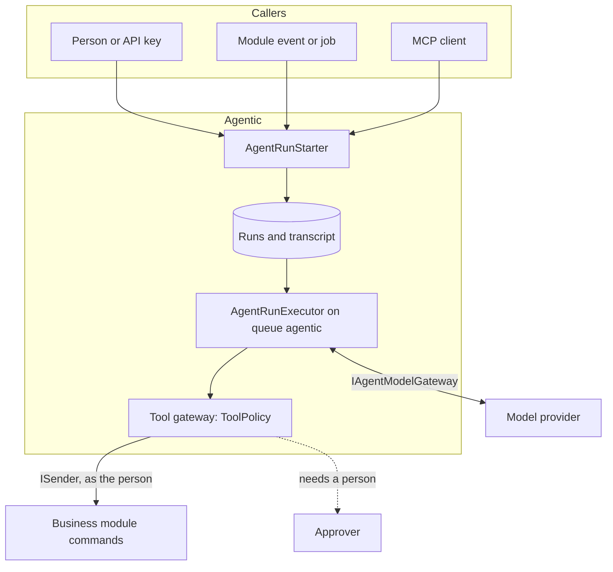
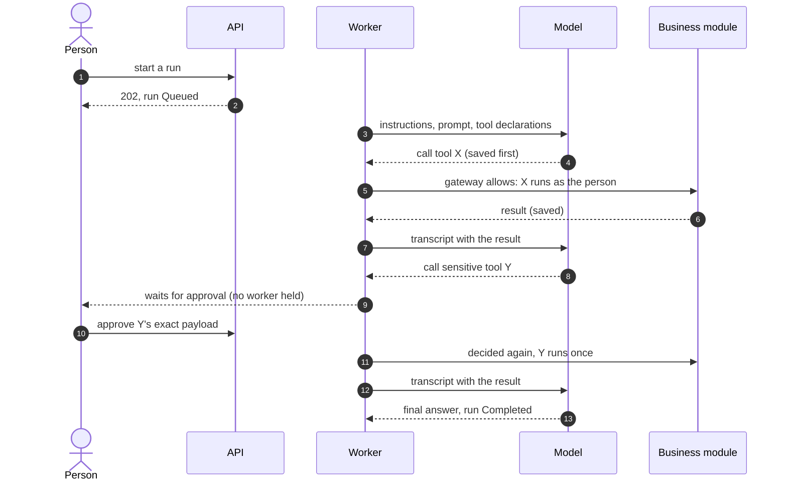
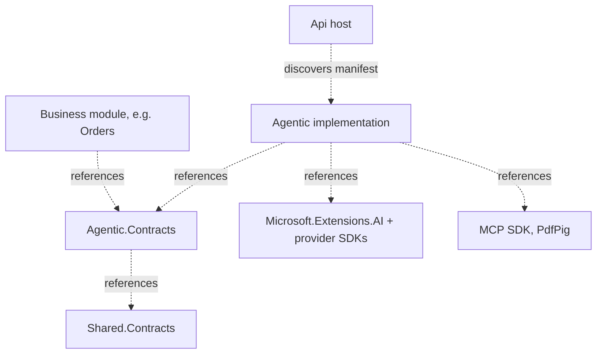
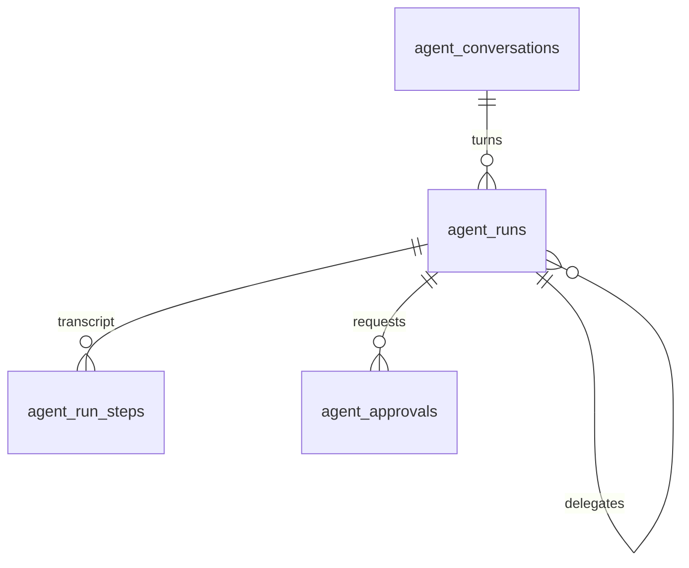

# Agentic module

Agentic runs AI agents as **durable background runs** that act **only through typed, authorized business tools**,
for a real person, under that person's current permissions, with a person deciding everything that matters.

This page is the overview and the map. Each part has its own page in the [Agentic guide](#the-guide); start with
[the big picture](#the-big-picture) and [the five rules](#the-five-rules) if you are new.

## In one minute

| Agentic **is** | Agentic **is not** |
|---|---|
| A runtime that executes agents other modules define | A place for business logic: rules stay in each module's commands |
| A tool gateway that decides every call a model asks for | A model wrapper that lets the model call functions on its own |
| A durable run per job, resumable on any worker | Work done inside an HTTP request |
| A port (`IAgentModelGateway`) in front of any provider | Tied to one vendor: OpenAI-compatible, Anthropic or a scripted model |

The module is **inert unless `Agentic:Enabled=true`**: its routes answer 404 and nothing executes. Its data lives in
schema `agentic` (an `ITenantDataContext`): every row carries `tenant_id` under forced row-level security.

## The big picture


*Figure: The model only proposes; the gateway decides; the business module's own command does the work, as the person the run acts for.*

## System design

Agentic never runs in a request: an endpoint, a consumer or MCP starts a run, and the agentic queue executes it.

```likec4-view
agentic
```

*Figure: Agentic starts every run through AgentRunStarter, executes it on the agentic Hangfire queue against model providers, decides every tool call with ToolPolicy, searches pgvector knowledge, and streams answers over the hub.*

```likec4-view
agentRun
```

*Figure: A run is durable: it is started through the starter, executed on the agentic queue, every tool call is decided by the policy, and a risky call waits for a person to approve that exact payload.*

| Runtime component | What this module uses it for |
|---|---|
| PostgreSQL | Schema `agentic`: runs, steps, approvals, conversations, knowledge with pgvector (HNSW) and full text (tenant data, row-level security) |
| Hangfire (`agentic`) | `ExecuteAgentRunJob`, `IndexKnowledgeDocumentJob`, `SummarizeAgentConversationJob`, `ResolveAgentDelegationJob`, `ExpireAgentApprovalsJob`, requeue and purge jobs |
| Hub | Answer previews as `agentic.run-text`, to the initiator only |
| Events out | `AgentRunCompletedIntegrationEvent`, `AgentRunFailedIntegrationEvent` |
| Events in | `UserDeletedIntegrationEvent`, `AttachmentDeletedIntegrationEvent` |
| Providers | Anthropic, OpenAI or OpenAI-compatible models behind `IChatClient` and `IEmbeddingGenerator`; MCP clients at `/api/v1/mcp/{agentKey}` |

The views come from [agentic.c4](../Architecture/model/agentic.c4); the whole system is on [System Design](../Architecture/System-Design.md).


## Core concepts

| Concept | In one line | Type / page |
|---|---|---|
| Agent | A named job description: instructions, allowed tools, autonomy, triggers | `AgentDefinition` ([Adding an agent](../Agentic/Adding-An-Agent.md)) |
| Tool | One business operation adapted for a model, with a risk and a permission | `[AgentTool]` + `IAgentTool<TInput,TOutput>` ([Tools and the gateway](../Agentic/Tools-And-The-Gateway.md)) |
| Run | One job for one person; the durable record of everything the agent did | `AgentRun` + `AgentRunStep` ([Runs](../Agentic/Runs.md)) |
| Autonomy | How far an agent may go alone: `Observe`, `Recommend`, `Prepare`, `Execute` | [Tools and the gateway](../Agentic/Tools-And-The-Gateway.md#autonomy-against-risk) |
| Approval | A person's consent to one exact action, used once | `AgentApproval` ([Approvals](../Agentic/Approvals.md)) |
| Taint | "This run read text we do not control": every later change needs a person | `AgentRun.Tainted` ([Taint](../Agentic/Tools-And-The-Gateway.md#taint-the-defence-against-instructions-in-content)) |
| Trigger | How a run started: `User`, `Api`, `Event`, `Schedule`, `Delegated`, `Mcp` | [Triggers, policies and quotas](../Agentic/Triggers-Policies-And-Quotas.md) |
| Policy | A tenant's settings for one agent; it can only tighten | `AgentPolicy` ([Triggers, policies and quotas](../Agentic/Triggers-Policies-And-Quotas.md#tenant-policies)) |
| Conversation | Many messages with one agent; each message is a run | `AgentConversation` ([Conversations](../Agentic/Conversations.md)) |
| Knowledge | Content a module indexed for agents to search | `KnowledgeDocument` + `KnowledgeChunk` ([Knowledge and memory](../Agentic/Knowledge-And-Memory.md)) |
| Memory | A fact a person wrote or approved, recalled through a read tool | `AgentMemory` ([Knowledge and memory](../Agentic/Knowledge-And-Memory.md#memory)) |
| Delegation | One agent handing a task to another as a child run | `agent.delegate` ([Delegation](../Agentic/Delegation.md)) |

## The five rules

Everything in the module follows from these. If a change would break one, it is the wrong change.

1. **The model only requests.** No chat client has automatic function invocation. Every call the model asks for is
   decided by `ToolPolicy` and saved as a step before and after it runs.
2. **A run acts as a real person, with their rights now.** There is no agent identity and no system user. The
   person's permissions are read again before every tool call; a run never has more than they do.
3. **A person decides what matters.** Sensitive and external actions, and any change after untrusted content was
   read, wait for an approval bound to the exact payload and used once.
4. **Business rules stay in commands.** A tool adapts one command through `ISender`; it never takes a DbContext or a
   repository, and instructions never repeat rules.
5. **Durable and at-least-once, made safe.** The run row is the truth; any worker resumes it; a repeated tool call is
   idempotent or the run stops for a person.

The threats each rule answers, with the test that proves it: [Agent security model](../Architecture/Agent-Security.md).

## A run, end to end


*Figure: Each arrow back from the model is saved before the next step, so any worker can resume the run after a crash or a wait.*

## Architecture


*Figure: A dependency view: a business module never references the Agentic implementation or a model SDK (`ModuleBoundaryTests`, `ThirdPartyIsolationTests`).*

`AgenticModuleManifest.Order` is `ModuleOrder.Agentic` (800): after every business module whose agents and tools it
runs, before Notification. A module plugs in with `AddAgent`, `AddAgentTool<T>`, `AddKnowledgeSource` and
`AddAgentScript<T>`; the registry is built and validated when the host starts.

### Data model


*Figure: The run tables, foreign keys as mapped. `knowledge_documents` owns `knowledge_chunks`; `agent_policies`, `agent_memories` and `agent_model_usages` stand alone, and an approval also names its step by `step_id` (unique, no foreign key). Every table carries `tenant_id` under forced RLS.*

### Layout

```text
Agentic.Contracts/           references Shared.Contracts only, no AI package
  Agents/       AgentDefinition, AgentAutonomy, AgentTriggerKind, AgentLimits, AddAgent, agent queries
  Tools/        IAgentTool<TInput,TOutput>, [AgentTool], AgentToolRisk, AgentToolContext, AddAgentTool
  Runs/         StartAgentRunCommand, RequestAgentRunCommand, CancelAgentRunCommand, queries, DTOs,
                IntegrationEvents/ (agentic.agent-run-completed.v1, agentic.agent-run-failed.v1)
  Approvals/    approve / reject commands, approval queries and DTOs
  Conversations/ start, send, rename, delete, queries and DTOs
  Policies/     UpdateAgentPolicyCommand, GetAgentPolicyQuery
  Usage/        GetAgentUsageQuery, AgentUsageDto
  Knowledge/    KnowledgeSourceDefinition, AddKnowledgeSource, IKnowledgeSourcePolicy, index / remove commands
  Memory/       memory queries and DTOs (writes are internal)
  Scripting/    IAgentScript, ScriptedTurn, ScriptedReply, AddAgentScript
Agentic/
  AgenticModule.cs, AgenticModuleManifest.cs, Options/ (AgenticOptions, validator, AgenticStartupCheck)
  Data/                   AgenticDbContext, configurations, repositories, migrations (RLS)
  Domains/AgentRuns/      AgentRun + AgentRunStep, AgentRunStarter, ExecuteAgentRunJob, RequeueStalledAgentRunsJob,
                          delegation handlers, content erasure, notifications, routes
  Domains/Approvals/      AgentApproval, decisions, ExpireAgentApprovalsJob, routes
  Domains/Conversations/  AgentConversation, AgentModelUsage, SummarizeAgentConversationJob, routes
  Domains/Policies/       AgentPolicy, policy and usage routes
  Domains/Knowledge/      KnowledgeDocument + KnowledgeChunk, IndexKnowledgeDocumentJob, knowledge.search
  Domains/Memory/         AgentMemory, memory.recall, memory.remember, routes
  Domains/Mcp/            AgentMcpModule (the MCP route)
  Runtime/Execution/      AgentRunExecutor, TranscriptBuilder, AgentDelegation, progress and text streams
  Runtime/Tools/          AgentRegistry, AgentToolDescriptor, AgentToolInvoker, ToolPolicy
  Runtime/Models/         IAgentModelGateway, ChatClientModelGateway, AgentChatClientFactory, ScriptedChatClient
  Runtime/Knowledge/      extraction, chunking, embeddings, KnowledgeStore (pgvector SQL), KnowledgeVectorIndexStep
  Runtime/Mcp/            AgentMcpGateway
  Runtime/Security/       AgentPrincipalResolver (the initiator's CURRENT permissions)
  Telemetry/              AgenticTelemetry (activity source), AgenticMetrics (meter)
Agentic.Tests/               unit tests and the opt-in real-model evaluations
Agentic.IntegrationTests/    Testcontainers PostgreSQL with pgvector, the real module, two tenants, a scripted model
```

## The guide

| Page | Read it when you want to know |
|---|---|
| [Runs and durable execution](../Agentic/Runs.md) | What a run is, its lifecycle, how a worker executes it, leases, retries, budgets, acting as the person |
| [Tools and the tool gateway](../Agentic/Tools-And-The-Gateway.md) | What a tool declares, how every call is decided, autonomy against risk, taint, typed results |
| [Human approval](../Agentic/Approvals.md) | When a person is asked, what they approve, who may decide, expiry |
| [Triggers, policies, quotas and usage](../Agentic/Triggers-Policies-And-Quotas.md) | How runs start automatically, what tenants can restrict, plan quotas, the usage report |
| [Conversations, streaming and summaries](../Agentic/Conversations.md) | Multi-turn chat, the history a model sees, live answers, summaries of long conversations |
| [Knowledge and memory](../Agentic/Knowledge-And-Memory.md) | Making content searchable, hybrid search, the HNSW index, memories |
| [Delegation between agents](../Agentic/Delegation.md) | One agent handing work to another, and why it never gains authority |
| [MCP server](../Agentic/MCP-Server.md) | Offering an agent's read tools to IDEs and desktop assistants |
| [Events and data lifecycle](../Agentic/Events-And-Data-Lifecycle.md) | Integration events, notifications, live progress, retention and erasure |
| [Models, providers and evaluation](../Agentic/Models-And-Evaluation.md) | The model seam, providers, the scripted model, proving a real model |
| [Adding an agent](../Agentic/Adding-An-Agent.md) | Step by step: from a command to a safe, tested agent |
| [Configuration](../Agentic/Configuration.md) | Every setting, grouped by what it controls |
| [API, permissions and observability](../Agentic/API-And-Observability.md) | Routes, permissions, error codes, metrics and traces |
| [Failure modes and guarantees](../Agentic/Failure-Modes.md) | What happens when something goes wrong, and the tests that hold it |

Also: [Agent security model](../Architecture/Agent-Security.md) (threats and controls) and
[Agentic operations](../deployment/Agentic-Operations.md) (production setup, sizing, alerts, runbooks).

<!--#if (sample)-->

The runnable example is the [Shipping sample](Shipping.md): a preparation agent with five tools, a typed result, an
event trigger and an approval, and a conversational assistant that delegates to it.

<!--#endif-->

## Decisions

| ADR | Decision |
|---|---|
| [0025](../Decisions/0025-agentic-module-and-model-seam.md) | Agentic is a runtime module; tools are typed, authorized adapters; the model sits behind a port |
| [0026](../Decisions/0026-durable-agent-runs-on-hangfire.md) | Runs are durable rows executed on Hangfire with leases and checkpoints |
| [0027](../Decisions/0027-agent-approvals-triggers-and-policies.md) | Approvals bound to a payload, automatic triggers for real users, tenant policies that only tighten |
| [0028](../Decisions/0028-agent-knowledge-and-memory-on-pgvector.md) | Knowledge and memory on PostgreSQL with pgvector, behind the same permissions |
| [0029](../Decisions/0029-agent-conversations.md) | Conversations as one run per turn, final-answer history, sticky taint |
| [0030](../Decisions/0030-streaming-agent-answers.md) | Answers stream to the initiator as a preview |
| [0031](../Decisions/0031-conversation-summaries.md) | Long conversations are summarized in a background job, as untrusted history |
| [0032](../Decisions/0032-knowledge-hnsw-index.md) | An HNSW index per configured dimension, built after migrations |
| [0033](../Decisions/0033-agent-delegation.md) | Delegation as child runs, never with more authority |
| [0034](../Decisions/0034-agent-mcp-server.md) | Agent tools served to MCP clients through the gateway, as tainted calls |
| [0036](../Decisions/0036-agentic-stays-in-process.md) | Agentic stays in the monolith, scales with worker replicas, extracted only on named triggers |

## Related

[Agent security model](../Architecture/Agent-Security.md), [Agentic operations](../deployment/Agentic-Operations.md),
[DataTransfer](DataTransfer.md) (the same leased-job pattern), [Shared projects](../Shared/README.md) (`ActingUser`),
[Messaging](../Architecture/Messaging.md).
