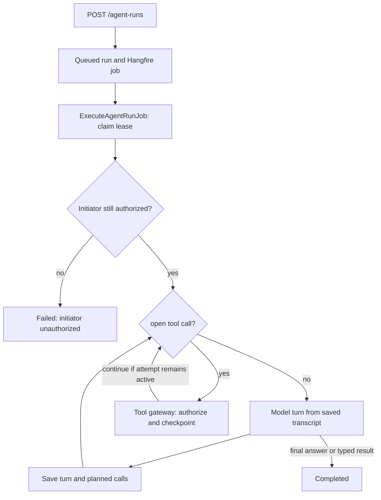
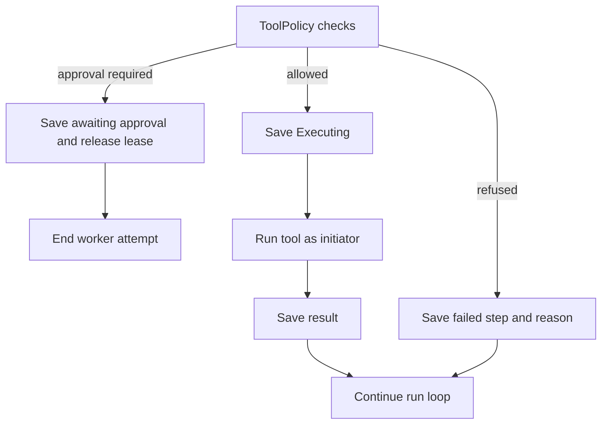
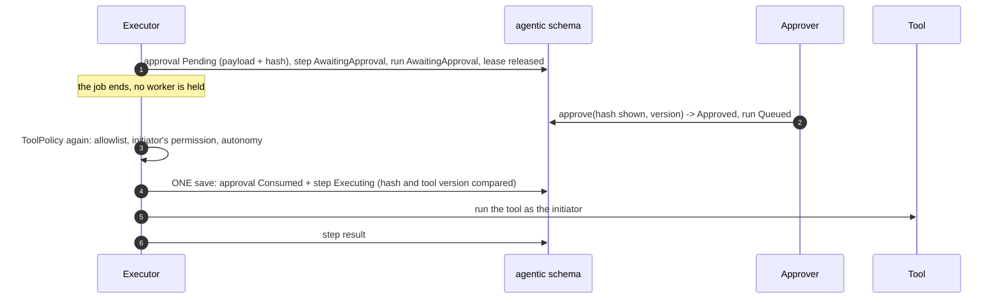
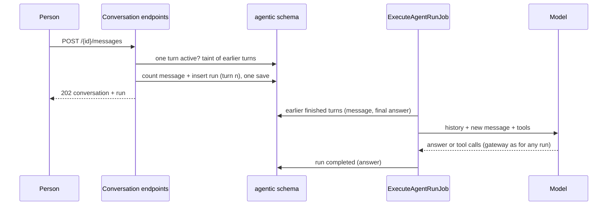

# Agentic module

Agentic runs AI agents as durable background runs that act only through typed, authorized business tools.

Agentic is the **runtime**. The module that owns a use case plugs in an **agent** and its **tools**, so Agentic never
references a business module and a business module never references a model SDK. Design rationale:
[ADR-0025](../Decisions/0025-agentic-module-and-model-seam.md) (module, tools, model seam),
[ADR-0026](../Decisions/0026-durable-agent-runs-on-hangfire.md) (durability) and
[ADR-0027](../Decisions/0027-agent-approvals-triggers-and-policies.md) (approvals, triggers, policies) and
[ADR-0028](../Decisions/0028-agent-knowledge-and-memory-on-pgvector.md) (knowledge and memory on pgvector) and
[ADR-0029](../Decisions/0029-agent-conversations.md) (conversations).

Data plane (`ITenantDataContext`, schema `agentic`): every row carries `tenant_id` and has forced RLS. The outbox
carries `AgentRunCompletedIntegrationEvent` and `AgentRunFailedIntegrationEvent`; approvals and policies are in the
tenant audit trail. The module is **inert unless `Agentic:Enabled=true`**: its routes answer 404 and nothing is
executed.

## At a glance

`AgentRun` owns lifecycle, lease, budgets and counters; `AgentRunStep` is the append-only transcript and the
checkpoint; `AgentApproval` is one request for a person's decision; `AgentPolicy` is a tenant's settings for one
agent; `KnowledgeDocument` + `KnowledgeChunk` are what modules made searchable; `AgentMemory` is a fact agents may
recall; `AgentConversation` groups the runs (turns) of one person's conversation with a conversational agent. `AgenticDbContext` maps schema `agentic`. `AgenticModuleManifest.Order` is `ModuleOrder.Agentic` (800).
Source: `src/Modules/Agentic/`.

### Layout

```text
Agentic.Contracts/           references Shared.Contracts only, no AI package
  Tools/      IAgentTool<TInput,TOutput>, [AgentTool], AgentToolRisk, AgentToolContext, AddAgentTool
  Agents/     AgentDefinition, AgentAutonomy, AgentTriggerKind, AgentLimits, AddAgent, agent queries and DTOs
  Runs/       StartAgentRunCommand, RequestAgentRunCommand, CancelAgentRunCommand, run queries, DTOs, enums,
              IntegrationEvents/ (agentic.agent-run-completed.v1, agentic.agent-run-failed.v1)
  Approvals/  approve / reject commands, approval queries, AgentApprovalDto, AgentApprovalStatus
  Policies/   UpdateAgentPolicyCommand, GetAgentPolicyQuery, AgentPolicyDto
  Usage/      GetAgentUsageQuery, AgentUsageDto
  Knowledge/  KnowledgeSourceDefinition, AddKnowledgeSource, IKnowledgeSourcePolicy, IndexKnowledgeDocumentCommand,
              RemoveKnowledgeDocumentCommand, GetKnowledgeDocumentsQuery
  Memory/     GetAgentMemoriesQuery (paged), AgentMemoryDto, AgentMemoryScope (writes are internal to the module)
  Scripting/  IAgentScript, ScriptedReply, AddAgentScript (the deterministic model for tests and demos)
Agentic/
  AgenticModule.cs        Add/UseAgenticModule (options, registry check)
  Options/                AgenticOptions (+ validator, AgenticStartupCheck)
  Data/                   AgenticDbContext, configurations, AgentRunRepository, migrations (RLS)
  Domains/AgentRuns/      AgentRun + AgentRunStep, ExecuteAgentRunJob, RequeueStalledAgentRunsJob, AgentRunStarter,
                          handlers, AgentRunsModule (routes), AgentAccess, notification handlers
  Domains/Approvals/      AgentApproval, decision handlers, AgentApprovalsModule (routes), ExpireAgentApprovalsJob
  Domains/Policies/       AgentPolicy, handlers, AgentPoliciesModule (policy and usage routes)
  Domains/Knowledge/      KnowledgeDocument + KnowledgeChunk, index/remove handlers, search (internal query),
                          IndexKnowledgeDocumentJob, the stall sweep, knowledge.search, AttachmentDeletedKnowledgeConsumer
  Domains/Memory/         AgentMemory, handlers, AgentMemoriesModule (routes), memory.recall, memory.remember
  Runtime/Knowledge/      KnowledgeSourceRegistry, text extraction, chunking, embeddings, KnowledgeStore (pgvector SQL)
  Runtime/Tools/          AgentRegistry, AgentToolDescriptor + typed invoker, ToolPolicy, AgentJson
  Runtime/Security/       AgentPrincipalResolver (the initiator's CURRENT permissions)
  Runtime/Models/         IAgentModelGateway, ChatClientModelGateway, AgentChatClientFactory, ScriptedChatClient
  Runtime/Execution/      AgentRunExecutor (the loop and the approval gate), TranscriptBuilder, AgentRunProgressPublisher
  Telemetry/              AgenticTelemetry (activity source), AgenticMetrics (meter)
Agentic.Tests/               aggregate state machine, tool policy, registry, model gateway, options
Agentic.IntegrationTests/    Testcontainers Postgres, real module + RLS app role, two tenants, scripted model
```

## How it works

### How a run executes


*Figure: The executor loops over saved model turns and tool calls; the tool gateway can suspend an attempt for approval.*


*Figure: Approval pauses the run; a later worker rechecks policy and consumes the exact approval before executing.*

1. `StartAgentRunHandler` authorizes the caller; `AgentRunStarter` applies the tenant's policy, capacity and the
   plan quota, creates the run and enqueues `ExecuteAgentRunJob` on the queue `agentic`. Nothing runs in the request.
   Fixed at that moment: agent version, model key, autonomy, budgets and, for an API key, its scopes as a permission
   ceiling. NOT stored: the user's permissions.
2. `AgentRunExecutor` claims a lease and loops. With no open tool call it asks the model; otherwise it handles the
   next open call. Every model answer and every tool outcome is saved before the loop goes on.
3. A free-text agent completes when the model answers without asking for a tool. An agent with an `OutputType`
   completes when the model hands in a valid value through the reserved tool `agent.submit_result`.

### The tool gateway

Every tool call the model asks for is decided by `ToolPolicy.Decide`, from trusted facts only:

| Order | Check | Refusal code |
|---|---|---|
| 1 | The tool is registered and in the agent's `Tools` allowlist | `tool_not_allowed` |
| 2 | The initiator holds the tool's `Permission` right now (or the tool is `AllowAnyMember`) | `forbidden` |
| 3 | The run's autonomy covers the tool's risk | `autonomy_exceeded` |
| 4 | Sensitive or external tools, any change after untrusted content was read, and any change when the tenant's policy says so, need a person | the run is suspended (see below) |

Then the arguments are checked: size (`arguments_too_large`), strict JSON against the input type (unknown or missing
members are errors) and the registered `IValidator<TInput>` (`invalid_arguments`). A refused call is not executed; the
step records the code and the model is told.

| Autonomy | Tools that may run |
|---|---|
| `Observe`, `Recommend` | `ReadOnly` |
| `Prepare` | plus `LowRiskMutation` |
| `Execute` | plus `SensitiveMutation` and `ExternalOrIrreversible`, each only with a person's approval |

### Human approval



- An approval covers one tool, one tool version and one set of arguments (`PayloadHash`). The approver sends the hash
  they were shown; a different payload on record is 409 `approval_payload_mismatch`.
- The approver needs `agentic.approvals.decide` and the tool's own permission, as an interactive user (no API key, no
  impersonation). `Agentic:Approvals:RequireDifferentApprover` adds a four-eyes rule.
- Approval replaces no check: when the run resumes, the initiator's permission, the allowlist and the autonomy are
  decided again. An approval is used once; a replayed job or a second decision changes nothing.
- Rejecting closes the step as `Rejected` with the reason; the run continues and the model is told.
- A request not decided within `Agentic:Approvals:ExpireAfterHours` expires (`ExpireAgentApprovalsJob`) and its run
  fails with `approval_expired`.
- When a run finishes in any way (cancelled, failed, completed), its open requests are closed
  (`CloseApprovalsOnRunFinishedEventHandler`). A decision on a run that stopped waiting is 409 `run_not_waiting`. A
  cancel request that arrives just before a suspension wins: the run is cancelled and nobody is asked.
- The audit trail records each request and decision with the payload's digest, not the arguments themselves;
  `PurgeAgentAuditEntriesJob` applies `AuditTrail:RetentionDays`.

### Automatic triggers

A consumer or a recurring job of the module that owns the agent sends
`RequestAgentRunCommand(agentKey, Event | Schedule, triggerKey, onBehalfOfUserId, prompt, inputJson)`:

- the agent's `AllowedTriggers` must list the kind, and the tenant's policy must allow automatic triggers;
- the run acts for `onBehalfOfUserId`, who must be an active member allowed to start the agent right now. There is no
  system identity;
- `triggerKey` is unique per tenant and agent: the same trigger again returns the existing run (`Created = false`);
- at most `Agentic:Triggers:MaxAutomaticRunsPerHour` automatic runs per agent and tenant (429 `automatic_run_limit`).

### Tenant policies, quotas and capacity

`AgentPolicy` (one per tenant and agent, `PUT /agent-policies/{agentKey}`) can switch the agent off, lower its
autonomy, lower its budgets, refuse automatic triggers and demand a person for every change. It is combined with the
agent's definition by taking the stricter value, so it can never widen an agent; a run keeps what it started with.

| Bound | Where | When it is hit |
|---|---|---|
| Per-run budgets | `Agentic:Limits`, lowered by `AgentDefinition.Limits` and the policy | run fails `budget_exceeded` |
| Runs in progress per tenant | `Agentic:Limits:MaxConcurrentRunsPerTenant`, plan limit `max_concurrent_agent_runs` | start refused, 429 `too_many_concurrent_runs` |
| Plan quota `agent_runs` | one unit per run, at start | start refused, 429 `quota_exceeded` |
| Plan quota `agent_tokens` | per saved model turn, the last one included | run fails `quota_exceeded` before its next step |

`GET /agent-usage` reports runs, model turns, tool calls, tokens and estimated cost from the run rows.

### Events, notifications and progress

- Outbox: `AgentRunCompletedIntegrationEvent`, `AgentRunFailedIntegrationEvent` (ids and the trigger key; a cancelled
  run raises nothing). The owning module consumes them and reads the result with `GetAgentRunByIdQuery`.
- In-app notifications to the user a run acts for, category group `agents`: `agents.approval-required`,
  `agents.run-finished`.
- Live progress: user event `agentic.run-progress` over the notification hub after checkpoints (throttled by
  `Agentic:ProgressIntervalMilliseconds`; a change of status is always sent). Payload: `runId`, `agentKey`, `status`,
  `modelTurns`, `toolCalls`, `cancelRequested`, `failureCode`, `stepSequence`, `stepKind`, `stepStatus`, `tool`. The
  run row stays the source of truth.

None of these carries prompts, tool arguments or results.

### Knowledge

A module makes content searchable for agents; nothing else is indexed.

1. Register a source in the module: `services.AddKnowledgeSource(new KnowledgeSourceDefinition { Key =
   "shipping.documents", Name = ..., RequiredPermission = TenantPermissions.X })` (or `AllowAnyMember = true`).
   Optionally `AddKnowledgeSourcePolicy<T>()`: an `IKnowledgeSourcePolicy` that returns, as the user a run acts for,
   which of the found documents they may read.
2. Index from the module's own handler or consumer: `IndexKnowledgeDocumentCommand(source, externalRef, title, Text:
   ...)` or `AttachmentId: ...`. The same content again is a no-op (unless the embedding model changed); new content is a new revision. Remove with
   `RemoveKnowledgeDocumentCommand`. Both are trusted commands (never bound to an endpoint) and do nothing while
   `Agentic:Knowledge:Enabled` is false.
3. `IndexKnowledgeDocumentJob` (queue `agentic`) extracts the text (plain text, Markdown, CSV, JSON, HTML without
   markup, PDF text layer), splits it into overlapping passages, embeds them and swaps old and new passages in one
   transaction, only while its revision is still current. Until then searches keep using the last indexed revision. Unreadable content fails at once (`unsupported_content_type`,
   `document_too_large`, `no_text`, `pdf_encrypted`, `pdf_unreadable`, `attachment_not_found`); a provider failure is
   retried with backoff and then fails (`indexing_failed`). `RequeueStalledKnowledgeDocumentsJob` re-queues lost jobs.
4. An agent that lists the built-in tool `knowledge.search` gets passages with citations
   (`<source>/<externalRef>#<passage>`). Sources come from the run's CURRENT permissions (narrowed by an API-key
   ceiling); the model can only narrow them further. SQL names the tenant and runs under RLS; then the source's policy
   filters per document. Keyword (`tsvector`, `'simple'`) and exact vector (pgvector, cosine) results are merged by
   reciprocal rank fusion; without a query embedding the search uses keywords only. The tool returns untrusted
   content, so the run is tainted and later changes need a person.

Vectors of different embedding models are never compared: a document stores the model identity of its passages.
After changing `Agentic:Knowledge:EmbeddingModelId`, have the owning modules send their documents again: unchanged
content is then indexed again with the new model.

### Memory

`agent_memories` holds personal memories (visible to one user) and tenant memories (everyone; written only with
`agentic.manage`). People manage them at `/api/v1/agent-memories`. Agents use two built-in tools:

- `memory.recall` (read, untrusted content): the user's and the tenant's memories that have not expired. Memory is
  data in the transcript, never part of the instructions.
- `memory.remember` (`RequiresApproval`, permission `agentic.runs.start`): proposes a personal memory for the user the
  run acts for. Every call waits for a person to approve the exact text, at any autonomy level from `Prepare`.

Memories expire after `Agentic:Memory:RetentionDays` and are limited per user and per tenant.

### Conversations

An agent declared with `Conversational = true` can be talked to over several messages at
`/api/v1/agent-conversations`. A conversation holds no messages itself: **every message is an ordinary run** linked by
`AgentRun.ConversationId` and numbered by `ConversationTurn` (1, 2, 3...). So each turn keeps everything a run has:
the initiator's current permissions for every tool call, the tool gateway, approvals, budgets, the `agent_runs`
quota, durable execution, retention and erasure.


*Figure: Each message queues a run; the run is given the earlier turns' messages and answers before the new message.*

| Rule | How |
|---|---|
| What the model is given | Each earlier **finished** turn as a user message and its final answer (`OutputText`, or `OutputJson` as "Result (JSON)"); a failed or cancelled turn as "(This request did not finish.)". Never the tool calls or tool results of earlier turns: the agent reads current data again instead of trusting a stale copy, and old untrusted text is not replayed |
| How much | The newest turns first, at most `Conversations:MaxHistoryTurns` and `Conversations:MaxHistoryCharacters`; older turns are dropped whole. A turn whose content was erased is left out. History counts against the run's `MaxTokens` |
| One turn at a time | 409 `conversation_busy` while a turn is queued, running or waiting for an approval. Two messages sent at the same moment are refused by the database: the filtered unique index `ux_agent_runs_active_turn` (one active run per conversation) and `ux_agent_runs_conversation_turn` (unique turn numbers) |
| Injection across turns | **Sticky taint**: a turn starts tainted when any earlier turn read untrusted content, because that turn's answer is in the history. Every change it proposes then needs a person |
| Whose | The person who started it (with an API key: that key) continues, renames and deletes it; holders of `agentic.runs.read` may read it; anyone else gets 404, in every tenant but its own |
| Which agents | Only `Conversational` ones (400 `agent_not_conversational`); the agent's permission and allowed triggers are checked again for every message |
| Size | `Conversations:MaxMessages` messages, then 409 `conversation_full` |
| Deleting | Stops a turn in progress and erases the content of every turn. A turn still running when its conversation is deleted is erased when it stops; `PurgeAgentContentJob` erases any left over |

Live progress (`agentic.run-progress`) carries the `conversationId`, and the `agent.run` span the tag
`gen_ai.conversation.id`. `GET /api/v1/agent-runs?conversationId=` lists the runs of one conversation. Answers are not
streamed token by token: a client shows the step progress, then reads the answer from `GET /{id}`.

<!--#if (sample)-->

The sample is `shipping.assistant` ([Shipping](Shipping.md#the-shipping-assistant)): read-only answers about shipments,
including follow-ups such as "and how much VAT is due?" that name no shipment.

<!--#endif-->

### Erasure and retention

- Account erasure (`UserDeletedIntegrationEvent`): the user's personal memories are deleted, their open runs are
  cancelled, and the content of their finished runs (prompt, input, output, transcript text, tool arguments and
  results, approval payloads) is erased in every tenant. Facts, counters and audit entries stay. Their conversations
  are closed and their titles dropped.
- `PurgeAgentContentJob` (daily) erases the content of runs that finished more than `Agentic:Content:RetentionDays`
  ago (0 = keep) and deletes expired memories. It also drops the titles of conversations idle for as long, and erases
  any finished turn of a deleted conversation that was not erased when it stopped.
- A deleted attachment (`AttachmentDeletedIntegrationEvent`) removes the documents indexed from it.

### Acting user and tenant

A tool runs exactly like a request of the initiating user: inside `TenantScope.Begin(tenant, membership:)` (their
current branch scope) and `ActingUser.Begin(userId, "agent-run:<id>")`. Handlers read the user from
`IHttpContextService` and the tenant from `ITenantContext` as usual. Audit entries of changes a tool makes carry the
initiator as actor and `agent-run:<id>` as correlation id.

`AgentPrincipalResolver` re-reads the initiator at the start of every attempt and before every tool call: the user
must be active (user directory), in multi-tenant mode still a member of the tenant, and their permissions come from
their current roles. A temporary sign-in lockout is not visible outside Identity and does not stop a run.

### Models

`IAgentModelGateway` is the only way to a model. It sends tool declarations and returns tool calls as data; it never
executes a tool. Provider kinds (`Agentic:Providers:<name>:Kind`):

| Kind | Use |
|---|---|
| `Scripted` | Deterministic `IAgentScript` per agent: tests, CI, demos. Refused in Production by `AgenticStartupCheck` |
| `OpenAiCompatible` | OpenAI, Azure OpenAI's v1 endpoint, self-hosted servers that speak the OpenAI chat API |
| `Anthropic` | The official Anthropic SDK |

### Endpoints

| Route | Authorization |
|---|---|
| `GET /api/v1/agents`, `GET /api/v1/agents/{key}` | tenant member, plan feature `agents`; only agents the caller may start |
| `POST /api/v1/agent-runs` (202) | `agentic.runs.start` + the agent's `RequiredPermission`, plan feature `agents`, no impersonation, rate limit `create`, optional `Idempotency-Key` |
| `GET /api/v1/agent-runs`, `/{id}`, `/{id}/steps` | tenant member; own runs, or all with `agentic.runs.read`; someone else's run is 404. An API key without the read scope sees only the runs that same key started |
| `POST /api/v1/agent-runs/{id}/cancel` | tenant member, no impersonation; the initiator, or anyone with `agentic.manage`. A waiting run is cancelled at once, a running one at its next checkpoint |
| `GET /api/v1/agent-approvals`, `/{id}` | tenant member; all requests with `agentic.approvals.decide`, otherwise those of the caller's own runs (none for an API key) |
| `POST /api/v1/agent-approvals/{id}/approve`, `/reject` | `agentic.approvals.decide` + the tool's permission; no API key, no impersonation |
| `GET`, `PUT /api/v1/agent-policies/{agentKey}` | `agentic.manage` (PUT: no impersonation) |
| `GET /api/v1/agent-usage` | `agentic.runs.read` |
| `POST /api/v1/agent-conversations` (202), `POST /{id}/messages` (202) | `agentic.runs.start` + the agent's `RequiredPermission`, plan feature `agents`, no impersonation, rate limit `create`, optional `Idempotency-Key`; messages only by the owner |
| `GET /api/v1/agent-conversations`, `/{id}` | tenant member; the list is the caller's own; a conversation is readable by its owner or with `agentic.runs.read` |
| `PATCH`, `DELETE /api/v1/agent-conversations/{id}` | tenant member, the owner only, no impersonation |
| `GET /api/v1/knowledge-documents` | `agentic.manage`; status, revision and passage count, no content |
| `GET`, `POST /api/v1/agent-memories`, `DELETE /{id}` | `agentic.runs.start` (POST and DELETE: no impersonation); a tenant memory needs `agentic.manage`; someone else's memory is 404 |

### Metrics, traces, permissions

- Activity source and meter `StarterKit.Agentic`: spans `agent.run`, `agent.model_turn` (the provider's `gen_ai`
  span is its child) and `agent.tool`; counters `agent.runs.started`, `agent.runs.finished`, `agent.runs.requeued`,
  `agent.model.turns`, `agent.model.tokens`, `agent.tool.calls`; histogram `agent.run.active.duration`; gauges
  `agent.approvals.pending`, `agent.approvals.oldest_pending.age` and `agent.runs.queued.oldest.age` (refreshed by
  the stall sweep). A run's spans join the trace of the request that started it; a conversation turn's `agent.run`
  span carries `gen_ai.conversation.id`. The Prometheus alerts on them and
  what to do when one fires: [Agentic operations](../deployment/Agentic-Operations.md).
- Tenant permissions: `agentic.runs.start`, `agentic.runs.read`, `agentic.approvals.decide`, `agentic.manage`
  (policies, cancel someone else's run).
- Entitlement keys: `agents` (plan feature), `agent_runs` and `agent_tokens` (quotas), `max_concurrent_agent_runs`
  (limit).

## Configuration

Section `Agentic` (`AgenticOptions`), validated at startup when enabled:

| Key | Default | Meaning |
|---|---|---|
| `Enabled` | `false` | Master switch |
| `DefaultModel` | `default` | Model key of agents that name none |
| `Models:<key>` | scripted | `Provider`, `ModelId`, `MaxOutputTokens`, `InputPricePerMillionTokens` / `OutputPricePerMillionTokens` (0 = cost not tracked) |
| `Providers:<name>` | scripted | `Kind`, `Endpoint`, `ApiKey`, `TimeoutSeconds`, `MaxRetries` |
| `Limits` | see `AgentRunLimitOptions` | Per-run ceilings: model turns, tool calls, calls per turn, tokens, active seconds, sizes (prompt, input, tool arguments and results, model text) |
| `LeaseSeconds` / `MaxAttempts` | 300 / 3 | Lease length (extended to cover a model request or tool timeout that is longer); consecutive failed attempts before the run fails |
| `StalledAfterMinutes` / `SweepCron` | 10 / every 5 min | `RequeueStalledAgentRunsJob` queues again a run without a live lease that was not queued recently |
| `ProgressIntervalMilliseconds` | 1000 | Throttle of live progress events |
| `Triggers:MaxAutomaticRunsPerHour` | 60 | Automatic runs per agent, tenant and hour; 0 = no limit |
| `Approvals:ExpireAfterHours` / `RequireDifferentApprover` / `ExpiryCron` | 72 / false / every 10 min | Approval expiry and the four-eyes rule |
| `Telemetry:CaptureContent` | `false` | Adds prompts and tool content to model spans |
| `Knowledge:Enabled` | `false` | Knowledge indexing and `knowledge.search` |
| `Knowledge:EmbeddingProvider` / `EmbeddingModelId` / `Dimensions` | scripted / hashing / model default | Embedding model (an OpenAI-compatible provider; `Scripted` hashes words, for tests) |
| `Knowledge:ChunkSize` / `ChunkOverlap` | 1200 / 150 | Passage length and overlap, in characters |
| `Knowledge:MaxDocumentBytes` / `MaxPdfPages` / `MaxTextLength` | 10 MB / 500 / 1,000,000 | Bounds of one document |
| `Knowledge:MaxAttempts` / `StalledAfterMinutes` | 4 / 15 | Indexing retries of a provider failure; stall sweep |
| `Knowledge:SearchCandidates` / `MaxResults` / `EmbeddingBatchSize` | 40 / 8 / 64 | Search breadth and size; embedding batch |
| `Memory:RetentionDays` / `MaxPerUser` / `MaxPerTenant` / `MaxRecalled` | 365 / 100 / 500 / 50 | Memory lifetime and limits |
| `Content:RetentionDays` | 90 | Content of finished runs is erased after this many days; 0 = keep |
| `Conversations:MaxHistoryTurns` / `MaxHistoryCharacters` | 20 / 24000 | Earlier turns a conversation turn is given at most (0 = none) |
| `Conversations:MaxMessages` | 200 | Messages per conversation (at least 1), then 409 `conversation_full`; also bounds the turns `GET /{id}` returns |
| `Hangfire:Servers:Agentic` | enabled, 4 workers | The server of the `agentic` queue |

A provider API key may come from a Docker secret named `agentic_<provider>_api_key` (provider name in lower case).
`docker-compose.agents.yml` turns agents on with an OpenAI-compatible provider and mounts that secret.

## Usage

### Adding an agent to your module

<!--#if (sample)-->

A complete, runnable example is the [Shipping sample](Shipping.md): five tools, a typed result, an event trigger and a
scripted scenario.

<!--#endif-->

1. Reference `Agentic.Contracts` from the module (never the Agentic implementation).
2. Write one class per operation. The input holds only what a model may choose:

   ```csharp
   public sealed record GetOrderInput(string OrderNumber);

   [AgentTool("orders.get_order", "Looks up an order by its number.", Permission = TenantPermissions.OrdersRead)]
   public sealed class GetOrderTool(ISender sender) : IAgentTool<GetOrderInput, OrderDto>
   {
       public Task<OrderDto> ExecuteAsync(GetOrderInput input, AgentToolContext context, CancellationToken ct) =>
           sender.Send(new GetOrderByNumberQuery(input.OrderNumber), ct);
   }
   ```

3. Declare what the attribute asks for: `Risk`, exactly one of `Permission` / `AllowAnyMember`, `Idempotent = false`
   when a repeat would have a second effect, `ReturnsUntrustedContent = true` when the result contains text the
   platform does not control. Raise `Version` when the input or the effect changes.
4. Register in `Add<M>Module`:

   ```csharp
   services.AddAgentTool<GetOrderTool>();
   services.AddAgent(new AgentDefinition
   {
       Key = "orders.order-assistant",
       Name = new LocalizedText("Order assistant", "مساعد الطلبات"),
       Instructions = "Answer questions about orders using the tools.",
       Autonomy = AgentAutonomy.Recommend,
       Tools = ["orders.get_order"]
   });
   ```

5. Optional: an `IValidator<TInput>` for the tool input, an `OutputType` for a typed result, and an `IAgentScript`
   (`AddAgentScript`) so tests and demos run without a provider.
6. Test it like `Agentic.IntegrationTests`: a scripted model asks for the calls, the assertions check what the tools
   did and what was refused.

Tool rules: call `ISender`; never take a DbContext, a repository or a service provider; never put a tenant id, a user
id or a permission in the input; make changes idempotent for `AgentToolContext.IdempotencyKey`; never return secrets.

For a conversational agent, set `Conversational = true` and write the instructions for a conversation ("in a follow-up
question, use the item the conversation is about"). A scripted model reads the earlier turns from
`ScriptedTurn.History`; `Prompt` and `TurnNumber` describe the current run only.

### Testing with a real model

The scripted provider proves the platform; a real model proves the agent. Before production, and whenever the model
changes:

1. **Key.** Put the provider key in `secrets/agentic_openai_api_key.txt` (one line, git-ignored), or set
   `Agentic:Providers:<name>:ApiKey` from the environment. Never in `appsettings` or a committed file. Give the
   provider account a monthly budget.
2. **The model alone.** Run `Agentic.Tests/ModelEvaluationTests` with `AGENTIC_EVAL_PROVIDER=OpenAiCompatible` (or
   `Anthropic`), `AGENTIC_EVAL_MODEL` and `AGENTIC_EVAL_API_KEY` (`dotnet test src/Modules/Agentic/Agentic.Tests
   --filter Category=ModelEvaluation`): a few hundred tokens per test.
3. **The agent end to end.** Run the API with `Agentic:Enabled=true`, a provider of kind `OpenAiCompatible` or
   `Anthropic` and `Agentic:Models:default` pointing at it (`docker-compose.agents.yml`, or environment variables in
   Development), then drive the agent over HTTP and read its transcript at `/api/v1/agent-runs/{id}/steps`.
4. **Cost.** Set the model's prices so runs and `GET /api/v1/agent-usage` report money, not only tokens.

What a real model changes compared with a script: it chooses the ORDER of its tool calls and may call several at once.
The platform's decisions follow from that order. For example, a change requested after an untrusted read waits for a
person (taint), the same change requested before it does not. Tests that drive a real model therefore assert outcomes
(what was done, what was refused, what waited for a person), never an exact sequence of steps or approvals.

## Failure modes and guarantees

| Situation | Outcome |
|---|---|
| Duplicate job delivery, second worker | Only the lease holder proceeds; the other does nothing |
| Provider outage | The attempt fails, the run is retried with backoff; after `MaxAttempts` it fails with `model_unavailable` |
| Idempotent tool fails unexpectedly | The attempt fails; the retry runs the same step with the same idempotency key |
| Non-idempotent tool fails unexpectedly or is found interrupted | The run fails with `tool_outcome_unknown`; the action is not repeated |
| Server shutdown | The run returns to `Queued` without counting a failure |
| Lost Hangfire job, dead worker | `RequeueStalledAgentRunsJob` queues the run again once its lease expired and the quiet period passed |
| A change whose result is too large | Stays a success with the payload withheld (a read-only tool gets `result_too_large`) |
| The model sends arguments over `MaxToolArgumentsBytes` (a typed result included) | Refused with `arguments_too_large` as the answer is saved; the arguments are never stored and the model is told |
| The model answers with more than `MaxModelTextBytes` of text | Nothing of the answer is stored or run; the run fails with `output_too_large` |
| Business error from a tool (4xx, conflict) | Returned to the model with its code; the run goes on |
| Budget reached | The run fails with `budget_exceeded` and the name of the limit |
| Initiator removed or deactivated | The run fails with `initiator_no_longer_authorized` |
| A permission revoked mid-run | The next call that needs it is refused with `forbidden` |
| A payload or tool changed after it was approved | Not executed; the action is proposed again |
| A decision replayed, or a job delivered again after the approval was used | Nothing happens: an approval is used once |
| Nobody decides in time | The request expires and the run fails with `approval_expired` |
| The same trigger delivered twice | One run |
| A document's content changes while it is indexed | The older job's result is dropped; the newer revision is indexed |
| Embedding provider down while indexing | Retried with backoff; after `Knowledge:MaxAttempts` the document is `Failed` and not searchable |
| Embedding provider down while searching | Keyword search only |
| A user without the source's permission searches | No passage of that source, whatever sources the model asks for |
| A message while the previous turn is still going, or two messages at once | 409 `conversation_busy`; one turn runs, nothing else starts |
| An earlier turn read untrusted content | Every later turn of the conversation starts tainted: its changes wait for a person |
| A conversation is deleted while a turn runs | The turn is asked to stop and its content is erased when it does; the other turns at once |
| Someone else's conversation, or another tenant's | 404 for every route (read with `agentic.runs.read` only) |

Failure messages on a run are localized texts chosen by code. Provider and exception details go to the log only.

## Guardrails

- `ThirdPartyIsolationTests`: Microsoft.Extensions.AI, the provider SDKs and PdfPig are referenced only by Agentic.
- `AgentToolArchitectureTests`: tools reach data only through the mediator.
- `ModuleBoundaryTests`, `TenantIsolationArchitectureTests`, `TenantRowLevelSecurityCoverageTests`,
  `BackgroundJobEventDispatchTests`, `PendingModelChangesTests`.
- `Agentic.IntegrationTests`: `AgentRunExecutionTests`, `AgentRunSecurityTests`, `AgentRunRecoveryTests`,
  `AgentRunCancellationTests`, `AgentApprovalTests`, `AgentGovernanceTests`, `AgentRunEventsTests`,
  `AgentRunTracingTests`, `KnowledgeTests`, `AgentMemoryTests`, `AgentConversationTests` (on `pgvector/pgvector`).
- `Agentic.Tests/ModelEvaluationTests` (category `ModelEvaluation`): whether a REAL model uses the tools as agents need.
  Skipped unless `AGENTIC_EVAL_PROVIDER`, `AGENTIC_EVAL_MODEL` and `AGENTIC_EVAL_API_KEY` are set; run them when choosing
  or upgrading a model. They measure the model only: no safety rule depends on them.
- The threats and the control and test that answer each: [Agent security model](../Architecture/Agent-Security.md).

<!--#if (sample)-->

Under load: the opt-in k6 scenario `agents` runs the Shipping demo ([Load testing](../Testing/Load-Testing.md)).

<!--#endif-->

## Related

[ADR-0025](../Decisions/0025-agentic-module-and-model-seam.md),
[ADR-0026](../Decisions/0026-durable-agent-runs-on-hangfire.md),
[ADR-0027](../Decisions/0027-agent-approvals-triggers-and-policies.md),
[ADR-0028](../Decisions/0028-agent-knowledge-and-memory-on-pgvector.md),
[ADR-0029](../Decisions/0029-agent-conversations.md), [Agent security model](../Architecture/Agent-Security.md),
[Agentic operations](../deployment/Agentic-Operations.md), [DataTransfer](DataTransfer.md) (the same job pattern),
[Shared projects](../Shared/README.md) (`ActingUser`).
