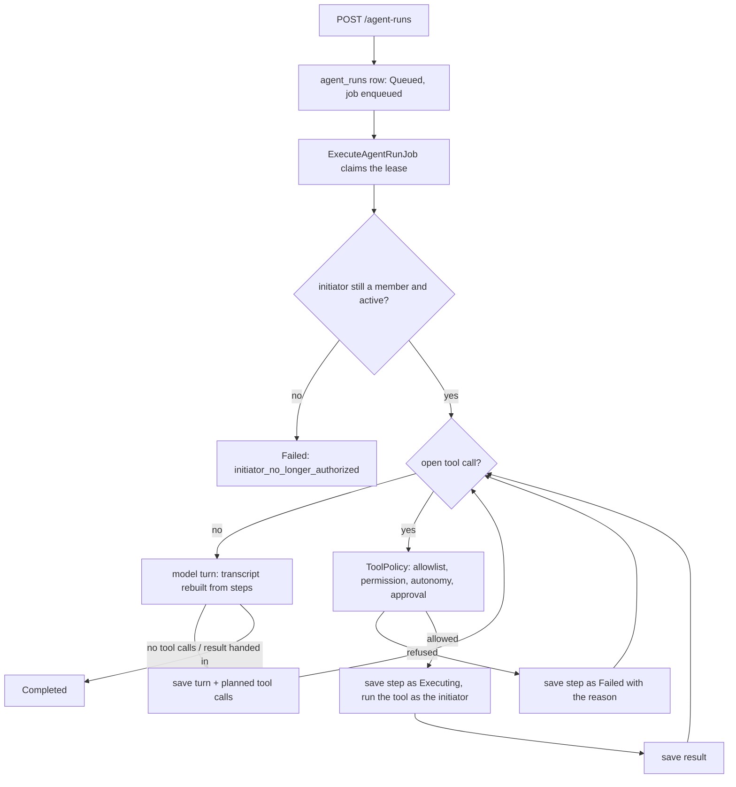

# Agentic module

Agentic runs AI agents as durable background runs that act only through typed, authorized business tools.

Agentic is the **runtime**. The module that owns a use case plugs in an **agent** and its **tools**, so Agentic never
references a business module and a business module never references a model SDK. Design rationale:
[ADR-0025](../Decisions/0025-agentic-module-and-model-seam.md) (module, tools, model seam) and
[ADR-0026](../Decisions/0026-durable-agent-runs-on-hangfire.md) (durability).

Data plane (`ITenantDataContext`, schema `agentic`): every row carries `tenant_id` and has forced RLS. The module is
**inert unless `Agentic:Enabled=true`**: its routes answer 404 and nothing is executed.

## At a glance

`AgentRun` owns lifecycle, lease, budgets and counters; `AgentRunStep` is the append-only transcript and the
checkpoint. `AgenticDbContext` maps schema `agentic`. `AgenticModuleManifest.Order` is `ModuleOrder.Agentic` (800).
Source: `src/Modules/Agentic/`.

### Layout

```text
Agentic.Contracts/           references Shared.Contracts only, no AI package
  Tools/      IAgentTool<TInput,TOutput>, [AgentTool], AgentToolRisk, AgentToolContext, AddAgentTool
  Agents/     AgentDefinition, AgentAutonomy, AgentTriggerKind, AgentLimits, AddAgent, agent queries and DTOs
  Runs/       StartAgentRunCommand, run queries, DTOs, AgentRunStatus, AgentRunStepKind, AgentRunStepStatus
  Scripting/  IAgentScript, ScriptedReply, AddAgentScript (the deterministic model for tests and demos)
Agentic/
  AgenticModule.cs        Add/UseAgenticModule (options, registry check)
  Options/                AgenticOptions (+ validator, AgenticStartupCheck)
  Data/                   AgenticDbContext, configurations, AgentRunRepository, migrations (RLS)
  Domains/AgentRuns/      AgentRun + AgentRunStep, ExecuteAgentRunJob, handlers, AgentRunsModule (routes), AgentAccess
  Runtime/Tools/          AgentRegistry, AgentToolDescriptor + typed invoker, ToolPolicy, AgentJson
  Runtime/Security/       AgentPrincipalResolver (the initiator's CURRENT permissions)
  Runtime/Models/         IAgentModelGateway, ChatClientModelGateway, AgentChatClientFactory, ScriptedChatClient
  Runtime/Execution/      AgentRunExecutor (the loop), TranscriptBuilder
  Telemetry/              AgenticTelemetry (activity source), AgenticMetrics (meter)
Agentic.Tests/               aggregate state machine, tool policy, registry, model gateway, options
Agentic.IntegrationTests/    Testcontainers Postgres, real module + RLS app role, two tenants, scripted model
```

## How it works

### How a run executes



1. `StartAgentRunHandler` creates the run and enqueues `ExecuteAgentRunJob` on the queue `agentic`. Nothing runs in
   the request. Fixed at that moment: agent version, model key, autonomy, budgets and, for an API key, its scopes as
   a permission ceiling. NOT stored: the user's permissions.
2. `AgentRunExecutor` claims a lease and loops. With no open tool call it asks the model; otherwise it handles the
   next open call. Every model answer and every tool outcome is saved before the loop goes on.
3. A free-text agent completes when the model answers without asking for a tool. An agent with an `OutputType`
   completes when the model hands in a valid value through the reserved tool `agent.submit_result`.

### The tool gateway

Every tool call the model asks for is decided by `ToolPolicy.Decide`, from trusted facts only:

| Order | Check | Refusal code |
|---|---|---|
| 1 | The tool is registered and in the agent's `Tools` allowlist | `tool_not_allowed` |
| 2 | The initiator holds the tool's `Permission` right now (or the tool is `AllowAnyMember`) | `forbidden` |
| 3 | The run's autonomy covers the tool's risk | `autonomy_exceeded` |
| 4 | Sensitive or external tools, and any change after untrusted content was read, need a person | `approval_required` |

Then the arguments are checked: size (`arguments_too_large`), strict JSON against the input type (unknown or missing
members are errors) and the registered `IValidator<TInput>` (`invalid_arguments`). A refused call is not executed; the
step records the code and the model is told. Until the approval workflow ships, a call that needs a person is refused
with `approval_required` (fail closed).

| Autonomy | Tools that may run |
|---|---|
| `Observe`, `Recommend` | `ReadOnly` |
| `Prepare` | plus `LowRiskMutation` |
| `Execute` | plus `SensitiveMutation` and `ExternalOrIrreversible`, each only with a person's approval |

### Acting user and tenant

A tool runs exactly like a request of the initiating user: inside `TenantScope.Begin(tenant, membership:)` (their
current branch scope) and `ActingUser.Begin(userId, "agent-run:<id>")`. Handlers read the user from
`IHttpContextService` and the tenant from `ITenantContext` as usual. Audit entries of changes a tool makes carry the
initiator as actor and `agent-run:<id>` as correlation id.

`AgentPrincipalResolver` re-reads the initiator at the start of every attempt and before every tool call: the user
must be active (user directory), in multi-tenant mode still a member of the tenant, and their permissions come from
their current roles. A temporary sign-in lockout is not visible outside Identity and does not stop a run.

### Models

`IAgentModelGateway` is the only way to a model. It sends tool declarations and returns tool calls as data; it never
executes a tool. Provider kinds (`Agentic:Providers:<name>:Kind`):

| Kind | Use |
|---|---|
| `Scripted` | Deterministic `IAgentScript` per agent: tests, CI, demos. Refused in Production by `AgenticStartupCheck` |
| `OpenAiCompatible` | OpenAI, Azure OpenAI's v1 endpoint, self-hosted servers that speak the OpenAI chat API |
| `Anthropic` | The official Anthropic SDK |

### Endpoints

| Route | Authorization |
|---|---|
| `GET /api/v1/agents`, `GET /api/v1/agents/{key}` | tenant member, plan feature `agents`; only agents the caller may start |
| `POST /api/v1/agent-runs` (202) | `agentic.runs.start` + the agent's `RequiredPermission`, plan feature `agents`, no impersonation, rate limit `create`, optional `Idempotency-Key` |
| `GET /api/v1/agent-runs`, `/{id}`, `/{id}/steps` | tenant member; own runs, or all with `agentic.runs.read`; someone else's run is 404. An API key without the read scope sees only the runs that same key started |
| `POST /api/v1/agent-runs/{id}/cancel` | tenant member, no impersonation; the initiator, or anyone with `agentic.manage`. A waiting run is cancelled at once, a running one at its next checkpoint |

### Metrics, traces, permissions

- Activity source and meter `StarterKit.Agentic`: spans `agent.run`, `agent.model_turn` (the provider's `gen_ai`
  span is its child) and `agent.tool`; counters `agent.runs.started`, `agent.runs.finished`, `agent.model.turns`,
  `agent.model.tokens`, `agent.tool.calls`; histogram `agent.run.active.duration`. A run's spans join the trace of
  the request that started it.
- Tenant permissions: `agentic.runs.start`, `agentic.runs.read`, `agentic.manage` (cancel someone else's run).
- Entitlement key: `agents` (plan feature).

## Configuration

Section `Agentic` (`AgenticOptions`), validated at startup when enabled:

| Key | Default | Meaning |
|---|---|---|
| `Enabled` | `false` | Master switch |
| `DefaultModel` | `default` | Model key of agents that name none |
| `Models:<key>` | scripted | `Provider`, `ModelId`, `MaxOutputTokens`, prices per million tokens |
| `Providers:<name>` | scripted | `Kind`, `Endpoint`, `ApiKey`, `TimeoutSeconds`, `MaxRetries` |
| `Limits` | see `AgentRunLimitOptions` | Per-run ceilings: model turns, tool calls, calls per turn, tokens, active seconds, sizes |
| `LeaseSeconds` / `MaxAttempts` | 300 / 3 | Lease length (extended to cover a model request or tool timeout that is longer); consecutive failed attempts before the run fails |
| `StalledAfterMinutes` / `SweepCron` | 10 / every 5 min | `RequeueStalledAgentRunsJob` queues again a run without a live lease that was not queued recently |
| `Telemetry:CaptureContent` | `false` | Adds prompts and tool content to model spans |
| `Hangfire:Servers:Agentic` | enabled, 4 workers | The server of the `agentic` queue |

A provider API key may come from a Docker secret named `agentic_<provider>_api_key` (provider name in lower case).

## Usage

### Adding an agent to your module

1. Reference `Agentic.Contracts` from the module (never the Agentic implementation).
2. Write one class per operation. The input holds only what a model may choose:

   ```csharp
   public sealed record GetOrderInput(string OrderNumber);

   [AgentTool("orders.get_order", "Looks up an order by its number.", Permission = TenantPermissions.OrdersRead)]
   public sealed class GetOrderTool(ISender sender) : IAgentTool<GetOrderInput, OrderDto>
   {
       public Task<OrderDto> ExecuteAsync(GetOrderInput input, AgentToolContext context, CancellationToken ct) =>
           sender.Send(new GetOrderByNumberQuery(input.OrderNumber), ct);
   }
   ```

3. Declare what the attribute asks for: `Risk`, exactly one of `Permission` / `AllowAnyMember`, `Idempotent = false`
   when a repeat would have a second effect, `ReturnsUntrustedContent = true` when the result contains text the
   platform does not control. Raise `Version` when the input or the effect changes.
4. Register in `Add<M>Module`:

   ```csharp
   services.AddAgentTool<GetOrderTool>();
   services.AddAgent(new AgentDefinition
   {
       Key = "orders.order-assistant",
       Name = new LocalizedText("Order assistant", "مساعد الطلبات"),
       Instructions = "Answer questions about orders using the tools.",
       Autonomy = AgentAutonomy.Recommend,
       Tools = ["orders.get_order"]
   });
   ```

5. Optional: an `IValidator<TInput>` for the tool input, an `OutputType` for a typed result, and an `IAgentScript`
   (`AddAgentScript`) so tests and demos run without a provider.
6. Test it like `Agentic.IntegrationTests`: a scripted model asks for the calls, the assertions check what the tools
   did and what was refused.

Tool rules: call `ISender`; never take a DbContext, a repository or a service provider; never put a tenant id, a user
id or a permission in the input; make changes idempotent for `AgentToolContext.IdempotencyKey`; never return secrets.

## Failure modes and guarantees

| Situation | Outcome |
|---|---|
| Duplicate job delivery, second worker | Only the lease holder proceeds; the other does nothing |
| Provider outage | The attempt fails, the run is retried with backoff; after `MaxAttempts` it fails with `model_unavailable` |
| Idempotent tool fails unexpectedly | The attempt fails; the retry runs the same step with the same idempotency key |
| Non-idempotent tool fails unexpectedly or is found interrupted | The run fails with `tool_outcome_unknown`; the action is not repeated |
| Server shutdown | The run returns to `Queued` without counting a failure |
| Lost Hangfire job, dead worker | `RequeueStalledAgentRunsJob` queues the run again once its lease expired and the quiet period passed |
| A change whose result is too large | Stays a success with the payload withheld (a read-only tool gets `result_too_large`) |
| Business error from a tool (4xx, conflict) | Returned to the model with its code; the run goes on |
| Budget reached | The run fails with `budget_exceeded` and the name of the limit |
| Initiator removed or deactivated | The run fails with `initiator_no_longer_authorized` |
| A permission revoked mid-run | The next call that needs it is refused with `forbidden` |

Failure messages on a run are localized texts chosen by code. Provider and exception details go to the log only.

## Guardrails

- `ThirdPartyIsolationTests`: Microsoft.Extensions.AI and the provider SDKs are referenced only by Agentic.
- `AgentToolArchitectureTests`: tools reach data only through the mediator.
- `ModuleBoundaryTests`, `TenantIsolationArchitectureTests`, `TenantRowLevelSecurityCoverageTests`,
  `BackgroundJobEventDispatchTests`, `PendingModelChangesTests`.
- `Agentic.IntegrationTests`: `AgentRunExecutionTests`, `AgentRunSecurityTests`, `AgentRunRecoveryTests`.

## Related

[ADR-0025](../Decisions/0025-agentic-module-and-model-seam.md),
[ADR-0026](../Decisions/0026-durable-agent-runs-on-hangfire.md), [DataTransfer](DataTransfer.md) (the same job
pattern), [Shared projects](../Shared/README.md) (`ActingUser`).
