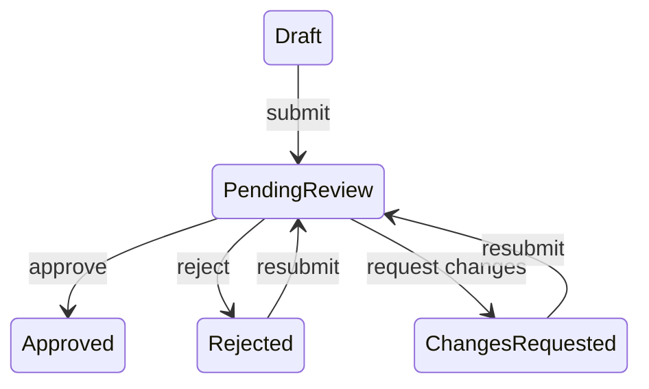
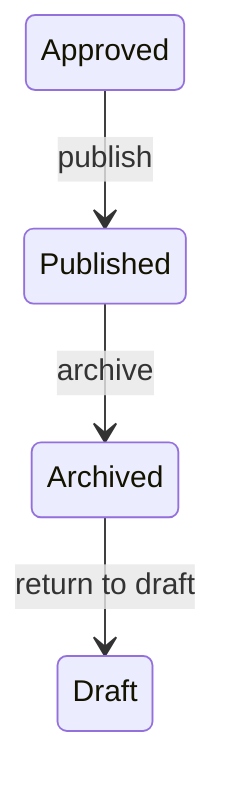

# Catalog: the reference module

Catalog is the optional reference module for vertical slices, demonstrating product moderation, tenant persistence, attachments, caching and messaging.

Use its pattern map when implementing a business module; remove the sample when the product no longer needs it. This page is excluded from products generated without the sample.

## At a glance

| Responsibility | Types / location |
|---|---|
| Product workflow and gallery | `Product`, `Pricing`, `ProductImage`, `ProductAttribute`, `ProductTag` |
| Lookups and saved products | `Category`, `Tag`, `AttributeType`, `WishlistItem` |
| Persistence | `CatalogDbContext`, schema `catalog`, `ITenantDataContext`; tenant filters and forced RLS |
| Discovery | `CatalogModuleManifest.Order = ModuleOrder.Catalog` (300) |
| Source | `src/Modules/Catalog/` |

All paths are relative to `src/Modules/Catalog/` unless they start with `src/` or `wiki/`.

### Layout

```
Catalog.Contracts/          public surface: commands, queries, DTOs, enums, integration events
Catalog/                    implementation (internal to the module)
  CatalogModule.cs          Add/UseCatalogModule: DI, DbContext, seeder, Hangfire job
  Common/                   module-wide helpers (culture, LIKE escaping, 23505, paging/sort, validation rules)
  Data/                     DbContext, design-time factory, configurations, repositories, seeder, migrations
  Domains/<Aggregate>/      Models, Features/<Feature>/{Handler,EndPoint}, Events, EventHandlers, Services, ...
  Options/  Resources/      bound options; en/ar resx
Catalog.Tests/              unit tests (xUnit + FluentAssertions 7 + Moq)
Catalog.IntegrationTests/   Testcontainers Postgres tests through the real DI + mediator pipeline
src/Api.E2ETests/Catalog/   HTTP end-to-end flows against the booted Api
```

## How it works


*Figure: The review half of ProductStatus permits resubmission from Rejected and ChangesRequested.*


*Figure: The publication half returns archived products to Draft before another review.*

States come from `Catalog.Contracts/Products/Enums/ProductEnums.cs`; `ProductStatusTransitions` is the transition allow-list. Soft deletion is separate from workflow status.

### Domain modelling

| Pattern | File |
|---|---|
| Aggregate root: factory, private setters, invariants, id-only domain events | `Catalog/Domains/Products/Models/Product.cs` |
| Aggregate version covers child-only changes (every mutation stamps `UpdatedAt`) | `Product.Touch()` in `Product.cs` |
| Owned value object with explicit columns + computed field (`DiscountPercentage`) | `Catalog/Domains/Products/Models/Pricing.cs`, `Data/Configurations/ProductConfiguration.cs` (`OwnsOne`) |
| Bilingual name (`Shared.Contracts.Localization.LocalizedText`) as owned type → `name_en` / `name_ar` | `ProductConfiguration.cs`, `Data/Configurations/LookupConfigurations.cs` |
| Child entity collection with client ids (`ValueGeneratedNever`) | `Catalog/Domains/Products/Models/ProductChildren.cs` (`ProductImage`), `Data/Configurations/ProductChildConfigurations.cs` |
| Many-to-many join entity **with payload** (attribute value) | `ProductAttribute` in `ProductChildren.cs`; `Product.AddAttribute/RemoveAttribute/ClearAttributes/SyncAttributes` |
| Many-to-many pure join entity | `ProductTag` in `ProductChildren.cs`; `Product.AddTag/RemoveTag/ClearTags/SyncTags` |
| Image gallery rules (max size, exactly one primary, contiguous order, reorder = permutation) | `Product.AddImage/RemoveImage/SetPrimaryImage/ReorderImages` |
| State machine as an allow-list (+ owner-editable statuses) | `Catalog/Domains/Products/Models/ProductStatusTransitions.cs` |
| Workflow methods with reviewer fields and one event per transition | `Product.SubmitForReview/Approve/Reject/RequestChanges/Publish/Archive/ReturnToDraft` |
| True soft delete + restore + purge marker | `Product.Delete/Restore/MarkPurged` |
| Hierarchical lookup (self-referencing parent) + pure tree algorithms (cycle check, descendants, tree build) | `Catalog/Domains/Categories/Models/Category.cs`, `CategoryHierarchy.cs` |
| Lookup with `int[]` "applicable types" (Npgsql array `Contains`) and a data-type enum validating values | `Catalog/Domains/AttributeTypes/Models/AttributeType.cs` |
| Simple lookup entity (deactivate, never delete) | `Catalog/Domains/Tags/Models/Tag.cs` |
| Separate small aggregate with unique `{TenantId, UserId, ProductId}` | `Catalog/Domains/Wishlist/Models/WishlistItem.cs` |

Workflow: `Draft / ChangesRequested / Rejected → PendingReview → Approved | Rejected | ChangesRequested`,
`Approved → Published → Archived → Draft`. Owners may edit content only in Draft / ChangesRequested / Rejected;
admins at any status.

### Contracts

| Pattern | File |
|---|---|
| Commands / queries / results (naming enforced by `src/Api.Tests`) | `Catalog.Contracts/Products/Commands/*`, `Products/Queries/*` |
| Shared field interface so create + update share one validator | `IProductDetails` in `Catalog.Contracts/Products/Commands/CreateProductCommand.cs` |
| Filter interface shared by public + admin list queries | `Catalog.Contracts/Products/Queries/IProductFilterQuery.cs` |
| Public / owner / admin DTOs by inheritance (`ProductDto` → `MyProductDto` → `ProductAdminDto`) | `Catalog.Contracts/Products/Dtos/*` |
| Every read DTO exposes `long Version`; critical updates take `long? Version = null` | `ProductDto`, `UpdateProductCommand`, `ProductWorkflowCommands.cs` |
| Enums with `[LocalizedDescription]` (+ string JSON) and `*Label` fields in DTOs | `Catalog.Contracts/Products/Enums/ProductEnums.cs` |
| Contracts assembly marker for the enum lookup | `Catalog.Contracts/CatalogContractsRoot.cs` (declared in `CatalogModuleManifest.EnumAssemblies`) |
| Cross-module contract query with no endpoint | `GetProductStatsQuery` → consumed by `src/Api/Endpoints/DashboardEndPoint.cs` |
| Integration event (`Shared.Contracts.Messaging.IntegrationEvent` + `[MessageUrn("catalog.product-published.v1")]`) | `Catalog.Contracts/Products/IntegrationEvents/ProductPublishedIntegrationEvent.cs` |

### Persistence

| Pattern | File |
|---|---|
| DbContext: schema `catalog`, `FilterSoftDeletedProperties`, snake_case, version tokens | `Catalog/Data/CatalogDbContext.cs` |
| Join/child following the parent's soft delete (non-`IEntity` with its own filter) | `WishlistItemConfiguration` in `Data/Configurations/LookupConfigurations.cs` |
| Enums stored as strings, explicit unique index names | `Data/Configurations/*.cs` |
| Repository per aggregate root (+ named non-isolation filter bypass for restore/purge) | `Catalog/Data/Repository/ProductRepository.cs`, `CategoryRepository.cs`, `WishlistRepository.cs` |
| PostgreSQL `23505` (unique violation) → HTTP 409, matched by index name | `src/Shared/Shared.Core/Data/PostgresErrors.cs` (`ex.IsUniqueViolation(<Configuration>.<Index>Name)`), used in the repositories and lookup handlers |
| Idempotent seeder (`IgnoreNonIsolationFilters().AnyAsync()` guard, fixed ids) | `Catalog/Data/Seed/CatalogDataSeeder.cs` |
| Design-time factory for `dotnet ef` (connection name `starterkit`) | `Catalog/Data/CatalogDbContextFactory.cs` |

### Features (vertical slices: `Features/<Feature>/<Feature>Handler.cs` + `<Feature>EndPoint.cs`)

| Pattern | File |
|---|---|
| Create with owner anti-spoofing, lookup validation, pending-upload session association (non-fatal) | `Features/CreateProduct/CreateProductHandler.cs` |
| Update with `dbContext.ExpectVersion(entity, command.Version)` and delta sync of children | `Features/UpdateProduct/UpdateProductHandler.cs` |
| Shared skeleton for workflow commands (load → authorize → expect version → transition → save) | `Catalog/Domains/Products/Services/ProductWorkflowRunner.cs`, `Features/{SubmitProductForReview,ApproveProduct,RejectProduct,RequestProductChanges,PublishProduct,ArchiveProduct,UnarchiveProduct}` |
| Soft delete / admin restore / internal purge command | `Features/DeleteProduct`, `Features/RestoreProduct`, `Features/PurgeProduct` |
| Admin toggle (non-critical: no version) | `Features/ToggleProductFeatured` |
| Multipart upload via the Attachment module (`DisableAntiforgery`, rate limit `upload`, compensation on failure) | `Features/UploadProductImage` |
| Set primary / delete (file deleted after the gallery change commits) / reorder images | `Features/SetPrimaryProductImage`, `Features/DeleteProductImage`, `Features/ReorderProductImages` |
| Public list: forced `Published`, `PageGate` policy, rate limit `search` | `Features/GetProducts` |
| Admin list (+ `IncludeDeleted`) / admin detail | `Features/GetAdminProducts`, `Features/GetAdminProductById` |
| Dedicated search endpoint (rate limit `search`) | `Features/SearchProducts` |
| Public detail: owner sees own drafts; atomic view counter (`ExecuteUpdateAsync`, no version bump) | `Features/GetProductById/GetProductByIdHandler.cs` |
| "My products" + stats in one `GroupBy(_ => 1)` query | `Features/GetMyProducts/GetMyProductsHandler.cs` |
| Admin moderation queue (FIFO) | `Features/GetPendingProducts` |
| Grouped Carter module for small lookup CRUD (`<X>Module`) | `Domains/Categories/Features/CategoryEndPoints.cs`, `Domains/Tags/Features/TagsModule.cs`, `Domains/AttributeTypes/Features/AttributeTypesModule.cs`, `Domains/Wishlist/Features/WishlistModule.cs` |
| Lookup CRUD with "deactivate instead of delete" + `IncludeInactive` (admins only) | `Domains/Tags/Features/TagHandlers.cs`, `Domains/AttributeTypes/Features/AttributeTypeHandlers.cs`, `Domains/Categories/Features/*` |
| Re-parenting with cycle detection + version | `Domains/Categories/Features/UpdateCategory/UpdateCategoryHandler.cs` |
| Wishlist add (409 on duplicate, unique index for races) / remove / list (`IsAvailable`) | `Domains/Wishlist/Features/WishlistHandlers.cs` |

### Queries and mapping

| Pattern | File |
|---|---|
| One filter pipeline for public + admin (category descendants, price, tags/attributes "has all", owner, featured, escaped ILIKE search) | `Catalog/Domains/Products/Services/ProductQueryBuilder.cs` |
| One SQL projection row → audience DTOs in memory (labels, discount) — DRY instead of one projection per DTO | `Catalog/Domains/Products/Mappings/ProductProjections.cs`, `ProductDtoMapper.cs` |
| Culture chosen in SQL (`arabic ? p.Name.Ar : p.Name.En` as a parameter) | `ProductProjections.ToProductRows` |
| `IsWishlisted` projected per current user | `ProductProjections.ToProductRows` |
| Default sort (newest first) + `OrderByDynamic` + stable tie-breaker; `PaginatedResult<T>` | `Catalog/Common/PaginatedResultExtensions.cs` |
| Mapster `IRegister` + `ProjectToType` for simple projections; culture filled in memory | `Catalog/Domains/Products/Mappings/LookupMappingConfig.cs`, `GetTagsHandler`, `GetCategoriesHandler` |
| LIKE-wildcard escaping | `Catalog/Common/LikePattern.cs` |

### Cross-cutting

| Pattern | File |
|---|---|
| Resource authorization service (owner/admin, status lock, owner anti-spoofing) | `Catalog/Domains/Products/Services/ProductAuthorizationService.cs` |
| Cross-module validation through another module's Contracts (attachment must be an image) | `Catalog/Domains/Products/Services/ProductImageValidator.cs` |
| DB-backed reference validation (category/tags/attributes active, applicable, value matches data type) | `Catalog/Domains/Products/Services/ProductLookupValidator.cs` |
| Redis (`IDistributedCache`) cache of a culture-neutral snapshot; failures swallowed with a warning | `Catalog/Domains/Categories/Cache/CategoryTreeCache.cs` |
| Cache invalidation via domain event (dispatched after commit) | `Catalog/Domains/Categories/EventHandlers/CategoryChangedEventHandler.cs` |
| Integration event raised by the aggregate (`AddIntegrationEvent`) → transactional outbox (`builder.AddTenantOutbox()`, `services.AddOutbox<CatalogDbContext>()`, migration `AddOutbox` with RLS) | `Product.Publish()`, `Catalog/Data/CatalogDbContext.cs`, `CatalogModule.cs` - see `wiki/Architecture/Messaging.md` |
| Sample MassTransit consumer (auto-registered: the manifest's `ConsumerAssemblies`) | `Catalog/Domains/Products/Consumers/ProductPublishedConsumer.cs` |
| Cleanup of another module's data on hard delete (`DeleteAttachmentsByEntityCommand`, non-fatal) | `Catalog/Domains/Products/EventHandlers/ProductPurgedEventHandler.cs` |
| Hangfire recurring job with options bound from config (`Catalog` section) | `Catalog/Domains/Products/Jobs/PurgeSoftDeletedProductsJob.cs`, `Catalog/Options/CatalogOptions.cs`, `CatalogModule.UseCatalogModule` |
| en/ar resx + validators using `IStringLocalizer<CatalogResource>` | `Catalog/Resources/CatalogResource*.resx`, any `*Validator` |
| Reusable validation rules (bilingual name, paging, version, filters) | `Catalog/Common/CatalogValidationRules.cs`, `Domains/Products/Features/ProductFilterRules.cs` |

Why attachments are cleaned up on **purge**, not on soft delete: a restored product must still have its images.

### Public contracts

Use `ISender` for commands and queries in `src/Modules/Catalog/Catalog.Contracts/`. DTOs and enums remain in that assembly; implementations remain private.

| Area in `Catalog.Contracts` | Commands, queries and ports |
|---|---|
| `AttributeTypes` | `CreateAttributeTypeCommand`, `DeleteAttributeTypeCommand`, `GetAttributeTypesQuery`, `UpdateAttributeTypeCommand` |
| `Categories` | `CreateCategoryCommand`, `DeleteCategoryCommand`, `GetCategoriesQuery`, `GetCategoryTreeQuery`, `UpdateCategoryCommand` |
| `Products` | `ApproveProductCommand`, `ArchiveProductCommand`, `CreateProductCommand`, `DeleteProductCommand`, `DeleteProductImageCommand`, `GetAdminProductByIdQuery`, `GetAdminProductsQuery`, `GetMyProductsQuery`, `GetPendingProductsQuery`, `GetProductByIdQuery`, `GetProductHistoryQuery`, `GetProductStatsQuery`, `GetProductsQuery`, `IProductDetails`, `IProductFilterQuery`, `ProductPublishedIntegrationEvent`, `PublishProductCommand`, `PurgeProductCommand`, `RejectProductCommand`, `ReorderProductImagesCommand`, `RequestProductChangesCommand`, `RestoreProductCommand`, `SearchProductsQuery`, `SetPrimaryProductImageCommand`, `SubmitProductForReviewCommand`, `ToggleProductFeaturedCommand`, `UnarchiveProductCommand`, `UpdateProductCommand`, `UploadProductImageCommand` |
| `Tags` | `CreateTagCommand`, `DeleteTagCommand`, `GetTagsQuery`, `UpdateTagCommand` |
| `Wishlist` | `AddToWishlistCommand`, `GetWishlistQuery`, `RemoveFromWishlistCommand` |

### Endpoints

Routes use `/api/v1` for `EndpointConfig.BaseApiPath`. The table records Carter authorization declarations, including inherited group restrictions; handlers also enforce ownership and resource access.

| Method | Route | Authorization / restrictions |
|---|---|---|
| GET | `/api/v1/admin/products` | `RequireAuthorization(PolicyConstants.AdminOnly)` |
| GET | `/api/v1/admin/products/{id:guid}` | `RequireAuthorization(PolicyConstants.AdminOnly)` |
| PATCH | `/api/v1/admin/products/{id:guid}/featured` | `RequireAuthorization(PolicyConstants.AdminOnly)` |
| POST | `/api/v1/admin/products/{id:guid}/restore` | `RequireAuthorization(PolicyConstants.AdminOnly)` |
| GET | `/api/v1/admin/products/pending` | `RequirePermission(Permissions.CatalogModerate)` |
| GET | `/api/v1/attribute-types` | `AllowAnonymous()` |
| POST | `/api/v1/attribute-types` | `RequireAuthorization(PolicyConstants.AdminOnly)` |
| DELETE | `/api/v1/attribute-types/{id:guid}` | `RequireAuthorization(PolicyConstants.AdminOnly)` |
| PUT | `/api/v1/attribute-types/{id:guid}` | `RequireAuthorization(PolicyConstants.AdminOnly)` |
| GET | `/api/v1/categories` | `RequireTenantPermission(TenantPermissions.CategoriesManage)` |
| POST | `/api/v1/categories` | `RequireTenantPermission(TenantPermissions.CategoriesManage)` |
| DELETE | `/api/v1/categories/{id:guid}` | `RequireTenantPermission(TenantPermissions.CategoriesManage)` |
| PUT | `/api/v1/categories/{id:guid}` | `RequireTenantPermission(TenantPermissions.CategoriesManage)` |
| GET | `/api/v1/categories/tree` | `AllowAnonymous()` |
| GET | `/api/v1/products` | `RequireAuthorization("PageGate")` |
| POST | `/api/v1/products` | `RequireAuthorization()` |
| DELETE | `/api/v1/products/{id:guid}` | `RequireAuthorization()` |
| GET | `/api/v1/products/{id:guid}` | `AllowAnonymous()` |
| PUT | `/api/v1/products/{id:guid}` | `RequireAuthorization()` |
| POST | `/api/v1/products/{id:guid}/approve` | `RequirePermission(Permissions.CatalogModerate)` |
| POST | `/api/v1/products/{id:guid}/archive` | `RequireAuthorization()` |
| GET | `/api/v1/products/{id:guid}/history` | `RequireTenantPermission(TenantPermissions.AuditRead)` |
| DELETE | `/api/v1/products/{id:guid}/images/{imageId:guid}` | `RequireAuthorization()` |
| PUT | `/api/v1/products/{id:guid}/images/{imageId:guid}/set-primary` | `RequireAuthorization()` |
| PUT | `/api/v1/products/{id:guid}/images/reorder` | `RequireAuthorization()` |
| POST | `/api/v1/products/{id:guid}/images/upload` | `RequireAuthorization()` |
| POST | `/api/v1/products/{id:guid}/publish` | `RequirePermission(Permissions.CatalogModerate)` |
| POST | `/api/v1/products/{id:guid}/reject` | `RequirePermission(Permissions.CatalogModerate)` |
| POST | `/api/v1/products/{id:guid}/request-changes` | `RequirePermission(Permissions.CatalogModerate)` |
| POST | `/api/v1/products/{id:guid}/submit-for-review` | `RequireAuthorization()` |
| POST | `/api/v1/products/{id:guid}/unarchive` | `RequireAuthorization()` |
| DELETE | `/api/v1/products/{id:guid}/wishlist` | `RequireAuthorization()` |
| POST | `/api/v1/products/{id:guid}/wishlist` | `RequireAuthorization()` |
| GET | `/api/v1/products/my` | `RequireAuthorization()` |
| GET | `/api/v1/products/search` | `RequireAuthorization("PageGate")` |
| GET | `/api/v1/products/wishlist` | `RequireAuthorization()` |
| GET | `/api/v1/tags` | `AllowAnonymous()` |
| POST | `/api/v1/tags` | `RequireAuthorization(PolicyConstants.AdminOnly)` |
| DELETE | `/api/v1/tags/{id:guid}` | `RequireAuthorization(PolicyConstants.AdminOnly)` |
| PUT | `/api/v1/tags/{id:guid}` | `RequireAuthorization(PolicyConstants.AdminOnly)` |

Source: Carter classes under `src/Modules/Catalog/Catalog/Domains/*/Features/`. `PageGate` permits public page one; public detail still limits unpublished products to their owner. Authenticated writes enforce owner/admin and editable-state rules in handlers. Upload uses rate limit `upload`; create uses `create`; search/list uses `search`.

Category management uses tenant permission `catalog.categories.manage`, while the category tree remains anonymous. Platform Admin alone is insufficient in multi-tenant mode without membership; single-tenant Admin/SuperAdmin have tenant permission claims. Moderation uses platform `catalog.moderate`; API keys require that scope.

Bulk definitions `catalog.products` and `catalog.categories` register in `CatalogModule.cs`; [DataTransfer](DataTransfer.md) owns their engine. Product import upserts by SKU, validates bilingual fields, pricing and active lookups, and uses a per-batch SKU lookup before saving. Category import upserts by slug with columns `slug, name_en, name_ar, parent, display_order, active`; a parent slug must already exist or appear earlier in the file. Empty order/active cells keep existing values. Cycles produce `parent_cycle`; export orders parents first and domain events invalidate the tree cache.

Product imports create Draft products owned by the requester and update only requester-owned products in owner-editable states. They reuse `ProductDetailsValidator`, including localized row messages. The definitions require `catalog.products.manage` and `catalog.categories.manage` respectively. An empty category parent means a top-level category. Product import performance is dominated by the per-batch SKU lookup and save; the engine-only baseline is on the DataTransfer page.

## Configuration

From `Catalog/Options/CatalogOptions.cs` and `src/Api/appsettings.json`:

| Key | Default | Meaning |
|---|---|---|
| `Catalog:SoftDeleteRetentionDays` | 30 | Age before hard purge |
| `Catalog:PurgeBatchSize` | 100 | Maximum products per purge run |
| `Catalog:PurgeCron` | `0 3 * * *` | Daily purge schedule |

`PurgeSoftDeletedProductsJob` removes expired soft-deleted products; `PurgeAuditEntriesJob` handles audit retention. `ProductPublishedConsumer` consumes the module's own `ProductPublishedIntegrationEvent`, re-reads visibility and notifies the owner; Webhooks forwards the public event. Integration delivery follows [Messaging](../Architecture/Messaging.md).

## Usage

From `src/Modules/Catalog/Catalog/Domains/Products/Models/ProductStatusTransitions.cs`:

```csharp
public static bool CanTransition(ProductStatus from, ProductStatus to) =>
    Allowed.TryGetValue(from, out var targets) && targets.Contains(to);
```

### Wiring checklist for a new module (based on Catalog)

1. Projects: `<M>.Contracts`, `<M>`, `<M>.Tests` (+ `<M>.IntegrationTests`); add them to `StarterKit.slnx`.
2. References: `<M>.Contracts` → `Shared.Contracts` ONLY (it has `[LocalizedDescription]`, `IDomainEvent`, `IntegrationEvent`; architecture test);
   `<M>` → `Shared.Core`, `<M>.Contracts`, other modules' `.Contracts` only (enforced by `src/Api.Tests`).
3. `GlobalUsings.cs` + `<M>Root` marker in the implementation, `<M>ContractsRoot` in Contracts.
4. DbContext like `CatalogDbContext` (call `FilterSoftDeletedProperties()` only if you soft delete) + design-time factory.
   Business data is tenant data: implement `ITenantDataContext`, make every entity `IMustHaveTenant`, end
   `OnModelCreating` with `ApplyTenantFilters(builder)` and enable RLS in the migration - checklist in
   `wiki/MultiTenancy/Adding-a-Tenant-Aware-Module.md`.
5. `<M>Module.cs` like `CatalogModule.cs` (repositories, services, `AddMediator`, `AddCustomMapster`, `AddCarterWithAssemblies`,
   `AddCustomDbContext(..., "starterkit")`, seeder, jobs; `Use<M>Module` migrates and schedules jobs).
6. `<M>ModuleManifest.cs` like `CatalogModuleManifest.cs` (`Order`, `EnumAssemblies`, delegating to `<M>Module`). That
   is all the host wiring: `Api.csproj` references the module by glob and `AddModules()` discovers it
   ([ADR-0019](../Decisions/0019-module-manifests-and-discovery.md)); `Program.cs` never changes.
7. Generate the first migration (see `wiki/Reference/Migrations.md`). Publishing integration events? Add the outbox
   (`builder.AddOutbox()`/`AddTenantOutbox()`, `services.AddOutbox<TContext>()`) - checklist in `wiki/Architecture/Messaging.md`.
8. Tests at every level as in the table above; `dotnet build StarterKit.slnx` and `dotnet test StarterKit.slnx`.

### Removing the Catalog sample

1. Nothing to remove from `src/Api/Program.cs` or `src/Api/Api.csproj`: the module is discovered from its folder (ADR-0019).
2. Remove the product stats from `src/Api/Endpoints/DashboardEndPoint.cs` and the `Catalog` section from `src/Api/appsettings.json`.
3. Remove the `Catalog` references from `src/Api.E2ETests/Api.E2ETests.csproj`; delete `src/Api.E2ETests/Catalog/`.
4. In `src/Api.Tests/Architecture`: remove
   `ProductPublishedIntegrationEvent` from the expected list and `CatalogDbContext` from the outbox expectation in
   `MessagingArchitectureTests`; adjust `TenantIsolationArchitectureTests.The_business_data_modules_are_tenant_data_contexts`.
   Optionally remove `Permissions.CatalogModerate` / `TenantPermissions.ProductsManage` and their grants.
5. Remove the `/src/Modules/Catalog/` folder from `StarterKit.slnx` and delete `src/Modules/Catalog/`.
6. Drop the schema from existing databases (`DROP SCHEMA catalog CASCADE;`) and the Hangfire job `catalog-purge-soft-deleted-products`.
7. Remove the sample forwarding consumer and its Catalog reference in `src/Modules/Webhooks/`, and sample-specific expectations in `AuditTrailArchitectureTests`. Search for remaining Catalog references before deleting the schema; generated products with `--sample false` already exclude these branches.
8. Run `dotnet build StarterKit.slnx` and `dotnet test src/Api.Tests`.

## Failure modes and guarantees

Invalid workflow transitions are rejected by the allow-list. Stale critical-update versions return 409 through the mediator concurrency behavior; database uniqueness also resolves duplicate wishlist and lookup races. Soft delete retains attachments for restore; purge removes them through Attachment.Contracts. Upload association and cleanup failures are non-fatal as documented by their handlers. Cache failure falls back to the database. Integration events commit with the product through the outbox and can be delivered more than once.

`ModuleDiscoveryTests`, `ModuleBoundaryTests`, `TenantIsolationArchitectureTests`, `ClientGeneratedKeyTests` and `MessagingArchitectureTests` enforce the wiring demonstrated here; the Guardrails table lists runtime suites.

## Guardrails

| Kind | Where | Covers |
|---|---|---|
| Unit | `Catalog.Tests/Domain/*` | invariants, every state-machine transition (Theory over all status × action pairs), gallery rules, pricing, soft delete, hierarchy algorithms, attribute value rules |
| Unit | `Catalog.Tests/Features/*`, `Services/*` | validators (incl. en/ar messages and resx key parity), handlers (ExpectVersion via a disconnected DbContext, owner/admin/status authorization, upload compensation), cache (invalidate, swallow failures), mapper, LIKE escaping |
| Integration | `Catalog.IntegrationTests/*` | real `AddCatalogModule` + PostgreSQL: filters, has-all, search escaping, sort/paging, public vs admin, my-products stats, soft-delete filter + restore + purge job cascade, wishlist unique index, atomic view counter, stale version → `ConcurrencyConflictException`, cache invalidation via events, seeder idempotency, integration event published |
| E2E | `src/Api.E2ETests/Catalog/ProductCrudFlowTests.cs` | seller → moderation → public → wishlist → archive, 403s, 409, soft delete + restore, lookups |

## Related

[ADR-0019](../Decisions/0019-module-manifests-and-discovery.md), [Concurrency](../Architecture/Concurrency-and-Versions.md); [Messaging](../Architecture/Messaging.md), [Multi-tenancy](../MultiTenancy/Overview.md), [Identity](../Identity/README.md), and [`/starterkit:new-module`](../../tools/claude/starterkit-plugin/skills/new-module/SKILL.md).
