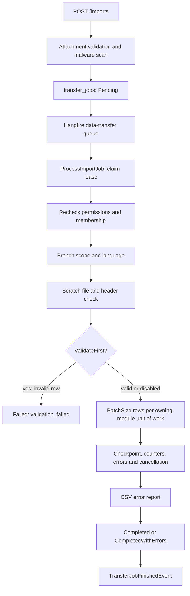

# DataTransfer module

DataTransfer runs bulk CSV/Excel imports and exports as resumable background jobs with validation, progress and cancellation.

DataTransfer is the **engine**. The module that owns the data plugs in a **definition**, so DataTransfer never
references an owning business module. Design rationale: [ADR-0016](../Decisions/0016-bulk-data-transfer-on-hangfire.md).

Data plane (`ITenantDataContext`, schema `datatransfer`): every row carries `tenant_id` and has forced RLS. The
outbox carries `DataImportCompletedIntegrationEvent`.

## At a glance

`TransferJob` owns lifecycle, lease, checkpoint and counters; `TransferJobError` stores row failures. `DataTransferDbContext` maps schema `datatransfer`. `DataTransferModuleManifest.Order` is `ModuleOrder.DataTransfer` (600). Source: `src/Modules/DataTransfer/`.

### Layout

```text
DataTransfer.Contracts/
  Definitions/        IImportDefinition, IExportDefinition, TransferColumn, ImportRecord, ImportRowResult, AddImportDefinition/AddExportDefinition
  Jobs/               commands, queries, DTOs
  Enums/              TransferJobKind, TransferFormat, ImportMode, ImportPolicy, TransferJobStatus, ImportRowOutcome, TransferJobFileKind
  IntegrationEvents/  DataImportCompletedIntegrationEvent (datatransfer.import-completed.v1)
DataTransfer/
  DataTransferModule.cs  Add/UseDataTransferModule, recurring sweep + purge jobs
  Data/                  DataTransferDbContext, configurations, TransferJobRepository, migrations (InitialCreate, RLS)
  Engine/                TabularReader (Sylvan CSV/XLSX), TabularWriter (own streaming CSV/XLSX), HeaderMap, CellText,
                         ImportRecords, TransferFileStore (Attachment), TransferDefinitionRegistry, DataTransferMetrics
  Domains/TransferJobs/  TransferJob + TransferJobError, ProcessImportJob, ProcessExportJob, maintenance jobs,
                         handlers, TransferJobsModule (routes), TransferAccess, finished-event -> in-app notification
DataTransfer.Tests/            engine, file round trips, limits, aggregate state machine
DataTransfer.IntegrationTests/ Testcontainers Postgres, real module + RLS app role, two tenants
```

## How it works

### How a job runs


*Figure: Imports validate and process leased batches before reporting completion.*

Each batch runs the owning definition's repositories and aggregate behavior, including domain events and outbox
writes. The completion event produces the `data-transfer.job-finished` in-app notification and SignalR hint.

- **Lease.** `LeaseOwner` / `LeaseUntil` are claimed and renewed under optimistic concurrency. A duplicate run (a
  Hangfire re-fetch of a long job, or the stall sweep) exits while the lease is live, and may take it over once it
  has expired. A run that loses its lease stops (`TransferLeaseLostException`).
- **Checkpoint and resume.** `LastCommittedRow` is saved after every batch, and a retry resumes after it.
  Definitions **must** upsert by a natural key, so replaying the last batch (crash between the definition's save and
  the checkpoint) changes nothing. Counters can be slightly high after such a crash.
- **Retry model.** Hangfire's own retry is off. A failed attempt releases the lease and schedules the next one
  (30 s, 2 min, 8 min, ...), up to `MaxAttempts`, then the job is `Failed` with `internal_error`. Some failures are
  permanent and fail at once, with no retry:
  - a file problem (`InvalidTransferFileException`: wrong columns, limits, unreadable file)
  - a 4xx from another module (e.g. Attachment `malware_detected`), except 408/409/429
  Shutdown releases the lease and Hangfire re-runs the aborted job.
- **The requester, at every attempt.** In multi-tenant mode the job re-reads the requester's membership (cached
  resolver). They must still be an active member holding `datatransfer.import`/`export` AND the definition's
  permission, or the job stops with `requester_no_longer_authorized`. The definition then runs in that
  membership's **branch scope**. Hangfire restores only the tenant, so without this a branch-restricted manager's
  export would contain every branch. The run also uses the requester's **language** (`CurrentUICulture`), so failure
  messages, row errors and headers are localized (en/ar resx).
- **Atomicity.** A commit is per batch, not per file: a large file in one transaction would hold locks and memory
  for minutes. `BestEffort` writes the valid rows and reports the rest. `ValidateFirst` writes nothing unless every
  row is valid (it is checked first), but the write itself is still batched. A cancel keeps the batches already
  committed.
- **Exports** stream the definition's rows (`AsAsyncEnumerable`) straight into a scratch file. Progress is saved,
  and a cancel request honoured, every `ExportProgressEvery` rows. The file becomes a private attachment of the job.
  A retry starts over.
- **Safety net.**
  - `RequeueStalledTransferJobsJob` (every 5 min, per tenant) queues again every unfinished job without a live lease
    that was not queued within `StalledAfterMinutes`.
  - `PurgeExpiredTransferJobsJob` (nightly) deletes jobs `RetentionDays` after they finished, with their files and
    errors. It works in keyset batches of 100, up to 50 per run. A dry run is kept while a commit that reuses its
    file is alive.
  - The `datatransfer-queue` health check reports **Degraded** when no live Hangfire server (this instance or a
    worker) processes `data-transfer`. An instance with the server switched off logs a startup warning.
- **Progress.** `TotalRows` is the sheet dimension for XLSX (no extra parse), unknown for CSV while running, and
  exact once the job finishes.

```mermaid
stateDiagram-v2
  accTitle: How a job runs
  accDescr: TransferJobStatus distinguishes row errors from job failure; cancellation retains previously committed batches.
  [*] --> Pending
  Pending --> Running: claim lease
  Running --> Completed: no row errors
  Running --> CompletedWithErrors: errors
  Running --> Failed: permanent or exhausted
  Pending --> Cancelled: cancel before claim
  Running --> Cancelled: cancellation checkpoint
```


*Figure: TransferJobStatus distinguishes row errors from job failure; cancellation retains previously committed batches.*

States are declared in `src/Modules/DataTransfer/DataTransfer.Contracts/Enums/TransferEnums.cs`; transitions are implemented by `Domains/TransferJobs/Models/TransferJob.cs`.

### Public contracts

Use `ISender` for commands and queries in `src/Modules/DataTransfer/DataTransfer.Contracts/`. DTOs and enums remain in that assembly; implementations remain private.

| Area in `DataTransfer.Contracts` | Commands, queries and ports |
|---|---|
| `Definitions` | `IExportDefinition`, `IImportDefinition`, `ITransferDefinition`, `ImportContext`, `ImportRecord`, `ImportRowError`, `ImportRowResult` |
| `IntegrationEvents` | `DataImportCompletedIntegrationEvent` |
| `Jobs` | `CancelTransferJobCommand`, `CommitImportCommand`, `GetTransferDefinitionsQuery`, `GetTransferJobByIdQuery`, `GetTransferJobFileQuery`, `GetTransferJobsQuery`, `GetTransferTemplateQuery`, `StartExportCommand`, `StartImportCommand` |

The module publishes `DataImportCompletedIntegrationEvent` through its outbox for completed commit imports; it has no MassTransit consumers. `TransferJobFinishedEvent` is in-process and triggers the requester notification and final progress hint.

### Live progress

After every saved checkpoint the job pushes a `UserEvent` of type `datatransfer.job-progress` to the requester's open
sessions over the notification hub (`/hubs/notifications`). It's throttled to one per job per
`ProgressIntervalMilliseconds` (1 s). The claim (`Running`) and the final state (sent by the finished-event handler,
also for a pending job that is cancelled) are always pushed.

```json
{ "type": "datatransfer.job-progress", "tenantId": "…",
  "data": { "jobId": "…", "kind": 1, "definitionKey": "tenancy.members", "status": 2, "totalRows": 12000,
            "processedRows": 1500, "createdRows": 1400, "updatedRows": 90, "unchangedRows": 0, "failedRows": 10,
            "cancelRequested": false, "failureCode": null } }
```

```js
hub.on("UserEvent", e => { if (e.type === "datatransfer.job-progress") progress.update(e.data); });
// after (re)connecting: GET /api/v1/data-transfer/jobs/{id} (the row is the source of truth)
```

Enums are their numeric values, the same as the REST DTOs. Delivery is best effort: polling still works, and a
missed event costs freshness, never data. Worker replicas reach the API replicas' sockets only through the SignalR
Redis backplane.

### Plan gates and quota

- Plan features: `bulk_import` (imports, commit, template) and `bulk_export` (exports), as `.RequireFeature` on the
  routes (403 `feature_not_in_plan`).
- Metered quota `data_transfer_rows` (`"limit/Period"`):
  - Commit imports count every batch BEFORE it is applied; exports count every `ExportProgressEvery` rows and the rest
    at the end. Dry runs and the `ValidateFirst` pass are free.
  - When the plan runs out, the job stops with `quota_exceeded` (localized `0 of 1` message, no retry), and what was
    committed before stays committed.
- The subscriber is the tenant (multi-tenant) or the requester, through `ActingUser` (single-tenant). Any member's job
  is paid by the tenant, with no billing permission needed.
- Enforced only with `Subscriptions:Entitlements:Enforce=true`, like every plan rule. Without a billing module the
  defaults are permissive, and the counter fails open when Redis is down.

### Acting user

The runner wraps each attempt in `ActingUser.Begin(requester)` (`Shared.Core.Web`). With no HTTP request,
`IHttpContextService.GetUserId()` then answers with the requester, so imported records get `CreatedBy` = the
requester and the audit trail names them. It grants no roles or permissions; the membership re-check above did the
authorization.

### Arabic and English

The request culture (e.g. `Accept-Language: ar`) is stored on the job. Every run uses it for what it produces, even
on a worker replica.

- **Messages.** API errors, job states, file failures, row errors and the quota message come from
  `DataTransferResource` en/ar (`TransferText`, also usable without DI in the aggregate and the readers). The error
  codes stay stable for clients. Two tests guard this:
  - every English key has an Arabic one;
  - every resource key the code references exists (a missing key would show its raw name).
- **Files.**
  - Imports accept a column's machine name, English or Arabic header.
  - Templates and exports use the requester's language for headers.
  - Arabic XLSX sheets are **right-to-left** with an Arabic sheet name (`البيانات`).
  - CSV is written with a BOM.
- **Definitions.** `DisplayName`, `Header` and the column hint `Description` are `LocalizedText`, and the
  definitions endpoint returns both languages.
- **Owning modules.** The job sets `CultureInfo.CurrentUICulture`, so a definition's own localizer (for example, Tenancy's invitation validators) answers in the requester's language.

### Files and formats

- Reading: **Sylvan.Data.Csv / Sylvan.Data.Excel** (MIT, streaming `DbDataReader`, memory stays flat). The first
  row is the header. Empty rows are skipped but counted, so row numbers match the spreadsheet. The CSV delimiter is
  detected (`, ; TAB |`), and the encoding comes from the BOM (UTF-8 default).
- Header matching: a column's machine name, English or Arabic header; case, spacing, `_`, a BOM and the template's
  `*` required marker are ignored. Unknown headers are ignored. A missing required column or a duplicate fails the
  file before any row is read.
- Writing: own streaming writers. CSV is RFC 4180, UTF-8 **with BOM** (Excel shows Arabic correctly), CRLF.
  XLSX is a minimal SpreadsheetML workbook:
  - The header row is bold and frozen, and column widths come from the header text.
  - Each `TransferColumn.Kind` decides the cell type. `Number` values become numeric cells, so there are no "number
    stored as text" markers. `Date` values (ISO `yyyy-MM-dd`, or a date-time with `T`) become Excel dates
    (`numFmt` 14 / 22). Everything else, and any value that doesn't parse, stays text. Codes with leading zeros stay
    `Text`.
  - Reading converts numbers and dates back to the same invariant text, so an export re-imports unchanged.
- **Formula injection guard** (OWASP): an exported CSV text cell starting with `= + - @ TAB CR` gets a leading `'`
  (plain numbers stay as they are), and import removes that apostrophe again.
- Limits (`DataTransfer:Limits`): file size, rows, export rows, columns, cell length. For XLSX, the uncompressed
  size and zip entry count are checked before any XML is parsed (zip-bomb guard).

### Endpoints

Source: `src/Modules/DataTransfer/DataTransfer/Domains/TransferJobs/Features/TransferJobsModule.cs`.

Routes use `/api/v1` for `EndpointConfig.BaseApiPath`. The table records Carter authorization declarations, including inherited group restrictions; handlers also enforce ownership and resource access.

| Method | Route | Authorization / restrictions |
|---|---|---|
| GET | `/api/v1/data-transfer/definitions` | `RequireTenantMember()` |
| GET | `/api/v1/data-transfer/definitions/{key}/template` | `RequireTenantPermission(TenantPermissions.DataImport)`; `RequireFeature(EntitlementKeys.BulkImport)` |
| POST | `/api/v1/data-transfer/exports` | `RequireTenantPermission(TenantPermissions.DataExport)`; `RequireFeature(EntitlementKeys.BulkExport)` |
| POST | `/api/v1/data-transfer/imports` | `RequireTenantPermission(TenantPermissions.DataImport)`; `RequireFeature(EntitlementKeys.BulkImport)`; `DisallowImpersonation()` |
| POST | `/api/v1/data-transfer/imports/{id:guid}/commit` | `RequireTenantPermission(TenantPermissions.DataImport)`; `RequireFeature(EntitlementKeys.BulkImport)`; `DisallowImpersonation()` |
| GET | `/api/v1/data-transfer/jobs` | `RequireTenantMember()` |
| GET | `/api/v1/data-transfer/jobs/{id:guid}` | `RequireTenantMember()` |
| POST | `/api/v1/data-transfer/jobs/{id:guid}/cancel` | `RequireTenantMember()` |
| GET | `/api/v1/data-transfer/jobs/{id:guid}/files/{kind}` | `RequireTenantMember()` |

### Request and response behavior

All under `api/v1/data-transfer`. A tenant is required, and every route declares its authorization.

| Method | Route | Auth | Purpose |
|---|---|---|---|
| GET | `/definitions` | tenant member | definitions the caller may use, with columns |
| GET | `/definitions/{key}/template?format=xlsx\|csv` | `datatransfer.import` | localized headers + one sample row |
| POST | `/imports` (multipart: `file`, `definitionKey`, `mode`, `policy`, `format`) | `datatransfer.import`, no impersonation, rate limit `create` | upload + queue; **202** with the job |
| POST | `/imports/{id}/commit` | `datatransfer.import`, no impersonation, `Idempotency-Key` | commit a completed dry run (same file) |
| POST | `/exports` (`definitionKey`, `format`, `filter`) | `datatransfer.export`, `Idempotency-Key` | queue an export; **202** |
| GET | `/jobs`, `/jobs/{id}` | tenant member | own jobs (all with `tenant.audit.read`); detail has the first errors |
| GET | `/jobs/{id}/files/{Source\|Result\|ErrorReport}` | tenant member | short-lived signed URL; someone else's files also need the definition's permission |
| POST | `/jobs/{id}/cancel` (no body, idempotent) | tenant member, own jobs only | pending: cancelled at once; running: stops between batches; finished: 400 `invalid_job_state` |

Starting a job also requires the definition's `RequiredPermission` (e.g. `tenant.members.manage`), checked through
the same tenant policies, so API-key scopes apply. Someone else's job answers 404. Errors: 400 `unsupported_format`,
`invalid_job_state` (plus the file codes below as job failures), 403, 404, 409 `import_already_running` (one
pending/running import per definition and tenant, a partial unique index).

Job failure codes: `missing_columns`, `duplicate_column`, `no_known_columns`, `empty_file`, `too_many_rows`,
`too_many_columns`, `file_too_large` (also an export over `Limits:MaxFileBytes`), `invalid_csv`, `invalid_xlsx`,
`validation_failed`, `internal_error`, `requester_no_longer_authorized`, or the code of a module's 4xx (e.g.
`malware_detected`). Messages are localized from `DataTransferResource` (`Transfer.*` keys). Row
error codes come from the definition (`required`, `invalid_number`, `invalid_value`, ...) plus the engine's
`cell_too_long` and `no_result`.

### Events, metrics, permissions

- Domain event `TransferJobFinishedEvent` → in-app notification to the requester (category `data-transfer.job-finished`).
- Integration event `DataImportCompletedIntegrationEvent` (commit imports that completed): job id, definition, counts.
- Metrics (meter `StarterKit.DataTransfer`): `datatransfer.rows` (definition, outcome), `datatransfer.job.duration`,
  `datatransfer.jobs.finished` (kind, definition, status). Logs never contain cell values.
- Tenant permissions `datatransfer.import` / `datatransfer.export` (`TenantPermissions.DataImport` / `DataExport`),
  held by the tenant Admin role and the owner; in single-tenant mode by the platform Admin/SuperAdmin.
- Files are attachments with `EntityType.DataTransferJob`. Nobody gets HTTP access to them through Attachment
  (no entity policy is registered); they are read through `OpenAttachmentContentQuery` and signed URLs (trusted
  Attachment contracts). An auditor (`tenant.audit.read`) sees every job's metadata, but downloads someone else's
  files only with the definition's permission too.
- Health check `datatransfer-queue` (Degraded only, tag `ready`).

## Configuration

Keys below are relative to `DataTransfer`, from `src/Modules/DataTransfer/DataTransfer/Options/DataTransferOptions.cs` and `src/Api/appsettings.json`.

| Key | Default | Meaning |
|---|---|---|
| `BatchSize` | 500 | rows per unit of work / checkpoint |
| `LeaseSeconds` | 300 | lease, renewed every batch |
| `MaxAttempts` | 3 | attempts before `internal_error` |
| `MaxStoredErrors` / `ErrorPreviewCount` | 10000 / 50 | row errors kept (report) / returned with the detail |
| `RetentionDays` | 7 | jobs and files purged after finishing |
| `StalledAfterMinutes`, `SweepCron`, `PurgeCron` | 10, `*/5 * * * *`, `30 3 * * *` | safety net and retention schedules |
| `ExportProgressEvery` | 5000 | export progress / cancel check / quota interval |
| `ProgressIntervalMilliseconds` | 1000 | live progress: at most one hub event per job per interval |
| `Limits:MaxFileBytes` | 52428800 | Input/output file byte cap |
| `Limits:MaxRows` / `Limits:MaxExportRows` | 200000 / 1000000 | Import/export row caps |
| `Limits:MaxColumns` / `Limits:MaxCellLength` | 100 / 10000 | Column and cell limits |
| `Limits:MaxUncompressedBytes` / `Limits:MaxZipEntries` | 524288000 / 1000 | XLSX archive limits |

The Attachment upload limit for documents (`Attachment:Validation:MaxDocumentSizeBytes`, 50 MB) applies too.

## Usage

### Adding a definition (owning module)

1. Reference `DataTransfer.Contracts` from the module (never `DataTransfer`).
2. Implement `IImportDefinition` and/or `IExportDefinition`. Reference implementation:
   `src/Modules/Tenancy/Tenancy/Domains/Members/DataTransfer/MemberTransferDefinitions.cs` (`tenancy.members`).
3. Register them in `Add<M>Module`: `services.AddImportDefinition<T>()` / `services.AddExportDefinition<T>()`.

Registration excerpt from `src/Modules/Tenancy/Tenancy/TenancyModule.cs`:

```csharp
services.AddImportDefinition<MemberImportDefinition>();
services.AddExportDefinition<MemberExportDefinition>();
```

Contract of `ApplyBatchAsync`:

- It runs in the requester's branch scope and culture (so EF filters and localized messages use that scope).
- Return one result per record.
- Report bad rows as row errors, never by throwing (a throw fails and retries the batch).
- Save nothing when `DryRun`.
- Upsert by a natural key.
- Save once per batch through your repository and aggregate methods.
- Act as `ImportContext.RequestedBy`: there is no HTTP user.

The Tenancy member definition resolves roles and branches, validates each invitation and returns one result per input row. Its invitations commit individually inside the batch; the engine cannot make a definition's independent commits atomic.

### Shipped definitions

| Key | Owner | Permission | Notes |
|---|---|---|---|
| `tenancy.members` | Tenancy | `tenant.members.manage` | See "Member import" below |

### Member import (`tenancy.members`)

Columns: `email, roles, branches` (import) plus read-only `display_name, status, joined_at` (export).

- **Roles and branches.** Cells hold role names (case-insensitive, `;` separated; empty = the default Member role) and
  branch codes (`;` separated; `CODE:self` = only that branch, otherwise the branch and its sub-branches). Names are
  resolved once per batch. Role names cannot contain `;` (the role validator rejects it). The export lists only
  ACTIVE branches, because the import resolves active codes only, so an export always re-imports.
- **Actor.** Each row runs `InviteMemberCommand` as the requester: seat limit, anti-escalation, branch scope, audit and
  the invitation e-mail all apply. In a job the requester's platform roles come from the user directory
  (`GetUserRolesQuery`), so single-tenant Admin/SuperAdmin requesters may grant roles; a plain requester cannot.
- **Idempotent.** The batch asks the directory which addresses are users (`GetUserIdsByEmailsQuery`, one query), then
  which of them are members of THIS tenant (any status) plus the pending invitations of this tenant, one query each.
  Those rows are `Unchanged`; a member or invitation of another tenant does not count.
- **Row errors.** `role_not_found`, `branch_not_found`, `branch_not_allowed` (outside the requester's branches),
  `forbidden` (role beyond the requester's permissions), `tenant_limit_exceeded`, `invalid`, plus `required` /
  email format. Any other 4xx except 409 becomes a row error too.
- **Dry run.** Validates everything including the grant rules, invites nobody and sends nothing. The plan seat limit is
  only enforced by a real run.
- **Crash recovery.** Each invitation commits with its own save and the e-mail is queued right after, fail-soft. If the
  process dies between the two, the invitation exists but its e-mail was never sent: a replay reports that row
  `Unchanged`, so resend it from the invitations list (`POST /tenant-invitations/{id}/resend`).

### Running the workers

Jobs run on the Hangfire server of queue `data-transfer` (`Hangfire:Servers:DataTransfer`, 2 workers by default),
apart from `default`/`critical` and `notification`, so imports do not consume the other queues' worker slots; replicas still share database and infrastructure capacity.
`Hangfire:Servers:<Default|Notification|DataTransfer>:Enabled` turns each server off. The same image then runs as
API-only or worker-only replicas: [`docker-compose.worker.yml`](../../docker-compose.worker.yml) adds a `worker` that
runs only `data-transfer` and turns it off on `api`. Scale it with `--scale worker=N`; leases keep replicas from
running the same job.

## Failure modes and guarantees

- In single-tenant mode the runner does not re-check membership: the requester's platform permissions are checked when the job is created,
  not again at each attempt.
- Jobs are not `IAuditable`: the job row itself records who imported or exported what.
- The error report and progress of a resumed job are counted at least once (see Checkpoint).

## Guardrails

`TransferJobTests` checks the lifecycle; `HeaderMapTests`, `CellTextTests`, `ImportRecordsTests`, `TabularFileTests`, `TypedXlsxTests` and `ExcelAuthoredWorkbookTests` check parsing and round trips. `BilingualTests` guards resource parity and referenced keys. `TenantIsolationArchitectureTests`, `BackgroundJobEventDispatchTests` and `ThirdPartyIsolationTests` enforce tenancy, event dispatch and parser isolation. `DataTransfer.IntegrationTests` exercises PostgreSQL and two-tenant isolation.

### Performance baseline

`DataTransfer.IntegrationTests/PerformanceBaselineTests` (opt-in, `STARTERKIT_PERF_TESTS=1`) runs 100k rows through
the real jobs on PostgreSQL with the production batch size. The definition is in memory, so this measures the engine.

| Scenario | Developer machine (2026-11-06) | CI threshold |
|---|---|---|
| CSV import, 100k rows | ~64,000 rows/s, ~36 MB peak heap growth | ≥ 10,000 rows/s, ≤ 100 MB |
| XLSX export, 100k rows | ~93,000 rows/s, ~22 MB peak heap growth | ≥ 10,000 rows/s, ≤ 100 MB |

`.github/workflows/datatransfer-perf.yml` runs it nightly and on PRs that touch the module. It uploads
`datatransfer-perf.json`, and the thresholds are environment variables (`STARTERKIT_PERF_MIN_ROWS_PER_SEC`,
`STARTERKIT_PERF_MAX_HEAP_MB`). A real definition adds its own writes on top: Tenancy's member definition adds directory lookups and invitation saves.

```bash
STARTERKIT_PERF_TESTS=1 dotnet test src/Modules/DataTransfer/DataTransfer.IntegrationTests --filter PerformanceBaselineTests --logger "console;verbosity=detailed"
```

## Related

[Tenancy](Tenancy.md), [ADR-0016](../Decisions/0016-bulk-data-transfer-on-hangfire.md), [Notification progress transport](Notification-Realtime-and-Push.md); [Messaging](../Architecture/Messaging.md), [Multi-tenancy](../MultiTenancy/Overview.md), [Identity](../Identity/README.md), and `/starterkit:add-background-job`.
