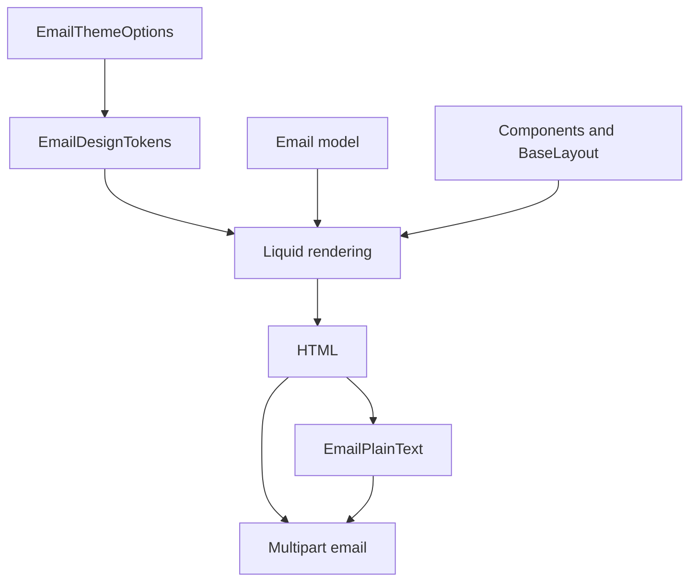

# Email design system

The email design system gives transactional templates a shared layout, semantic tokens and reusable components for bilingual, safe rendering.

## At a glance

| Piece | Where | What |
|---|---|---|
| Tokens | [`EmailDesignTokens.cs`](../../src/Modules/Notification/Notification/Channels/Email/EmailDesignTokens.cs) | Semantic colors (`text`, `textMuted`, `brand`, `danger`, ...), dark-scheme colors (`dark*`), type scale, spacing, radii, font stacks. Exposed to Liquid as `t` (`{{ t.textMuted }}`). |
| Brand overrides | `Email:Theme` ([`EmailThemeOptions`](../../src/Modules/Notification/Notification/Channels/Email/EmailDesignTokens.cs)) | `PrimaryColor`, `OnPrimaryColor`, `AccentColor` (6-digit hex; invalid values keep the default), `LogoUrl`, `LogoWidth`, `HelpCenterUrl`, `PrivacyUrl`, `CompanyAddress`. `Email:BrandName` and `Email:SupportEmail` provide the display name and contact. |
| Layout | `Templates/Layouts/BaseLayout.liquid` | 600px card, logo or text brand, hidden preheader, footer (support, help/privacy links, address), light + dark scheme, RTL through `dir`. |
| Components | `Templates/Components/` | see below |
| Plain text | [`EmailPlainText`](../../src/Modules/Notification/Notification/Channels/Email/EmailPlainText.cs) | every mail is `multipart/alternative`: a text part derived from the HTML (links as `label (url)`), then the HTML. |

Globals available everywhere: `culture`, `dir` (`ltr`/`rtl`), `align` / `alignEnd` (logical start/end),
`brandName`, `appBaseUrl`, `supportEmail`, `currentYear`, `logoUrl`, `t`.

## How it works


*Figure: Templates share tokens and layout; the rendered HTML also supplies the plain-text alternative.*

This is part of Notification, not a separate module: `NotificationModuleManifest.Order` is 900, and delivery persists through `NotificationDbContext` in schema `notification`. It introduces no aggregate, DbContext, background job or integration-event contract. `EmailTemplate`, email models and `EmailAttachment` live in `Notification.Contracts`; [Notification](Notification.md) owns the sender, jobs and consumers.

### Components

Include with `` after assigning the parameters.

| Component | Parameters | Use |
|---|---|---|
| `Heading` | `heading_text` | the email title |
| `Text` | `text_content` (encoded) or `text_html` (trusted markup written in the template); `text_tone` = body / muted / small | paragraphs |
| `Button` | `button_url` (always through `safe_url`), `button_text`, `button_variant` = primary / success / danger / secondary | call to action (VML for Outlook) |
| `Alert` | `alert_text_en`, `alert_text_ar`, `alert_type` = info / success / warning / danger | notices |
| `Card` | `card_content` (captured), `card_title` | grouped data |
| `KeyValue` | `kv_label`, `kv_value`, `kv_strong` | label/value rows inside a Card (amounts, dates, references) |
| `CodeBlock` | `code_value`, `code_caption` | one-time codes (monospace, spaced, `dir=ltr`) |
| `Badge` | `badge_text`, `badge_tone` | inline status pill |
| `Divider`, `Spacer` | `spacer_size` | rhythm |

Preheader (inbox preview line): `{{ 'Your invoice is ready' | set_preheader }}` anywhere in the template. Never put
secrets (codes, links with tokens) in it - lock screens show it.

Reference templates built only from components: [`SecurityAlert.liquid`](../../src/Modules/Notification/Notification/Channels/Email/Templates/SecurityAlert.liquid),
[`OneTimeCode.liquid`](../../src/Modules/Notification/Notification/Channels/Email/Templates/OneTimeCode.liquid).
Older templates keep their markup but use tokens and the `sk-h` / `sk-p` dark-mode classes.

### Dark mode

Inline styles carry the light scheme (every client); the layout re-colors elements with `sk-*` classes under
`prefers-color-scheme: dark` (Apple Mail, iOS, Outlook for Mac/iOS/Android) and `[data-ogsc]/[data-ogsb]`
(Outlook.com). Gmail applies its own inversion. Classes: `sk-bg`, `sk-card`, `sk-body`, `sk-footer`, `sk-h`,
`sk-p`, `sk-muted`, `sk-box`, `sk-code`.

## Configuration

Defaults are from `EmailThemeOptions` and `EmailDesignTokens.Defaults` in `src/Modules/Notification/Notification/Channels/Email/EmailDesignTokens.cs`. The table shows option-class defaults; appsettings supplies the same colors explicitly and empty strings for optional branding fields. invalid six-digit hex colors retain the semantic default. Sender and brand settings are in [Notification configuration](Notification.md#configuration).

| Key | Default | Meaning |
|---|---|---|
| `Email:Theme:PrimaryColor` | `null` → `#1a1a2e` | Header and primary button |
| `Email:Theme:OnPrimaryColor` | `null` → `#ffffff` | Text on primary |
| `Email:Theme:AccentColor` | `null` → `#2563eb` | Links and accents |
| `Email:Theme:LogoUrl` | `null` | Optional logo; otherwise text brand |
| `Email:Theme:LogoWidth` | 140 | Logo width in pixels |
| `Email:Theme:HelpCenterUrl / Email:Theme:PrivacyUrl` | `null` | Optional footer links |
| `Email:Theme:CompanyAddress` | `null` | Optional footer postal address |

## Usage

From `src/Modules/Notification/Notification/Channels/Email/Templates/OneTimeCode.liquid`:

```liquid


```

The same template sets its non-secret preview with `{{ 'Your verification code is inside' | set_preheader }}`. Never include the code, reset token or token-bearing URL in the subject or preheader.

To add a template, follow [`/starterkit:add-email-template`](../../tools/claude/starterkit-plugin/skills/add-email-template/SKILL.md): add the `EmailTemplate` value and `TemplateFile` attribute, dictionary model, `IEmailTemplate` subject class and embedded Liquid file; render both cultures and run the design-system tests.

| Route | Authorization | Purpose |
|---|---|---|
| `POST /api/v1/notifications/email/test` | `RequireAuthorization(PolicyConstants.AdminOnly)` | Render sample data and synchronously send a test email |

The route is declared in `src/Modules/Notification/Notification/Features/Deliveries/SendTestEmailEndPoint.cs`; this design system adds no other endpoints.

## Failure modes and guarantees

Template registration is validated at startup. Development smoke-renders every template in English and Arabic. Model output is HTML-encoded; links pass through `safe_url`, which replaces disallowed URLs with `#`. Raw `text_html` and captured component markup are trusted template code, not untrusted model input. Dark-mode support depends on the mail client: Gmail inversion is not controlled by these styles.

## Guardrails

[`EmailDesignSystemTests`](../../src/Modules/Notification/Notification.Tests/Email/EmailDesignSystemTests.cs) enforces:

- No hex color in any `.liquid` file - use a token; add a token in `EmailDesignTokens` if a new role is needed.
- Every template renders in `en` and `ar` with no unresolved Liquid, no empty style value (a misspelled token), the
  dark-mode block and the right `dir`.
- The plain-text part is readable (no markup, no runs of blank lines).
- Model values are HTML-encoded; every `href` goes through `safe_url`.

## Related

[Notification](Notification.md), [Real-time and push](Notification-Realtime-and-Push.md); [Messaging](../Architecture/Messaging.md), [Multi-tenancy](../MultiTenancy/Overview.md), [Identity](../Identity/README.md), and [`/starterkit:add-email-template`](../../tools/claude/starterkit-plugin/skills/add-email-template/SKILL.md).
