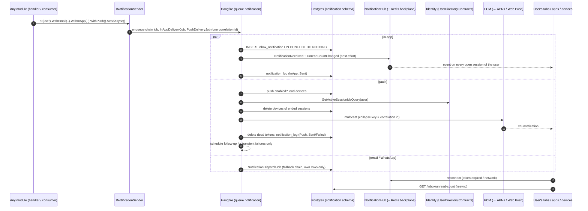

# In-app inbox, real-time (SignalR) and push (FCM)

Part of the [Notification module](Notification.md). Two **additive** channels sit next to the email/WhatsApp
fallback chain:

| Channel | What the user gets | Stored in | Delivered by |
|---|---|---|---|
| `InApp` | an inbox entry + a real-time event on every open tab/app | `notification.inbox_notification` | `InAppDeliveryJob` + `NotificationHub` |
| `Push` | an OS notification on every active device (Android, iOS, Web) | `notification.push_device` (the devices) | `PushDeliveryJob` → `IPushProvider` (FCM) |

"Additive" means they are delivered **in addition to** the chain, never instead of it: the inbox always gets the entry,
push follows the user's `pushEnabled` switch, and the chain keeps its own preferences and fallback. They can never
be put in a channel order (`ChannelOrderRules` and the `Notification:DefaultChannelOrder` validation refuse them).
Decision record: [ADR 0012](../Decisions/0012-realtime-inbox-and-push.md).

## Sending

```csharp
await notifications
    .For(invoice.UserId, culture)
    .WithEmail(EmailTemplate.InvoiceIssued, model.ToDictionary())          // the chain (optional)
    .WithInApp(new InAppContent(
        Title: new LocalizedText("Invoice ready", "الفاتورة جاهزة"),
        Body: new LocalizedText($"Invoice {invoice.Number} is ready.", $"الفاتورة {invoice.Number} جاهزة."),
        Category: "billing.invoice-issued",                                 // clients group / route by it
        ActionUrl: $"/billing/invoices/{invoice.Id}",                       // relative, or an allow-listed host
        Severity: NotificationSeverity.Success,
        Data: new Dictionary<string, string> { ["invoiceId"] = invoice.Id.ToString() }))
    .WithPush()                                                             // same title/body as the inbox entry
    .SendAsync(cancellationToken: ct);
```

- `WithPush(PushContent)` sends its own text; `WithPush(sensitive: true)` reuses the in-app text but sends a generic
  "New notification / Open the app to view it" (push content transits Google/Apple).
- Both need a USER recipient: `For(userId)` or `ToEmail(address, culture, userId)`. Without one they are logged
  `Skipped`.
- `SendAsync(NotificationChannel.Push)` (or `InApp`) delivers ONLY that channel. `SendAsync(NotificationChannel.Email)`
  narrows the chain and keeps in-app and push.
- Limits are part of the contract (`InAppContent.*MaxLength`, `MaxDataEntries`); exceeding the category or data limits
  throws at the call site, long text is truncated at delivery. `Data` is for ids and routes, never PII.

## Delivery



`NotificationJobEnqueuer` turns one notification into up to three Hangfire jobs (queue `notification`) that share ONE
correlation id: the chain (`NotificationDispatchJob`), `InAppDeliveryJob` and `PushDeliveryJob`. Separate jobs keep
failure domains apart: an FCM outage never re-runs (re-sends) the email, and an inbox `Sent` row never stops the email
(the chain only looks at its own rows).

**`InAppDeliveryJob`**

1. Inserts the entry with `INSERT ... ON CONFLICT (user_id, correlation_id) DO NOTHING`: a retry or a duplicate
   enqueue never creates a second entry.
2. Sends `NotificationReceived` + `UnreadCountChanged` to the user (all sessions), **then** writes the `Sent` log row.
   A crash in between re-sends the event on retry (clients de-duplicate by `id`); a finished delivery is a no-op.
3. Text is plain and capped; the action URL must be app-relative (`/x`, not `//x`) or an absolute http(s) URL on
   `Email:AppBaseUrl` / `Email:AllowedLinkHosts` (the email `safe_url` rule), otherwise it is dropped.
4. The entry is stamped with the tenant of the sending request (restored by the Hangfire tenant filter).

**`PushDeliveryJob`**

1. Skips (logged) when the user turned push off or has no device.
2. **Session-bound devices**: devices registered under a session (`sid`) that has since been signed out or revoked are
   deleted and skipped. The job asks Identity through `UserDirectory.Contracts` (`GetActiveSessionIdsQuery`), so a lost
   phone whose session an admin revoked stops receiving pushes at the next send.
3. Sends one multicast through `IPushProvider` (FCM: chunks of 500). Per device:

   | FCM result | Effect |
   |---|---|
   | delivered | counted |
   | `UNREGISTERED`, `SENDER_ID_MISMATCH` | the device is deleted (dead token) |
   | `UNAVAILABLE`, `INTERNAL`, `QUOTA_EXCEEDED`, network/5xx | retried by a follow-up job carrying ONLY those device ids (`Push:RetryDelaysSeconds`, up to `Push:MaxAttempts`) |
   | `INVALID_ARGUMENT`, `THIRD_PARTY_AUTH_ERROR` | logged, device kept, not retried (it may be the payload, so devices are never wiped on it) |

4. The correlation id is the collapse key on every platform (Android `tag`, APNs `apns-collapse-id`, Web Push `tag`),
   so a duplicate replaces the shown notification instead of stacking.
5. One `notification_log` row per attempt: `Sent` (at least one device accepted it; partial failures in `error`),
   `Skipped` or `Failed`. In-app and push rows cannot be re-enqueued by hand (they retry automatically).

## Real-time hub

`/hubs/notifications` (`NotificationHub`, `Notification.Contracts.Realtime.NotificationHubContract`). It is
**push-only**: clients invoke nothing on it, every command goes through REST. Events (camelCase JSON):

| Event | Payload | When |
|---|---|---|
| `NotificationReceived` | `InboxNotificationDto` | a new entry (may repeat after a retry: de-duplicate by `id`) |
| `UnreadCountChanged` | `{ tenantId, count }` | new entry, read, read-all, delete |
| `NotificationsRead` | `{ ids \| null, readAt, upTo }` | read on another tab/device (`ids: null` = all up to `upTo`) |
| `NotificationDeleted` | `{ id }` | deleted on another tab/device |
| `UserEvent` | `{ type, tenantId, data }` | a transient event from another module, e.g. `datatransfer.job-progress` (not stored) |

Other modules push `UserEvent`s through `IUserEventPublisher` (`Notification.Contracts.Realtime`): best effort, at
most `UserEvent.MaxDataEntries` (20) entries of ids, counts and statuses, never PII. Unlike inbox entries they are not
stored: a client that reconnects re-reads the state over REST. In a split deployment (worker replicas), the Redis
backplane carries a worker's send to the sockets on the API replicas.

Events are hints, delivered best effort (a Redis hiccup is logged, never fails a request or job). **After every
(re)connect, re-read `GET /inbox/unread-count`.**

**Authentication.** Browsers cannot set `Authorization` on a WebSocket, so the token travels as
`?access_token=` - accepted ONLY under `/hubs` (`Shared.Core.Web.RealtimePaths`; anywhere else a token in the URL is
ignored). Every check (token blacklist, session revocation, security stamp) runs on the token that was validated,
however it arrived (`TokenBlacklistJwtBearerEvents`). API keys are refused (`DisallowApiKey`).
`CloseOnAuthenticationExpiration` drops the socket when the access token expires, so a revoked session cannot keep a
connection open for longer than one access-token lifetime (`JwtSettings:AccessTokenExpirationMinutes`, 15 in Docker);
the client reconnects with a fresh token.

**Scale-out.** With `Redis:Enabled` the hub uses the SignalR Redis backplane on its own connection (channel prefix
`<Redis:InstanceName>:signalr`): a send from the replica that ran the job reaches a socket on any replica. Behind a
load balancer without sticky sessions (the shipped nginx is `least_conn`), clients connect with **WebSockets and
`skipNegotiation: true`**; `appsettings.Docker.json` allows only WebSockets (`Realtime:Transports`). SSE/long polling
need sticky sessions.

### Browser client (TypeScript, `@microsoft/signalr`)

```ts
import { HubConnectionBuilder, HttpTransportType, LogLevel } from "@microsoft/signalr";

const hub = new HubConnectionBuilder()
  .withUrl("https://api.example.com/hubs/notifications", {
    accessTokenFactory: () => auth.getAccessToken(),   // called on every (re)connect: return a FRESH token
    transport: HttpTransportType.WebSockets,
    skipNegotiation: true,
  })
  .withAutomaticReconnect()
  .configureLogging(LogLevel.Warning)
  .build();

hub.on("NotificationReceived", (n) => inbox.upsert(n));          // de-duplicate by n.id
hub.on("UnreadCountChanged", (c) => badge.set(c.tenantId, c.count));
hub.on("NotificationsRead", (r) => inbox.markRead(r.ids, r.upTo));
hub.on("NotificationDeleted", (d) => inbox.remove(d.id));
hub.onreconnected(() => badge.refresh());                         // GET /api/v1/notifications/inbox/unread-count
hub.onclose(() => setTimeout(() => hub.start(), 5000));            // token expiry closes the socket by design

await hub.start();
await badge.refresh();
```

### Android client (Kotlin, `com.google.firebase:firebase-messaging`)

```kotlin
class AppMessagingService : FirebaseMessagingService() {
    // FCM rotated the token: refresh the registration (only when signed in).
    override fun onNewToken(token: String) { if (session.isSignedIn) api.registerDevice(token) }

    // Data / notification while the app is in the foreground. Route on tap with data["category"] / data["actionUrl"];
    // data["correlationId"] is the inbox entry's correlation id.
    override fun onMessageReceived(message: RemoteMessage) = notifications.show(message)
}

// After sign-in (Android 13+: request POST_NOTIFICATIONS first).
val token = FirebaseMessaging.getInstance().token.await()
deviceId = api.registerDevice(token)   // PUT /api/v1/notifications/devices {token, platform:"Android", appVersion, locale}

// Sign-out: unregister while the access token is still valid, then drop the FCM token.
api.unregisterDevice(deviceId)         // DELETE /api/v1/notifications/devices/{deviceId}
FirebaseMessaging.getInstance().deleteToken().await()
```

### iOS client (Swift, `FirebaseMessaging`)

```swift
// AppDelegate: UNUserNotificationCenter.current().requestAuthorization(options: [.alert, .badge, .sound]) { ... }
// then UIApplication.shared.registerForRemoteNotifications(). FirebaseMessaging maps the APNs token to an FCM token.
extension AppDelegate: MessagingDelegate {
    func messaging(_ messaging: Messaging, didReceiveRegistrationToken fcmToken: String?) {
        guard let fcmToken, session.isSignedIn else { return }
        Task { deviceId = try await api.registerDevice(token: fcmToken, platform: "Ios") }
    }
}
// Sign-out: try await api.unregisterDevice(deviceId); try await Messaging.messaging().deleteToken()
```

The server sets `apns-collapse-id` and `thread-id` (= category); notifications of one category are grouped and a
duplicate replaces the shown one. Silent/background pushes are not used.

## Push devices (mobile / web app)

1. After sign-in, on every app start and whenever FCM rotates the token (`onTokenRefresh`):
   `PUT /api/v1/notifications/devices { token, platform: "Android" | "Ios" | "Web", appVersion?, locale? }`.
   It is an upsert by token: the device is bound to the CURRENT session; a token registered by another account moves
   to the caller (shared device). At most `Push:MaxDevicesPerUser` devices are kept (least recently seen evicted).
2. On sign-out, BEFORE discarding the session: `DELETE /api/v1/notifications/devices/{deviceId}`. (Forgetting it is
   safe: the revoked session drops the device at the next send.)
3. Devices not re-registered for `Push:StaleDeviceDays` are purged daily.
4. The data payload always carries `correlationId` (plus `category` / `actionUrl` with `WithPush()`): route on tap.

## Endpoints

| Route | Auth | Notes |
|---|---|---|
| `GET /api/v1/notifications/inbox?unreadOnly=&category=&pageNumber=&pageSize=` | the user | newest first, the current tenant + platform notices |
| `GET /api/v1/notifications/inbox/unread-count` | the user | badge |
| `POST /api/v1/notifications/inbox/{id}/read` | the user | idempotent |
| `POST /api/v1/notifications/inbox/read-all { upTo? }` | the user | pass the `createdAt` of the newest entry the user SAW |
| `DELETE /api/v1/notifications/inbox/{id}` | the user | |
| `PUT /api/v1/notifications/devices` | the user, no API key | register / refresh |
| `GET /api/v1/notifications/devices` | the user, no API key | token masked (`...abcdefgh`) |
| `DELETE /api/v1/notifications/devices/{id}` | the user, no API key | |
| `PUT /api/v1/notifications/preferences { channelOrder, pushEnabled?, categoryMutes?, quietHours?, timeZone? }` | the user | omitted = unchanged; `categoryMutes` replaces the whole map |
| `GET /api/v1/notifications/preferences/category-groups` | the user | the mutable groups with `en`/`ar` names |
| `/hubs/notifications` | the user (JWT, header or `?access_token=`), no API key | SignalR |

A foreign or unknown id is always 404 (never 403), so ids cannot be probed.

## Tenancy

The inbox is per user. With multi-tenancy on, a request in tenant T sees T's entries plus tenant-less platform
notices (`InboxScope`); single-tenant mode sees all. Entries are deleted with the tenant (`TenantDataPurgeRequestedEvent`)
and with the user (`UserDeletedIntegrationEvent`, which also deletes the devices). Hub events carry `tenantId`; a client
in another tenant ignores them or refreshes.

## Configuration

| Section | Keys (defaults) |
|---|---|
| `Inbox` | `RetentionDays` (90) |
| `Realtime` | `Enabled` (true; false = no hub, clients poll), `Transports` (comma-separated, `WebSockets,ServerSentEvents,LongPolling`; Docker: `WebSockets`), `KeepAliveInterval` (15s), `ClientTimeoutInterval` (30s), `UseRedisBackplane` (true) |
| `Push` | `Apns` (`Enabled`, `KeyId`, `TeamId`, `BundleId`, `PrivateKeyFile`, `UseSandbox`), `Provider` (`Auto` = FCM when credentials exist, else NoOp; `Fcm`; `NoOp`), `ProjectId`, `CredentialsFile` or the `fcm_service_account_json` secret, `DefaultTimeToLive` (1 day, max 28), `MaxAttempts` (4), `RetryDelaysSeconds` ([30,120,600]), `MaxDevicesPerUser` (10), `StaleDeviceDays` (60) |

Everything is validated at startup (`ValidateOnStart`): `Push:Provider=Fcm` without credentials, an unknown transport
or a bad interval refuses to boot. `Realtime:Transports` is a string, not an array: configuration merges arrays by
index, so an environment file could never remove a transport from one.

## Mutes and quiet hours

A category is `<group>.<event>` (`billing.invoice-issued`); the group is the part before the first dot. Groups:
`billing`, `security`, `membership`, `catalog`, `data-transfer`, `webhooks`, `system` (no dot or an unknown group =
`system`). The list, with `en`/`ar` names, is `NotificationCategoryGroups` (Notification.Contracts) and the
`category-groups` endpoint.

- **Mutes** are per group and per channel: `categoryMutes: { "membership": { "push": true, "inApp": false, "email": false } }`.
  A muted in-app or push delivery is logged `Skipped` and never stored or sent. "Email" covers the whole email/WhatsApp
  chain of that send: muting it does NOT fall back to WhatsApp.
- **Fixed channels** (cannot be muted): every channel of `security`, and `billing` email (invoices and payment failures
  are transactional). The validator answers 400 (localized en/ar) and delivery ignores a stale stored mute (defense in
  depth). `category-groups` returns `inAppMutable` / `pushMutable` / `emailMutable` per group. The table is
  `NotificationCategoryGroups` in Notification.Contracts. Forced email (`SendAsync(NotificationChannel.Email)`) is no
  longer special: whether it can be muted depends on its group like any other send.
- **No category, no mute.** An email-only send names its category with the optional `.InCategory("membership.invitation-accepted")`
  on the builder. Without it the in-app category is used; with neither, the email is never muted. Push and in-app with no
  category are not muted or deferred either. `InCategory` is a default interface method (returns the builder), so test
  doubles need no change. The resolved category travels on `NotificationMessage`, `InAppDelivery` and `PushDelivery`.
- **Quiet hours:** `quietHours: { enabled, start: "22:00", end: "07:00" }` plus `timeZone`. The time zone is stored as its
  canonical IANA id (e.g. `Africa/Cairo`); a Windows id such as `Egypt Standard Time` is converted and an id with no IANA
  equivalent is rejected. It is validated with `TimeZoneInfo`, so slim container images need `tzdata`. The window may cross
  midnight; an end time that does not exist (spring-forward) ends at the first valid local time, an ambiguous one
  (fall-back) at its first occurrence. During the window a push is DEFERRED: the job is rescheduled to the window end with
  the remaining time-to-live reduced by the wait, a `Queued` log row "Deferred until ..." is written, and a duplicate run of
  the same notification schedules nothing more. A push whose TTL would expire first is dropped (`Skipped`). In-app entries
  are still stored and counted as unread, but the live SignalR event is not sent. `security` ignores quiet hours.
  `enabled: false` removes the window.

## FCM / APNs setup

1. Create a Firebase project; add the Android, iOS and/or Web apps (the client SDKs give the registration token).
2. iOS: upload the APNs authentication key (`.p8`) in Firebase → Project settings → Cloud Messaging. Pushes to iOS go
   through FCM unless you enable the direct adapter below.

   **Direct APNs (optional).** Overlay `docker-compose.apns.yml`, or set `Push:Apns:Enabled=true` with `KeyId`,
   `TeamId`, `BundleId` (`CHANGE_ME` counts as missing) and `Push:Apns:PrivateKeyFile`, the path of the `.p8` key
   (`secrets/apns_auth_key.p8`; read by path, never loaded into configuration). The key is parsed at startup: a missing
   or invalid key stops the boot. `UseSandbox=true` is for development-build tokens (a token only works in the environment
   that issued it). No NuGet package: HTTP/2 with an ES256 JWT cached about 50 minutes, minted once when a burst of
   `ExpiredProviderToken` answers arrives. The HTTP client has no logging handler because the URI carries the device token.
   `RoutingPushProvider` sends iOS devices holding a NATIVE APNs token (hexadecimal) to Apple and every other device,
   including iOS devices with a Firebase token, through FCM; one provider failing never discards the other's results.
   The payload is kept within 4096 bytes (UTF-8, not escaped): the body is cut first, then the title, then data entries.
   Errors: only `410 Unregistered` deletes the device. `400 BadDeviceToken` (often a sandbox/production mismatch) is
   Rejected: the device is kept and a warning is logged. 429, 5xx and `ExpiredProviderToken` retry; anything else is
   rejected.
3. Generate a service-account key (Project settings → Service accounts) with only the "Firebase Cloud Messaging API
   Admin" role, save it as `secrets/fcm_service_account.json` and run with the overlay:
   `docker compose -f docker-compose.yml -f docker-compose.push.yml up -d`. The key is read by path
   (`Push:CredentialsFile`) and never loaded into configuration (`.json` secrets are read-by-path, like `.pfx`).
4. Only a `service_account` key is accepted (an external-account JSON could make the SDK call arbitrary token URLs).

## Operations

- Metrics (meter `StarterKit.Notification`): `notification.inapp.delivered`, `notification.push.sent{result}`,
  `notification.realtime.sent{method,result}`; open sockets: `signalr.server.active_connections`
  (meter `Microsoft.AspNetCore.Http.Connections`).
- Delivery history: `GET /api/v1/notifications/history?channel=Push&status=Failed`.
- Alerts (`infra/observability/configs/alerts.yaml`, group `notification`): `PushDeliveryFailing` (> 20% of device
  sends failing), `PushRejectedByProvider` (configuration problem), `RealtimeSendErrors` (backplane).
- Nginx: `location /hubs/` (upgrade headers, no buffering, 3600s read timeout, its own per-IP connection budget, a log
  format without the query string) - [Nginx](../deployment/Nginx.md).

## Troubleshooting

| Symptom | Likely cause | Check / fix |
|---|---|---|
| Hub connect returns 401 | token missing/expired, or sent in the URL on a non-hub route | the client must use `accessTokenFactory` (query string `access_token`) and connect to `/hubs/notifications`; a logged-out or revoked token is refused by design |
| Hub connect returns 403 `api_key_restricted` | an API key was used | hubs are for signed-in people only (`DisallowApiKey`) |
| WebSocket fails behind nginx, works locally | `location /hubs/` missing or no upgrade headers | `deployment/nginx/conf.d/app-production.conf`; `curl -i -H "Connection: Upgrade" -H "Upgrade: websocket" https://api.example.com/hubs/notifications?access_token=...` should not be 400/404 |
| Works with 1 replica, events lost with 2+ | negotiate and connect hit different replicas, or no backplane | clients: WebSockets + `skipNegotiation: true`; server: `Redis:Enabled=true`, `Realtime:UseRedisBackplane=true` |
| Socket closes every ~15 minutes | access-token expiry (`CloseOnAuthenticationExpiration`) | expected: `withAutomaticReconnect` + a fresh token from `accessTokenFactory` |
| Events arrive, badge wrong in another tenant | `UnreadCountChanged.tenantId` is a different tenant | the client compares `tenantId` with its current tenant and ignores or refreshes |
| No push at all, log says `Push provider: NoOp` | no credentials (`Push:Provider=Auto`) | mount `secrets/fcm_service_account.json` with `docker-compose.push.yml` |
| Boot fails: `Push:Provider is Fcm but no credentials` | `Push__Provider=Fcm` without a key | set `Push__CredentialsFile` (or the `fcm_service_account_json` secret) |
| Every push `Failed [transient]`, log shows 401/403 from Google | the service account lacks the FCM role, or the FCM API (V1) is disabled | grant "Firebase Cloud Messaging API Admin"; enable the API in Google Cloud Console |
| `rejected` with `THIRD_PARTY_AUTH_ERROR` (iOS only) | APNs key missing/expired in Firebase | upload a valid `.p8` key in Firebase → Cloud Messaging |
| `rejected` with `INVALID_ARGUMENT` for every device | payload too large (4 KB limit) or bad data | shorten `Data`; the devices are kept on purpose |
| Browser: `messaging/token-subscribe-failed` | FCM API disabled, or a VAPID key from another project | enable the API; use the project's own Web Push certificate |
| Push `Skipped: No active push device` right after login | the device was registered under an older session | register again after every sign-in (the device follows the latest session) |
| Hub events stop, inbox fine; alert `RealtimeSendErrors` | Redis down (backplane) | restore Redis; clients resync over REST |

Logs to search (Seq / Loki): `Push delivery`, `Push to device`, `Dropped ... push device(s)`, `Real-time ... failed`,
`In-app notification delivered`. Alerts: `PushDeliveryFailing`, `PushRejectedByProvider`, `RealtimeSendErrors`
(`infra/observability/configs/alerts.yaml`).

## Tests

| Where | What |
|---|---|
| `Notification.Tests/Dispatch/AdditiveChannelDispatchTests.cs` | job fan-out, forced channels, the chain is never stopped by an inbox row, builder rules, Hangfire argument round trip |
| `Notification.Tests/Dispatch/InAppDeliveryJobTests.cs` | idempotency, crash-and-retry, unsafe links, cultures, truncation |
| `Notification.Tests/Dispatch/PushDeliveryJobTests.cs` | session-bound devices, dead tokens, retry only the failed devices, attempts exhausted, sensitive text, TTL |
| `Notification.Tests/Dispatch/PushProviderTests.cs` | the FCM error table, the FCM message mapping (collapse keys), credential type |
| `Notification.Tests/Persistence/InboxAndDevicesPostgresTests.cs` | real Postgres: `ON CONFLICT`, read-all `upTo`, tenant scope, ownership, device upsert/move/cap, purge, erasure |
| `Notification.Tests/Realtime/NotificationHubTests.cs` | real hub + .NET client: per-user targeting, isolation, auth, push-only hub, **Redis backplane across two replicas** |
| `Identity.Tests/Sessions/HubTokenTests.cs` | query-string token only on `/hubs`, a logged-out token is rejected from the query string |
| `Api.E2ETests/Notification/InboxAndRealtimeE2ETests.cs` | real login → hub over WebSockets → notification received; logout → hub refused; REST endpoints |
| `Notification.Tests/Dispatch/FcmLiveTests.cs` | **opt-in, real Firebase**: a real device token is delivered, an unknown one never is |
| `Api.E2ETests/Notification/FcmLiveE2ETests.cs` | **opt-in, real Firebase**: login → register device over HTTP → push through FCM → logout → next push skipped, device deleted |

The two live tests are skipped unless configured (CI skips them). To run them, get a device token (for a browser:
any page that calls the Firebase JS SDK `getToken` with your project's web config and VAPID key), then:

```bash
export FCM_CREDENTIALS_FILE=secrets/fcm_service_account.json FCM_TEST_TOKEN="<device token>"
export Push__Provider=Fcm Push__CredentialsFile="$FCM_CREDENTIALS_FILE"
dotnet test src/Modules/Notification/Notification.Tests --filter "FullyQualifiedName~FcmLiveTests"
dotnet test src/Api.E2ETests --filter "FullyQualifiedName~FcmLiveE2ETests"
```

The device shows "StarterKit push works" and "StarterKit: delivered through the API", and never the third message
(sent after logout).
