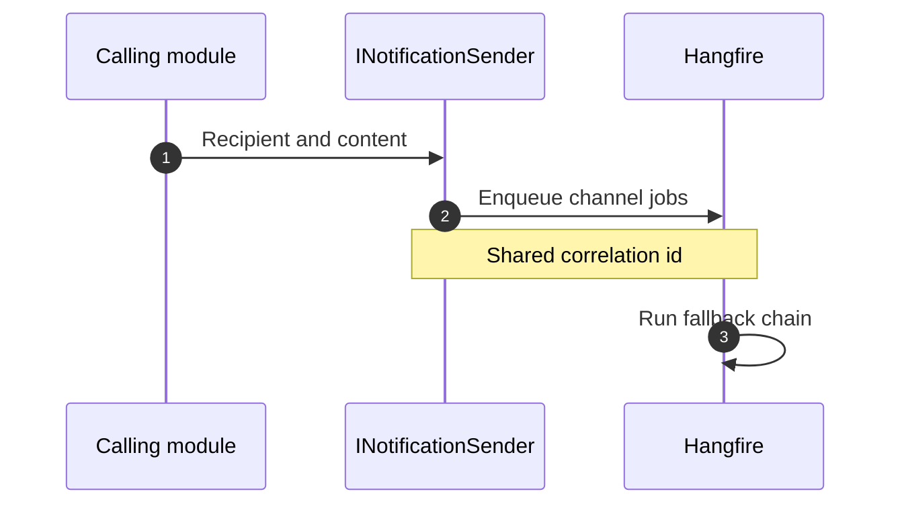
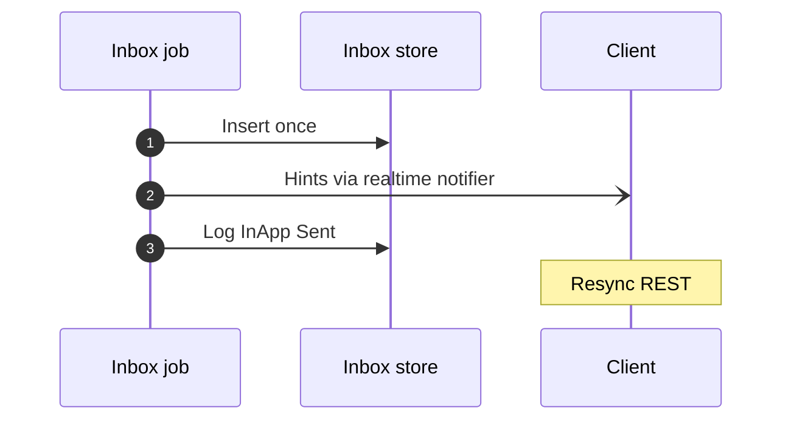
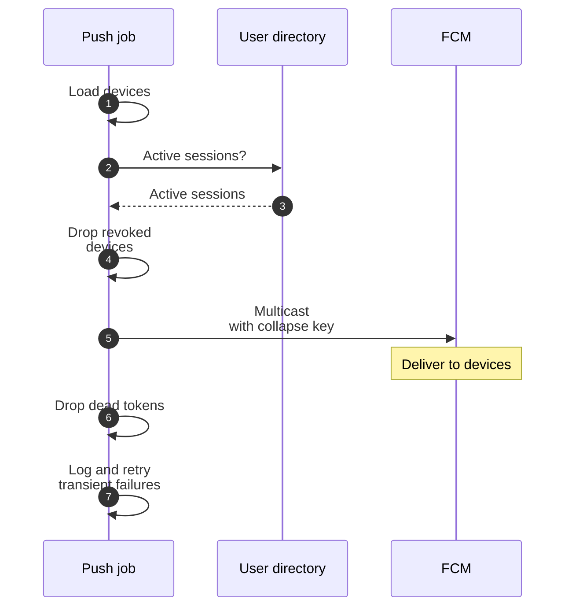

# In-app inbox, real-time (SignalR) and push (FCM)

Inbox and push extend Notification with persisted user messages, session-bound devices and best-effort live updates across application replicas.

## At a glance

These features share `NotificationModuleManifest.Order = ModuleOrder.Notification` (900) and the host `NotificationDbContext`, schema `notification`. Main records are `InboxNotification` and `PushDevice`; the [module page](Notification.md#database) covers preferences and delivery logs. Source: `src/Modules/Notification/Notification/`, with public ports and DTOs in `Notification.Contracts/`.

| Channel | What the user gets | Stored in | Delivered by |
|---|---|---|---|
| `InApp` | an inbox entry + a real-time event on every open tab/app | `notification.inbox_notification` | `InAppDeliveryJob` + `NotificationHub` |
| `Push` | an OS notification on every active device (Android, iOS, Web) | `notification.push_device` (the devices) | `PushDeliveryJob` → `IPushProvider` (FCM) |

"Additive" means they are delivered **in addition to** the chain, never instead of it: the inbox gets an entry unless suppressed by its category mute,
push follows the user's `pushEnabled` switch, and the chain keeps its own preferences and fallback. They can never
be put in a channel order (`ChannelOrderRules` and the `Notification:DefaultChannelOrder` validation refuse them).
Decision record: [ADR 0012](../Decisions/0012-realtime-inbox-and-push.md).

## How it works

### Delivery


*Figure: Channel jobs are independent and share a correlation id.*

`WithEmail`, `WithInApp` and `WithPush` select the channels before `SendAsync`. `NotificationDispatchJob` handles the fallback chain, while `InAppDeliveryJob` and `PushDeliveryJob` handle the additive channels.


*Figure: The inbox persists independently of best-effort real-time hints.*

`InAppDeliveryJob` inserts the inbox row and calls `IRealtimeNotifier` for `NotificationReceived` and `UnreadCountChanged`. The notifier sends through the hub context; the hub has no client-invokable methods. The hub uses the Redis backplane across replicas. Clients call `GET /api/v1/notifications/inbox/unread-count` after reconnecting; the insert uses `ON CONFLICT DO NOTHING`.


*Figure: Push delivery validates device sessions before calling FCM.*

FCM forwards to Android, APNs and Web Push. Outcomes are stored in `notification_log`; all three channel groups use the `notification` queue.

`NotificationJobEnqueuer` turns one notification into up to three Hangfire jobs (queue `notification`) that share ONE
correlation id: the chain (`NotificationDispatchJob`), `InAppDeliveryJob` and `PushDeliveryJob`. Separate jobs keep
failure domains apart: an FCM outage never re-runs (re-sends) the email, and an inbox `Sent` row never stops the email
(the chain only looks at its own rows).

**`InAppDeliveryJob`**

1. Inserts the entry with `INSERT ... ON CONFLICT (user_id, correlation_id) DO NOTHING`: a retry or a duplicate
   enqueue never creates a second entry.
2. Sends `NotificationReceived` + `UnreadCountChanged` to the user (all sessions), **then** writes the `Sent` log row.
   A crash in between re-sends the event on retry (clients de-duplicate by `id`); a finished delivery is a no-op.
3. Text is plain and capped; the action URL must be app-relative (`/x`, not `//x`) or an absolute http(s) URL on
   `Email:AppBaseUrl` / `Email:AllowedLinkHosts` (the email `safe_url` rule), otherwise it is dropped.
4. The entry is stamped with the tenant of the sending request (restored by the Hangfire tenant filter).

**`PushDeliveryJob`**

1. Skips (logged) when the user turned push off or has no device.
2. **Session-bound devices**: devices registered under a session (`sid`) that has since been signed out or revoked are
   deleted and skipped. The job asks Identity through `UserDirectory.Contracts` (`GetActiveSessionIdsQuery`), so a lost
   phone whose session an admin revoked stops receiving pushes at the next send.
3. Sends one multicast through `IPushProvider` (FCM: chunks of 500). Per device:

   | FCM result | Effect |
   |---|---|
   | delivered | counted |
   | `UNREGISTERED`, `SENDER_ID_MISMATCH` | the device is deleted (dead token) |
   | `UNAVAILABLE`, `INTERNAL`, `QUOTA_EXCEEDED`, network/5xx | retried by a follow-up job carrying ONLY those device ids (`Push:RetryDelaysSeconds`, up to `Push:MaxAttempts`) |
   | `INVALID_ARGUMENT`, `THIRD_PARTY_AUTH_ERROR` | logged, device kept, not retried (it may be the payload, so devices are never wiped on it) |

4. The correlation id is the collapse key on every platform (Android `tag`, APNs `apns-collapse-id`, Web Push `tag`),
   so a duplicate replaces the shown notification instead of stacking.
5. One `notification_log` row per attempt: `Sent` (at least one device accepted it; partial failures in `error`),
   `Skipped` or `Failed`. In-app and push rows cannot be re-enqueued by hand (they retry automatically).

### Real-time hub

`/hubs/notifications` (`NotificationHub`, `Notification.Contracts.Realtime.NotificationHubContract`). It is
**push-only**: clients invoke nothing on it, every command goes through REST. Events (camelCase JSON):

| Event | Payload | When |
|---|---|---|
| `NotificationReceived` | `InboxNotificationDto` | a new entry (may repeat after a retry: de-duplicate by `id`) |
| `UnreadCountChanged` | `{ tenantId, count }` | new entry, read, read-all, delete |
| `NotificationsRead` | `{ ids \| null, readAt, upTo }` | read on another tab/device (`ids: null` = all up to `upTo`) |
| `NotificationDeleted` | `{ id }` | deleted on another tab/device |
| `UserEvent` | `{ type, tenantId, data }` | a transient event from another module, e.g. `datatransfer.job-progress` (not stored) |
| `ForceDisconnect` | `{ reason }` | the session behind this socket was revoked; the server closes the socket right after. **Do not reconnect with the same token** - sign in again |

Other modules push `UserEvent`s through `IUserEventPublisher` (`Notification.Contracts.Realtime`): best effort, at
most `UserEvent.MaxDataEntries` (20) entries of ids, counts and statuses, never PII. Unlike inbox entries they are not
stored: a client that reconnects re-reads the state over REST. In a split deployment (worker replicas), the Redis
backplane carries a worker's send to the sockets on the API replicas.

Events are hints, delivered best effort (a Redis hiccup is logged, never fails a request or job). **After every
(re)connect, re-read `GET /inbox/unread-count`.**

**Authentication.** Browsers cannot set `Authorization` on a WebSocket, so the token travels as
`?access_token=` - accepted ONLY under `/hubs` (`Shared.Core.Web.RealtimePaths`; anywhere else a token in the URL is
ignored). Every check (token blacklist, session revocation, security stamp) runs on the token that was validated,
however it arrived (`TokenBlacklistJwtBearerEvents`). API keys are refused (`DisallowApiKey`).
`CloseOnAuthenticationExpiration` drops the socket when the access token expires, so a revoked session cannot keep a
connection open for longer than one access-token lifetime (`JwtSettings:AccessTokenExpirationMinutes`, 15 in Docker);
the client reconnects with a fresh token.

**Scale-out.** With `Redis:Enabled` the hub uses the SignalR Redis backplane on its own connection (channel prefix
`<Redis:InstanceName>:signalr`): a send from the replica that ran the job reaches a socket on any replica. Behind a
load balancer without sticky sessions (the shipped nginx is `least_conn`), clients connect with **WebSockets and
`skipNegotiation: true`**; `appsettings.Docker.json` allows only WebSockets (`Realtime:Transports`). SSE/long polling
need sticky sessions.

### Closing sockets on revocation

Revoking a session (sign out of a device, logout-all, lock, delete, password or role change, refresh-token reuse)
normally closes its live sockets shortly after outbox delivery; token expiry remains the fallback:

1. Identity adds a short-lived `SessionRevocation` tombstone row; saving it writes `UserSessionsRevokedIntegrationEvent`
   (`UserDirectory.Contracts`, urn `userdirectory.user-sessions-revoked.v1`: `UserId`, `SessionIds` or `AllSessions`) to
   the Identity outbox. Revocation itself is a set-based update with no aggregate, hence the row.
   - **Inside an open transaction** the recorder only adds the row; the caller's unit of work saves it, so it commits or
     rolls back WITH the revocation.
   - **Without one** (the revocation already committed) the row is saved on a dedicated context through
     `IUnitOfWorkRunner`, so no other pending change is flushed. A failure there is logged, never thrown: the database
     revocation stays authoritative and the socket still closes at token expiry.
   - Nothing is recorded for an unknown user. `RefreshTokenCleanupJob` purges rows after 7 days.
2. `UserSessionsRevokedConsumer` (Notification) hands it to `IHubRevocationBroadcaster`. The event reaches ONE replica
   (competing consumers) but the sockets are on all of them, so with Redis the broadcaster publishes on
   `<Redis:InstanceName>:notification:hub-revoke` (same approach as the tenant L1 cache invalidation) and every
   subscribed replica closes its own matches; without Redis it closes locally.
3. `HubSessionCloser` looks up the connections (indexed by user) in the per-replica `HubConnectionRegistry`, sends
   `ForceDisconnect`, then aborts the socket. Only the revoked `sid` closes (`AllSessions` closes every socket of the
   user); the user's other sessions stay connected.
4. `SessionRevocationHubFilter` registers each connection FIRST and then re-checks it on connect
   (`ISessionRevocationChecker` in `UserDirectory.Contracts`, backed by the Redis blacklist: the session id AND the
   security-stamp hash, so a revoke-all is caught). A revocation landing between the check and the registration finds the
   socket in the registry. The hub has no client methods, so there is no per-invocation check. Fails open if the store is
   down; the handshake check and `CloseOnAuthenticationExpiration` still apply.

**Redis down.** Publishing fails or this replica is not subscribed: the replica always closes its OWN matching sockets
locally; sockets on other replicas then close at access-token expiry (`JwtSettings:AccessTokenExpirationMinutes`). A failed
subscription is retried in the background (and after a reconnect), so a replica rejoins the fan-out without a restart.

### Which events notify

In-app inbox entries (and push where it is actionable) accompany the existing emails and events. Category =
`<group>.<event>` (groups in use today: `billing`, `membership`, `data-transfer`, `webhooks`, `agents`; reserved: `security`,
`system`); text is in both languages from the owning module's resx (`InApp.<group>.<event>.Title/.Body`, read with
`Shared.Core.Localization.BilingualResource`). Amounts are kept out of the text; webhook endpoints show only their host.
Send a STABLE correlation id (`.WithCorrelationId(...)`, e.g. the integration event's message id) from consumers: the inbox
is unique per user and correlation id, so an at-least-once redelivery does not create a second entry. Billing
notifications are sent inside the subscriber's tenant scope when multi-tenancy is on (the subscriber is the tenant).
Membership notifications are not sent to the person who made the change.

| Category | Source | Push |
|---|---|---|
| `billing.subscription-activated`, `renewed`, `cancelled`, `cancellation-scheduled`, `downgrade-*`, `upgraded`, `refund-approved`, `refund-rejected`, `invoice-ready` | Subscriptions event handlers, `InvoiceDeliveryJob` | no |
| `billing.past-due`, `payment-rejected`, `refund-processed` | Subscriptions | yes (sensitive: no details on the lock screen) |
| `billing.expired`, `subscription-rejected`, `upgrade-reverted`, `trial-ending` | Subscriptions, `TrialReminderProcessor` | yes |
| `membership.joined` (non-owner members added by someone else), `membership.role-changed` (the role SET changed) | Tenancy (to the member) | no |
| `webhooks.endpoint-disabled` | Webhooks (to the tenant owner) | yes (sensitive) |
| `data-transfer.job-finished` | DataTransfer | yes |
<!--#if (agentic)-->
| `agents.approval-required`, `agents.run-finished` | Agentic (to the user the run acts for) | yes |
<!--#endif-->

### Browser client

Use the SignalR client with an access-token factory that obtains a fresh token on each connection, WebSockets and negotiation skipped when the load balancer has no affinity. Subscribe to the five inbox/user event methods in the table above. Deduplicate notifications by id, apply tenant-specific badge updates only to the matching tenant, and refresh unread count after initial connection and every reconnect. Handle `ForceDisconnect` by stopping reconnect attempts until sign-in establishes a new session; never reuse the revoked token. Client UI helpers are application code, not supplied by this backend template.

### Android client

Register the Firebase token after sign-in, on application start and on token rotation. On Android 13 and later, obtain notification permission before expecting visible notifications. Handle foreground delivery and route taps using `category`, `actionUrl` and `correlationId` in the payload. Before sign-out, unregister the device while the access token is still valid, then delete the Firebase token.

### iOS client

Request notification authorization and register for remote notifications. Firebase maps the APNs token to an FCM token; register that token after sign-in and whenever it rotates. Unregister before sign-out, then delete the Firebase token. Direct APNs is optional and uses a native APNs token instead, as described below.

The server sets `apns-collapse-id` to the correlation id and `thread-id` to the category: retries can replace the same notification while categories group notifications. Silent/background pushes are not used.

### Tenancy

The inbox is per user. With multi-tenancy on, a request in tenant T sees T's entries plus tenant-less platform
notices (`InboxScope`); single-tenant mode sees all. Entries are deleted with the tenant (`TenantDataPurgeRequestedEvent`)
and with the user (`UserDeletedIntegrationEvent`, which also deletes the devices). Hub events carry `tenantId`; a client
in another tenant ignores them or refreshes.

### Endpoints

Declarations are in `src/Modules/Notification/Notification/Features/Inbox/InboxModule.cs`, `Features/Devices/PushDevicesModule.cs` and `NotificationModule.cs` for the hub. Preferences are declared in `Features/Preferences/`.

| Route | Auth | Notes |
|---|---|---|
| `GET /api/v1/notifications/inbox?unreadOnly=&category=&pageNumber=&pageSize=` | `RequireAuthorization()` | newest first, the current tenant + platform notices |
| `GET /api/v1/notifications/inbox/unread-count` | `RequireAuthorization()` | badge |
| `POST /api/v1/notifications/inbox/{id}/read` | `RequireAuthorization()` | idempotent |
| `POST /api/v1/notifications/inbox/read-all { upTo? }` | `RequireAuthorization()` | pass the `createdAt` of the newest entry the user SAW |
| `DELETE /api/v1/notifications/inbox/{id}` | `RequireAuthorization()` | |
| `PUT /api/v1/notifications/devices` | `RequireAuthorization()` + `DisallowApiKey()` | register / refresh |
| `GET /api/v1/notifications/devices` | `RequireAuthorization()` + `DisallowApiKey()` | token masked (`...abcdefgh`) |
| `DELETE /api/v1/notifications/devices/{id}` | `RequireAuthorization()` + `DisallowApiKey()` | |
| `PUT /api/v1/notifications/preferences { channelOrder, pushEnabled?, categoryMutes?, quietHours?, timeZone? }` | `RequireAuthorization()` | omitted = unchanged; `categoryMutes` replaces the whole map |
| `GET /api/v1/notifications/preferences/category-groups` | `RequireAuthorization()` | the mutable groups with `en`/`ar` names |
| `/hubs/notifications` | `RequireAuthorization()` + `DisallowApiKey()`; JWT header or `?access_token=` | SignalR |

A foreign or unknown id is always 404 (never 403), so ids cannot be probed.

## Configuration

Defaults from `src/Modules/Notification/Notification/Options/PushOptions.cs` and `src/Api/appsettings.json`; Docker restricts transports to WebSockets.

| Key | Default | Meaning |
|---|---|---|
| `Inbox:RetentionDays` | 90 | Inbox retention |
| `Realtime:Enabled` | true | Map the hub; false leaves REST available |
| `Realtime:Transports` | `WebSockets,ServerSentEvents,LongPolling` | Comma-separated string, not an array |
| `Realtime:KeepAliveInterval` | `00:00:15` | Server ping interval |
| `Realtime:ClientTimeoutInterval` | `00:00:30` | Silent-client timeout |
| `Realtime:UseRedisBackplane` | true | Use the backplane when Redis is enabled |
| `Push:Provider` | `Auto` | FCM with credentials; otherwise NoOp |
| `Push:ProjectId` | `null` | Optional override of credential project |
| `Push:CredentialsJson / Push:CredentialsFile` | `null` | Secret JSON or file path |
| `Push:DefaultTimeToLive` | `1.00:00:00` | Offline TTL; provider maximum is 28 days |
| `Push:MaxAttempts` | 4 | Per-device transient attempts |
| `Push:RetryDelaysSeconds` | `[30,120,600]` | Retry delay sequence |
| `Push:MaxDevicesPerUser` | 10 | Evict least recently seen beyond cap |
| `Push:StaleDeviceDays` | 60 | Device purge age |
| `Push:Apns:Enabled` | false | Enable direct native APNs adapter |
| `Push:Apns:KeyId / Push:Apns:TeamId / Push:Apns:BundleId` | Empty | APNs identity |
| `Push:Apns:PrivateKeyFile` | `null` | PKCS#8 key file |
| `Push:Apns:UseSandbox` | false | Use sandbox for development-build tokens |

Options validate on startup. Explicit FCM without credentials, unknown transports or invalid intervals refuse boot. Transport selection is a string because configuration arrays merge by index and cannot reliably remove transports.

## Usage

### Sending

The actual billing handler excerpt is in [Sending a notification](Notification.md#sending-a-notification). For the additive payload contract, see `src/Modules/Notification/Notification.Contracts/InApp/InAppContent.cs`; for fluent calls, `Notification.Contracts/INotificationSender.cs`.

```csharp
INotificationBuilder WithInApp(InAppContent content);
INotificationBuilder WithPush(PushContent content);
INotificationBuilder WithPush(bool sensitive = false);
```

- `WithPush(PushContent)` sends its own text; `WithPush(sensitive: true)` reuses the in-app text but sends a generic
  "New notification / Open the app to view it" (push content transits Google/Apple).
- Both need a USER recipient: `For(userId)` or `ToEmail(address, culture, userId)`. Without one they are logged
  `Skipped`.
- `SendAsync(NotificationChannel.Push)` (or `InApp`) delivers ONLY that channel. `SendAsync(NotificationChannel.Email)`
  narrows the chain and keeps in-app and push.
- Limits are part of the contract (`InAppContent.*MaxLength`, `MaxDataEntries`); exceeding the category or data limits
  throws at the call site, long text is truncated at delivery. `Data` is for ids and routes, never PII.

### Push devices (mobile / web app)

1. After sign-in, on every app start and whenever FCM rotates the token (`onTokenRefresh`):
   `PUT /api/v1/notifications/devices { token, platform: "Android" | "Ios" | "Web", appVersion?, locale? }`.
   It is an upsert by token: the device is bound to the CURRENT session; a token registered by another account moves
   to the caller (shared device). At most `Push:MaxDevicesPerUser` devices are kept (least recently seen evicted).
2. On sign-out, BEFORE discarding the session: `DELETE /api/v1/notifications/devices/{deviceId}`. (Forgetting it is
   safe: the revoked session drops the device at the next send.)
3. Devices not re-registered for `Push:StaleDeviceDays` are purged daily.
4. The data payload always carries `correlationId` (plus `category` / `actionUrl` with `WithPush()`): route on tap.

### Mutes and quiet hours

A category is `<group>.<event>` (`billing.invoice-issued`); the group is the part before the first dot. Groups:
`billing`, `security`, `membership`, `catalog`, `data-transfer`, `webhooks`, `agents`, `system` (no dot or an unknown group =
`system`). The list, with `en`/`ar` names, is `NotificationCategoryGroups` (Notification.Contracts) and the
`category-groups` endpoint.

- **Mutes** are per group and per channel: `categoryMutes: { "membership": { "push": true, "inApp": false, "email": false } }`.
  A muted in-app or push delivery is logged `Skipped` and never stored or sent. "Email" covers the whole email/WhatsApp
  chain of that send: muting it does NOT fall back to WhatsApp.
- **Fixed channels** (cannot be muted): every channel of `security`, and `billing` email (invoices and payment failures
  are transactional). The validator answers 400 (localized en/ar) and delivery ignores a stale stored mute (defense in
  depth). `category-groups` returns `inAppMutable` / `pushMutable` / `emailMutable` per group. The table is
  `NotificationCategoryGroups` in Notification.Contracts. Forced email (`SendAsync(NotificationChannel.Email)`) is no
  longer special: whether it can be muted depends on its group like any other send.
- **No category, no mute.** An email-only send names its category with the optional `.InCategory("membership.invitation-accepted")`
  on the builder. Without it the in-app category is used; with neither, the email is never muted. Push and in-app with no
  category are not muted or deferred either. `InCategory` is a default interface method (returns the builder), so test
  doubles need no change. The resolved category travels on `NotificationMessage`, `InAppDelivery` and `PushDelivery`.
- **Quiet hours:** `quietHours: { enabled, start: "22:00", end: "07:00" }` plus `timeZone`. The time zone is stored as its
  canonical IANA id (e.g. `Africa/Cairo`); a Windows id such as `Egypt Standard Time` is converted and an id with no IANA
  equivalent is rejected. It is validated with `TimeZoneInfo`, so slim container images need `tzdata`. The window may cross
  midnight; an end time that does not exist (spring-forward) ends at the first valid local time, an ambiguous one
  (fall-back) at its first occurrence. During the window a push is DEFERRED: the job is rescheduled to the window end with
  the remaining time-to-live reduced by the wait, a `Queued` log row "Deferred until ..." is written, and a duplicate run of
  the same notification schedules nothing more. A push whose TTL would expire first is dropped (`Skipped`). In-app entries
  are still stored and counted as unread, but the live SignalR event is not sent. `security` ignores quiet hours.
  `enabled: false` removes the window.

### FCM / APNs setup

1. Create a Firebase project; add the Android, iOS and/or Web apps (the client SDKs give the registration token).
2. iOS: upload the APNs authentication key (`.p8`) in Firebase → Project settings → Cloud Messaging. Pushes to iOS go
   through FCM unless you enable the direct adapter below.

   **Direct APNs (optional).** Overlay `docker-compose.apns.yml`, or set `Push:Apns:Enabled=true` with `KeyId`,
   `TeamId`, `BundleId` (`CHANGE_ME` counts as missing) and `Push:Apns:PrivateKeyFile`, the path of the `.p8` key
   (`secrets/apns_auth_key.p8`; read by path, never loaded into configuration). The key is parsed at startup: a missing
   or invalid key stops the boot. `UseSandbox=true` is for development-build tokens (a token only works in the environment
   that issued it). No NuGet package: HTTP/2 with an ES256 JWT cached about 50 minutes, minted once when a burst of
   `ExpiredProviderToken` answers arrives. The HTTP client has no logging handler because the URI carries the device token.
   `RoutingPushProvider` sends iOS devices holding a NATIVE APNs token (hexadecimal) to Apple and every other device,
   including iOS devices with a Firebase token, through FCM; one provider failing never discards the other's results.
   The payload is kept within 4096 bytes (UTF-8, not escaped): the body is cut first, then the title, then data entries.
   Errors: only `410 Unregistered` deletes the device. `400 BadDeviceToken` (often a sandbox/production mismatch) is
   Rejected: the device is kept and a warning is logged. 429, 5xx and `ExpiredProviderToken` retry; anything else is
   rejected.
3. Generate a service-account key (Project settings → Service accounts) with only the "Firebase Cloud Messaging API
   Admin" role, save it as `secrets/fcm_service_account.json` and run with the overlay:
   `docker compose -f docker-compose.yml -f docker-compose.push.yml up -d`. The key is read by path
   (`Push:CredentialsFile`) and never loaded into configuration (`.json` secrets are read-by-path, like `.pfx`).
4. Only a `service_account` key is accepted (an external-account JSON could make the SDK call arbitrary token URLs).

### Operations

- Metrics (meter `StarterKit.Notification`): `notification.inapp.delivered`, `notification.push.sent{result}`,
  `notification.realtime.sent{method,result}`; open sockets: `signalr.server.active_connections`
  (meter `Microsoft.AspNetCore.Http.Connections`).
- Delivery history: `GET /api/v1/notifications/history?channel=Push&status=Failed`.
- Alerts (`infra/observability/configs/alerts.yaml`, group `notification`): `PushDeliveryFailing` (> 20% of device
  sends failing), `PushRejectedByProvider` (configuration problem), `RealtimeSendErrors` (backplane).
- Nginx: `location /hubs/` (upgrade headers, no buffering, 3600s read timeout, its own per-IP connection budget, a log
  format without the query string) - [Nginx](../deployment/Nginx.md).

## Failure modes and guarantees

REST is authoritative after reconnect; SignalR hints can be missed or repeated. Inbox insertion is idempotent per user/correlation id. Push acceptance does not guarantee the OS displayed a notification; retries may replace a displayed notification through collapse keys. Foreign or absent inbox/device ids return 404; API keys are rejected on device and hub routes. See [Troubleshooting](#troubleshooting) for 401/403 and provider failures.

The public `Notification.Contracts` surface contains inbox read/delete commands and queries, device registration/removal queries and commands, `INotificationClient` and `IUserEventPublisher`. `IRealtimeNotifier` lives in `Notification/Realtime/NotificationHub.cs`; `IPushProvider` is in `Notification/Channels/Push/IPushProvider.cs`. Both are implementation-side ports. There are no additive-channel integration events published. `UserSessionsRevokedConsumer` consumes the user-directory revocation event; user erasure and tenant purge are described in [Notification](Notification.md).

### Troubleshooting

| Symptom | Likely cause | Check / fix |
|---|---|---|
| Hub connect returns 401 | token missing/expired, or sent in the URL on a non-hub route | the client must use `accessTokenFactory` (query string `access_token`) and connect to `/hubs/notifications`; a logged-out or revoked token is refused by design |
| Hub connect returns 403 `api_key_restricted` | an API key was used | hubs are for signed-in people only (`DisallowApiKey`) |
| WebSocket fails behind nginx, works locally | `location /hubs/` missing or no upgrade headers | `deployment/nginx/conf.d/app-production.conf`; `curl -i -H "Connection: Upgrade" -H "Upgrade: websocket" https://api.example.com/hubs/notifications?access_token=...` should not be 400/404 |
| Works with 1 replica, events lost with 2+ | negotiate and connect hit different replicas, or no backplane | clients: WebSockets + `skipNegotiation: true`; server: `Redis:Enabled=true`, `Realtime:UseRedisBackplane=true` |
| Socket closes every ~15 minutes | access-token expiry (`CloseOnAuthenticationExpiration`) | expected: `withAutomaticReconnect` + a fresh token from `accessTokenFactory` |
| Events arrive, badge wrong in another tenant | `UnreadCountChanged.tenantId` is a different tenant | the client compares `tenantId` with its current tenant and ignores or refreshes |
| No push at all, log says `Push provider: NoOp` | no credentials (`Push:Provider=Auto`) | mount `secrets/fcm_service_account.json` with `docker-compose.push.yml` |
| Boot fails: `Push:Provider is Fcm but no credentials` | `Push__Provider=Fcm` without a key | set `Push__CredentialsFile` (or the `fcm_service_account_json` secret) |
| Every push `Failed [transient]`, log shows 401/403 from Google | the service account lacks the FCM role, or the FCM API (V1) is disabled | grant "Firebase Cloud Messaging API Admin"; enable the API in Google Cloud Console |
| `rejected` with `THIRD_PARTY_AUTH_ERROR` (iOS only) | APNs key missing/expired in Firebase | upload a valid `.p8` key in Firebase → Cloud Messaging |
| `rejected` with `INVALID_ARGUMENT` for every device | payload too large (4 KB limit) or bad data | shorten `Data`; the devices are kept on purpose |
| Browser: `messaging/token-subscribe-failed` | FCM API disabled, or a VAPID key from another project | enable the API; use the project's own Web Push certificate |
| Push `Skipped: No active push device` right after login | the device was registered under an older session | register again after every sign-in (the device follows the latest session) |
| Hub events stop, inbox fine; alert `RealtimeSendErrors` | Redis down (backplane) | restore Redis; clients resync over REST |

Logs to search (Seq / Loki): `Push delivery`, `Push to device`, `Dropped ... push device(s)`, `Real-time ... failed`,
`In-app notification delivered`. Alerts: `PushDeliveryFailing`, `PushRejectedByProvider`, `RealtimeSendErrors`
(`infra/observability/configs/alerts.yaml`).

## Guardrails

| Where | What |
|---|---|
| `Notification.Tests/Dispatch/AdditiveChannelDispatchTests.cs` | job fan-out, forced channels, the chain is never stopped by an inbox row, builder rules, Hangfire argument round trip |
| `Notification.Tests/Dispatch/InAppDeliveryJobTests.cs` | idempotency, crash-and-retry, unsafe links, cultures, truncation |
| `Notification.Tests/Dispatch/PushDeliveryJobTests.cs` | session-bound devices, dead tokens, retry only the failed devices, attempts exhausted, sensitive text, TTL |
| `Notification.Tests/Dispatch/PushProviderTests.cs` | the FCM error table, the FCM message mapping (collapse keys), credential type |
| `Notification.Tests/Persistence/InboxAndDevicesPostgresTests.cs` | real PostgreSQL: `ON CONFLICT`, read-all `upTo`, tenant scope, ownership, device upsert/move/cap, purge, erasure |
| `Notification.Tests/Realtime/NotificationHubTests.cs` | real hub + .NET client: per-user targeting, isolation, auth, push-only hub, **Redis backplane across two replicas** |
| `Identity.Tests/Sessions/HubTokenTests.cs` | query-string token only on `/hubs`, a logged-out token is rejected from the query string |
| `Api.E2ETests/Notification/InboxAndRealtimeE2ETests.cs` | real login → hub over WebSockets → notification received; logout → hub refused; REST endpoints |
| `Notification.Tests/Dispatch/FcmLiveTests.cs` | **opt-in, real Firebase**: a real device token is delivered, an unknown one never is |
| `Api.E2ETests/Notification/FcmLiveE2ETests.cs` | **opt-in, real Firebase**: login → register device over HTTP → push through FCM → logout → next push skipped, device deleted |

The two live tests are skipped unless configured (CI skips them). To run them, get a device token (for a browser:
any page that calls the Firebase JS SDK `getToken` with your project's web config and VAPID key), then:

```bash
export FCM_CREDENTIALS_FILE=secrets/fcm_service_account.json FCM_TEST_TOKEN="<device token>"
export Push__Provider=Fcm Push__CredentialsFile="$FCM_CREDENTIALS_FILE"
dotnet test src/Modules/Notification/Notification.Tests --filter "FullyQualifiedName~FcmLiveTests"
dotnet test src/Api.E2ETests --filter "FullyQualifiedName~FcmLiveE2ETests"
```

The device shows "StarterKit push works" and "StarterKit: delivered through the API", and never the third message
(sent after logout).

## Related

[Notification](Notification.md), [ADR-0012](../Decisions/0012-realtime-inbox-and-push.md); [Messaging](../Architecture/Messaging.md), [Multi-tenancy](../MultiTenancy/Overview.md), [Identity](../Identity/README.md), and `/starterkit:add-feature`.
