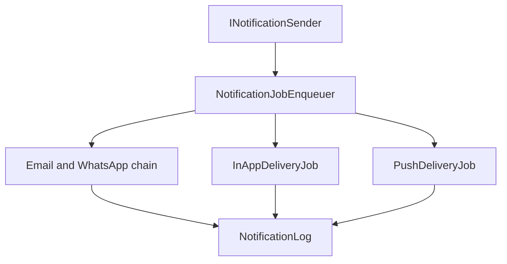

# Notification module

Notification delivers email, WhatsApp, inbox and push messages through independent jobs with shared preferences and delivery history.

## At a glance

`NotificationModuleManifest.Order` is `ModuleOrder.Notification` (900). Persistence uses `NotificationDbContext` in `src/Modules/Notification/Notification/Persistence/`, schema `notification`; it is a host context. Email replaced the former Shared.Email and Shared.Notification projects and remains a channel of this module.

| Project | Who references it | Contents |
|---|---|---|
| `Notification.Contracts` | every module that sends notifications | `INotificationSender` / `INotificationBuilder`, `INotificationRecipientResolver`, `INotificationLinkResolver`, `IOtpDeliveryService`, enums (`EmailTemplate`, `WhatsAppTemplate`, `NotificationChannel`, `NotificationCulture`, `NotificationSeverity`, `PushPlatform`, ...), email models (`Email/Models/*Model`), `EmailAttachment`, `InApp/InAppContent`, `Push/PushContent`, inbox and device commands/queries/DTOs, the hub client contract (`Realtime/INotificationClient`) |
| `Notification` | `Api` only (and test projects) | dispatch jobs (chain, in-app, push), channels (MailKit/NoOp email, WhatsApp Cloud API, FCM/NoOp push), `NotificationHub`, Liquid templates, subjects, options, `NotificationDbContext`, endpoints, `OtpDeliveryService` |
| `Notification.Tests` | - | unit tests + PostgreSQL Testcontainers tests |

Modules never reference the implementation project (enforced by `Api.Tests/Architecture/ModuleBoundaryTests`).
Notification itself reads recipient contact data only through `UserDirectory.Contracts` (`GetUserContactInfoQuery`),
so it works with any identity provider.

## System design

Notification is called by every module and never blocks the caller: `SendAsync` enqueues work on its own Hangfire server.

```likec4-view
notification
```

*Figure: Modules call INotificationSender; Hangfire jobs on the notification queue deliver email with a WhatsApp fallback, in-app events over the SignalR hub, and push through FCM or APNs.*

```likec4-view
notificationDelivery
```

*Figure: One send becomes independent Hangfire jobs per channel group sharing a correlation id: the email chain with its WhatsApp fallback, the in-app inbox with a real-time event, and push.*

| Runtime component | What this module uses it for |
|---|---|
| PostgreSQL | Schema `notification`: delivery log, in-app inbox, preferences, push devices |
| Redis | SignalR backplane (events reach sockets on every replica), session revocation fan-out |
| Hangfire (`notification`) | `NotificationDispatchJob`, `InAppDeliveryJob`, `PushDeliveryJob`, `NotificationDailyPurgeJob`, `NotificationDailyFailureSummaryJob` |
| Hub | `/hubs/notifications`, push-only; also carries data-transfer progress and other user events |
| Events in | `UserDeletedIntegrationEvent`, `UserSessionsRevokedIntegrationEvent` |
| Providers | SMTP (`MailKitEmailService`), WhatsApp (`WhatsAppApiClient`), FCM and APNs |

The views come from [notification.c4](../Architecture/model/notification.c4); the whole system is on [System Design](../Architecture/System-Design.md).


## How it works

### Delivery pipeline


*Figure: The chain and additive channels share correlation, but retry and record outcomes independently.*

The configured default chain is WhatsApp then email; user preferences may select email then WhatsApp. Only channels with payloads participate.

One notification becomes up to three Hangfire jobs sharing one correlation id: `NotificationDispatchJob` (the
email/WhatsApp chain below), `InAppDeliveryJob` and `PushDeliveryJob` (see
[Notification-Realtime-and-Push](Notification-Realtime-and-Push.md#delivery)).

`NotificationDispatchJob` (Hangfire queue `notification`, 4 retries at 30s/2m/10m/30m):

- **Permanent** failure (4xx, invalid recipient, bad template) - no retry, fall back to the next channel.
- **Transient** failure (5xx, 429, connection refused) - Hangfire retries; after `Notification:FallbackAfterAttempts`
  failures on a channel, fall back.
- **Ambiguous** failure (timeout) - retry the same channel only, never fall back (it may have been delivered).
- **Idempotent** - every attempt is a `notification.notification_log` row keyed by the correlation id; a re-run that
  finds a `Sent` row of the chain stops, so completed logged sends are skipped on retry; a crash after provider acceptance but before the log commit can still duplicate a send (in-app/push rows of the same correlation id are
  ignored: they are separate deliveries).
- The tenant of the enqueuing request is restored while the job runs (`TenantJobFilter`) and stamped on the log row.

Recurring jobs: `notification-daily-purge` (03:00: log rows older than `Notification:LogRetentionDays`, expired inbox
entries, push devices not seen for `Push:StaleDeviceDays`) and
`notification-daily-failure-summary` (07:00, warns in Seq with the number of notifications of the last 24 h that
were not delivered on any channel).

### Email templates

Adding a template = four pieces (startup validation fails if one is missing):

1. `EmailTemplate` value with `[TemplateFile("X")]` - `Notification.Contracts/Enums/EmailTemplate.cs`
2. Data model `XModel` with `ToDictionary()` - `Notification.Contracts/Email/Models/`
3. Subject class `XSubject : IEmailTemplate` (template, `ModelType`, localized subject) - `Notification/Channels/Email/Subjects/`
4. Liquid file `X.liquid` (embedded resource) - `Notification/Channels/Email/Templates/`, built from the design-system
   components; colors only as tokens (`{{ t.textMuted }}`). See [Email design system](Notification-Email-Design-System.md).

Globals available in every template: `culture` (`en`/`ar`), `dir`, `align`, `t` (tokens), `brandName`, `appBaseUrl`,
`supportEmail`, `currentYear`. Every mail is sent as `multipart/alternative` (plain text derived from the HTML).
`SecurityAlert` (sign-in method changes) and `OneTimeCode` (email OTP) are the reference templates. All `{{ output }}` is HTML-encoded; every `href` must use `| safe_url` (http/https and allow-listed
hosts only - `Email:AllowedLinkHosts`). In Development every template is smoke-rendered in both cultures at startup.

### One-time code delivery (OTP)

Identity owns the OTP system (`IOtpCodeService`: issue, verify, attempts, cooldown, send cap, HMAC hashing - see
[Identity OTP](../Identity/README.md#one-time-codes-otp)). Notification only delivers:
`IOtpDeliveryService.SendAsync(userId, VerificationPurpose, code, culture)` - synchronous (not through the dispatch
job, so the caller can release an undelivered code), never stores or logs the code, returns a result instead of
throwing. Channel per purpose: `PhoneVerification` → WhatsApp (`PhoneVerificationOtp`), `EmailVerification` → Email
(`EmailTemplate.OneTimeCode`), `TwoFactorLogin` → the user's preferred channel (WhatsApp
`TwoFactorOtp`). SMS codes (phone verification, password reset) go through Identity's `ISmsService`.

### Endpoints

Routes use `/api/v1` for `EndpointConfig.BaseApiPath`. The table records Carter authorization declarations, including inherited group restrictions; handlers also enforce ownership and resource access.

| Method | Route | Authorization / restrictions |
|---|---|---|
| POST | `/api/v1/notifications/{id:guid}/reenqueue` | `RequireAuthorization(PolicyConstants.AdminOnly)` |
| POST | `/api/v1/notifications/email/test` | `RequireAuthorization(PolicyConstants.AdminOnly)` |
| GET | `/api/v1/notifications/history` | `RequireAuthorization(PolicyConstants.AdminOnly)` |
| GET | `/api/v1/notifications/preferences` | `RequireAuthorization()` |
| PUT | `/api/v1/notifications/preferences` | `RequireAuthorization()` |
| GET | `/api/v1/notifications/preferences/{userId:guid}` | `RequireAuthorization(PolicyConstants.AdminOnly)` |
| PUT | `/api/v1/notifications/preferences/{userId:guid}` | `RequireAuthorization(PolicyConstants.AdminOnly)` |
| GET | `/api/v1/notifications/preferences/category-groups` | `RequireAuthorization()` |

History filters are `userId`, `channel` and `status`. Re-enqueue accepts failed chain rows only; additive delivery jobs own their retries.

Sources: `src/Modules/Notification/Notification/Features/Preferences/` and `Features/Deliveries/`. [Inbox, devices and hub routes](Notification-Realtime-and-Push.md#endpoints) complete the surface. Verification send/validate routes under `/api/v1/notifications/verification` belong to Identity and use its OTP service.

### Database

The persisted records are `NotificationLog`, `UserNotificationPreference`, `InboxNotification` and `PushDevice`; these are delivery/user records rather than a tenant business aggregate.

`NotificationDbContext`, schema `notification`, history table `__notification_migrations_history`:
`notification_log` (every delivery attempt of every channel), `user_notification_preference` (channel order,
`push_enabled`, `category_mutes` jsonb, quiet hours + `time_zone`), `inbox_notification` (unique `(user_id, correlation_id)`, partial index for the unread count) and
`push_device` (unique `token`). A host-database context (not `ITenantDataContext`): log and inbox rows carry a
nullable `tenant_id` and are deleted by the tenant purge (`TenantDataPurgeRequestedEvent`); the user erasure
(`UserDeletedIntegrationEvent`) deletes the user's log, preferences, inbox and devices.

```bash
dotnet ef migrations add <Name> --context NotificationDbContext \
  --project src/Modules/Notification/Notification --startup-project src/Api --output-dir Data/Migrations
```

### Public contracts

Use `ISender` for commands and queries in `src/Modules/Notification/Notification.Contracts/`. DTOs and enums remain in that assembly; implementations remain private.

| Area in `Notification.Contracts` | Commands, queries and ports |
|---|---|
| `Devices` | `GetMyPushDevicesQuery`, `RegisterPushDeviceCommand`, `UnregisterPushDeviceCommand` |
| `Inbox` | `DeleteInboxNotificationCommand`, `GetInboxNotificationsQuery`, `GetUnreadInboxCountQuery`, `MarkAllInboxNotificationsReadCommand`, `MarkInboxNotificationReadCommand` |
| `INotificationLinkResolver.cs` | `INotificationLinkResolver` |
| `INotificationRecipientResolver.cs` | `INotificationRecipientResolver` |
| `INotificationSender.cs` | `INotificationBuilder`, `INotificationSender` |
| `IOtpDeliveryService.cs` | `IOtpDeliveryService` |
| `Realtime` | `INotificationClient`, `IUserEventPublisher` |

Notification publishes no integration events. `UserDeletedNotificationConsumer` consumes `UserDeletedIntegrationEvent` to erase user data; `UserSessionsRevokedConsumer` consumes `UserSessionsRevokedIntegrationEvent` to close hub connections. `NotificationTenantPurgeHandler` handles the in-process `TenantDataPurgeRequestedEvent`.

## Configuration

Defaults from `src/Api/appsettings.json` and `src/Modules/Notification/Notification/Options/`.

| Key | Default | Meaning |
|---|---|---|
| `Notification:DefaultChannelOrder` | `[WhatsApp, Email]` | Default fallback order |
| `Notification:FallbackAfterAttempts` | 3 | Transient failures before fallback |
| `Notification:OtpEmailLifetimeMinutes` | 10 | Displayed lifetime only; Identity enforces expiry |
| `Notification:LogRetentionDays` | 90 | Delivery log retention |
| `Notification:LogPurgeBatchSize` | 1000 | Rows per purge statement |
| `Email:Provider` | `Auto` | Auto uses NoOp in Development without a real SMTP host; otherwise SMTP |
| `Email:SmtpHost` | `smtp.example.com` | SMTP destination; replace for delivery |
| `Email:SmtpPort` | 587 | SMTP port |
| `Email:UseTls` | true | TLS transport |
| `Email:SmtpUsername / Email:SmtpPassword` | Empty options values | Credentials supplied by secrets |
| `Email:FromAddress / Email:FromName` | `no-reply@example.com` / `StarterKit` | Sender identity |
| `Email:BrandName` | `StarterKit` | Rendered brand |
| `Email:AppBaseUrl / Email:SupportEmail` | `https://app.example.com` / `support@example.com` | Notification links and support contact |
| `Email:AllowedLinkHosts` | `[]` | Additional permitted link hosts |
| `WhatsApp:ApiVersion` | `v25.0` | Cloud API version |
| `WhatsApp:AccessToken / WhatsApp:PhoneNumberId` | Empty options values | Provider credentials |
| `WhatsApp:Templates` | `{}` in options; populated in appsettings | MetaTemplateName, LanguageCode and BodyParameters; registry validates coverage |

[Email theme](Notification-Email-Design-System.md#configuration) and [Inbox, Realtime and Push](Notification-Realtime-and-Push.md#configuration) own their settings. Secrets: `smtp_username`, `smtp_password`, `whatsapp_access_token`, `whatsapp_phone_number_id`, `fcm_service_account_json`; FCM can instead read `Push:CredentialsFile`. Identity owns `identity_otp_hmac_key`.

## Usage

### Sending a notification

From `src/Modules/Subscriptions/Subscriptions/Domains/Subscriptions/EventHandlers/SubscriptionActivatedEventHandler.cs`:

```csharp
await notificationSender
    .For(notification.SubscriberId)
    .WithEmail(EmailTemplate.SubscriptionActivated, model.ToDictionary())
    .WithBillingInApp("subscription-activated", NotificationSeverity.Success, BillingInApp.SubscriptionUrl, data: BillingInApp.SubscriptionData(notification.SubscriptionId, notification.SubscriberId, tenants), args: [planName, model.RenewalDate])
    .SendForSubscriberAsync(tenants, notification.SubscriberId, NotificationChannel.Email, cancellationToken);
```

The handler resolves the subscriber, builds the model and uses the subscriber-aware extension to establish the notification tenant scope.

- `For(userId)` - contact data is resolved at delivery time; the user's channel order (preferences) decides which
  channel is tried first; the other channels with a payload are the fallback.
- `ToEmail(address, culture, userId?)` - an explicit address (invitations, the CONFIRMED address of a password reset,
  admin digests). `userId` only links the log row.
- `SendAsync(NotificationChannel.Email)` - select a chain channel, bypassing channel order but still respecting category mutes. Security channels and billing email are fixed by category; forcing email alone does not make it unmutable.
- `InCategory("membership.invitation-accepted")` - names the category of an email-only send so the user's per-group email
  mute applies (it mutes the whole email/WhatsApp chain). Security email and billing email can never be muted; an email
  with no category is never muted.
- `INotificationRecipientResolver` (implemented by Tenancy) maps a non-user recipient (a tenant subscriber) to the
  user who receives it (the tenant owner).
- `INotificationLinkResolver.ToAbsolute(url)` - links put into notifications: relative URLs are resolved against
  `Email:AppBaseUrl`.

- `.WithInApp(InAppContent)` / `.WithPush(...)` - the additive channels (inbox + real-time, mobile/web push), delivered
  alongside the chain: [Notification-Realtime-and-Push](Notification-Realtime-and-Push.md#sending).

Ordinary module sends enqueue jobs. The admin test endpoint and `IOtpDeliveryService` send synchronously.

## Failure modes and guarantees

Permanent chain failures fall through; transient failures retry before fallback; ambiguous timeouts retry the same channel. The delivery log records `Queued`, `Sent`, `Failed` and `Skipped` (`NotificationDeliveryStatus`).

```mermaid
stateDiagram-v2
  accTitle: Failure modes and guarantees
  accDescr: These NotificationDeliveryStatus outcomes describe delivery work; retries append log records rather than mutate a single aggregate lifecycle.
  Queued --> Sent: provider accepts
  Queued --> Failed: delivery attempt fails
  Queued --> Skipped: policy suppresses delivery
```


*Figure: These NotificationDeliveryStatus outcomes describe delivery work; retries append log records rather than mutate a single aggregate lifecycle.*

The enum is in `src/Modules/Notification/Notification.Contracts/Enums/NotificationDeliveryStatus.cs`; dispatch jobs write the corresponding log outcomes. A sent record prevents later logged duplicates, not exactly-once provider delivery. Additive failures do not replay the chain.

Category groups, fixed channels, per-channel mutes and quiet hours are defined in [Mutes and quiet hours](Notification-Realtime-and-Push.md#mutes-and-quiet-hours). Security cannot be muted; billing email cannot be muted; no category means no mute. Quiet hours defer push and suppress live inbox hints while preserving the inbox row.

## Guardrails

`NotificationDispatchJobTests`, `NotificationDispatchPostgresTests`, `NotificationPreferenceEnforcementTests`, `AdditiveChannelDispatchTests`, `OtpDeliveryServiceTests`, `TemplateRenderingTests` and `EmailContentSafetyTests` cover dispatch, preferences, OTP delivery and rendering. `ModuleBoundaryTests` enforces contract-only access and `ThirdPartyIsolationTests` keeps provider SDKs inside Notification.

## Related

[Real-time and push](Notification-Realtime-and-Push.md), [Email design system](Notification-Email-Design-System.md); [Messaging](../Architecture/Messaging.md), [Multi-tenancy](../MultiTenancy/Overview.md), [Identity](../Identity/README.md), and `/starterkit:add-email-template`.
