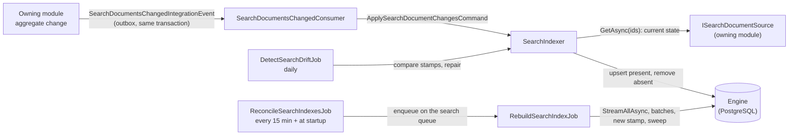

# Search module

Search gives every module full-text search (ranking, stemming, Arabic normalization, typo tolerance, facets and
highlights) through one engine-neutral contract. PostgreSQL is the default engine; Meilisearch is an option.

Search is the **index**. The module that owns the data plugs in an **index definition** and a **document source**,
so Search never references an owning business module. Design rationale:
[ADR-0036](../Decisions/0036-search-module-and-engine-port.md).

Data plane (`ITenantDataContext`, schema `search`): every row carries `tenant_id` and has forced RLS.

## Status

The contract, the PostgreSQL engine and the indexing pipeline are in place: an index of a tenant is built by the
reconcile job and kept in sync through the outbox. No module registers an index yet. The admin API, the analytics, the
Meilisearch adapter and Catalog's indexed product search follow.

## Layout

```text
Search.Contracts/
  Indexing/   SearchIndexDefinition (text + filter fields), SearchDocument (+ builder), ISearchDocumentSource,
              AddSearchIndex<TSource>(definition)
              IntegrationEvents/SearchDocumentsChangedIntegrationEvent (search.documents-changed.v1)
  Querying/   SearchDocumentsQuery, filters (keyword, keywords, number/date range, bool), SearchDocumentsResult
Search/
  SearchModule.cs   Add/UseSearchModule, options, registry, startup checks
  Options/          SearchOptions (section "Search") + SearchOptionsValidator
  Data/             SearchDbContext (search_index_states, search_documents), configurations, migration AddSearch (RLS)
  Engine/           ISearchEngine (the port), SearchIndexRegistry, RegisteredIndex (field lookups, fingerprint,
                    document checks), SearchDocumentPreparer, SearchEngineUnavailableException
  Engine/Text/      SearchTextNormalizer, SearchQueryParser, SearchHighlighter (the same for every engine)
  Engine/Postgres/  PostgresSearchEngine, PostgresIndexSql (upsert per index), tsquery and filter compilers
  Domains/Indexes/  SearchIndexState (build state per tenant and index: stamps, lease, drift), SearchIndexer,
                    ApplySearchDocumentChangesCommand, SearchDocumentsChangedConsumer,
                    RebuildSearchIndexJob, ReconcileSearchIndexesJob, DetectSearchDriftJob, SearchTenantPurgeHandler
  Observability/    SearchMetrics (meter StarterKit.Search)
  Domains/Querying/ SearchDocumentsQueryValidator + handler
Search.Tests/            contracts, registry, fingerprint, options, query validation, text pipeline, SQL builders, index state
Search.IntegrationTests/ Testcontainers Postgres, real module and migration, RLS app role; the engine conformance suite
```

## Making an entity searchable

1. **Define the index** in the owning module: a key `<module>.<entity>` (never renamed), text fields with a weight and
   an analyzer (`Simple`, `English`, `Arabic`, `Bilingual`), and typed filter fields (`Keyword`, `KeywordList`,
   `Number`, `Date`, `Boolean`; facetable, sortable).

   ```csharp
   public static readonly SearchIndexDefinition Definition = new()
   {
       Key = "orders.orders",
       Name = LocalizedText.Create("Orders", "الطلبات"),
       TextFields =
       [
           new SearchTextField("number", SearchWeight.Highest, SearchAnalyzer.Simple) { Suggest = true },
           new SearchTextField("customer", SearchWeight.High, SearchAnalyzer.Bilingual) { Highlight = true }
       ],
       FilterFields =
       [
           new SearchFilterField("status", SearchFieldType.Keyword) { Facetable = true },
           new SearchFilterField("total", SearchFieldType.Number) { Sortable = true }
       ]
   };
   ```

2. **Implement the source** (`ISearchDocumentSource`): the current documents for a set of ids, and a stream of all of
   them. Read every branch (`IgnoreBranchScope()`), never return soft-deleted entities, and build each document with
   `SearchDocument.For(entity.Id, entity.Version)...Build()`.
3. **Register both**: `services.AddSearchIndex<OrderSearchSource>(OrderSearchIndex.Definition);` in `Add<M>Module`.
   The host refuses to start when a definition is invalid or duplicated.
4. **Raise the change** from the aggregate whenever a searchable value changes, including delete and restore:
   `AddIntegrationEvent(SearchDocumentsChangedIntegrationEvent.For(OrderSearchIndex.Definition.Key, Id));`. It goes
   through the outbox; Search reads the current state from the source.
5. **Search** from the owning module's handler with `SearchDocumentsQuery` (through `ISender`), always with its
   visibility filters. Load the hits through the module's own DbContext and filter them again. When `Status` is not
   `Ok`, fall back to the module's SQL search.

## Text pipeline

Search prepares text the same way for every engine, so results do not change when the engine does.

- **Normalization** (`SearchTextNormalizer`), applied to documents and queries alike, following Lucene's Arabic rules:
  diacritics, Quranic marks and tatweel are removed; أ إ آ ٱ become ا, ى becomes ي, ة becomes ه; hamza on waw and ya
  folds (ؤ to و, ئ to ي); Arabic-Indic and Persian digits become 0-9; ligatures and full-width forms are decomposed;
  Latin loses case and accents (Café matches cafe); invisible characters are removed. A map back to the original text
  is kept for highlights. Changing a rule bumps `RegisteredIndex.FormatVersion`, which rebuilds every index.
- **Query syntax** (`SearchQueryParser`), like web search: words (all must match), `"quoted phrases"`, `-excluded`
  words or phrases, and `OR` between alternatives. `ab-123` is the phrase `ab 123`. Words beyond
  `Search:Query:MaxTerms` are dropped. A query of excluded words only is no query. In autocomplete mode the word
  being typed matches as a prefix.
- **Highlights** (`SearchHighlighter`): a snippet of the original text (about 160 characters around the first match,
  cut on word boundaries, HTML-encoded) with matches in `<mark>`. A word matches when its normalized form equals a
  query word, starts with it, is a stem of it, or does so after an Arabic article or prefix (ال، وال، بال، كال، فال،
  لل). Excluded words are never highlighted.

## Keeping an index in sync



- **Live changes.** The owning aggregate raises `SearchDocumentsChangedIntegrationEvent` in the same transaction as
  the change. The consumer, in the event's tenant, sends `ApplySearchDocumentChangesCommand`; `SearchIndexer` reads
  the current documents from the source, writes those that exist and removes the others. Repeats and reordering are
  harmless. A change is searchable seconds after it commits (metric `search.index.lag`).
- **Rebuild** (`RebuildSearchIndexJob`, Hangfire queue `search`, per tenant). It takes the lease on the index state,
  streams the whole source in `Indexing:BatchSize` batches under a new stamp (extending the lease every batch), sweeps
  the documents the stamp did not reach, and makes the stamp live. The previous build keeps answering throughout, and
  live changes during the rebuild carry the new stamp, so the sweep keeps them. An unavailable engine is retried by
  Hangfire; any other failure is recorded (`LastErrorCode`) and the previous build stays live.
- **Reconcile** (`ReconcileSearchIndexesJob`, `Reconcile:Cron`, and once at startup when indexes exist). It enqueues
  a rebuild in every tenant whose index was never built or was built from another definition (the fingerprint
  changes with any field, weight, analyzer or the normalizer). A failed rebuild is retried at most once an hour.
- **Drift** (`DetectSearchDriftJob`, `Drift:Cron`). It compares the ids and versions of the source with the index:
  missing, stale and orphaned documents are recorded on the index state and, with `Drift:AutoRepair`, re-indexed.
  Indexes above `Drift:MaxDocuments` are skipped.
- **Tenant purge.** `TenantDataPurgeRequestedEvent` removes the tenant's documents from the engine (the database rows
  are purged centrally by Tenancy).
- **Worker replicas.** The `search` queue has its own Hangfire server, `Hangfire:Servers:Search` (enabled with 2
  workers by default). An instance without it logs a warning at startup: some replica must run it.

## PostgreSQL engine

The default engine keeps documents in the application database, in `search.search_documents` (tenant data, forced
RLS), one row per tenant, index and document:

| Column | Content |
|---|---|
| `search_vector` (`tsvector`, GIN) | built by PostgreSQL from the normalized text: per field and analyzer `setweight(to_tsvector(config, text), weight)` (configurations `simple`, `english`, `arabic`; weights A to D); analyses and fields are separated by a position gap, so a phrase never matches across them |
| `suggest_text` (GIN `gin_trgm_ops`) | the normalized suggest fields, for the typo-tolerant fallback |
| `filters` (`jsonb`, GIN `jsonb_path_ops`) | the filter values (dates as epoch milliseconds) |
| `content` (`jsonb`) | the original text of the highlight fields |
| `source_version`, `rebuild_stamp`, `indexed_at` | the version guard (an older write never replaces a newer one) and the rebuild sweep |

- **Matching.** Every clause of the query must match; each word is matched through every configuration the index
  uses, and a word one configuration drops as a stop word ("the") is dropped entirely. Phrases use
  `phraseto_tsquery`, autocomplete a `:*` prefix, exclusions `!!`. When nothing matches and a word has at least
  `Query:Fuzzy:MinTermLength` letters, a trigram similarity search on the suggest text runs instead and the result
  says `Fuzzy`.
- **Ranking and order.** `ts_rank_cd` with the field weights, or a sortable filter field; ties by document id.
  Without text, the index's default sort.
- **Facets** are counted over the filtered matches, up to `Facets:ScanLimit` of them (`FacetsExhaustive` tells).
- **Safety.** Every statement names the tenant and the index as well as relying on RLS; words, values and field names
  are always parameters (only configuration names, weight letters and casts, from closed enums, are SQL text); every
  search runs with `Postgres:StatementTimeoutMs`. A timeout or a lost connection answers `EngineUnavailable`; any
  other error is a bug and is not hidden.

## Configuration

Section `Search` (validated at startup):

| Key | Default | Meaning |
|---|---|---|
| `Engine` | `Postgres` | `Postgres` or `Meilisearch` |
| `Query:MaxPageSize` / `MaxWindow` / `MaxTextLength` / `MaxTerms` | 100 / 1000 / 200 / 10 | query limits |
| `Query:Fuzzy:Enabled` / `MinTermLength` / `Threshold` | true / 3 / 0.4 | close-spelling fallback |
| `Facets:MaxValues` / `ScanLimit` | 20 / 10000 | facet counts |
| `Postgres:StatementTimeoutMs` | 2000 | timeout of every search query |
| `Meilisearch:Url` / `ApiKey` / `IndexPrefix` | | required with `Engine=Meilisearch` (the key from a secret) |
| `Indexing:BatchSize` / `LeaseMinutes` | 500 / 30 | rebuilds |
| `Reconcile:Cron`, `Drift:Cron` / `AutoRepair` / `MaxDocuments` | every 15 min, 03:00 / true / 200000 | index upkeep |
| `Analytics:Enabled` / `RetentionDays` / `MaxQueryLength` / `FlushSeconds` | true / 90 / 64 / 30 | zero-result analytics |

## Related

[ADR-0036](../Decisions/0036-search-module-and-engine-port.md), [Messaging](../Architecture/Messaging.md),
[Multi-tenancy overview](../MultiTenancy/Overview.md).
