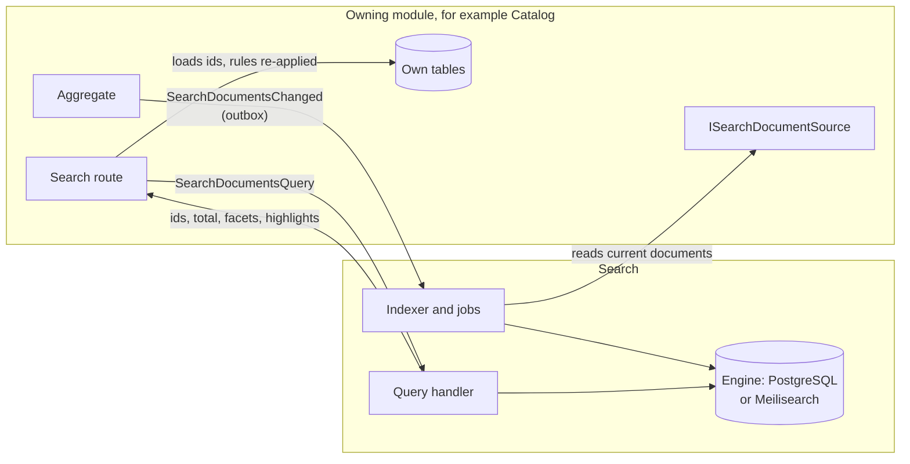

# Search module

Search gives any module **full-text search**: best matches first, English and Arabic word forms, letter forms and
diacritics, close spellings, facets and highlights, through one engine-neutral contract. PostgreSQL is the default
engine; Meilisearch is a configuration switch away.

This page is the overview and the map. Each part has its own page in [the guide](#the-guide); start with
[the big picture](#the-big-picture) and [the five rules](#the-five-rules) if you are new.

## In one minute

| Search **is** | Search **is not** |
|---|---|
| An index that owning modules feed with their records | The source of truth: the owning module always is |
| A ranked, faceted, typo-tolerant answer: ids in order | A visibility check: the owner loads every hit again with its own rules |
| Kept in sync through the outbox, seconds after a change | Read-your-writes: lists people check right after editing stay on SQL |
| A port (`ISearchEngine`) with a PostgreSQL and a Meilisearch adapter | Tied to one engine: both pass the same conformance suite |
| Always answering: not ready or down means the owner's SQL search answers | A new failure mode for your routes |

Its data lives in schema `search` (an `ITenantDataContext`): every row carries `tenant_id` under forced row-level
security, and every engine request names the tenant.

## The big picture


*Figure: The owner tells Search what changed and asks it for ids; Search ranks, the owner decides what the caller sees.*

## System design

```likec4-view
search
```

*Figure: Search keeps its indexes behind an engine port (PostgreSQL in the search schema, or Meilisearch), indexes owner changes from integration events, rebuilds and repairs on the search queue, and counts zero-result searches.*

```likec4-view
searchRebuild
```

*Figure: Reconcile finds an index of a tenant that was never built or was built from another definition; the rebuild streams the owner source under a new stamp while the previous build keeps answering, sweeps what the stamp did not reach, and makes it live.*

| Runtime component | What this module uses it for |
|---|---|
| PostgreSQL | Schema `search`: index states, the PostgreSQL engine's documents, analytics (tenant data, row-level security) |
| Hangfire (`search`) | `RebuildSearchIndexJob`, `ReconcileSearchIndexesJob`, `DetectSearchDriftJob`, `PurgeSearchAnalyticsJob` |
| Events in | `SearchDocumentsChangedIntegrationEvent` from any owning module; `TenantDataPurgeRequestedEvent` (in-process) |
| Meilisearch (optional) | `Search:Engine=Meilisearch`: one index per key shared by tenants, behind a scoped API key |

The views come from [search.c4](../Architecture/model/search.c4); the whole system is on
[System Design](../Architecture/System-Design.md).

## Core concepts

| Concept | In one line | Type / page |
|---|---|---|
| Index | What one module makes searchable: a key, weighted text fields, typed filter fields | `SearchIndexDefinition` ([Adding a search index](../Search/Adding-A-Search-Index.md#2-define-the-index)) |
| Document | One record as the index sees it: id, version, branch, text, filter values | `SearchDocument.For(id, version)...Build()` |
| Source | How Search reads the owner's current data, by id or all of it | `ISearchDocumentSource` ([step 3](../Search/Adding-A-Search-Index.md#3-write-the-document-source)) |
| Change event | "These ids changed": Search re-reads them from the source | `SearchDocumentsChangedIntegrationEvent` |
| Query | Text, filters, facets, sort and page against one index | `SearchDocumentsQuery` ([Searching from a client](../Search/Using-Search.md)) |
| Status | `Ok`, `IndexNotReady`, `EngineUnavailable`: anything but `Ok` means "answer from SQL" | `SearchStatus` |
| Match mode | `Exact`, `Fuzzy` (close spellings), `Browse` (no text) | `SearchMatchMode` |
| Rebuild | A full reload of one tenant's index without downtime | `RebuildSearchIndexJob` ([How search works](../Search/How-It-Works.md#keeping-an-index-in-sync)) |
| Drift | Documents the index has out of sync with the source; repaired daily | `DetectSearchDriftJob` |
| Engine | Where documents are stored and matched | `ISearchEngine` ([PostgreSQL](../Search/Postgres-Engine.md), [Meilisearch](../Search/Meilisearch.md)) |

## The five rules

1. **The owner is the source of truth.** Search stores a copy to rank; it re-reads the owner's source on every change
   and never decides what a caller may see. The owner loads every hit again with all its rules.
2. **Changes travel through the outbox.** The aggregate raises one `SearchDocumentsChangedIntegrationEvent` per save,
   in the same transaction. Nothing calls the indexer or an engine from feature code.
3. **Search never fails a request.** Not built or engine down is a status; the owner answers from SQL.
4. **Only engines touch the index.** No module reads or writes the `search` schema or a Meilisearch index, and engine
   specifics stay behind `ISearchEngine`, pinned by the conformance suite.
5. **Tenant first, everywhere.** Every engine statement names the tenant and the reader's branch scope; analytics keep
   no user id or IP address.

## Quick start

```csharp
// 1. In Add<M>Module: the definition and the source (Search.Contracts).
services.AddSearchIndex<OrderSearchDocumentSource>(OrderSearchIndex.Definition);

// 2. In the aggregate, on every searchable change (one per save).
AddIntegrationEvent(SearchDocumentsChangedIntegrationEvent.For(OrderSearchIndex.Key, Id));

// 3. In your search handler: ids from the index, rows from your DbContext, SQL when the status is not Ok.
var found = await sender.Send(new SearchDocumentsQuery { IndexKey = OrderSearchIndex.Key, Text = text, Page = 1, PageSize = 20 }, ct);
```

The full walkthrough, with the source, the handler and the tests: [Adding a search index](../Search/Adding-A-Search-Index.md).
<!--#if (sample)-->
Catalog's products are the running reference (`catalog.products`, see [Catalog](Catalog.md#search-index)).
<!--#endif-->

## The guide

| Page | Read it when you want to know |
|---|---|
| [How search works](../Search/How-It-Works.md) | How changes reach the index, how a search is answered, guarantees and failure modes |
| [Searching from a client](../Search/Using-Search.md) | What a front end sends and receives: query syntax, facets, highlights, suggestions, UI patterns |
| [Adding a search index](../Search/Adding-A-Search-Index.md) | Step by step: make your module's records searchable, with code and tests |
| [Text and languages](../Search/Text-And-Languages.md) | Query syntax, Arabic and Latin normalization, analyzers and word forms, highlights |
| [Managing indexes and analytics](../Search/Managing-Indexes-And-Analytics.md) | The tenant and platform routes, permissions, zero-result analytics |
| [PostgreSQL engine](../Search/Postgres-Engine.md) | The default engine: storage, matching, ranking, safety, capacity |
| [Meilisearch engine](../Search/Meilisearch.md) | When to choose it, setup with a least-privilege key, differences |
| [Configuration](../Search/Configuration.md) | Every setting, with defaults |
| [Operations](../Search/Operations.md) | First deployment, the search queue, signals, alerts and their answers |

## Layout

```text
Search.Contracts/
  Indexing/   SearchIndexDefinition (text + filter fields), SearchDocument (+ builder), ISearchDocumentSource,
              AddSearchIndex<TSource>(definition)
              IntegrationEvents/SearchDocumentsChangedIntegrationEvent (search.documents-changed.v1)
  Querying/   SearchDocumentsQuery, filters (keyword, keywords, number/date range, bool), SearchDocumentsResult
  Admin/      index status (SearchIndexStatus), rebuild and drift commands, analytics queries, platform engine view
Search/
  SearchModule.cs   Add/UseSearchModule, options, registry, startup checks
  Options/          SearchOptions (section "Search") + SearchOptionsValidator
  Data/             SearchDbContext (search_index_states, search_documents, search_daily_stats,
                    search_zero_result_terms), configurations, migrations AddSearch and AddSearchAnalytics (RLS)
  Engine/           ISearchEngine (the port), SearchIndexRegistry, RegisteredIndex (field lookups, fingerprint,
                    document checks), SearchDocumentPreparer, SearchEngineUnavailableException
  Engine/Text/      SearchTextNormalizer, SearchQueryParser, SearchHighlighter (the same for every engine)
  Engine/Postgres/  PostgresSearchEngine, PostgresSql (PostgresIndexSql: upsert per index; tsquery and filter compilers)
  Engine/Meilisearch/ MeilisearchSearchEngine, MeilisearchClient (HTTP, tasks, failures), MeilisearchIndexes, and the
                    pure parts: names, settings, documents, filter compiler, query text, requests/responses
  Domains/Indexes/  SearchIndexState (build state per tenant and index: stamps, lease, drift), SearchIndexer,
                    ApplySearchDocumentChangesCommand, SearchDocumentsChangedConsumer,
                    RebuildSearchIndexJob, ReconcileSearchIndexesJob, DetectSearchDriftJob, SearchTenantPurgeHandler,
                    Features/SearchIndexes (the tenant's index routes)
  Domains/Analytics/ SearchQueryScrubber, SearchAnalyticsRecorder, SearchAnalyticsBuffer, SearchAnalyticsStore,
                    SearchAnalyticsFlushService, PurgeSearchAnalyticsJob, Features/SearchAnalytics (routes)
  Domains/Platform/ Features/SearchPlatform (the operators' routes)
  Observability/    SearchMetrics (meter StarterKit.Search)
  Domains/Querying/ SearchDocumentsQueryValidator + handler
Search.Tests/            contracts, registry, fingerprint, options, query validation, text pipeline, SQL builders, index state,
                         analytics scrubber, buffer and recorder
Search.IntegrationTests/ Testcontainers Postgres, real module and migration, RLS app role; the engine conformance suite,
                         the indexing pipeline, the admin commands and queries, analytics flush and purge
```

`SearchModuleManifest.Order` is `ModuleOrder.Default` (700): owning modules register their definitions before it, and
the registry is built and validated when the host starts.

## Decisions

| ADR | Decision |
|---|---|
| [ADR-0036](../Decisions/0036-search-module-and-engine-port.md) | Full-text search in one Search module, behind an engine port, fed by the outbox |

## Related

[Messaging](../Architecture/Messaging.md), [Multi-tenancy overview](../MultiTenancy/Overview.md),
[Endpoint authorization](../Reference/Endpoint-Authorization.md), [Database conventions](../Architecture/DatabaseConventions.md).
