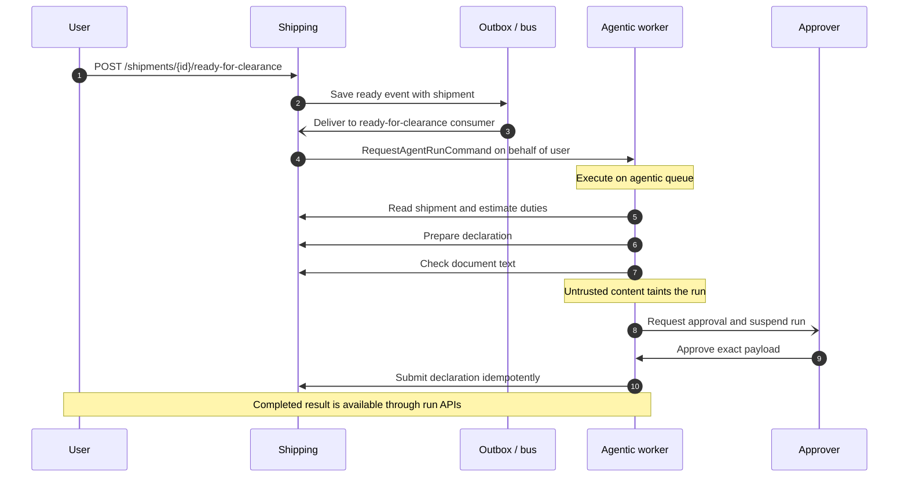

# Shipping module (sample)

Shipping is the proof of concept of the [Agentic](Agentic.md) module: a small customs domain and one agent that
prepares a shipment for clearance through typed, authorized tools.

It is optional: it ships with the template's `sample` switch (`dotnet new starterkit --sample false` leaves it out),
like [Catalog](Catalog.md). Data plane (`ITenantDataContext`, schema `shipping`): every row carries `tenant_id` and has
forced RLS. The amounts, tariff rates and customs gateway are **illustrative**: the gateway is
`MockCustomsGateway`, which accepts everything.

## At a glance

| Piece | What |
|---|---|
| `Shipment` | Reference (unique per tenant), route, HS code, declared value, weight, status, and its `ShipmentDocument`s |
| `DeclarationDraft` | One per shipment: customs value, duty, VAT, notes; once `Submitted` it is final and has the customs reference |
| `DutyCalculator` | The tariff rules: duty by HS chapter, VAT by destination. The ONLY source of declaration amounts |
| `ICustomsGateway` | The customs authority, idempotent per declaration. Sample adapter: `MockCustomsGateway` |
| `ShipmentPreparationAgent` | The agent `shipping.shipment-preparation`, its five tools and its scripted model |
| `ShipmentReadyForClearanceConsumer` | The event trigger: starts the agent for the user who handed the shipment over |

Business rules live in the aggregates and commands: the documents clearance needs (commercial invoice, packing list,
certificate of origin), the allowed transitions (`Draft → ReadyForClearance → DeclarationSubmitted`), and that a
declaration cannot be submitted while a document is missing. The agent's instructions repeat none of them as rules; it
learns them from tool results.

## System design

Shipping shows the whole agent seam: an event trigger, a run started on behalf of a real user, and tools that only call the module commands.

```likec4-view
shipping
```

*Figure: Shipping stores shipments in its schema, turns a ready shipment into an agent run request, and supplies agents whose tools call back into its own commands.*

```likec4-view
shippingAgentRun
```

*Figure: Marking a shipment ready publishes an event; the consumer requests an agent run, which executes on the agentic queue and calls Shipping tools through the tool policy.*

| Runtime component | What this module uses it for |
|---|---|
| PostgreSQL | Schema `shipping`: shipments, customs declarations |
| Events out and in | `ShipmentReadyForClearanceIntegrationEvent` → `ShipmentReadyForClearanceConsumer` |
| Agentic | `RequestAgentRunCommand` through `ISender`; agents `ShipmentPreparationAgent` and `ShippingAssistantAgent` with typed tools |
| MCP | `shipping.assistant` opts in to the MCP server |

The views come from [shipping.c4](../Architecture/model/shipping.c4); the whole system is on [System Design](../Architecture/System-Design.md).


## How the agent works



*Figure: a shipment handed to customs preparation starts the agent, which suspends before the external submission.*

The event is `ShipmentReadyForClearanceIntegrationEvent`; `ShipmentReadyForClearanceConsumer` starts an event
trigger with key `shipment:{id}:ready-for-clearance`. The executor returns `ShipmentPreparationResult` as the run
result, rather than holding the initiating HTTP request open. Tool keys and approval requirements are listed below;
submission uses the declaration as its gateway idempotency key.

| Tool | Risk | Permission | Notes |
|---|---|---|---|
| `shipping.get_shipment` | read | any member | Summary without document text |
| `shipping.estimate_duties` | read | any member | `DutyCalculator` |
| `shipping.prepare_declaration` | low-risk change | `shipping.shipments.manage` | Creates or recomputes the draft; idempotent |
| `shipping.check_documents` | read, untrusted content | any member | Document text and the missing kinds |
| `shipping.submit_declaration` | external / irreversible | `shipping.declarations.submit` | Always approved by a person; idempotent |

The agent runs at autonomy `Execute`, needs `shipping.shipments.manage` to start, allows the triggers `User`, `Api` and
`Event`, and hands in a typed `ShipmentPreparationResult` (findings, missing documents, estimate, declaration id,
submitted, customs reference). `ShipmentPreparationScript` is its deterministic model for the scripted provider: it
follows the steps, stops without submitting when a document is missing, and reports a rejected approval. Point the
model key at a real provider (`Agentic:Models`) and the same tools serve a real model.

### The shipping assistant

`ShippingAssistantAgent` (`shipping.assistant`) is the conversational sample: a free-text agent with
`Conversational = true` and read tools only. A person asks about a shipment by its reference and then asks follow-ups
that name none ("and how much VAT is due?"); every message is a turn of an
[agent conversation](../Agentic/Conversations.md) and is given the earlier turns. It changes nothing itself: "prepare it
for clearance" is [delegated](../Agentic/Delegation.md) to `shipping.shipment-preparation` (its only `Delegates` entry),
which runs for the same person, needs `shipments.manage`, and proposes the submission to a person. Its autonomy is
`Execute` only so that delegate can propose that submission; its own tools stay read-only. With `McpServer = true`, its
read tools are also offered to MCP clients at `/api/v1/mcp/shipping.assistant` when `Agentic:Mcp:Enabled` is on.

| Tool | Risk | Permission | Notes |
|---|---|---|---|
| `shipping.find_shipments` | read | any member | Shipments whose reference contains the text, newest first, at most 10 (`GetShipmentsQuery`) |
| `shipping.get_shipment`, `shipping.estimate_duties`, `shipping.check_documents` | read | any member | As above; reading documents taints the conversation |

`ShippingAssistantScript` is its deterministic model: it finds the reference in the message or, for a follow-up, in
the earlier turns, then delegates when asked to prepare, answers about duties when asked, otherwise about the route
and status.

## Endpoints

| Route | Authorization |
|---|---|
| `POST /api/v1/shipping/shipments` | `shipping.shipments.manage` |
| `GET /api/v1/shipping/shipments`, `/{id}` | tenant member |
| `POST /api/v1/shipping/shipments/{id}/ready-for-clearance` | `shipping.shipments.manage`, no impersonation; starts the agent when agents are enabled |
| `GET /api/v1/shipping/shipments/{id}/duties`, `/{id}/declaration` | tenant member |
| `POST /api/v1/shipping/shipments/{id}/declaration` | `shipping.shipments.manage` (prepare the draft) |
| `POST /api/v1/shipping/declarations/{id}/submit` | `shipping.declarations.submit`, no impersonation |

## Run the demo

1. Set `Agentic:Enabled=true` (the default model is the scripted provider; no API key needed outside Production).
2. Create a shipment with its three documents, then `POST .../ready-for-clearance`.
3. Watch the run (`GET /api/v1/agent-runs`, or the `agentic.run-progress` hub event): it waits in `AwaitingApproval`.
4. `GET /api/v1/agent-approvals`, then approve with the `payloadHash` shown. The run submits and completes; the
   declaration is `Submitted` with a `MOCK-...` reference.

`Api.E2ETests/Shipping/ShipmentPreparationAgentE2ETests` runs exactly this over HTTP, plus the missing-document and
rejection paths.

The assistant: `POST /api/v1/agent-conversations` with `agentKey` `shipping.assistant` and a message that names a
shipment reference, wait for the turn (`GET /api/v1/agent-runs/{runId}`), then
`POST /api/v1/agent-conversations/{id}/messages` with a follow-up and read the answers at
`GET /api/v1/agent-conversations/{id}`. `Api.E2ETests/Shipping/ShippingAssistantConversationE2ETests` runs it.

## Failure modes and guarantees

| Situation | Outcome |
|---|---|
| The event is delivered twice | One run (trigger key) |
| Agents are off, or the user may not start the agent | The consumer logs it and acknowledges the event |
| A required document is missing | The agent reports it and submits nothing; the command would refuse with `documents_missing` anyway |
| A person rejects the submission | Nothing is submitted; the run completes and says so |
| A worker dies during the submission | The retried call returns the submitted declaration or resubmits with the same gateway key |
| Another tenant's shipment id | 404 from every query and command |

## Tests

`Shipping.Tests` (aggregates, tariff rules, validators, mock gateway, the scripted scenario), `Shipping.IntegrationTests`
(commands on PostgreSQL with RLS: cross-tenant ids, stale versions, the trigger consumer), `Api.E2ETests/Shipping` (the
demo with agents enabled, and the authorization of every route).

A submission with a stale `Version` is refused **before** the customs gateway is called: `ExpectVersion` alone is
checked at `SaveChanges`, which comes after the external call.

## Related

[Agentic](Agentic.md), [ADR-0025](../Decisions/0025-agentic-module-and-model-seam.md),
[ADR-0027](../Decisions/0027-agent-approvals-triggers-and-policies.md), [Catalog](Catalog.md).
