# Subscriptions module

Subscriptions owns plans, subscriber lifecycles and billing records, connecting paid access to invoices, an append-only ledger and metered entitlements.

## At a glance

| Responsibility | Main types / location |
|---|---|
| Plans and lifecycle | `Plan`, `Subscription`; `src/Modules/Subscriptions/Subscriptions/Domains/Plans/` and `Domains/Subscriptions/` |
| Money and invoices | `SubscriptionPayment`, `SubscriptionInvoice`, `SubscriptionRefundRequest`, `LedgerEntry`, `SubscriptionPaymentReceipt` |
| Payment configuration and checkout | `PaymentMethod`, `PaymentInstructions`, `OnlinePaymentSession`, `InboundWebhookEvent`, `SavedPaymentMethod` |
| Growth and access | `Coupon`, `DunningNotice`, `UsageRecord`, `PlanEntitlementService`, `UsageService` |
| Persistence | `SubscriptionsDbContext`, host schema `subscriptions`; ledger and receipts are append-only; PostgreSQL 23505 maps to `ConflictException` |
| Discovery | `SubscriptionsModuleManifest.Order = ModuleOrder.Subscriptions` (400) |

A subscriber is a user in single-tenant mode and a tenant in multi-tenant mode. The module covers manual and proof-based payments, online gateways, renewals, refunds, price changes and invoices. [Billing](../Subscriptions/Billing.md) owns financial rules; [Payment methods](../Subscriptions/PaymentMethods-Frontend-Integration.md) and [Online payments](../Subscriptions/Online-Payments.md) own frontend flows and gateway operation.

## How it works

```mermaid
stateDiagram-v2
  accTitle: How it works
  accDescr: This SubscriptionStatus subset shows approval and overdue renewal; Billing documents trials, cancellation and reactivation.
  PendingApproval --> Active: approve
  PendingApproval --> Rejected: reject
  Active --> PastDue: renewal overdue
  PastDue --> Active: settle renewal
  PastDue --> Expired: grace period ends
```


*Figure: This SubscriptionStatus subset shows approval and overdue renewal; Billing documents trials, cancellation and reactivation.*

`SubscriptionStatus` in `Subscriptions.Contracts/Subscriptions/Enums/SubscriptionStatus.cs` also defines `Trialing` and `Cancelled`. Use the [full lifecycle](../Subscriptions/Billing.md#lifecycle) for transition conditions and billing periods.

### Entitlements and quotas

`PlanEntitlementService` replaces Shared.Core's permissive `IEntitlementService`. It reads snapshotted features and limits through `EntitlementCache`; `EntitlementCacheInvalidationHandler` invalidates on activation, cancellation, expiry, past due, rejection, renewal, upgrades, reverted upgrades and applied downgrades. Feature gates and quota checks use `ISubscriberIdProvider.GetPayingSubscriberId()`, so members use the tenant's plan without billing-management permission. Subscription management uses `GetCurrentSubscriberId()` and requires `tenant.billing.manage` in tenant mode.

`UsageService` implements `IUsageMeter` and `IQuotaService`. Redis increments are atomic, over-limit reservations roll back, and `FlushUsageCountersJob` persists counters to `UsageRecord`. Store failures fail open. With `Subscriptions:Entitlements:Enforce=false`, feature gates allow access and usage is counted without denial. DataTransfer already gates `bulk_import` and `bulk_export`; metering details are in [Billing](../Subscriptions/Billing.md#metering-and-quotas).

### Dunning, jobs and events

`ProcessDunningJob` records each overdue reminder step and sends a fresh checkout link. Optional saved-card retries run before reminders; settlement and provider idempotency are described in [Dunning](../Subscriptions/Billing.md#dunning) and [saved cards](../Subscriptions/Billing.md#saved-cards-and-automatic-retries).

`SubscriptionsModule.cs` registers recurring `ProcessExpiredSubscriptionsJob`, `ProcessPastDueSubscriptionsJob`, `ProcessRenewalRemindersJob`, `ProcessPlanPriceChangesJob`, `ProcessPriceChangeNotificationsJob`, `ProcessScheduledDowngradeRemindersJob`, `ProcessUpgradeSlaExpiryJob`, `ProcessInvoiceRetryJob`, `AdminBillingDigestJob`, `RetryFailedPaymentWebhooksJob`, `ProcessTrialRemindersJob`, `ProcessDunningJob` and `FlushUsageCountersJob`. `InvoiceDeliveryJob` is enqueued delivery work rather than a recurring schedule. Jobs use units of work and handle concurrency conflicts; schedule expressions are in the registration and option classes.

The aggregate publishes `SubscriptionActivatedIntegrationEvent` and `SubscriptionExpiredIntegrationEvent` through the outbox. Tenancy re-reads billing to change availability; Webhooks forwards both public events. Subscriptions has no MassTransit consumer class. Incoming provider callbacks are HTTP webhook inbox records, not bus integration-event consumers. Domain handlers send activation, renewal, past-due, reminder, invoice, refund and price-change notifications through `INotificationSender`.

### Public contracts

Use `ISender` for commands and queries in `src/Modules/Subscriptions/Subscriptions.Contracts/`. DTOs and enums remain in that assembly; implementations remain private.

| Area in `Subscriptions.Contracts` | Commands, queries and ports |
|---|---|
| `Ledger` | `GetBillingDashboardQuery`, `GetLedgerEntriesQuery` |
| `Subscribers` | `ISubscriberIdProvider`, `ISubscriberInfoProvider` |
| `Subscriptions/Commands` | `AddPaymentMethodCommand`, `AddPlanFeatureCommand`, `AdminReviewRefundCommand`, `ApproveProrationPaymentCommand`, `ApproveRenewalCommand`, `ApproveSubscriptionCommand`, `CancelScheduledDowngradeCommand`, `CancelScheduledPriceChangeCommand` |
| `Subscriptions/Commands` | `CancelSubscriptionCommand`, `CompSubscriptionCommand`, `CreateCouponCommand`, `CreateFeatureDefinitionCommand`, `CreateOnlineCheckoutCommand`, `CreatePlanCommand`, `CreateSubscriptionCommand`, `CreateSubscriptionForApprovedApplicationCommand` |
| `Subscriptions/Commands` | `DeleteCouponCommand`, `DeletePaymentMethodCommand`, `DeletePlanCommand`, `DeletePlanFeatureCommand`, `ExtendSubscriptionCommand`, `ForceApplyPriceChangeCommand`, `IssueCreditNoteCommand`, `MarkRefundProcessedCommand` |
| `Subscriptions/Commands` | `ReactivateSubscriptionCommand`, `RecordManualPaymentCommand`, `RedeemCouponCommand`, `RejectProrationPaymentCommand`, `RejectRenewalPaymentCommand`, `RejectSubscriptionCommand`, `RequestRefundCommand`, `ResendInvoiceCommand` |
| `Subscriptions/Commands` | `RetryInvoiceCommand`, `ScheduleDowngradeCommand`, `SchedulePriceChangeCommand`, `StartTrialCommand`, `UpdateCouponCommand`, `UpdateFeatureDefinitionCommand`, `UpdatePaymentMethodCommand`, `UpdatePlanCommand` |
| `Subscriptions/Commands` | `UpgradeSubscriptionCommand`, `UploadPaymentProofCommand`, `UploadProrationProofCommand`, `UploadRenewalProofCommand`, `UpsertPaymentInstructionsCommand` |
| `Subscriptions/Queries` | `GetActivePlanLimitsQuery`, `GetAdminAuditLogQuery`, `GetAdminInvoicesQuery`, `GetAdminPaymentMethodsQuery`, `GetAdminPlansQuery`, `GetAdminRefundRequestsQuery`, `GetAdminSubscriptionByIdQuery`, `GetAdminSubscriptionsQuery` |
| `Subscriptions/Queries` | `GetAllFeaturesQuery`, `GetCouponByIdQuery`, `GetCouponsQuery`, `GetFailedWebhookEventsQuery`, `GetFeatureCatalogQuery`, `GetFeatureFlagQuery`, `GetInvoicePdfQuery`, `GetMyRefundRequestQuery` |
| `Subscriptions/Queries` | `GetMySubscriptionInvoicesQuery`, `GetMySubscriptionQuery`, `GetMyUsageQuery`, `GetPastDueSubscriptionsQuery`, `GetPaymentByIdQuery`, `GetPaymentHistoryQuery`, `GetPaymentInstructionsQuery`, `GetPaymentMethodsQuery` |
| `Subscriptions/Queries` | `GetPendingPaymentsQuery`, `GetPendingSubscriptionsQuery`, `GetPlanByIdQuery`, `GetPlanFeaturesQuery`, `GetPlansQuery`, `GetRenewalStatusQuery`, `GetSubscriberSubscriptionStatusQuery`, `GetSubscriptionInvoicesQuery` |
| `Subscriptions/Queries` | `GetSubscriptionStatusQuery` |
| `Subscriptions/IntegrationEvents` | `SubscriptionActivatedIntegrationEvent`, `SubscriptionExpiredIntegrationEvent` |

### Endpoints

Source: Carter classes under `src/Modules/Subscriptions/Subscriptions/Domains/*/Features/`. Subscriber routes require ownership/billing access in handlers. Anonymous provider callbacks verify provider signatures; anonymous access does not bypass payment verification. Platform policies cover `billing.read/approve/refund/export`, `plans.manage` and `payment-settings.manage`; consult [billing permissions](../Subscriptions/Billing.md#permissions) for role grants.

Routes use `/api/v1` for `EndpointConfig.BaseApiPath`. The table records Carter authorization declarations, including inherited group restrictions; handlers also enforce ownership and resource access.

| Method | Route | Authorization / restrictions |
|---|---|---|
| GET | `/api/v1/admin/billing/dashboard` | `RequirePermission(Permissions.BillingRead)` |
| GET | `/api/v1/admin/billing/ledger` | `RequirePermission(Permissions.BillingRead)` |
| GET | `/api/v1/admin/coupons` | `RequirePermission(Permissions.BillingCouponsManage)` |
| POST | `/api/v1/admin/coupons` | `RequirePermission(Permissions.BillingCouponsManage)` |
| DELETE | `/api/v1/admin/coupons/{id:guid}` | `RequirePermission(Permissions.BillingCouponsManage)`; `DisallowImpersonation()` |
| GET | `/api/v1/admin/coupons/{id:guid}` | `RequirePermission(Permissions.BillingCouponsManage)` |
| PUT | `/api/v1/admin/coupons/{id:guid}` | `RequirePermission(Permissions.BillingCouponsManage)` |
| GET | `/api/v1/admin/feature-definitions` | `RequirePermission(Permissions.PlansManage)` |
| POST | `/api/v1/admin/feature-definitions` | `RequirePermission(Permissions.PlansManage)` |
| PUT | `/api/v1/admin/feature-definitions/{key}` | `RequirePermission(Permissions.PlansManage)` |
| GET | `/api/v1/admin/invoices` | `RequirePermission(Permissions.BillingRead)` |
| POST | `/api/v1/admin/invoices/{id:guid}/credit-note` | `RequirePermission(Permissions.BillingRefund)` |
| POST | `/api/v1/admin/invoices/{id:guid}/resend` | `RequirePermission(Permissions.BillingApprove)` |
| POST | `/api/v1/admin/invoices/{id:guid}/retry` | `RequirePermission(Permissions.BillingApprove)` |
| PUT | `/api/v1/admin/payment-instructions` | `RequirePermission(Permissions.PaymentSettingsManage)` |
| GET | `/api/v1/admin/payment-methods` | `RequirePermission(Permissions.PaymentSettingsManage)` |
| POST | `/api/v1/admin/payment-methods` | `RequirePermission(Permissions.PaymentSettingsManage)` |
| DELETE | `/api/v1/admin/payment-methods/{id:guid}` | `RequirePermission(Permissions.PaymentSettingsManage)` |
| PUT | `/api/v1/admin/payment-methods/{id:guid}` | `RequirePermission(Permissions.PaymentSettingsManage)` |
| GET | `/api/v1/admin/payments/{paymentId:guid}` | `RequirePermission(Permissions.BillingRead)` |
| GET | `/api/v1/admin/payments/{paymentId:guid}/proof` | `RequirePermission(Permissions.BillingRead)` |
| GET | `/api/v1/admin/payments/pending` | `RequirePermission(Permissions.BillingRead)` |
| GET | `/api/v1/admin/plans` | `RequirePermission(Permissions.PlansManage)` |
| POST | `/api/v1/admin/plans` | `RequirePermission(Permissions.PlansManage)` |
| DELETE | `/api/v1/admin/plans/{id:guid}` | `RequirePermission(Permissions.PlansManage)` |
| GET | `/api/v1/admin/plans/{id:guid}` | `RequirePermission(Permissions.PlansManage)` |
| PUT | `/api/v1/admin/plans/{id:guid}` | `RequirePermission(Permissions.PlansManage)` |
| GET | `/api/v1/admin/plans/{id:guid}/features` | `RequirePermission(Permissions.PlansManage)` |
| POST | `/api/v1/admin/plans/{id:guid}/features` | `RequirePermission(Permissions.PlansManage)` |
| POST | `/api/v1/admin/plans/{id:guid}/force-price-change` | `RequirePermission(Permissions.PlansManage)` |
| DELETE | `/api/v1/admin/plans/{id:guid}/schedule-price-change` | `RequirePermission(Permissions.PlansManage)` |
| POST | `/api/v1/admin/plans/{id:guid}/schedule-price-change` | `RequirePermission(Permissions.PlansManage)` |
| DELETE | `/api/v1/admin/plans/{planId:guid}/features/{key}` | `RequirePermission(Permissions.PlansManage)` |
| GET | `/api/v1/admin/refunds` | `RequirePermission(Permissions.BillingRead)` |
| POST | `/api/v1/admin/refunds/{refundId:guid}/mark-processed` | `RequirePermission(Permissions.BillingRefund)` |
| POST | `/api/v1/admin/refunds/{refundId:guid}/review` | `RequirePermission(Permissions.BillingRefund)` |
| GET | `/api/v1/admin/subscriptions` | `RequirePermission(Permissions.BillingRead)` |
| GET | `/api/v1/admin/subscriptions/{id:guid}` | `RequirePermission(Permissions.BillingRead)` |
| POST | `/api/v1/admin/subscriptions/{id:guid}/approve` | `RequirePermission(Permissions.BillingApprove)` |
| POST | `/api/v1/admin/subscriptions/{id:guid}/cancel` | `RequirePermission(Permissions.BillingApprove)` |
| POST | `/api/v1/admin/subscriptions/{id:guid}/comp` | `RequirePermission(Permissions.BillingApprove)` |
| POST | `/api/v1/admin/subscriptions/{id:guid}/extend` | `RequirePermission(Permissions.BillingApprove)` |
| POST | `/api/v1/admin/subscriptions/{id:guid}/payments/manual` | `RequirePermission(Permissions.BillingApprove)` |
| POST | `/api/v1/admin/subscriptions/{id:guid}/proration/approve` | `RequirePermission(Permissions.BillingApprove)` |
| POST | `/api/v1/admin/subscriptions/{id:guid}/proration/reject` | `RequirePermission(Permissions.BillingApprove)` |
| POST | `/api/v1/admin/subscriptions/{id:guid}/reactivate` | `RequirePermission(Permissions.BillingApprove)` |
| POST | `/api/v1/admin/subscriptions/{id:guid}/reject` | `RequirePermission(Permissions.BillingApprove)` |
| POST | `/api/v1/admin/subscriptions/{id:guid}/renewal/approve` | `RequirePermission(Permissions.BillingApprove)` |
| POST | `/api/v1/admin/subscriptions/{id:guid}/renewal/reject` | `RequirePermission(Permissions.BillingApprove)` |
| GET | `/api/v1/admin/subscriptions/{subscriberId:guid}/features` | `RequirePermission(Permissions.PlansManage)` |
| GET | `/api/v1/admin/subscriptions/past-due` | `RequirePermission(Permissions.BillingRead)` |
| GET | `/api/v1/admin/subscriptions/pending` | `RequirePermission(Permissions.BillingRead)` |
| GET | `/api/v1/admin/subscriptions/webhook-events/failed` | `RequirePermission(Permissions.BillingRead)` |
| GET | `/api/v1/invoices/{id:guid}/pdf` | `RequireAuthorization()` |
| GET | `/api/v1/payment-instructions` | `AllowAnonymous()` |
| GET | `/api/v1/payment-methods` | `AllowAnonymous()` |
| GET | `/api/v1/plans` | `AllowAnonymous()` |
| POST | `/api/v1/subscriptions` | `RequireAuthorization()` |
| POST | `/api/v1/subscriptions/{id:guid}/cancel` | `RequireAuthorization()` |
| GET | `/api/v1/subscriptions/{id:guid}/invoices` | `RequireAuthorization()` |
| GET | `/api/v1/subscriptions/{id:guid}/refund` | `RequireAuthorization()` |
| POST | `/api/v1/subscriptions/{id:guid}/refund` | `RequireAuthorization()` |
| POST | `/api/v1/subscriptions/{id:guid}/schedule-downgrade` | `RequireAuthorization()` |
| DELETE | `/api/v1/subscriptions/{id:guid}/scheduled-downgrade` | `RequireAuthorization()` |
| POST | `/api/v1/subscriptions/{id:guid}/upgrade` | `RequireAuthorization()` |
| POST | `/api/v1/subscriptions/{subscriptionId:guid}/online-payment` | `RequireAuthorization()` |
| POST | `/api/v1/subscriptions/{subscriptionId:guid}/proof` | `RequireAuthorization()` |
| POST | `/api/v1/subscriptions/{subscriptionId:guid}/proration/proof` | `RequireAuthorization()` |
| POST | `/api/v1/subscriptions/{subscriptionId:guid}/renewal/proof` | `RequireAuthorization()` |
| GET | `/api/v1/subscriptions/me` | `RequireAuthorization()` |
| POST | `/api/v1/subscriptions/me/coupons/redeem` | `RequireAuthorization()` |
| GET | `/api/v1/subscriptions/me/invoices` | `RequireAuthorization()` |
| GET | `/api/v1/subscriptions/me/payments` | `RequireAuthorization()` |
| GET | `/api/v1/subscriptions/me/renewal` | `RequireAuthorization()` |
| GET | `/api/v1/subscriptions/me/usage` | `RequireAuthorization()` |
| GET | `/api/v1/subscriptions/payments/{paymentId:guid}/proof` | `RequireAuthorization()` |
| GET | `/api/v1/subscriptions/saved-payment-methods` | `RequireAuthorization()`; `DisallowApiKey()` |
| DELETE | `/api/v1/subscriptions/saved-payment-methods/{methodId:guid}` | `RequireAuthorization()`; `DisallowImpersonation()`; `DisallowApiKey()` |
| POST | `/api/v1/subscriptions/saved-payment-methods/{methodId:guid}/default` | `RequireAuthorization()`; `DisallowImpersonation()`; `DisallowApiKey()` |
| POST | `/api/v1/subscriptions/trial` | `RequireAuthorization()` |
| GET | `/api/v1/superadmin/subscriptions/audit` | `RequirePermission(Permissions.AuditRead)` |
| POST | `/api/v1/webhooks/payments/{provider}` | `AllowAnonymous()` |

## Configuration

Core defaults below come from `src/Modules/Subscriptions/Subscriptions/Options/SubscriptionOptions.cs` and `src/Api/appsettings.json`. [Billing configuration](../Subscriptions/Billing.md#configuration-new-keys), [growth configuration](../Subscriptions/Billing.md#config-keys) and [Online payments](../Subscriptions/Online-Payments.md) contain the specialized tax, invoice, gateway and retry settings.

| Key | Default | Meaning |
|---|---|---|
| `Subscriptions:GracePeriodDays` | 7 | Paid renewal grace period |
| `Subscriptions:CacheMinutes / Subscriptions:NoSubscriptionCacheMinutes` | 5 / 1 | Subscription read cache |
| `Subscriptions:UpgradeSlaHours` | 72 | Upgrade payment deadline |
| `Subscriptions:PriceChangeNoticeDays` | 53 | Price-change notice window |
| `Subscriptions:RefundFullWindowDays / Subscriptions:RefundProratedWindowDays` | 14 / 45 | Refund windows |
| `Subscriptions:Entitlements:Enforce` | false | Enable access/limit denials |
| `Subscriptions:Entitlements:CacheSeconds` | 60 | Entitlement cache TTL; events invalidate sooner |
| `Subscriptions:Trials:ReminderDaysBeforeEnd / Subscriptions:Trials:PostTrialGraceDays` | 3 / 3 | Trial reminder and unpaid grace |
| `Subscriptions:Dunning:Enabled` | true | Overdue reminders |
| `Subscriptions:Dunning:ScheduleDays` | `[1,3,5]` effective default | Days since past due |
| `Subscriptions:Dunning:FinalNoticeDaysBeforeGraceEnd` | 1 | Final reminder |
| `Subscriptions:Dunning:Cron` | `20 * * * *` | Hourly dunning schedule |
| `Subscriptions:Dunning:AutoRetry:Enabled` | false | Off-session saved-card charge before reminder |
| `Subscriptions:Metering:FlushCron` | `5 * * * *` | Hourly counter persistence |
| `Subscriptions:Metering:MonthlyCounterTtlDays` | 62 | Monthly counter retention |

## Usage

A cross-module query from `src/Modules/Subscriptions/Subscriptions.Contracts/Subscriptions/Queries/GetActivePlanLimitsQuery.cs`:

```csharp
public record GetActivePlanLimitsQuery(Guid SubscriberId) : IQuery<ActivePlanLimitsDto>;
```

Send through `ISender`; callers must not read `SubscriptionsDbContext` directly. Tenancy uses the plan limit when provisioning a member. Use [Billing](../Subscriptions/Billing.md) for command payloads and settlement examples.

## Failure modes and guarantees

Money-moving POSTs opt into `WithIdempotency()`: create subscription, proof uploads, manual payment, refund request, upgrade and credit note. The optional `Idempotency-Key` is scoped by tenant, user, method and route. In-flight duplicates return 409 `idempotency_in_progress`; a changed body returns 422 `idempotency_key_reused`; completed responses replay with `Idempotency-Replayed`. Defaults are 24-hour response TTL, 5-minute reservation and 256 KB maximum stored body. A 5xx/exception releases the key; Redis failure fails open, so it is not a financial uniqueness guarantee. See [Errors and responses](../Architecture/Errors-and-Responses.md).

Enforced feature denial is 403 `feature_not_in_plan`; quota denial is 429 `quota_exceeded`. The database protects open-subscription uniqueness and immutable financial history; ledger rules and inbound-webhook deduplication remain authoritative when caches fail. See [Ledger](../Subscriptions/Billing.md#ledger-immutable-money-ledger) and [Online payments](../Subscriptions/Online-Payments.md).

## Guardrails

`SubscriptionStateMachineTests`, `SubscriptionLifecycleTests`, `SubscriptionIntegrationEventTests`, `EntitlementCacheTests` and `DunningStepsTests` cover lifecycle, messages, cached access and dunning in `Subscriptions.Tests`; `Subscriptions.IntegrationTests` exercises PostgreSQL ledger constraints, uniqueness races and lifecycle flows. `ModuleBoundaryTests`, `MessagingArchitectureTests`, `BackgroundJobEventDispatchTests` and `AdminEndpointAuthorizationTests` enforce contracts, outbox registration, event dispatch and explicit authorization.

## Related

[Billing](../Subscriptions/Billing.md), [Payment methods](../Subscriptions/PaymentMethods-Frontend-Integration.md), [Online payments](../Subscriptions/Online-Payments.md); [Messaging](../Architecture/Messaging.md), [Multi-tenancy](../MultiTenancy/Overview.md), [Identity](../Identity/README.md), and `/starterkit:add-feature`.
