# Tenancy module

Tenancy owns the multi-tenancy control plane, keeping tenant identity, membership, access and lifecycle records in the host database.

## At a glance

| Responsibility | Main types / location |
|---|---|
| Tenant lifecycle and domains | `Tenant`, `src/Modules/Tenancy/Tenancy/Domains/Tenants/` |
| Branches, memberships, roles and invitations | `Branch`, `TenantMembership`, `TenantRole`, `TenantInvitation` in `Domains/` |
| Audit and runtime flags | `TenantAuditLog`, `FeatureFlag`, `FeatureFlagOverride`; `Domains/Audit/`, `Domains/FeatureFlags/` |
| Persistence | `TenancyDbContext`, schema `tenancy`; host context, not `ITenantDataContext` |
| Discovery | `TenancyModuleManifest.Order = ModuleOrder.Tenancy` (100); after Identity, before tenant-data seeding |

The Default tenant exists in both modes. Tenant creation requires enabled multi-tenancy; branch and membership primitives remain available with it disabled. Tenant-owned control-plane rows have named tenant filters. Audit is append-only except during host-scoped purge.

## System design

Tenancy is the control plane: it runs on every tenant request (resolution) and owns the data that says who may act where.

```likec4-view
tenancy
```

*Figure: Tenancy resolves the tenant and membership of every request from a Redis-backed cache, stores the control plane in PostgreSQL, and reacts to billing and user-deletion events.*

```likec4-view
tenantRequest
```

*Figure: A member request passes Nginx, authentication, tenant resolution and authorization before the handler reads tenant data under row-level security.*

| Runtime component | What this module uses it for |
|---|---|
| PostgreSQL | Schema `tenancy`: tenants, branches, memberships, tenant roles, invitations, feature flags, tenant audit; optional dedicated tenant databases |
| Redis | Tenant and membership cache behind a per-replica L1 (`TenantStore`, `TenantMembershipResolver`), evictions over pub/sub; feature flag cache |
| Hangfire (`default`) | `PurgeDeletedTenantsJob` |
| Events in | `SubscriptionActivated/ExpiredIntegrationEvent` → `TenantBillingStatusConsumer`; `UserDeletedIntegrationEvent` → `UserDeletedTenancyConsumer` |
| Calls in | `ProvisionMemberCommand` from Identity SCIM; member imports from DataTransfer |
| Providers | Email invitations through Notification |

The views come from [tenancy.c4](../Architecture/model/tenancy.c4); the whole system is on [System Design](../Architecture/System-Design.md).


## How it works

Tenant creation commits the tenant, system roles, head office, owner membership and audit together. Shared tenants become active immediately; dedicated tenants wait for provisioning. `ProvisionTenantJob` and `MoveTenantJob` perform database work; `PurgeDeletedTenantsJob` runs daily at 03:00 after the deletion grace period. Startup migration/seeding creates the Default tenant before data modules initialize, but Tenancy is not the first manifest overall.

```mermaid
stateDiagram-v2
  accTitle: How it works
  accDescr: This subset of TenantStatus shows provisioning and suspension; deletion and database moves are documented in Operations.
  [*] --> Provisioning: dedicated tenant
  Provisioning --> Active: MarkProvisioned
  Provisioning --> ProvisioningFailed: provisioning fails
  ProvisioningFailed --> Active: retry succeeds
  Active --> Suspended: Suspend
  Suspended --> Active: Reactivate
```


*Figure: This subset of TenantStatus shows provisioning and suspension; deletion and database moves are documented in Operations.*

State names come from `src/Shared/Shared.Core/MultiTenancy/TenantModels.cs`; transitions come from `Domains/Tenants/Models/Tenant.cs`.

### Public contracts

Use `ISender` for commands and queries in `src/Modules/Tenancy/Tenancy.Contracts/`. DTOs and enums remain in that assembly; implementations remain private.

| Area in `Tenancy.Contracts` | Commands, queries and ports |
|---|---|
| `Branches` | `CreateBranchCommand`, `GetBranchByIdQuery`, `GetBranchesQuery`, `MoveBranchCommand`, `SetBranchActiveCommand`, `UpdateBranchCommand` |
| `FeatureFlags` | `CreateFeatureFlagCommand`, `DeleteFeatureFlagCommand`, `GetFeatureFlagByKeyQuery`, `GetFeatureFlagsQuery`, `GetMyFeatureFlagsQuery`, `RemoveFeatureFlagOverrideCommand`, `SetFeatureFlagOverrideCommand`, `UpdateFeatureFlagCommand` |
| `Members` | `AcceptInvitationCommand`, `GetInvitationsQuery`, `GetMembersQuery`, `GetMyMembershipQuery`, `InviteMemberCommand`, `LeaveTenantCommand`, `ProvisionMemberCommand`, `RemoveMemberCommand`, `ResendInvitationCommand`, `RevokeInvitationCommand`, `SetMemberStatusCommand`, `UpdateMemberCommand` |
| `Roles` | `CreateTenantRoleCommand`, `DeleteTenantRoleCommand`, `GetTenantAuditLogQuery`, `GetTenantPermissionsQuery`, `GetTenantRolesQuery`, `UpdateTenantRoleCommand` |
| `Tenants` | `AbortTenantMoveCommand`, `AddTenantDomainCommand`, `CancelTenantDeletionCommand`, `ChangeTenantIsolationCommand`, `CreateTenantCommand`, `DeleteTenantCommand`, `ExportTenantDataCommand`, `GetCurrentTenantQuery`, `GetHostTenantsQuery`, `GetOwnedTenantsQuery`, `GetTenantByIdQuery`, `GetTenantDomainsQuery`, `GetUserTenantsQuery`, `MoveTenantCommand`, `ReactivateTenantCommand`, `RemoveTenantDomainCommand`, `RequestTenantDeletionCommand`, `RetryTenantMoveCommand`, `RetryTenantProvisioningCommand`, `SuspendTenantCommand`, `TransferTenantOwnershipCommand`, `UpdateTenantSettingsCommand`, `VerifyTenantDomainCommand` |

### Directory provisioning and role validation

`ProvisionMemberCommand` is an internal SSO/SCIM contract, not an HTTP endpoint. It creates a missing active membership, or changes only supplied roles/status. Null roles preserve existing roles (new memberships have none); unknown role ids are ignored. Deactivating a non-member does not create a row, and a directory cannot suspend the owner. New or reactivated members are checked against the active plan's seat limit.

`ITenantRoleGuard` lives in `src/Modules/Identity/Identity/Services/Sso/TenantRoleGuard.cs`. Identity calls it before storing SSO default roles or SCIM mappings; it sends `GetTenantRolesQuery` and rejects foreign/stale ids with 400 `tenant_role_not_found`. It is not a Tenancy.Contracts interface. User data comes through [UserDirectory.Contracts](../Identity/README.md).

### Feature flags, events and background work

`FeatureFlagStore` caches stored definitions and overrides in memory over Redis. `FeatureFlagChangedEventHandler` invalidates both levels and broadcasts L1 eviction. Cache failure falls back to the database; a database read failure returns an uncached empty snapshot, allowing `FeatureFlags:Defaults` to apply. `TenancyFeatureFlags` implements runtime evaluation; plan entitlements belong to Subscriptions.

Tenancy publishes no integration-event types. `Tenancy.Contracts/Events/TenantContractEvents.cs` contains in-process tenant-created/activated/suspended/reactivated/deletion, membership and role-change events. `TenantBillingStatusConsumer` consumes `SubscriptionActivatedIntegrationEvent` and `SubscriptionExpiredIntegrationEvent`, re-reading billing before changing tenant availability. `UserDeletedTenancyConsumer` consumes `UserDeletedIntegrationEvent` for erasure. `ImpersonationAuditHandler` handles `ImpersonationStartedEvent` synchronously before token issuance. Purge uses `TenantDataPurgeRequestedEvent` for module-owned blobs/logs, then removes tenant data; see [Messaging](../Architecture/Messaging.md).

### Member import and export

`MemberImportDefinition` and `MemberExportDefinition` register the `tenancy.members` definition from `Domains/Members/DataTransfer/MemberTransferDefinitions.cs`. Both require `tenant.members.manage`, in addition to the DataTransfer route permission. Imports invoke `InviteMemberCommand`, retaining seat limits, anti-escalation, branch scope and audit. Dry runs validate without inviting or mailing; exports include member status and active branch assignments. Existing members/pending invitations are unchanged on replay. The [member import reference](DataTransfer.md#member-import-tenancymembers) covers columns, row errors and the commit-to-email crash window.

### Endpoints

Sources: `Domains/Tenants/Features/TenantsModule.cs`, `Domains/Branches/Features/BranchesModule.cs`, `Domains/Members/Features/MembersModule.cs`, `Domains/Roles/Features/TenantRolesModule.cs`, and `Domains/FeatureFlags/Features/FeatureFlagsModule.cs`, under `src/Modules/Tenancy/Tenancy/`.

Routes use `/api/v1` for `EndpointConfig.BaseApiPath`. The table records Carter authorization declarations, including inherited group restrictions; handlers also enforce ownership and resource access.

| Method | Route | Authorization / restrictions |
|---|---|---|
| GET | `/api/v1/admin/feature-flags` | `HostOnly()`; `RequirePermission(Permissions.FeatureFlagsManage)` |
| POST | `/api/v1/admin/feature-flags` | `HostOnly()`; `RequirePermission(Permissions.FeatureFlagsManage)`; `DisallowImpersonation()` |
| DELETE | `/api/v1/admin/feature-flags/{key}` | `HostOnly()`; `RequirePermission(Permissions.FeatureFlagsManage)`; `DisallowImpersonation()` |
| GET | `/api/v1/admin/feature-flags/{key}` | `HostOnly()`; `RequirePermission(Permissions.FeatureFlagsManage)` |
| PUT | `/api/v1/admin/feature-flags/{key}` | `HostOnly()`; `RequirePermission(Permissions.FeatureFlagsManage)`; `DisallowImpersonation()` |
| PUT | `/api/v1/admin/feature-flags/{key}/overrides` | `HostOnly()`; `RequirePermission(Permissions.FeatureFlagsManage)`; `DisallowImpersonation()` |
| DELETE | `/api/v1/admin/feature-flags/{key}/overrides/{overrideId:guid}` | `HostOnly()`; `RequirePermission(Permissions.FeatureFlagsManage)`; `DisallowImpersonation()` |
| GET | `/api/v1/branches` | `RequireTenantPermission(TenantPermissions.BranchesRead)` |
| POST | `/api/v1/branches` | `RequireTenantPermission(TenantPermissions.BranchesManage)` |
| GET | `/api/v1/branches/{id:guid}` | `RequireTenantPermission(TenantPermissions.BranchesRead)` |
| PUT | `/api/v1/branches/{id:guid}` | `RequireTenantPermission(TenantPermissions.BranchesManage)` |
| POST | `/api/v1/branches/{id:guid}/activate` | `RequireTenantPermission(TenantPermissions.BranchesManage)` |
| POST | `/api/v1/branches/{id:guid}/deactivate` | `RequireTenantPermission(TenantPermissions.BranchesManage)` |
| POST | `/api/v1/branches/{id:guid}/move` | `RequireTenantPermission(TenantPermissions.BranchesManage)` |
| GET | `/api/v1/host/tenants` | `HostOnly()`; `RequirePermission(Permissions.TenantsRead)` |
| DELETE | `/api/v1/host/tenants/{id:guid}` | `HostOnly()`; `RequirePermission(Permissions.TenantsManage)` |
| POST | `/api/v1/host/tenants/{id:guid}/cancel-deletion` | `HostOnly()`; `RequirePermission(Permissions.TenantsManage)` |
| PUT | `/api/v1/host/tenants/{id:guid}/isolation` | `HostOnly()`; `RequirePermission(Permissions.TenantsManage)` |
| POST | `/api/v1/host/tenants/{id:guid}/move` | `HostOnly()`; `RequirePermission(Permissions.TenantsManage)` |
| POST | `/api/v1/host/tenants/{id:guid}/move/abort` | `HostOnly()`; `RequirePermission(Permissions.TenantsManage)` |
| POST | `/api/v1/host/tenants/{id:guid}/move/retry` | `HostOnly()`; `RequirePermission(Permissions.TenantsManage)` |
| POST | `/api/v1/host/tenants/{id:guid}/provision` | `HostOnly()`; `RequirePermission(Permissions.TenantsManage)` |
| POST | `/api/v1/host/tenants/{id:guid}/reactivate` | `HostOnly()`; `RequirePermission(Permissions.TenantsManage)` |
| POST | `/api/v1/host/tenants/{id:guid}/suspend` | `HostOnly()`; `RequirePermission(Permissions.TenantsManage)` |
| GET | `/api/v1/me/feature-flags` | `RequireAuthorization()` |
| GET | `/api/v1/me/tenants` | `HostOnly()`; `RequireAuthorization()` |
| GET | `/api/v1/members` | `RequireTenantPermission(TenantPermissions.MembersRead)` |
| DELETE | `/api/v1/members/{userId:guid}` | `RequireTenantPermission(TenantPermissions.MembersManage)` |
| PUT | `/api/v1/members/{userId:guid}` | `RequireTenantPermission(TenantPermissions.MembersManage)` |
| POST | `/api/v1/members/{userId:guid}/reactivate` | `RequireTenantPermission(TenantPermissions.MembersManage)` |
| POST | `/api/v1/members/{userId:guid}/suspend` | `RequireTenantPermission(TenantPermissions.MembersManage)` |
| POST | `/api/v1/members/leave` | `RequireTenantMember()`; `DisallowImpersonation()` |
| GET | `/api/v1/members/me` | `RequireTenantMember()` |
| GET | `/api/v1/tenant-audit` | `RequireTenantPermission(TenantPermissions.AuditRead)` |
| GET | `/api/v1/tenant-invitations` | `RequireTenantPermission(TenantPermissions.MembersManage)` |
| POST | `/api/v1/tenant-invitations` | `RequireTenantPermission(TenantPermissions.MembersManage)` |
| DELETE | `/api/v1/tenant-invitations/{id:guid}` | `RequireTenantPermission(TenantPermissions.MembersManage)` |
| POST | `/api/v1/tenant-invitations/{id:guid}/resend` | `RequireTenantPermission(TenantPermissions.MembersManage)` |
| POST | `/api/v1/tenant-invitations/accept` | `HostOnly()`; `RequireAuthorization()` |
| GET | `/api/v1/tenant-permissions` | `RequireTenantMember()` |
| GET | `/api/v1/tenant-roles` | `RequireTenantPermission(TenantPermissions.MembersRead)` |
| POST | `/api/v1/tenant-roles` | `RequireTenantPermission(TenantPermissions.RolesManage)` |
| DELETE | `/api/v1/tenant-roles/{id:guid}` | `RequireTenantPermission(TenantPermissions.RolesManage)` |
| PUT | `/api/v1/tenant-roles/{id:guid}` | `RequireTenantPermission(TenantPermissions.RolesManage)` |
| POST | `/api/v1/tenants` | `HostOnly()`; `RequireAuthorization()` |
| GET | `/api/v1/tenants/current` | `RequireTenantMember()` |
| PUT | `/api/v1/tenants/current` | `RequireTenantPermission(TenantPermissions.SettingsManage)` |
| POST | `/api/v1/tenants/current/deletion` | `RequireTenantMember()`; `DisallowImpersonation()` |
| GET | `/api/v1/tenants/current/domains` | `RequireTenantPermission(TenantPermissions.SettingsManage)` |
| POST | `/api/v1/tenants/current/domains` | `RequireTenantPermission(TenantPermissions.SettingsManage)` |
| DELETE | `/api/v1/tenants/current/domains/{host}` | `RequireTenantPermission(TenantPermissions.SettingsManage)` |
| POST | `/api/v1/tenants/current/domains/{host}/verify` | `RequireTenantPermission(TenantPermissions.SettingsManage)` |
| POST | `/api/v1/tenants/current/export` | `RequireTenantMember()`; `DisallowImpersonation()` |
| POST | `/api/v1/tenants/current/transfer-ownership` | `RequireTenantMember()`; `DisallowImpersonation()` |

Owner checks apply in handlers for export, deletion and ownership transfer; membership alone does not grant those operations. Leaving uses `/members/leave`; cancelling deletion is a host operation.

## Configuration

Tenancy uses `MultiTenancyOptions` in `src/Shared/Shared.Core/MultiTenancy/` and `src/Api/appsettings.json`. Full resolution, isolation, invitation and cache settings are in [Multi-tenancy configuration](../MultiTenancy/Overview.md#configuration).

| Key | Default | Meaning |
|---|---|---|
| `MultiTenancy:Enabled` | `false` | Enable tenant resolution and tenant creation |
| `MultiTenancy:DeletionGracePeriodDays` | `30` | Delay before deletion becomes eligible for purge |
| `MultiTenancy:Cache:LocalSeconds` | `30` | Local tenant, membership and flag snapshot cache |
| `MultiTenancy:Cache:DistributedSeconds` | `600` | Distributed cache lifetime |
| `FeatureFlags:Defaults:<key>` | `false` when absent | Fallback value when no stored flag is available; read by `FeatureFlagDefaults` in `src/Shared/Shared.Core/FeatureFlags/FeatureFlags.cs` |

## Usage

From `src/Modules/Tenancy/Tenancy.Contracts/Members/MemberContracts.cs`:

```csharp
public sealed record ProvisionMemberCommand(
    Guid UserId,
    MemberProvisioningSource Source,
    IReadOnlyList<Guid>? RoleIds = null,
    bool? Active = null) : ICommand<ProvisionMemberResult>;
```

Send in the current tenant scope. Directory provisioning is a system workflow; it is not a replacement for the member-facing invite command.

## Failure modes and guarantees

Database uniqueness guards tenant identifiers, custom domains, branch codes, role names and user/tenant membership. Concurrent conflicts must be handled even when a pre-check passed. Plan seat exhaustion rejects provisioning with 403. A failed invitation email does not roll back the invitation; resend generates a new token. Post-commit in-process events are not a durable message queue.

Tenant lifecycle errors and database-move recovery belong to [Operations](../MultiTenancy/Operations.md); branch restrictions belong to [Branches and scoping](../MultiTenancy/Branches-and-Scoping.md). Keep business data in its owning module's `ITenantDataContext`.

## Guardrails

`TenantTests`, `BranchTests`, `MembershipTests`, `InvitationTests`, `TenantRoleTests`, `InvitationDeliveryTests`, `TenantBillingStatusConsumerTests` and `CacheInvalidationBroadcastTests` cover domain and runtime rules. `Tenancy.IntegrationTests` uses real PostgreSQL and module registration for atomic creation, provisioning after commit, seed idempotency and uniqueness. `src/Api.E2ETests/MultiTenancy/` covers HTTP isolation; `ModuleBoundaryTests` and `AdminEndpointAuthorizationTests` enforce boundaries and explicit authorization.

New permissions go in `TenantPermissions` and `SystemTenantRoles`; follow `/starterkit:add-permission`.

## Related

[Isolation and dedicated databases](../MultiTenancy/Isolation-and-Dedicated-Databases.md), [Adding a tenant-aware module](../MultiTenancy/Adding-a-Tenant-Aware-Module.md), [ADR-0005](../Decisions/0005-tenant-isolation-model.md); [Messaging](../Architecture/Messaging.md), [Multi-tenancy](../MultiTenancy/Overview.md), [Identity](../Identity/README.md), and `/starterkit:add-permission`.
