# Webhooks module

Webhooks delivers public integration events to tenant-managed HTTPS endpoints with signing, bounded retries and delivery history.

Design rationale and security model: [ADR-0009](../Decisions/0009-outbound-webhooks.md).

Data plane (`ITenantDataContext`, schema `webhooks`): every row carries `tenant_id` and has forced RLS.

## At a glance

Source: `src/Modules/Webhooks/`.

`WebhookEndpoint` owns destination, subscriptions, secret and health; `WebhookDelivery` records the exact payload and attempts. `WebhooksDbContext` uses schema `webhooks`. `WebhooksModuleManifest.Order` is `ModuleOrder.Webhooks` (500).

### Layout

```
Webhooks.Contracts/   commands, queries, DTOs, WebhookDeliveryStatus
Webhooks/
  WebhooksModule.cs   Add/UseWebhooksModule, options guard, recurring jobs
  Data/               WebhooksDbContext, configurations, repositories, migrations (InitialCreate)
  Domains/Endpoints/  WebhookEndpoint aggregate, auto-disable event + owner email handler, CRUD/rotate/ping handlers, routes
  Domains/Deliveries/ WebhookDelivery, forwarding consumers, DeliverWebhookJob, sweep + purge jobs, log handlers, routes
  Security/           WebhookUrlPolicy, WebhookHttpSender, WebhookSigner, secret protector
  Services/           event catalog, payload factory, fan-out
Webhooks.Tests/            unit tests (SSRF policy, signer, domain, validators, catalog)
Webhooks.IntegrationTests/ Testcontainers Postgres, real module + RLS app role, real sockets
```

## How it works

```mermaid
stateDiagram-v2
  accTitle: How it works
  accDescr: WebhookDeliveryStatus records one delivery; manual redelivery creates a new Pending row with the same event id.
  [*] --> Pending
  Pending --> Pending: retry scheduled
  Pending --> Succeeded: receiver returns 2xx
  Pending --> Failed: permanent or exhausted
  Pending --> Cancelled: endpoint unavailable
```


*Figure: WebhookDeliveryStatus records one delivery; manual redelivery creates a new Pending row with the same event id.*

States are defined in `Webhooks.Contracts/Enums/WebhookDeliveryStatus.cs`; `WebhookDelivery` implements these transitions.

### Public contracts

Use `ISender` for commands and queries in `src/Modules/Webhooks/Webhooks.Contracts/`. DTOs and enums remain in that assembly; implementations remain private.

| Area in `Webhooks.Contracts` | Commands, queries and ports |
|---|---|
| `Deliveries` | `GetWebhookDeliveriesQuery`, `GetWebhookDeliveryByIdQuery`, `RedeliverWebhookCommand` |
| `Endpoints` | `CreateWebhookEndpointCommand`, `DeleteWebhookEndpointCommand`, `GetWebhookEndpointByIdQuery`, `GetWebhookEndpointsQuery`, `GetWebhookEventTypesQuery`, `RotateWebhookEndpointSecretCommand`, `SendWebhookTestPingCommand`, `UpdateWebhookEndpointCommand` |

### Routes

Routes use `/api/v1` for `EndpointConfig.BaseApiPath`. The table records Carter authorization declarations, including inherited group restrictions; handlers also enforce ownership and resource access.

| Method | Route | Authorization / restrictions |
|---|---|---|
| GET | `/api/v1/webhooks/deliveries` | `RequireTenantPermission(TenantPermissions.WebhooksManage)` |
| GET | `/api/v1/webhooks/deliveries/{id:guid}` | `RequireTenantPermission(TenantPermissions.WebhooksManage)` |
| POST | `/api/v1/webhooks/deliveries/{id:guid}/redeliver` | `RequireTenantPermission(TenantPermissions.WebhooksManage)` |
| GET | `/api/v1/webhooks/endpoints` | `RequireTenantPermission(TenantPermissions.WebhooksManage)` |
| POST | `/api/v1/webhooks/endpoints` | `RequireTenantPermission(TenantPermissions.WebhooksManage)`; `DisallowImpersonation()` |
| DELETE | `/api/v1/webhooks/endpoints/{id:guid}` | `RequireTenantPermission(TenantPermissions.WebhooksManage)`; `DisallowImpersonation()` |
| GET | `/api/v1/webhooks/endpoints/{id:guid}` | `RequireTenantPermission(TenantPermissions.WebhooksManage)` |
| PUT | `/api/v1/webhooks/endpoints/{id:guid}` | `RequireTenantPermission(TenantPermissions.WebhooksManage)`; `DisallowImpersonation()` |
| POST | `/api/v1/webhooks/endpoints/{id:guid}/ping` | `RequireTenantPermission(TenantPermissions.WebhooksManage)` |
| POST | `/api/v1/webhooks/endpoints/{id:guid}/rotate-secret` | `RequireTenantPermission(TenantPermissions.WebhooksManage)`; `DisallowImpersonation()` |
| GET | `/api/v1/webhooks/event-types` | `RequireTenantPermission(TenantPermissions.WebhooksManage)` |

Sources: `src/Modules/Webhooks/Webhooks/Domains/Endpoints/Features/WebhookEndpointsModule.cs` and `Domains/Deliveries/Features/WebhookDeliveriesModule.cs`. Create returns the `whsec_` secret once; rotate replaces it and returns the new secret once. Updating with `enabled: true` re-enables the endpoint and resets failures. `*` subscribes to all catalogued public events; ping queues `webhook.ping`. Delivery list filters are `endpointId`, `status`, `eventType`; detail includes payload and the last response snippet. Redelivery creates a new delivery with the same event id.

### Public events

`subscriptions.subscription-activated.v1` and `subscriptions.subscription-expired.v1` are always available; the optional sample adds its product-published event only when included.
To add one: mark the integration event `[PublicWebhookEvent(Description = "...")]` and add a sealed
`<X>WebhookConsumer : WebhookForwardingConsumer<TEvent>` in `WebhookForwardingConsumer.cs`.

`SubscriptionActivatedWebhookConsumer` and `SubscriptionExpiredWebhookConsumer` derive the tenant from `SubscriberId` for host-owned subscription events. Other tenant events inherit message scope. Webhooks publishes no integration-event type of its own. See [Messaging](../Architecture/Messaging.md) for outbox and consumer retries.

Payload: `{ "id": "evt_<guid>", "type": "...", "timestamp": "...", "tenantId": "...", "data": { ... } }`.

## Configuration

Defaults from `src/Modules/Webhooks/Webhooks/Options/WebhooksOptions.cs` and `src/Api/appsettings.json`.

| Key | Default | Meaning |
|---|---|---|
| `Webhooks:MaxAttempts` | 8 | Total attempts, including the first |
| `Webhooks:RetryBaseDelaySeconds` | 10 | Delay before attempt two |
| `Webhooks:RetryBackoffFactor` | 6 | Multiplier per subsequent attempt |
| `Webhooks:MaxRetryDelayMinutes` | 360 | Delay cap |
| `Webhooks:AutoDisableAfterConsecutiveFailures` | 10 | Endpoint failure threshold |
| `Webhooks:MaxEndpointsPerTenant` | 20 | Destination cap |
| `Webhooks:RequestTimeoutSeconds` | 10 | Outbound deadline |
| `Webhooks:MaxResponseBytes` | 65536 | Maximum response read |
| `Webhooks:MaxPayloadBytes` | 262144 | Maximum outgoing body |
| `Webhooks:RequireHttps` | true | Require TLS URLs |
| `Webhooks:AllowPrivateNetworks` | false | Development/Testing only |
| `Webhooks:DispatchSweepCron` | `* * * * *` | Lost-enqueue recovery |
| `Webhooks:SweepStuckAfterMinutes` | 5 | Overdue threshold |
| `Webhooks:SweepBatchSize` | 200 | Sweep batch |
| `Webhooks:RetentionDays` | 30 | Finished-delivery retention |
| `Webhooks:PurgeBatchSize` | 1000 | Purge batch |
| `Webhooks:PurgeCron` | `30 3 * * *` | Purge schedule |

## Usage

### Verifying a delivery (receiver side)

```
signed  = "{webhook-id}.{webhook-timestamp}.{raw body}"
key     = base64decode(secret without "whsec_")
expect  = "v1," + base64(HMAC_SHA256(key, signed))
```
Compare in constant time, reject timestamps more than 5 minutes in either direction from the receiver's clock, and de-duplicate on `webhook-id`.
`WebhookSigner.Verify` is the reference implementation in `src/Modules/Webhooks/Webhooks/Security/WebhookSigner.cs`. The formula above describes the Standard Webhooks format; the exact signing header names are `webhook-id`, `webhook-timestamp` and `webhook-signature`.

From `src/Modules/Webhooks/Webhooks/Domains/Deliveries/Models/WebhookDelivery.cs`:

```csharp
public WebhookDelivery Redeliver(DateTime now) => Create(EndpointId, EventId, EventType, Payload, now, Id);
```

### Wiring checklist (done)

`StarterKit.slnx`, `WebhooksModuleManifest` (discovered by the host, ADR-0019), `TenantIsolationArchitectureTests`, `appsettings.json`, `TenantPermissions.WebhooksManage`,
`EmailTemplate.WebhookEndpointDisabled`.

## Failure modes and guarantees

### Retries and health

Attempts: 8, delays 10 s, 1 min, 6 min, 36 min, 3.6 h, 6 h, 6 h. A failed attempt counts against the endpoint; at 10
consecutive failures it is disabled and the tenant owner gets the `WebhookEndpointDisabled` email. Deliveries that
exhausted their attempts show as `Failed` and can be redelivered.

`WebhookHttpSender` retries timeouts, connection errors, 408/425/429 and 5xx through the job; redirects, blocked addresses and other 4xx are permanent. The HTTP client disables redirects, proxies, cookies and hidden resilience retries. `Shared.Core.Net.GuardedConnector` resolves and validates addresses at connect time, preventing DNS rebinding to private networks. Startup rejects insecure settings outside Development/Testing.

Fan-out is idempotent per event and endpoint; attempts use optimistic leases. A crash after the receiver accepted a request but before recording success can deliver it again. Receivers must deduplicate. The sweep recovers the commit-to-enqueue gap. Secrets are protected at rest with Data Protection; keep the shared key ring available across replicas.

### Jobs

| Job id | Class | Schedule |
|---|---|---|
| (enqueued) | `DeliverWebhookJob` | per delivery attempt |
| `webhooks-dispatch-due` | `DispatchDueWebhooksJob` | every minute; re-enqueues deliveries overdue by `SweepStuckAfterMinutes` |
| `webhooks-purge-deliveries` | `PurgeWebhookDeliveriesJob` | `30 3 * * *`; deletes finished deliveries older than `RetentionDays` |

## Guardrails

`WebhookDeliveryTests`, `WebhookEndpointTests`, `WebhookSignerTests`, `WebhookUrlPolicyTests`, `NetworkAddressPolicyTests`, `GuardedConnectorTests` and `WebhookCatalogAndPayloadTests` cover transitions, signing, SSRF and event registration. `Webhooks.IntegrationTests` exercises PostgreSQL, tenant RLS and real sockets. `TenantIsolationArchitectureTests`, `ModuleBoundaryTests` and `AdminEndpointAuthorizationTests` guard structure.

## Related

[ADR-0009](../Decisions/0009-outbound-webhooks.md), [Notification](Notification.md); [Messaging](../Architecture/Messaging.md), [Multi-tenancy](../MultiTenancy/Overview.md), [Identity](../Identity/README.md), and `/starterkit:add-integration-event`.
