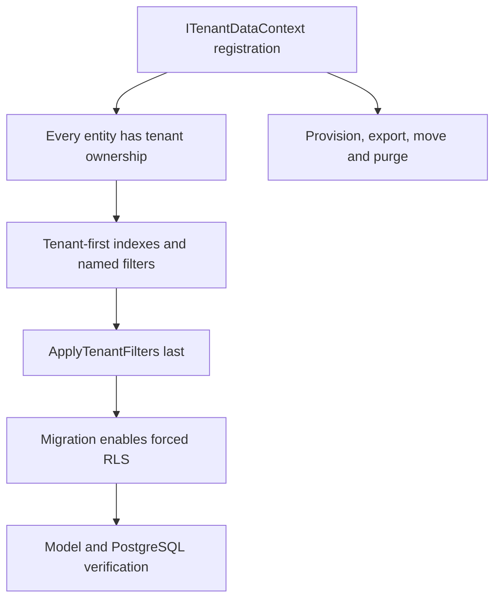

# Adding a tenant-aware module

Make a business module participate in tenant routing, row isolation, provisioning, export and erasure by applying the tenant-data conventions to its context and every mapped entity.

## Goal

Use Webhooks as the worked example: `WebhooksDbContext` owns tenant endpoints and delivery rows in the shared or
dedicated database selected by ambient scope. General model conventions belong in
[Database conventions](../Architecture/DatabaseConventions.md); this procedure adds the tenancy-specific obligations.

## Prerequisites

- Read [Overview](Overview.md), [Isolation](Isolation-and-Dedicated-Databases.md) and the repository's `CLAUDE.md`.
- Have a registered module and context, or start with `/starterkit:new-module`. Modules call each other through
  `ISender` plus contracts or integration events; user access comes through `UserDirectory.Contracts`.
- Use `/starterkit:add-aggregate` and `/starterkit:add-migration`, whose checklists are in
  `tools/claude/starterkit-plugin/skills/add-aggregate/SKILL.md` and
  `tools/claude/starterkit-plugin/skills/add-migration/SKILL.md`.
- Have the pinned .NET SDK, restored local EF tool, and Docker for PostgreSQL integration/E2E verification.

## Steps

### 1. Mark and register the context

Implement `ITenantDataContext`. From `src/Modules/Webhooks/Webhooks/Data/WebhooksDbContext.cs`:

```csharp
public class WebhooksDbContext(DbContextOptions<WebhooksDbContext> options)
    : AppDbContextBase(options), ITenantDataContext
```

Register through `AddCustomDbContext`. From `src/Modules/Webhooks/Webhooks/WebhooksModule.cs`:

```csharp
services.AddCustomDbContext<WebhooksDbContext>(configuration, Shared.Core.Data.DatabaseDefaults.ConnectionStringName);
```

Registration supplies tenant connection routing, save/connection interceptors and context discovery for provisioning,
migration, export and purge. Follow [module discovery](../Architecture/Overview.md) for manifest registration.

### 2. Make every row tenant-owned

Every entity in the context implements `IMustHaveTenant`, including children, join rows, audit rows and outbox rows.
Both `WebhookEndpoint` and `WebhookDelivery` implement it in
`src/Modules/Webhooks/Webhooks/Domains/Endpoints/Models/WebhookEndpoint.cs` and
`src/Modules/Webhooks/Webhooks/Domains/Deliveries/Models/WebhookDelivery.cs`.

Expose `public Guid TenantId { get; set; }` for infrastructure stamping, but **never assign TenantId** in application
factories or handlers. Create data inside the intended tenant scope; `TenantEntityInterceptor` stamps empty ids and
rejects foreign writes. Children need their own tenant column because RLS applies per table.

Branch-owned data also implements `IBranchScoped` with nullable `BranchId`; null means tenant-wide.
Validate write destinations as described in [Branches and scoping](Branches-and-Scoping.md).

The infrastructure recognizes `[HostEntity("reason")]` for deliberately global entities, but this is not a shortcut
for ordinary business data. Keep global state in a control-plane context; the repository rule for new tenant-data
entities is `IMustHaveTenant` on every entity.

### 3. Use tenant-first unique indexes and apply filters last

From `src/Modules/Webhooks/Webhooks/Data/Configurations/WebhookConfigurations.cs`:

```csharp
builder.HasIndex(e => new { e.TenantId, e.Url }).IsUnique().HasDatabaseName(UrlIndexName);
```

Every unique business index starts with `TenantId` (database column `tenant_id`).
For owned-column uniqueness, use a tenant-first SQL index in the migration as described in
[Database conventions](../Architecture/DatabaseConventions.md#indexes).

The Webhooks context finishes model construction in this order:

```csharp
builder.ToSnakeCaseTables();
builder.ConfigureVersionConcurrencyTokens();

// Last: tenant filter (named) and tenant_id indexes.
ApplyTenantFilters(builder);
```

Put entity configurations, optional soft-delete mappings, audit and outbox mappings before this final call.
Webhooks consumes integration events but has no outbox. Add an outbox only when the new module publishes integration
events. Use named filters only. `IgnoreNonIsolationFilters()` removes soft-delete/lifecycle filters;
`IgnoreBranchScope()` removes branch scope; neither removes tenant isolation.
Never use parameterless `IgnoreQueryFilters()` in production code.

### 4. Add and review the migration

From the repository root, use the owning module as the EF project. For an actual Webhooks schema change, replace
`<Name>` with the migration name:

```bash
dotnet ef migrations add <Name> --context WebhooksDbContext --project src/Modules/Webhooks/Webhooks --startup-project src/Api --output-dir Data/Migrations
```

Add `EnableTenantRowLevelSecurity` for **every new table**. The existing
`src/Modules/Webhooks/Webhooks/Data/Migrations/20261104210646_InitialCreate.cs` contains:

```csharp
migrationBuilder.EnableTenantRowLevelSecurity("webhooks", "webhook_endpoints");
migrationBuilder.EnableTenantRowLevelSecurity("webhooks", "webhook_deliveries");
```

The helper installs forced RLS with the `tenant_isolation` policy. When introducing `tenant_id` to existing tables,
backfill with `TenantDefaults.DefaultTenantId`, then remove the temporary default so future inserts must use
tenant stamping. The Attachment `AddMultiTenancy` migration in
`src/Modules/Attachment/Attachment/Data/Migrations/20261102142450_AddMultiTenancy.cs` demonstrates this transition.

Review Up/Down, tenant-first indexes and table coverage. Deployment uses the shared/dedicated
[migration procedure](Operations.md#6-migrate-shared-and-dedicated-databases).

### 5. Declare endpoint authorization and background scope

Endpoints in assemblies owning tenant-data contexts require a resolved tenant by default.
Still declare authorization explicitly with `RequireTenantPermission` or `RequireTenantMember`.
Add new permission definitions to `TenantPermissions` and, when appropriate, `SystemTenantRoles`.
`TenantOptional()` and `HostOnly()` override resolution requirements; neither grants permission.
Destructive/ownership actions supporting staff should use `DisallowImpersonation()`.

For platform maintenance, use narrowly scoped `TenantScope.BeginHostScope()` and platform authorization.
Keep this separate from normal business writes.

Recurring tenant-data jobs use `ITenantJobRunner.ForEachTenantScopeAsync` when they manage their own units of work,
or `ForEachTenantAsync` for one unit per tenant. Hangfire request-enqueued jobs and MassTransit consumers restore
tenant context; domain event handlers inherit it. Re-establish user/branch authorization for user-directed work.
See [Request lifecycle](../Architecture/Request-Lifecycle.md#save-commit-and-dispatch) for post-commit dispatch.

### 6. Scope caches, files and seed identities

- Build tenant-derived cache keys with `ITenantCacheKeys.For(key)`; invalidate explicitly from domain event handlers.
- Put blob keys under `StoragePaths.TenantRoot(tenantId)`, defined in
  `src/Modules/Attachment/Attachment/Infrastructure/Storage/StoragePaths.cs`.
  Other modules request storage through Attachment contracts; do not reference its implementation.
- Derive stable seed ids with `TenantSeedIds.For(tenantId, seedId)`. Default retains the original seed id; other
  tenants receive deterministic distinct ids. Run seeds inside tenant scope and keep them idempotent.
- If data exists outside the DbContext (blobs, external services), handle `TenantDataPurgeRequestedEvent`
  idempotently. Generic purge/export/move discovers the tenant-owned mapped tables; it cannot erase arbitrary
  external state.


*Figure: Context registration enables lifecycle discovery, while model and migration checks establish row isolation.*

## Verify

Run the build and architecture guardrails after implementation:

```bash
dotnet build StarterKit.slnx
dotnet test src/Api.Tests
dotnet test src/Modules/Webhooks/Webhooks.Tests
dotnet test src/Modules/Webhooks/Webhooks.IntegrationTests
dotnet test src/Api.E2ETests --filter "FullyQualifiedName~TenantRowLevelSecurityCoverageTests|FullyQualifiedName~PendingModelChangesTests"
```

For another module, run its relevant tests in place of Webhooks tests. Integration/E2E tests require Docker.

- `TenantIsolationArchitectureTests` discovers contexts from the host and checks tenant ownership, named filters,
  filter ordering and unique-index coverage.
- `TenantRowLevelSecurityCoverageTests` inspects migrated PostgreSQL tables for forced RLS and
  `tenant_isolation`; a model test alone cannot prove database isolation.
- `PendingModelChangesTests` detects schema/model drift; `ClientGeneratedKeyTests` checks child key generation.
- Exercise two tenants, children as well as roots, cross-tenant reads/writes, branch restrictions where relevant,
  and shared/dedicated routing. Test export/purge behavior for external resources.

## Pitfalls

A tenant column on the root does not isolate child tables. A query filter does not constrain raw SQL.
An RLS policy does not protect a superuser connection. A tenant-aware cache prefix does not invalidate stale entries.
Treat model, database, authorization and cache rules as separate responsibilities.

Never set `Version` manually; use the [concurrency contract](../Architecture/Concurrency-and-Versions.md).
Do not resolve and retain a tenant DbContext before establishing the tenant scope: its database selection belongs
to that scope. Do not use `[HostEntity]` to avoid adding tenant ownership to business data.

## Related

[Overview](Overview.md), [Isolation and dedicated databases](Isolation-and-Dedicated-Databases.md),
[Operations](Operations.md), [Database conventions](../Architecture/DatabaseConventions.md),
[ADR-0005](../Decisions/0005-tenant-isolation-model.md),
[ADR-0019](../Decisions/0019-module-manifests-and-discovery.md),
`/starterkit:add-aggregate`, `/starterkit:add-migration` and `/starterkit:new-module`.
