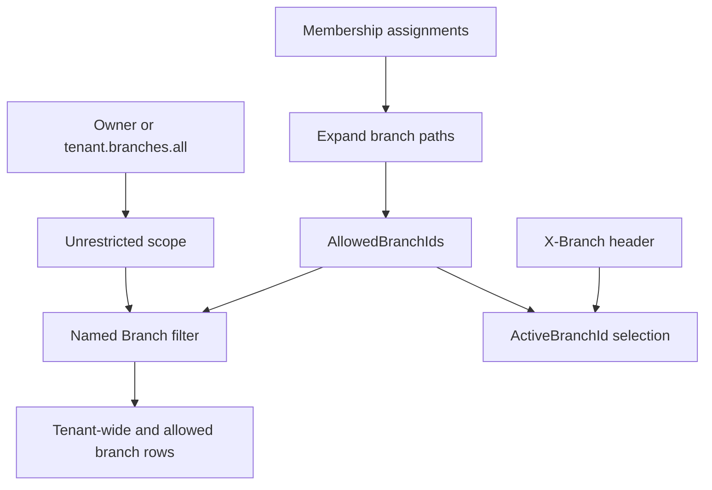

# Branches and scoping

Branches form a tenant-local hierarchy that expands membership assignments into the rows a caller may read and the branches they may manage.

## At a glance

| Concern | Implementation |
|---|---|
| Tree and mutations | `src/Modules/Tenancy/Tenancy/Domains/Branches/`, `Branch`, `MoveBranchHandler` |
| Effective membership scope | `src/Modules/Tenancy/Tenancy/Services/TenantMembershipResolver.cs` |
| Ambient selection | `BranchScope`, `ITenantContext.Branches`, `TenantResolutionMiddleware` |
| Business-row reads | `IBranchScoped`, named `Branch` filter from `ApplyTenantFilters` |

## How it works

### The tree

Each tenant starts with a head-office branch in `tenancy.branches`. Regions and branches can be added beneath it,
up to `MultiTenancy:MaxBranchDepth` (default 6, head office at depth 1). Unrestricted members can also create roots.

Paths use `/{rootId}/{childId}/?/{id}/`, with 32-character hexadecimal ids. Descendant expansion uses indexed
prefix queries; the index starts with `tenant_id` and uses `text_pattern_ops` for the path.
`Code` is unique within a tenant; head office starts with `HQ`.

`POST /api/v1/branches/{id}/move` re-parents a branch: the root is saved and descendant paths/depths are rewritten
with a set-based update in one transaction. Cycles and subtree depth overflow are rejected.
Branches are deactivated, never deleted, so business rows keep their references. Active descendants must be
deactivated first; head office cannot be deactivated or moved.

### Assignments and scope

Memberships store `branches: [{ branchId, includeDescendants }]`.
`TenantMembershipResolver` expands these into cached `BranchScope.AllowedBranchIds`.

| Membership | Effective scope |
|---|---|
| Owner, or role with `tenant.branches.all` (Administrator) | Unrestricted: `AllowedBranchIds = null`. |
| Branch assignment with descendants | Assigned branch and every descendant. |
| Assignment without descendants | Assigned branch only. |
| Member with no assignments | Empty allowed set: only tenant-wide rows with `BranchId = null`. |

Creating a child branch and moving a branch invalidate the tenant's membership-cache generation because
descendant scopes may change. Expansion does not filter out inactive branches.

`X-Branch` optionally sets `ITenantContext.Branches.ActiveBranchId`. It must parse as a Guid and satisfy
`BranchScope.Allows`. It does not narrow the allowed set or prove that the branch exists: an unrestricted scope
accepts any syntactically valid id. Validate existence and tenant ownership before using it for a new record.


*Figure: Membership controls row visibility; the optional active branch does not replace the allowed branch set.*

## Configuration

Defaults come from `src/Shared/Shared.Core/MultiTenancy/MultiTenancyOptions.cs`.

| Key | Default | Meaning |
|---|---|---|
| `MultiTenancy:MaxBranchDepth` | `6` | Maximum depth; validated range 1?32. |
| `MultiTenancy:Resolution:BranchHeaderName` | `X-Branch` | Optional active-branch selection. |

## Usage

### Branch-scoped data

Implement `IBranchScoped` (`Guid? BranchId`) on a tenant-data entity.
`ApplyTenantFilters` adds the named `Branch` filter: a row is visible when branch filtering is disabled, its
`BranchId` is null, or its branch is in the allowed set. The separate `Tenant` filter still applies.

A null branch means tenant-wide data, visible to every branch scope within that tenant. Authorized tenant-wide
views can call `IgnoreBranchScope()`; this removes only the branch filter. See
[Database conventions](../Architecture/DatabaseConventions.md#query-filters).

Filters protect reads. Validate the destination branch on writes, following `TenancyRequest.EnsureBranchesInScope`.
From `src/Modules/Tenancy/Tenancy/Domains/Branches/Features/BranchHandlers.cs`:

```csharp
request.EnsureBranchesInScope(command.NewParentId is { } p ? [command.Id, p] : [command.Id]);
if (command.NewParentId is null && request.Branches.IsRestricted)
    throw new TenantAccessDeniedException(TenantErrors.BranchNotAllowed, "only unrestricted members can create roots.");
```

`BranchesModule.cs` requires `tenant.branches.read` for GET and `tenant.branches.manage` for create, update,
move and activation changes. Update and move accept a nullable version; see
[Concurrency and versions](../Architecture/Concurrency-and-Versions.md).

## Failure modes and guarantees

### Anti-escalation

Members with `tenant.members.manage` or `tenant.roles.manage` can grant only permissions they hold and assign only
branches inside their own scope. Only the owner may change their own roles.

Invalid moves and deactivation return 400; duplicate branch codes return 409.
By-id reads hide out-of-scope branches with 404; explicit scope checks reject writes with 403.
A bad branch header yields 403 with `branch_not_allowed` in the message, not a populated `errorCode` field.
See [Overview](Overview.md#failure-modes-and-guarantees).

Tenant isolation is separate from branch authorization. A caller without membership receives an unrestricted
branch scope during resolution, but no tenant permissions; endpoint authorization must still protect non-public data.

## Guardrails

`BranchTests` and `MembershipTests` in `src/Modules/Tenancy/Tenancy.Tests/TenancyDomainTests.cs` cover tree invariants
and assignments. `TenantLifecycleTests` checks per-tenant branch-code uniqueness.
`TenantDataIsolationTests` and `TenantResolutionMiddlewareTests` exercise row scoping and request selection;
`TenantIsolationArchitectureTests` enforces named-filter conventions.

## Related

[Overview](Overview.md), [Adding a tenant-aware module](Adding-a-Tenant-Aware-Module.md),
[ADR-0005](../Decisions/0005-tenant-isolation-model.md), and `/starterkit:add-permission`.
