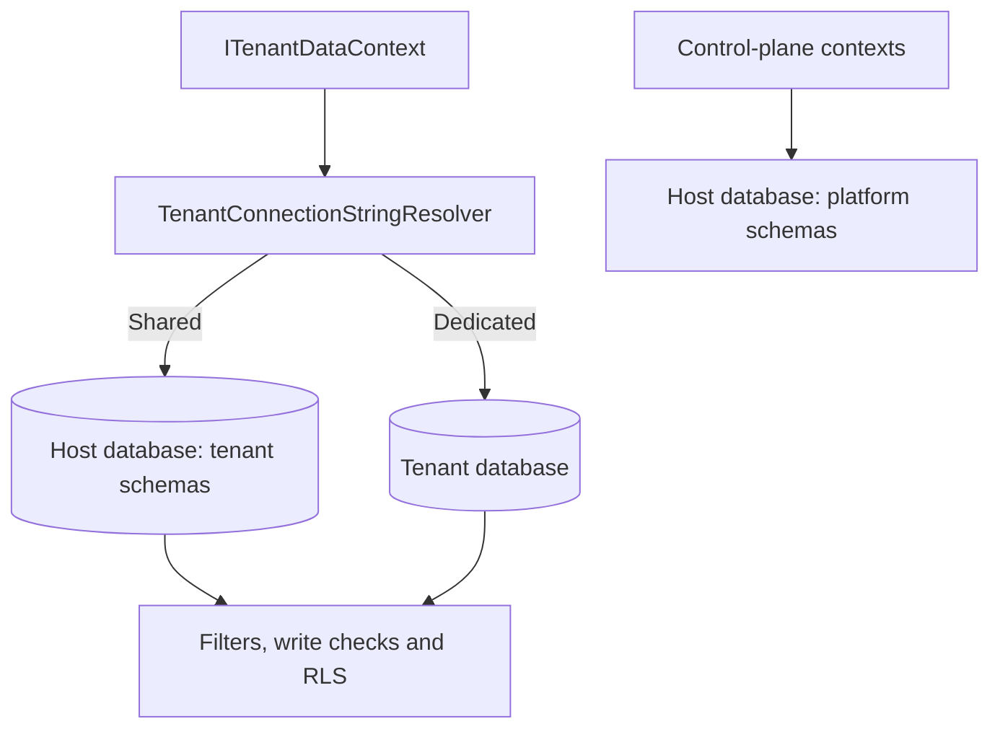

# Isolation and dedicated databases

Tenant-data contexts enforce application checks and PostgreSQL row-level security in shared or dedicated databases while platform state remains in the host database.

## At a glance

| Responsibility | Source |
|---|---|
| Connection routing | `src/Shared/Shared.Core/MultiTenancy/TenantConnectionStringResolver.cs` |
| EF writes and PostgreSQL session/policy setup | `src/Shared/Shared.Core/MultiTenancy/Data/` |
| Provision, migrate and move | `src/Modules/Tenancy/Tenancy/Services/` |
| Erasure | `src/Modules/Tenancy/Tenancy/Jobs/PurgeDeletedTenantsJob.cs` |

## How it works

### Control plane vs data plane

| Plane | Contexts | Database |
|---|---|---|
| Control | `ApplicationIdentityDbContext`, `TenancyDbContext`, `SubscriptionsDbContext`, `NotificationDbContext`; Hangfire storage | Host database. |
| Data | Every `ITenantDataContext`, including `AttachmentDbContext`, `WebhooksDbContext` and `DataTransferDbContext` | Shared or dedicated tenant database. |

Users are global; the tenant is the billing subscriber. Only tenant-data contexts move into a dedicated database.
The [architecture overview](../Architecture/Overview.md) defines module boundaries.


*Figure: Dedicated isolation changes the data-plane location while control-plane contexts remain in the host database.*

### The three isolation layers

1. Resolution validates tenant claims, host and header before authorization; see [Overview](Overview.md).
2. EF applies the named `Tenant` filter. `TenantEntityInterceptor` stamps inserts and rejects cross-tenant
   insert/update/delete and ownership changes with `CrossTenantAccessException` (404, logged as a security event).
3. PostgreSQL RLS constrains SQL reads and writes independently of EF filters, subject to database-role privileges.

An unresolved tenant matches no tenant rows; inserts raise `TenantNotResolvedException` (400).
`IgnoreNonIsolationFilters()` preserves tenant and branch filters; `IgnoreBranchScope()` preserves tenant
isolation. See [Database conventions](../Architecture/DatabaseConventions.md#query-filters).

`TenantScope.BeginHostScope()` explicitly bypasses application tenant isolation for migrations, seed, stores,
membership resolution, platform queries and purge. Keep the scope narrow and authorized. The optional tenant
argument selects a dedicated database for maintenance. `.HostOnly()` alone does not enter this privileged scope.

## Row-Level Security

Every migration adding a tenant table calls `EnableTenantRowLevelSecurity(schema, table)`.
The helper enables and forces RLS, then installs `tenant_isolation` with the same predicate for `USING` and
`WITH CHECK`: the schema-local `tenant_rls_bypass()` must permit bypass, or `tenant_id` must match
`NULLIF(current_setting('app.tenant_id', true), '')::uuid`.
Source: `src/Shared/Shared.Core/MultiTenancy/Data/TenantRlsMigrationExtensions.cs`.

`TenantSessionConnectionInterceptor` sets `app.tenant_id` and `app.bypass_rls` on every tenant-data connection open,
including reused Npgsql connections. Forced RLS applies to table owners, but superusers and BYPASSRLS roles bypass it.
The default Docker/Aspire superuser connection therefore does not exercise RLS; application filters still apply.

For production use a non-superuser runtime login without BYPASSRLS. Grant schema privileges rather than making
the runtime login an unrestricted owner. Database creation privileges are needed only for provisioning generated
dedicated databases. The role setup script is `deployment/postgres/scripts/init-rls-roles.sql`; use placeholder
secrets such as `CHANGE_ME` only in configuration examples, never deployed credentials.

### Hardened bypass: role instead of session variable

| Mode | Host-scope behavior | Limit |
|---|---|---|
| `SessionVariable` (default) | Sets `app.bypass_rls=on` on the runtime connection. | Without the bypass group role, arbitrary SQL under that login can set the same variable. |
| `Role` | Replaces username/password with credentials from `HostConnectionString`; never requests session-variable bypass. | Requires RLS enabled and a privileged host login on each target server. |

The schema helper accepts `app.bypass_rls=on` only if the cluster has no `tenant_rls_bypass` group role or
`current_user` belongs to that role. Creating the role therefore hardens every database carrying the helper.
The Attachment `RlsBypassRoleHardening` migration upgrades existing policies.

The setup script creates `starterkit_app` (NOBYPASSRLS, not owner), `starterkit_host` (BYPASSRLS), and
`tenant_rls_bypass`. Do not make the runtime login a member of the bypass group. Run migration/seed with an
appropriately privileged owner/migration role in that group or the host role.

Role mode swaps credentials during `ConnectionOpening`, preserving the context's server and database.
Dedicated databases on another server need the host role there too; `TenantDataMover` uses this through host scope.

Roles are cluster-wide. Do not mix deployments expecting unrestricted SessionVariable bypass with hardened Role
deployments in the same cluster: a SessionVariable runtime login outside the group loses host bypass and fails
closed. `EnableRowLevelSecurity=false` leaves policies installed and requests session bypass; it cannot override
the group-membership restriction, and Role-mode options require RLS enabled.

`RlsBypassRoleCheck` refuses startup if the reachable host database lacks the group, or the checked runtime login
is superuser, BYPASSRLS, or a bypass-group member. Connection/timeout failures are logged rather than fatal in this
guard. It is not an audit of every remote dedicated server; verify those roles before routing traffic there.

### Connection pooling (PgBouncer)

Tenant RLS uses session-level settings. PgBouncer transaction pooling can execute session setup and the query on
different server connections. Use direct connections or session pooling for all tenant-data connections, including
dedicated databases and host credentials. Npgsql client-side pooling is supported.

`PoolingSafetyCheck` warns for port 6432 or a host containing `pgbouncer`. This is a heuristic, not detection of
the actual pool mode.

## Shared vs dedicated

| Concern | Shared | Dedicated |
|---|---|---|
| Location | Tenant rows in shared schemas. | Generated database on the shared server or a configured external database. |
| Isolation | Filters, write interceptor and RLS. | Physical database separation plus the same filters/RLS. |
| Provisioning | Active immediately; tenant seed work runs in background. | `Provisioning` until `ProvisionTenantJob` creates/migrates/seeds the database. |
| Operational cost | Shared connection pools and migration targets. | One pool and migration target per tenant. |
| Selection | Default for self-service deployments. | Useful for residency routing or separate workload capacity. |

Platform creation accepts `isolation`, `connectionSecretRef` and `region`; see [Operations](Operations.md).

### Connection resolution (`TenantConnectionStringResolver`)

- Shared tenant, unresolved tenant, host scope without a target, or disabled multi-tenancy uses
  `ConnectionStrings:starterkit`.
- Dedicated tenants with a `ConnectionSecretRef` resolve `MultiTenancy:Connections:{ref}`, then
  `ConnectionStrings:{ref}`. The first section is configurable. Connection strings are secrets in configuration,
  not database rows; environment-variable keys use double underscores.
- Without a reference, the resolver uses the shared server with `DedicatedDatabaseNameFormat`.
  Names are lowercased, non-alphanumeric characters become underscores, and length is capped at 63 characters.
- `TenantScope.BeginHostScope(tenant)` can select the dedicated database for maintenance.
- A positive `MaxDedicatedPoolSize` caps the Npgsql pool. An unresolved dedicated reference throws; it never
  falls back to shared data.

For the existing Aspire demonstration, run
`dotnet run --project src/Aspire/AppHost -- MultiTenancy:DedicatedSample=true`.
It supplies `ConnectionStrings:tenant-demo` for `starterkit_tenant_demo`; create a tenant with
`connectionSecretRef: "tenant-demo"`. See [Aspire](../Infrastructure/Aspire.md).

### Migrations

Shared migration uses `UseMigration<TContext>()` when enabled.
`DedicatedTenantDatabaseMigrator` migrates and seeds **active and suspended** dedicated tenants with bounded
parallelism. Boot execution requires both migration switches below; production uses `--migrate-only`.
That command invokes dedicated migration directly and fails the run if any selected tenant fails.
See [Operations](Operations.md) and [Database conventions](../Architecture/DatabaseConventions.md#migrations-at-deploy).

Every database that holds tenant data, dedicated ones and the target of a tenant move included, needs the `vector`
extension (pgvector) before its migrations run, and both sides of a move need the same pgvector version: the
Agentic knowledge passages carry a `vector` column that the mover copies in binary form.
<!--#if (agentic)-->
See [ADR-0028](../Decisions/0028-agent-knowledge-and-memory-on-pgvector.md).
<!--#endif-->
The repository's PostgreSQL image has it; on a managed server, create it as an administrator (`deployment/postgres/scripts/init-rls-roles.sql`).

### Storage (attachments)

`StoragePaths.TenantRoot` prefixes blob keys with `t/{tenantId:N}/`.
Legacy unprefixed keys belong to the Default tenant. The orphan sweeper lists the current tenant's prefix;
purge deletes the tenant's storage. Database moves do not relocate blobs.

### Caches

Tenant-derived entries use `ITenantCacheKeys.For(key)` (`t:{tenantId:N}:{key}`).
Platform/user-keyed entries retain their own keys. Tenant and membership L1 caches broadcast evictions over Redis;
see [Overview](Overview.md#caches-and-storage) for generation invalidation and failure limits.

## Configuration

Defaults come from `MultiTenancyOptions.cs` and `src/Api/appsettings.json`.

| Key | Default | Meaning |
|---|---|---|
| `MultiTenancy:DefaultIsolation` | `Shared` | New tenant default. |
| `MultiTenancy:Database:EnableRowLevelSecurity` | `true` | Apply tenant session state; disabling requests session bypass. |
| `MultiTenancy:Database:RlsBypass` | `SessionVariable` | Host bypass mode: `SessionVariable` or `Role`. |
| `MultiTenancy:Database:HostConnectionString` | `null` | Credentials for host scope in Role mode. |
| `MultiTenancy:Database:ConnectionsSection` | `MultiTenancy:Connections` | Dedicated secret lookup section. |
| `MultiTenancy:Database:DedicatedDatabaseNameFormat` | `{database}_t_{identifier}` | Generated database name. |
| `MultiTenancy:Database:MaxDedicatedPoolSize` | `20` | Dedicated pool cap when positive. |
| `MultiTenancy:Database:MigrationParallelism` | `4` | Concurrent dedicated tenant migrations. |
| `MultiTenancy:Database:MigrateDedicatedOnStartup` | `true` | Boot migrator switch; also requires `Database:MigrateOnStartup`. |

## Usage

The Webhooks initial migration enables RLS on both tables. From
`src/Modules/Webhooks/Webhooks/Data/Migrations/20261104210646_InitialCreate.cs`:

```csharp
migrationBuilder.EnableTenantRowLevelSecurity("webhooks", "webhook_endpoints");
migrationBuilder.EnableTenantRowLevelSecurity("webhooks", "webhook_deliveries");
```

Apply the helper to every new tenant table, including child, audit and outbox tables.
[Adding a tenant-aware module](Adding-a-Tenant-Aware-Module.md) provides the implementation procedure.

## Failure modes and guarantees

### Data moves between databases

`TenantMover` validates distinct source/target databases, waits for propagation of `Migrating`, prepares the target
without seed data, and copies each registered context. `TenantDataMover` streams binary COPY from a repeatable-read
source snapshot into one target transaction per context, clears earlier attempt rows and verifies per-table counts.
There is no transaction spanning all contexts and the control-plane cutover.

After every copy succeeds, the tenant mapping switches and the effective status returns. Source cleanup follows
another propagation wait. Failure before cutover keeps the original location and attempts partial-target cleanup.
Cleanup after cutover is best effort and does not undo the switch.
Use the [move runbook](Operations.md#moving-a-tenant-between-shared-and-dedicated-automated).

### Purge

`PurgeDeletedTenantsJob` dispatches `TenantDataPurgeRequestedEvent` for external resources, deletes tenant data and
control-plane rows, then leaves a `Deleted` tombstone reserving the identifier.
A generated dedicated database (no secret reference) is dropped; shared or externally configured databases have
only that tenant's rows purged. Failures are logged and retried on the next daily run.
External erasure handlers must be idempotent: purge spans several units of work and is not globally atomic.

## Guardrails

`TenantIsolationArchitectureTests` checks model conventions.
`TenantRowLevelSecurityCoverageTests` checks forced RLS and `tenant_isolation` on migrated tables.
`RowLevelSecurityTests`, `RlsBypassRoleTests`, `TenantConnectionStringResolverTests` and `TenantDataMoveTests`
cover isolation, hardening, routing and copy behavior; `TenantMoveTests` covers lifecycle transitions.

## Related

[Overview](Overview.md), [Operations](Operations.md), [Database conventions](../Architecture/DatabaseConventions.md),
[ADR-0005](../Decisions/0005-tenant-isolation-model.md), and `/starterkit:add-migration`.
