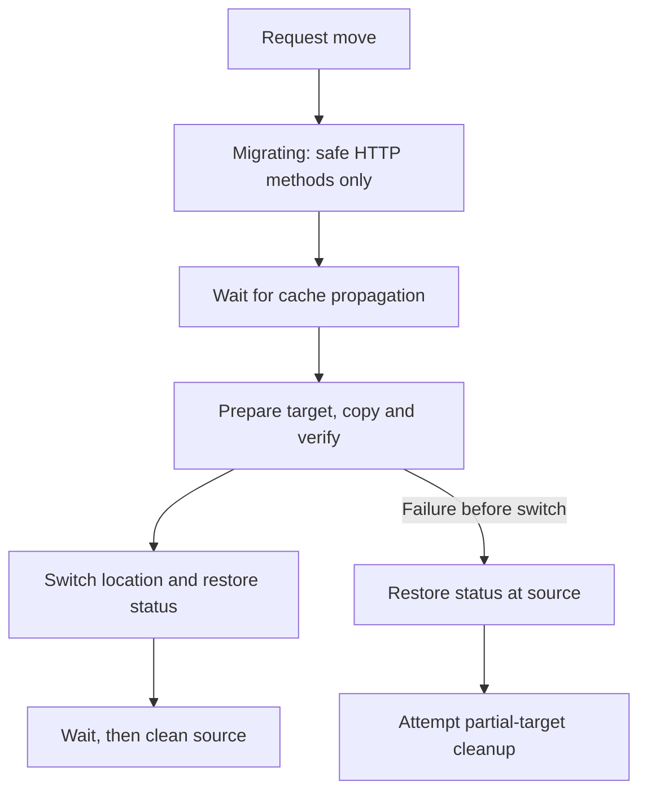

# Multi-tenancy operations

Operate tenant provisioning, access status, database moves and erasure through the Tenancy control plane, with explicit verification before and after each transition.

## Goal

Create, suspend, relocate or delete a tenant, and deploy schema changes across shared and dedicated databases.
The [Overview](Overview.md#tenant-status-lifecycle) owns the lifecycle model;
[Isolation](Isolation-and-Dedicated-Databases.md) explains database guarantees.

## Prerequisites

- Current shared schema and Tenancy seed data, configuration secrets available to API and workers, and working Hangfire.
- Platform `tenants.read` to inspect tenants and `tenants.manage` for administrative changes; applicable staff 2FA rules.
- A non-superuser runtime database role, correct RLS host credentials, and direct/session-pooled database connections.
- Backups and an external-data retention policy before moves or purge.

## Steps

### 1. Enable multi-tenancy

#### Enabling multi-tenancy on an existing deployment

1. Apply current migrations with `dotnet run --project src/Api -- --migrate-only`. Existing tenant-data rows from the
   original tenancy migrations belong to the Default tenant. Production must not assume boot-time migration.
2. Configure the runtime and host roles as described in [Isolation](Isolation-and-Dedicated-Databases.md#row-level-security).
3. Set `MultiTenancy__Enabled=true` and, for subdomains, `MultiTenancy__Resolution__RootDomain=api.example.com`.
   The deployment's `MULTITENANCY_ROOT_DOMAIN` variable maps this setting; redeploy with consistent worker settings.
4. Establish ownership/membership for existing users before expecting tenant permissions. The Default seed creates
   a tenant with no owner (`Guid.Empty`), head office and system roles, not user memberships.
   If retaining existing data, bootstrap an owner membership and the tenant's owner together through a reviewed
   control-plane data change. There is no public ?claim Default tenant? endpoint. Alternatively, users create new
   tenants, which does not transfer their Default-tenant data.

The seed behavior is in `src/Modules/Tenancy/Tenancy/Data/Seed/TenancyDataSeeder.cs`.
Use the membership factory/system-role mapping in `CreateTenantHandler` as the bootstrap reference; do not
hand-assign entity versions.

### 2. Create and inspect a tenant

Routes below are from `src/Modules/Tenancy/Tenancy/Domains/Tenants/Features/TenantsModule.cs`.
All host-admin routes are tenant-less (`.HostOnly()`); the handlers enter privileged scope where needed.

| Method and route | Authorization / result |
|---|---|
| `POST /api/v1/tenants` | Authenticated caller; creation handler enforces self-service/admin restrictions. 201. |
| `GET /api/v1/me/tenants` | Authenticated caller's memberships. |
| `GET /api/v1/host/tenants` | `tenants.read`; paginated platform list. |
| `POST /api/v1/host/tenants/{id}/provision` | `tenants.manage`; queue provisioning again. 200. |
| `POST /api/v1/host/tenants/{id}/suspend` | `tenants.manage`; reason body. 200. |
| `POST /api/v1/host/tenants/{id}/reactivate` | `tenants.manage`. 200. |
| `POST /api/v1/host/tenants/{id}/move` | `tenants.manage`; target isolation/reference. 202. |
| `POST /api/v1/host/tenants/{id}/move/retry` | `tenants.manage`; recover a stuck move. 202. |
| `POST /api/v1/host/tenants/{id}/move/abort` | `tenants.manage`; remain at source. 200. |
| `PUT /api/v1/host/tenants/{id}/isolation` | `tenants.manage`; metadata-only change on a suspended tenant. 200. |
| `DELETE /api/v1/host/tenants/{id}` | `tenants.manage`; optional reason query, starts grace period. 200. |
| `POST /api/v1/host/tenants/{id}/cancel-deletion` | `tenants.manage`; returns to Suspended. 200. |

1. Create with a name and unique identifier. Self-service requires `AllowSelfServiceSignup=true`; it cannot
   explicitly request Dedicated, a connection reference or another owner.
   Omitted isolation uses `DefaultIsolation`, including Dedicated if configured.
2. Platform callers with `tenants.manage` may choose `isolation`, `connectionSecretRef`, `ownerUserId` and `region`.
   Store referenced credentials in configuration before requesting provisioning.
3. Inspect status. Creation writes the tenant, system roles, head office and owner membership in one save.
   Shared tenants are active immediately and seed in background; dedicated tenants start Provisioning.
   `ProvisionTenantJob` retries failures up to five times. Inspect the failure reason before using the provision route.
4. Use `POST /api/auth/switch-tenant` to obtain a tenant session; inspect
   `GET /api/v1/members/me` for permissions and branch scope.

### 3. Suspend or reactivate

1. Submit a reason to the suspend endpoint and confirm Suspended in the host list.
2. Verify required tenant requests are blocked, or allow GET/HEAD/OPTIONS when
   `MultiTenancy:SuspendedTenantMode=ReadOnly`.
3. Reactivate after resolving the cause. Subscription expiry can suspend a tenant and activation lifts a
   billing suspension; it must not override a separate manual suspension.
4. During Migrating, suspend/reactivate changes the status to restore at move completion rather than ending the move.

### 4. Move the tenant's data

#### Moving a tenant between shared and dedicated (automated)

`POST /api/v1/host/tenants/{id}/move` `{ "isolation": "Dedicated", "connectionSecretRef": null }` (permission
`tenants.manage`) → 202. Shared ⇄ dedicated, or dedicated → another server (`connectionSecretRef`).

| Step | What happens |
|---|---|
| Request | Target validated (connection resolvable, NOT the database the tenant lives in); tenant → `Migrating` (read-only); `MoveTenantJob` queued; audit `tenant.move-requested` |
| Propagation | Waits one L1 cache period (`Cache:LocalSeconds` + 5 s) so every instance sees `Migrating`: HTTP writes → 503, Hangfire jobs of the tenant retry later, MassTransit messages use delayed redelivery |
| Target | Dedicated: database created + migrated (no seeding) |
| Copy | Per tenant-data context ONE target transaction: leftovers of a failed attempt deleted, every tenant table streamed with binary `COPY` from a `REPEATABLE READ` snapshot, per-table row counts verified (`TenantDataMover`) |
| Switch | Tenant points at the target, previous status restored, caches dropped; audit `tenant.move-completed` (row counts) |
| Cleanup | After another cache period: a dedicated database we created is DROPPED, otherwise the tenant's rows are purged from the source |

* **Failure before the switch**: the tenant stays where it was (status restored, audit `tenant.move-failed` with the
  error) and the target's partial copy is removed. Fix the cause and request the move again.
* **Crash / stuck `Migrating`**: `POST /api/v1/host/tenants/{id}/move/retry` (idempotent) or `/move/abort` (stays put).
* **Cleanup failure** (after a successful switch) is logged (`Tenant move: cleaning the source database failed`);
  the tenant already works from the target - remove its rows from the source by hand (they are isolated anyway).
* Moves run one at a time (`DisableConcurrentExecution`), with automatic Hangfire retries disabled. Read-only time ≈ 2 × cache period + copy time.
* Blobs do not move (storage is not per database). Billing suspensions arriving during a move apply when it ends.
* Manual fallback (metadata only): suspend, copy with `COPY … WHERE tenant_id = '<id>'`, then
  `PUT /api/v1/host/tenants/{id}/isolation`, verify, delete the source rows, reactivate.


*Figure: Cutover restores the effective status before delayed source cleanup; a pre-cutover failure keeps the source authoritative.*

### 5. Delete or cancel deletion

1. The owner calls `POST /api/v1/tenants/current/deletion` (tenant membership required, owner checked in handler,
   impersonation forbidden), or platform staff use the DELETE route above.
2. Confirm PendingDeletion and the purge deadline; tenant-required traffic is unavailable immediately.
3. Before purge, platform staff can cancel deletion; the tenant returns to Suspended and needs explicit reactivation.
4. After the grace period, verify erasure and the Deleted tombstone. Deletion cannot be requested during Migrating.

#### Purge (daily `tenancy-purge-deleted-tenants`, 03:00)

For each tenant past its grace period: modules erase external data (`TenantDataPurgeRequestedEvent` → blobs under
`t/{id}/`), then the dedicated database we created is **dropped** (otherwise the tenant's rows are deleted from every
tenant-data context), then memberships/roles/invitations/branches/audit are removed and the tenant becomes `Deleted`.
A failure is retried on the next run. **Irreversible** - take backups per your retention policy.


### 6. Migrate shared and dedicated databases

1. Supply the same tenant connection secrets used by the deployment and appropriate migration privileges.
2. From the repository root, run:

   ```bash
   dotnet run --project src/Api -- --migrate-only
   ```

3. Require exit code 0 and `Migrate-only run completed.` before deploying runtime instances.
   `src/Api/Program.cs` returns 1 when any dedicated tenant migration fails.
4. Inspect the per-tenant migration logs. `DedicatedTenantDatabaseMigrator.MigrateAllAsync` selects Active and
   Suspended dedicated tenants, migrates/seeds each registered tenant-data context, continues past individual
   failures and reports their count. Provisioning, Migrating and PendingDeletion tenants are not selected.
5. Keep `Database:MigrateOnStartup=false` in production. The one-shot command invokes dedicated migration even
   if `MultiTenancy:Database:MigrateDedicatedOnStartup=false`.

Migration locks, credentials and the shared-only `Database:MigrationConnectionString` override are covered by
[Database conventions](../Architecture/DatabaseConventions.md#migrations-at-deploy).

### 7. Run recurring work in tenant scopes

Use `ITenantJobRunner.ForEachTenantScopeAsync` when the job already manages units of work or mediator commands.
It establishes scope only; it does not create a database unit of work or dispatch events by itself.
`ForEachTenantAsync` supplies one `IUnitOfWorkRunner` unit per tenant. Both count/log per-tenant failures and continue;
cancellation stops the run. Single-tenant mode visits Default; multi-tenant fan-out uses serviceable tenants.

The Webhooks sweep in `src/Modules/Webhooks/Webhooks/Domains/Deliveries/Jobs/DispatchDueWebhooksJob.cs` uses this
pattern. Request-enqueued jobs restore tenant context through `TenantJobFilter`; they do not restore the caller's
branch permissions. User-directed work must re-check membership and establish the user's branch scope.
See [Request lifecycle](../Architecture/Request-Lifecycle.md#save-commit-and-dispatch) for event dispatch.

### Supporting operations

### Subdomains and custom domains (Nginx / TLS)

* DNS: `*.api.example.com` → the server; certificate for `api.example.com` + `*.api.example.com` (wildcard needs the
  ACME **DNS-01** challenge).
* Nginx: `server_name api.example.com *.api.example.com;` and forward the host (`proxy_set_header Host $host;`) - see
  the comment in `deployment/nginx/conf.d/app-production.conf`.
* Custom domains: the tenant adds `api.example.com`, creates the TXT record `_tenant-verify.api.example.com = <token>`,
  calls `POST /api/v1/tenants/current/domains/{host}/verify`. Route the domain to the API (CNAME) and issue its certificate
  (e.g. Caddy/Traefik on-demand TLS, or a cert-manager per domain).
* CORS: besides `Cors:AllowedOrigins`, tenant frontends are allowed automatically (`TenantCorsPolicyProvider`):
  `https://{identifier}.{MultiTenancy:Cors:FrontendRootDomain}` of existing tenants and `https://{host}` of VERIFIED
  custom domains (plain `http` only in Development). The configured policy (credentials, methods, headers) applies.

### Tenant data export (portability)

`POST /api/v1/tenants/current/export` - **owner only**, audited (`tenant.data-exported`), not available while
impersonating. Returns a zip: `manifest.json`, `tenant/*.json` (profile, branches, roles, members with e-mails,
invitations, audit trail) and `data/{schema}.{table}.csv` for EVERY table of every tenant-data context (shared or
dedicated database; read in the tenant's scope, so EF filters and RLS apply). Built in a temp file that is deleted
when the response ends. Files/blobs are listed in the attachment tables, not embedded.

### Invitations

`POST /tenant-invitations` e-mails the link (template `TenantInvitation`, culture from the tenant) built from
`MultiTenancy:Invitations:AcceptUrl` (`{token}` placeholder; relative → `Email:AppBaseUrl`). The token is returned in
the response only when `ReturnTokenInResponse=true` (apps delivering invitations themselves, tests). A failed e-mail
does not fail the request (`emailQueued=false`); `POST /tenant-invitations/{id}/resend` issues a NEW link (the old one
stops working) and restarts the lifetime. Accepting still requires a signed-in user with the same VERIFIED e-mail.

### Support impersonation

`POST /api/identity/impersonations` `{ tenantId, userId, reason, minutes? }` - permission `tenants.impersonate`
(SuperAdmin, Support; admin 2FA rules apply).

* Only active, non-staff users (no platform role besides User) who are active members of the tenant.
* Access token only (no refresh token), lifetime ≤ `MultiTenancy:Impersonation:MaxMinutes`, claim `act` = the
  platform user. The token carries the TARGET's membership - nothing more.
* Blocked while impersonating (403 `impersonation_restricted`): every write to Identity (password, 2FA, profile,
  sessions), every write to host endpoints (switch tenant, create tenant, accept invitation), and endpoints marked
  `.DisallowImpersonation()` (tenant deletion, ownership transfer, data export, leave tenant).
* Audited twice: Identity admin audit (`impersonation.started` + reason) and the TENANT's audit trail
  (`platform.impersonation-started`); every tenant audit entry made during the session records `ImpersonatorUserId`,
  every log line carries `ImpersonatorId`. Turn the feature off with `MultiTenancy:Impersonation:Enabled=false`.

### Notification logs

* `notification.notification_log` (every channel, e-mail included) carries `tenant_id` (stamped from the ambient tenant) and are
  erased by the tenant purge.
* Billing notifications are addressed to the subscriber (= the tenant): `INotificationRecipientResolver` delivers them
  to the tenant's OWNER.

### Observability

* Every log line of a tenant request/job carries `TenantId` and `TenantIdentifier` (Seq: `TenantId = '…'`).
* Traces: `tenant.id`, `tenant.identifier` tags.
* Security events: `SECURITY: blocked cross-tenant …` warnings from `TenantEntityInterceptor`; tenant mismatches are
  logged by the resolution middleware.

### Configuration reference

| Key | Default | Notes |
|---|---|---|
| `MultiTenancy:Enabled` | `false` | Master switch |
| `MultiTenancy:DefaultIsolation` | `Shared` | For new tenants |
| `MultiTenancy:SuspendedTenantMode` | `Block` | `ReadOnly` = GET/HEAD/OPTIONS still work |
| `MultiTenancy:AllowSelfServiceSignup` | `true` | `false` = only platform admins create tenants |
| `MultiTenancy:MaxBranchDepth` | `6` | 1-32 |
| `MultiTenancy:DeletionGracePeriodDays` | `30` | |
| `MultiTenancy:Resolution:RootDomain` | empty | Subdomain resolution |
| `MultiTenancy:Resolution:HeaderName` / `BranchHeaderName` | `X-Tenant` / `X-Branch` | |
| `MultiTenancy:Database:EnableRowLevelSecurity` | `true` | |
| `MultiTenancy:Database:DedicatedDatabaseNameFormat` | `{database}_t_{identifier}` | |
| `MultiTenancy:Database:MaxDedicatedPoolSize` | `20` | |
| `MultiTenancy:Database:MigrationParallelism` | `4` | |
| `MultiTenancy:Database:MigrateDedicatedOnStartup` | `true` | |
| `MultiTenancy:Connections:{ref}` | - | Dedicated connection strings (secrets!) |
| `MultiTenancy:Cache:LocalSeconds` / `DistributedSeconds` | `30` / `600` | `0` disables a level (also the move's propagation wait) |
| `MultiTenancy:Cache:BroadcastInvalidation` / `InvalidationChannel` | `true` / `starterkit:tenancy:invalidate` | Redis pub/sub L1 eviction across instances (no-op without Redis) |
| `MultiTenancy:Database:RlsBypass` / `HostConnectionString` | `SessionVariable` / empty | `Role` = host scope connects as a BYPASSRLS role (see Isolation page) |
| `MultiTenancy:Invitations:SendEmail` / `AcceptUrl` / `ReturnTokenInResponse` | `true` / `/invitations/accept?token={token}` / `false` | |
| `MultiTenancy:Cors:Enabled` / `FrontendRootDomain` / `AllowVerifiedCustomDomains` | `true` / empty / `true` | Tenant-aware CORS |
| `MultiTenancy:Impersonation:Enabled` / `MaxMinutes` | `true` / `30` | 5-60 |
| `MultiTenancy:DomainVerification:DohEndpoint` | Cloudflare DNS-over-HTTPS endpoint (implementation default) | |
| `RateLimiting:Tenant:PermitLimit` / `WindowSeconds` | `0` (off) / `60` | Per-tenant global budget |

## Verify

- Check host status and the tenant audit trail, not only the HTTP acceptance response.
- After creation or migration, exercise tenant-required reads/writes under the target tenant and confirm another
  tenant cannot read its ids.
- After a move, check `tenant.move-completed` row counts and the configured target; then confirm source cleanup.
- After suspension, check another replica as well as the instance that handled the change.
- Before deletion grace expires, confirm exports/backups and expected external-resource cleanup.
- Relevant regression coverage: `TenantLifecycleTests`, `TenantMoveTests`, `TenantDataMoveTests`,
  `TenantBillingStatusConsumerTests`, `CacheInvalidationBroadcastTests` and `TenantMessagingBusTests`.

## Pitfalls

| Symptom | Check / recovery |
|---|---|
| 400 `tenant_required` | Send a valid tenant session, host or header to a tenant-required endpoint. |
| 403 `tenant_mismatch` | Align host/header with the token or switch tenant first. |
| 401 `tenant_membership_changed` | Refresh the session; membership stamp changed. |
| 403 `tenant_access_denied` | Re-check active membership; refreshing cannot restore removed access. |
| 503 `tenant_migrating` | Wait for cutover; inspect the move job and audit before retry/abort. |
| ProvisioningFailed | Inspect status reason, connection reference, role privileges and migration logs; re-provision. |
| Role-mode startup refusal | Install `tenant_rls_bypass` and remove bypass privileges/group membership from runtime. |
| Another replica serves stale scope | Check Redis pub/sub and L2 invalidation; local TTL only bounds L1 retention. |
| Target active but source rows remain | Cleanup failed after cutover; remove only the verified source copy under controlled maintenance. |
| Dedicated migration failed | Fix that tenant's target and rerun the deploy migrator; do not treat partial fleet success as a green deploy. |

Tenant identifiers above are exception-message prefixes, not JSON `errorCode` values; see
[Overview](Overview.md#failure-modes-and-guarantees). Purge and moves span multiple transactions and external work.
Do not interpret a failed response or worker crash as proof that nothing changed.

## Related

[Overview](Overview.md), [Isolation and dedicated databases](Isolation-and-Dedicated-Databases.md),
[Adding a tenant-aware module](Adding-a-Tenant-Aware-Module.md),
[ADR-0005](../Decisions/0005-tenant-isolation-model.md), and `/starterkit:add-background-job` /
`/starterkit:add-migration`.
