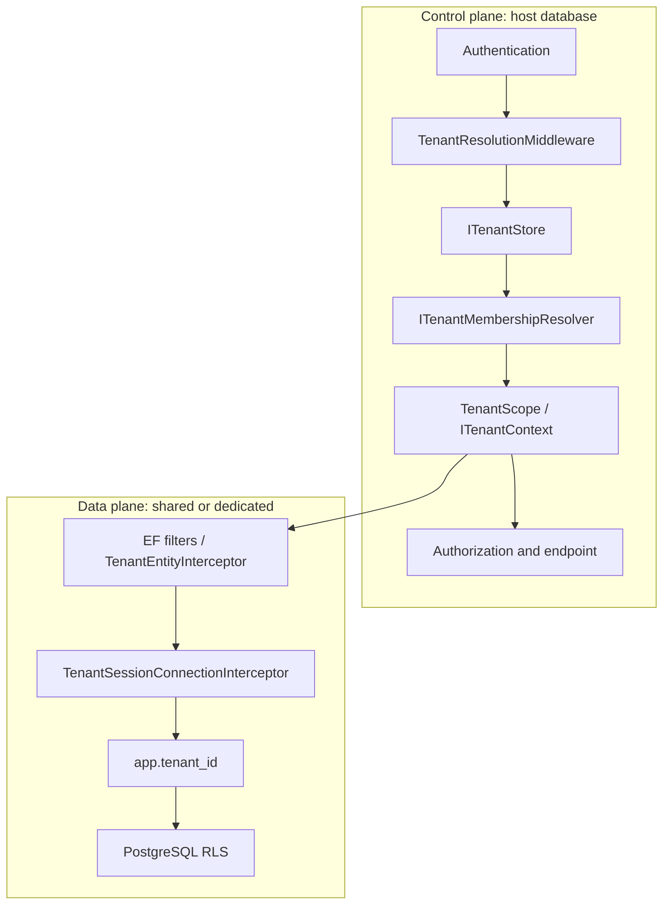
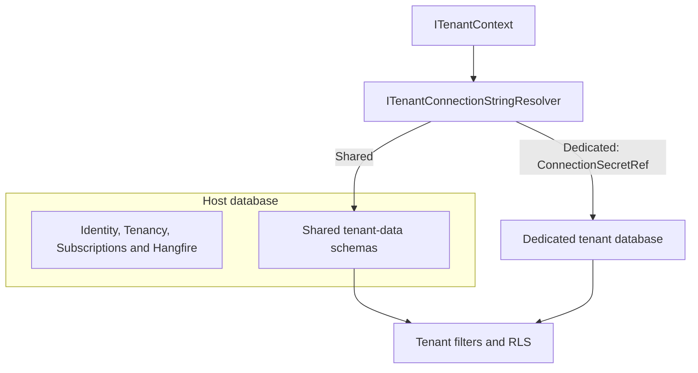
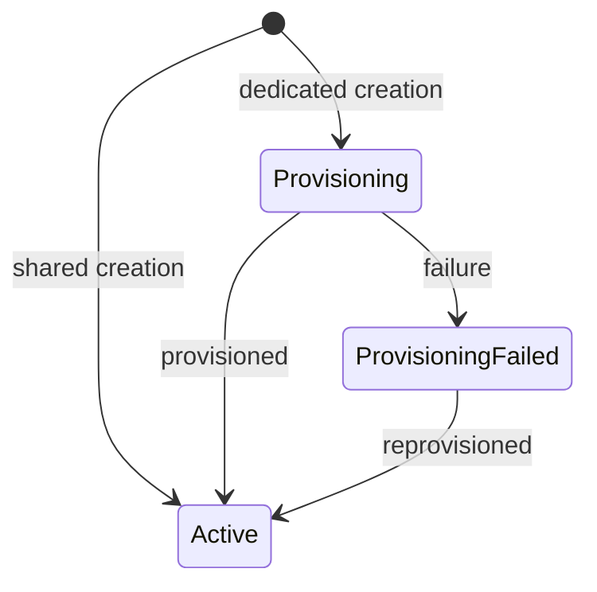
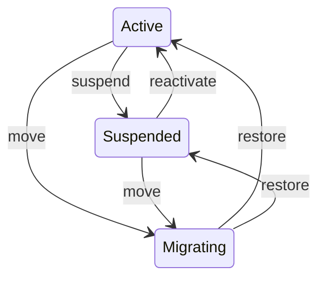
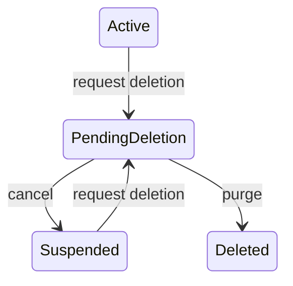

# Multi-tenancy

Multi-tenancy binds requests, background work and business data to a tenant while keeping identity and platform administration in the host database.

## At a glance

- Runtime: `ITenantContext`, `TenantScope` and isolation infrastructure in `src/Shared/Shared.Core/MultiTenancy/`.
- Control plane: `src/Modules/Tenancy/Tenancy/` owns tenants, branches, memberships, roles, invitations and audit.
- Data plane: every `ITenantDataContext` routes tenant-owned rows to a shared or dedicated database.

| Document | What it covers |
|---|---|
| **Overview** (this page) | Requirements, architecture, request flow, NFRs, threat model |
| [Isolation-and-Dedicated-Databases.md](Isolation-and-Dedicated-Databases.md) | The 3 isolation layers, shared vs dedicated, RLS, connection resolution |
| [Branches-and-Scoping.md](Branches-and-Scoping.md) | Branch tree, branch assignments, branch-scoped data |
| [Adding-a-Tenant-Aware-Module.md](Adding-a-Tenant-Aware-Module.md) | Checklist for new modules/entities/jobs/caches |
| [Operations.md](Operations.md) | Enabling, provisioning, migrations, suspension, deletion/purge, runbooks |


## How it works

### Single and multi-tenant modes

With the current schema installed, With `Enabled=false` every row belongs to the always-present **Default tenant**
(`00000000-0000-0000-0000-000000000001`). The schema is the same in both modes, so switching on later needs **no data
migration**: existing data remains the Default tenant's data. Branch and membership primitives remain usable in both modes; tenant creation rejects disabled multi-tenancy.


### Capabilities

| Area | Capability | Endpoint(s) |
|---|---|---|
| Sign-up | An authenticated caller creates a company and becomes its owner (configured default isolation) | `POST /api/v1/tenants` |
| Tenant switcher | Global users belong to **many tenants**; list and switch | `GET /api/v1/me/tenants`, `POST /api/auth/switch-tenant` |
| Tenant profile | Name, legal name, locale, currency, branding | `GET/PUT /api/v1/tenants/current` |
| Custom domains | Add, verify (DNS TXT), remove | `/api/v1/tenants/current/domains` |
| Ownership | Transfer ownership; request deletion (grace period) | `/api/v1/tenants/current/transfer-ownership`, `/deletion` |
| Branches | Tree CRUD, move subtree, (de)activate | `/api/v1/branches` |
| Members | List, update roles + branches, suspend, remove, leave | `/api/v1/members` |
| Invitations | Invite by e-mail (link e-mailed, seat-limited by plan), re-send, revoke, accept | `/api/v1/tenant-invitations` |
| Tenant roles | System roles + custom roles from a permission catalog | `/api/v1/tenant-roles`, `/api/v1/tenant-permissions` |
| Audit | Append-only tenant audit trail | `GET /api/v1/tenant-audit` |
| Data export | Owner downloads all tenant data (JSON + CSV per table) | `POST /api/v1/tenants/current/export` |
| Billing | The **tenant** is the subscriber; expiry suspends, activation reactivates | Subscriptions endpoints |
| Platform admin | List, suspend, reactivate, delete, cancel deletion, **move data** (shared ⇄ dedicated, automated), re-provision | `/api/v1/host/tenants` |
| Support | Audited, short-lived, restricted impersonation of a tenant member | `POST /api/identity/impersonations` |

Global users + memberships: one login (e-mail) can be a member of several tenants with different roles in each - the
membership model. Identity stays global; the **Tenancy** module owns tenants, branches, memberships, roles,
invitations and the audit trail.


### Resolution and data access


*Figure: Tenant resolution establishes the context used by application and database isolation.*

Resolution uses `tid`, host or `X-Tenant`, with cached store and membership lookups. Named Tenant and Branch filters restrict reads; `TenantEntityInterceptor` checks writes. Both use the ambient `ITenantContext`.

#### Building blocks (`src/Shared/Shared.Core/MultiTenancy`)

| Type | Role |
|---|---|
| `MultiTenancyOptions` | `MultiTenancy` configuration section |
| `TenantInfo`, `TenantStatus`, `TenantIsolation` | Cache-friendly tenant snapshot |
| `TenantScope` / `ITenantContext` | AsyncLocal ambient tenant (flows into handlers, events, jobs, consumers) |
| `ITenantStore` / `ITenantMembershipResolver` | Lookups (implemented + cached by the Tenancy module) |
| `IMustHaveTenant`, `IBranchScoped`, `ITenantDataContext`, `[HostEntity]` | Markers |
| `AppDbContextBase.ApplyTenantFilters` | Named `Tenant` / `Branch` filters + `tenant_id` indexes |
| `TenantEntityInterceptor` | Write-side isolation |
| `TenantSessionConnectionInterceptor` + `TenantRlsMigrationExtensions` | PostgreSQL RLS |
| `TenantConnectionStringResolver` | Shared vs dedicated database |
| `TenantResolutionMiddleware` + `RequireTenant()/HostOnly()/TenantOptional()` | Request resolution |
| `TenantPermissions` + `RequireTenantPermission()/RequireTenantMember()` | Tenant authorization |
| `ITenantJobRunner` | Per-tenant fan-out for background work |
| `ITenantCacheKeys` | `t:{tenantId}:` cache keys |
| `TenantDataPurger`, `TenantDataPurgeRequestedEvent` | Tenant erasure |
| Hangfire `TenantJobFilter`, MassTransit `Tenant*Filter` | Tenant propagation across async boundaries |

#### Request flow

1. **Authentication** (JWT) - the token may carry `tid` (tenant) and `tms` (membership stamp).
2. **Tenant resolution** (`UseMultiTenancy`, between authentication and authorization):
   - **Token claim `tid`** is authoritative. A host/header naming another tenant → **403 `tenant_mismatch`**.
   - Otherwise **host** (`{identifier}.{RootDomain}` or a verified custom domain), then the **`X-Tenant`** header
     (id or identifier) - for login pages, public storefronts and service calls.
   - Tenant must exist (404) and be serviceable: `Suspended` → 403 `tenant_suspended` (or GET/HEAD/OPTIONS-only in
     `SuspendedTenantMode=ReadOnly`), `Provisioning/PendingDeletion` → 403 `tenant_unavailable`.
   - A token's tenant must still list the user as an active member (403 `tenant_access_denied`) with the same
     membership stamp (401 `tenant_membership_changed` → refresh the token).
   - Optional `X-Branch` selects the active branch (must be inside the user's branch scope).
3. **Endpoint requirement**: endpoints in modules that own an `ITenantDataContext` **require** a tenant by default
   (400 `tenant_required`); others are optional (an invalid tenant is ignored, not fatal); `HostOnly()` endpoints run
   tenant-less (platform/control plane).
4. **Authorization**: `tperm:*` policies check the **membership's** permissions (owner = all). Tenant permissions are
   **not** in the JWT - they are resolved per request from the cached membership, with invalidations propagating role changes across replicas.
5. **Data access**: filters, interceptor and RLS all read the ambient tenant.

#### Sessions

* Login picks the tenant addressed by the request (host/header), else the user's last active tenant, else their only
  tenant; otherwise the session is tenant-less and the client calls `POST /api/auth/switch-tenant`.
* Refresh tokens remember their tenant and re-validate the membership on every rotation (removed member → the
  session continues tenant-less).
* `GET /api/v1/members/me` returns the caller's effective permissions and branch scope (for UI gating).


## Failure modes and guarantees

| Concern | Mechanism / limit |
|---|---|
| **Isolation** | Three independent layers (resolution validation, EF named filters + write interceptor, PostgreSQL RLS). Fail closed: no tenant → no rows, no writes. Cross-tenant access answers **404** (no existence oracle). Enforced by architecture tests. |
| **Performance** | Tenant + membership resolution: one cached lookup each per request (L1 memory 30 s, L2 Redis 10 min; misses cached 30 s). `tenant_id`-leading indexes on every tenant table; unique indexes are per tenant. Branch subtree = one indexed prefix query (materialized path, `text_pattern_ops`). |
| **Scalability** | Shared tenants use row isolation. Dedicated DBs are bounded by `MaxDedicatedPoolSize` per tenant pool; the tenant → connection mapping is the hook for sharding (several servers). |
| **Availability** | Background work fans out per tenant; one tenant's failure (job, migration, purge) is logged and skipped. Dedicated boot migrations are conditional; production uses the deploy migrator in [Operations](Operations.md). |
| **Security** | No spoofable tenant header (validated against the token); privilege-escalation guard (members can only grant what they hold); host endpoints require platform permissions (+ admin 2FA rules); dedicated connection strings live in configuration/Docker secrets, never in the DB; append-only tenant audit trail. |
| **Noisy neighbour** | Optional per-tenant global rate limit (`RateLimiting:Tenant`), plan seat limits (`MaxUsers` on invitations). |
| **Observability** | `TenantId`/`TenantIdentifier` in the logging scope of every request and job; `tenant.id` activity tag on traces. No tenant label on metrics (bounded cardinality). |
| **Compliance** | Region field (data residency routing hook), deletion with grace period + irreversible purge (rows, dedicated DB, blobs), tenant audit trail. |
| **Backward compatibility** | `Enabled=false` behaves like the original single-tenant template; enabling later needs no data migration. |
| **Testability** | In-memory isolation tests, Testcontainers RLS tests, E2E multi-tenant collection, architecture guardrails. |


### Threat model

| Threat | Mitigation |
|---|---|
| Client sends another tenant's id in `X-Tenant` | Token claim wins; mismatch → 403. Anonymous callers only get public data (no membership → no tenant permissions). |
| Forged id in a request body (IDOR across tenants) | Tenant filter hides the row (404); attach-and-update is blocked by `TenantEntityInterceptor` (logged as a security event). |
| Developer forgets the filter / uses `IgnoreQueryFilters()` | Named filters; architecture test forbids the parameterless call; RLS still blocks at the database. |
| Raw SQL | RLS (non-superuser role) - see [Isolation](Isolation-and-Dedicated-Databases.md#row-level-security). |
| Background job runs without a tenant | Fail closed (no rows); recurring jobs fan out per tenant; Hangfire/MassTransit carry the tenant. |
| Cache poisoning across tenants | `ITenantCacheKeys` (`t:{tenantId}:` prefix); throws without a tenant. |
| Removed member keeps a valid JWT | Middleware re-checks the (cached) membership on every request + stamp check; refresh drops the tenant. |
| Tenant admin escalates privileges | Can only grant roles/permissions/branches it holds itself; owner-only ownership/deletion. |
| Orphan-blob sweeper deletes another tenant's files | Storage keys are tenant-prefixed (`t/{tenantId}/`); the sweeper lists only the current tenant's prefix. |
| Support staff abuses impersonation | Permission + 2FA, mandatory reason, ≤ 60 min access-only token, staff accounts not impersonable, no credential/session/owner actions, audited in BOTH the admin audit and the tenant's own trail. |
| Malicious site calls the API from a browser | CORS allows only configured origins, tenant subdomains of existing tenants and VERIFIED custom domains. |
| Writes lost during a tenant move | `Migrating` blocks HTTP writes (503) and defers jobs/messages; copy verified by row counts in one target transaction per context before the switch. |


### Shared and dedicated topology


*Figure: Tenant-data connections vary by isolation mode while control-plane data stays in the host database.*


### Tenant status lifecycle

During a move, suspension/reactivation updates the status to restore when the move ends; it does not exit `Migrating`. Suspension may block all requests or permit reads according to `SuspendedTenantMode`.


*Figure: Tenant creation activates shared tenants or provisions a dedicated database.*


*Figure: A completed or failed move restores the tenant's effective access status.*

While `Migrating`, reads continue, writes return 503, and jobs and messages defer. Suspension or reactivation
during the move changes the status that will be restored.


*Figure: Pending deletion can be cancelled to a suspended state before purge.*

Deletion can also be requested from `Provisioning` or `ProvisioningFailed`, but not during `Migrating`.

### Error contract

The identifiers in `TenantErrors` are prefixes in exception messages, **not** values assigned to
`CustomException.ErrorCode`. Do not assume a JSON `errorCode` property for these failures.
Source: `src/Shared/Shared.Core/MultiTenancy/TenantAbstractions.cs`;
envelope: [Errors and responses](../Architecture/Errors-and-Responses.md).

| Condition on a tenant-required endpoint | HTTP / message identifier |
|---|---|
| No resolved tenant | 400 / `tenant_required` |
| Unknown tenant | 404 / `tenant_not_found` |
| Conflicting claim, host or header | 403 / `tenant_mismatch` |
| Removed membership / changed stamp | 403 / `tenant_access_denied`; 401 / `tenant_membership_changed` |
| Suspended / otherwise unavailable | 403 / `tenant_suspended` or `tenant_unavailable` |
| Migrating, unsafe HTTP method | 503 / `tenant_migrating` |
| Invalid or out-of-scope branch header | 403 / `branch_not_allowed` |
| Cross-tenant tracked write | 404 without disclosing the foreign row |

Safe methods are GET, HEAD and OPTIONS. Optional endpoints catch tenant-resolution `CustomException` failures and
run tenant-less. A malformed tenant claim returns 401 on a required endpoint. Host/header disagreement also fails
without a claim. Unknown tenant subdomains and headers fail; unknown custom hosts resolve no tenant. Reserved
subdomains and nested labels are ignored. These rules live in `TenantResolutionMiddleware`, not separate
pluggable resolution strategies.

## Configuration

Defaults are from `src/Api/appsettings.json` and `src/Shared/Shared.Core/MultiTenancy/MultiTenancyOptions.cs`.

| Key | Default | Meaning |
|---|---|---|
| `MultiTenancy:Enabled` | `false` | Select Default tenant when disabled; ignore tenant claims/host/header. |
| `MultiTenancy:DefaultIsolation` | `Shared` | New tenant default; see [creation restrictions](Operations.md). |
| `MultiTenancy:SuspendedTenantMode` | `Block` | `ReadOnly` permits safe HTTP methods. |
| `MultiTenancy:Resolution:ClaimType` | `tid` | Authoritative authenticated tenant claim. |
| `MultiTenancy:Resolution:EnableHost` | `true` | Enable subdomain and verified custom-domain lookup. |
| `MultiTenancy:Resolution:RootDomain` | empty | Subdomain suffix; empty disables only subdomain resolution. |
| `MultiTenancy:Resolution:ReservedSubdomains` | `www, api, app, admin, host, status, mail` | Labels never resolved as tenants. |
| `MultiTenancy:Resolution:EnableHeader` | `true` | Enable tenant header lookup. |
| `MultiTenancy:Resolution:HeaderName` | `X-Tenant` | Tenant id or identifier. |
| `MultiTenancy:Resolution:BranchHeaderName` | `X-Branch` | Optional active branch id. |
| `MultiTenancy:Cache:LocalSeconds` | `30` | L1 lifetime; zero disables this level. |
| `MultiTenancy:Cache:DistributedSeconds` | `600` | L2 lifetime; zero disables this level. |
| `MultiTenancy:Cache:BroadcastInvalidation` | `true` | Redis pub/sub eviction across replicas. |
| `MultiTenancy:Cache:InvalidationChannel` | `starterkit:tenancy:invalidate` | Eviction channel. |

Database settings live in [Isolation](Isolation-and-Dedicated-Databases.md#configuration); operational settings in
[Operations](Operations.md#configuration-reference).

## Usage

### Ambient context and host scope

`ITenantContext` reads an AsyncLocal `TenantScope`. `Begin` installs a tenant, optional membership and branch scope;
disposing restores the prior scope. `BeginEmpty` explicitly has no tenant, even in single-tenant mode.
`BeginHostScope()` bypasses tenant filters for narrowly scoped platform work; its optional tenant argument chooses
a dedicated database for maintenance.

`.HostOnly()` endpoints use `BeginEmpty()`, **not** `BeginHostScope()`. Handlers explicitly enter host scope where
needed and enforce platform permissions. Never wrap ordinary request handling in a host scope.
See [Request lifecycle](../Architecture/Request-Lifecycle.md) for middleware order and
[Architecture](../Architecture/Overview.md) for module boundaries.

### Tenant-owned persistence

Every entity, children included, in an `ITenantDataContext` implements `IMustHaveTenant`.
`TenantEntityInterceptor` stamps new rows and rejects cross-tenant changes; never set `TenantId` in application code.
`ApplyTenantFilters` runs last in model construction. [Database conventions](../Architecture/DatabaseConventions.md)
owns the general EF rules.

`IgnoreNonIsolationFilters()` removes only `SoftDelete` and `Lifecycle`; `IgnoreBranchScope()` removes only
`Branch`. Neither removes `Tenant`. Parameterless `IgnoreQueryFilters()` is forbidden in production code.

### Jobs and messages

Hangfire `TenantJobFilter` in `src/Api/Infrastructure/TenantJobFilter.cs` captures tenant and host-scope parameters
when enqueuing and restores scope when executing. Missing tenants cancel jobs; migrating tenants defer ordinary
jobs through Hangfire retry. Host-scoped maintenance is exempt from that migration check.

MassTransit filters in `src/Shared/Shared.Core/MultiTenancy/Messaging/TenantMessageFilters.cs` propagate
`X-Tenant-Id` and `X-Tenant-Host-Scope`. Purged-tenant messages are dropped; migrating-tenant messages use delayed
redelivery so they do not occupy consumer slots in an in-memory retry loop.
Domain handlers inherit the caller's ambient flow.

Tenant propagation does not restore user authorization or branch restrictions. User-initiated work must re-check
the user and establish their branch scope. Recurring work uses `ITenantJobRunner`; see [Operations](Operations.md)
and [Messaging](../Architecture/Messaging.md).

### Caches and storage

Use `ITenantCacheKeys.For(key)` for tenant-derived data; it throws without a tenant.
From `src/Shared/Shared.Core/MultiTenancy/TenantCacheKeys.cs`:

```csharp
public string PrefixOf(Guid tenantId) => $"t:{tenantId:N}:";
```

Platform/user-keyed entries (token blacklist, OTP, plan catalog, subscription-by-subscriber) retain their own keys.
Invalidate explicitly from domain event handlers; cache failures must not fail requests.
Storage uses `StoragePaths.TenantRoot(tenantId)`; seed identities use `TenantSeedIds.For`.

`TenantStore` and `TenantMembershipResolver` layer memory over Redis. Invalidations evict local/distributed entries
and publish affected L1 keys through `ILocalCacheInvalidationBus`; tenant-wide membership invalidation rotates a
generation and broadcasts its key. Receivers, including the sender, evict idempotently. This reduces stale access
windows but is not synchronous acknowledgement from every replica. Without Redis, broadcast is a no-op; failures
are logged. Local TTL bounds L1 retention, not stale L2 data if distributed invalidation also fails.

## Guardrails

`TenantIsolationArchitectureTests` checks tenant entities, named filters, unique indexes and forbidden filter bypass.
`TenantRowLevelSecurityCoverageTests` checks forced RLS and policies against migrated PostgreSQL.
`TenantResolutionMiddlewareTests`, `TenantScopeTests`, `TenantDataIsolationTests`, `TenantCacheKeysTests`,
`CacheInvalidationBroadcastTests` and `TenantMessagingBusTests` exercise runtime boundaries.

## Related

[Branches and scoping](Branches-and-Scoping.md), [Isolation and dedicated databases](Isolation-and-Dedicated-Databases.md),
[Operations](Operations.md), [Adding a tenant-aware module](Adding-a-Tenant-Aware-Module.md),
[Concurrency and versions](../Architecture/Concurrency-and-Versions.md),
[ADR-0005](../Decisions/0005-tenant-isolation-model.md), and `/starterkit:add-background-job`.
