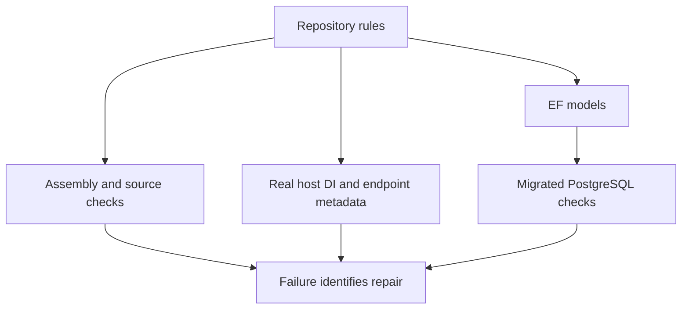

# Architecture guardrails

Architecture tests turn repository rules into executable checks, with failures naming the boundary, mapping or registration that must be repaired.

## At a glance

| Suite | What it inspects | Infrastructure |
|---|---|---|
| `src/Api.Tests/Architecture` | Assembly references, IL calls, EF models, real host DI registrations and Carter metadata | No running database required |
| `src/Api.E2ETests/Infrastructure` | Migrated runtime models and actual PostgreSQL RLS policies | E2E fixture and Docker |

The catalog below covers every test class in the architecture folder plus the two database guardrails. `RealHost` and `IlCalls` are helpers, not additional test suites. Other Api.Tests folders contain separate infrastructure tests, such as `ToolManifestTests`; module tests cover behavior these architecture checks cannot prove.

## How it works


*Figure: Static and host-model checks run without a database while migration and RLS coverage use the E2E database.*

The module set comes from the host's discovered manifests. Some tests construct Npgsql models without opening a database; others inspect the host container through `RealHost`. Presence assertions prevent a broken scan from passing over an empty set. Passing this suite proves the listed assertions, not every rule in `CLAUDE.md`: code review and behavioral tests remain necessary.

## Guardrails

### ModuleDiscoveryTests

Source: [ModuleDiscoveryTests.cs](../../src/Api.Tests/Architecture/ModuleDiscoveryTests.cs). Related rule: `CLAUDE.md` → Architecture rules → Registration; Startup order.

**Fails on:** Host-discovered module names differ from implementation project folders; missing/multiple/wrongly named manifests; Identity not first, Notification not last; Tenancy after a tenant-data module or Subscriptions; Webhooks before modules it forwards; missing consumer assemblies or duplicate enum assemblies. A self-test asserts missing manifests fail fast.

**Fix:** Restore the project reference/glob, one `<M>ModuleManifest` with the assembly attribute, and the required `ModuleOrder`; declare consumer/enum assemblies in manifests.

Reference: [implementation guide](../Architecture/ProjectStructure.md).

### ModuleBoundaryTests

Source: [ModuleBoundaryTests.cs](../../src/Api.Tests/Architecture/ModuleBoundaryTests.cs). Related rule: `CLAUDE.md` → Architecture rules → Boundaries.

**Fails on:** A module assembly references another implementation; Contracts reference implementation assemblies; Shared projects reference modules/contracts; UserDirectory port references modules/contracts; non-Identity modules/contracts or Shared reference Identity.Contracts. The host is deliberately not in the last prohibition.

**Fix:** Move the public message/DTO to the owning Contracts project, invoke through `ISender`, and use UserDirectory.Contracts for users. Remove implementation project references.

Reference: [implementation guide](../Identity/Replacing-the-Identity-Provider.md).

### NamingConventionTests

Source: [NamingConventionTests.cs](../../src/Api.Tests/Architecture/NamingConventionTests.cs). Related rule: `CLAUDE.md` → Naming; Architecture rules → Slice layout.

**Fails on:** Command/query handlers, commands, queries, validators, domain events or Carter classes violate suffixes; handlers live in Contracts. Carter accepts `EndPoint` or `Module`.

**Fix:** Rename the offending concrete type and move handlers into the implementation assembly. Commands end in Command, queries in Query, validators in Validator and domain events in Event.

Reference: [implementation guide](../Architecture/CodingStandards.md).

### ThirdPartyIsolationTests

Source: [ThirdPartyIsolationTests.cs](../../src/Api.Tests/Architecture/ThirdPartyIsolationTests.cs). Related rule: `CLAUDE.md` → Hard-won patterns → Mediator pipeline; Notifications; Architecture guardrails.

**Fails on:** Production assemblies reference MediatR or SixLabors; concrete notification handlers target abstract/interface events; SkiaSharp, QuestPDF, Sylvan or FirebaseAdmin/Google.Apis references are not confined to their designated module; Microsoft.Extensions.AI or a model-provider SDK (OpenAI, Anthropic) is referenced outside Agentic; SignalR Redis backplane appears outside Notification; Contracts reference MassTransit beyond Abstractions. Exact-one-module assertions also fail if an expected adapter disappears.

**Fix:** Use the owned mediator and concrete event handlers. Keep imaging in Attachment, PDFs in Subscriptions, tabular readers in DataTransfer, model providers in Agentic and push/backplane infrastructure in Notification; Contracts may use only MassTransit.Abstractions. This test does not enforce package major versions.

Reference: [implementation guide](Third-Party-Licenses.md).

### MessagingArchitectureTests

Source: [MessagingArchitectureTests.cs](../../src/Api.Tests/Architecture/MessagingArchitectureTests.cs). Related rule: `CLAUDE.md` → Messaging: domain vs integration events; Architecture rules → Boundaries.

**Fails on:** Integration events occur outside Contracts/IntegrationEvents, lack a module-prefixed versioned kebab-case URN, share a URN, also implement IDomainEvent/INotification, or cannot round-trip through the runtime URN map. Consumers occur outside module implementations; outbox model mappings and registrations disagree. Contracts reference Shared.Core/Messaging except the explained Tenancy.Contracts allowlist; obsolete exceptions fail too. Presence checks ensure known events/consumers/contexts remain discoverable.

**Fix:** Put integration types under the Contracts IntegrationEvents namespace, pin unique `[MessageUrn]` values, separate domain events, map the outbox and call `AddOutbox<TContext>()`. Keep the expected presence lists representative and remove stale exceptions; do not bypass delivery assertions.

Reference: [implementation guide](../Architecture/Messaging.md).

### SagaArchitectureTests

Source: [SagaArchitectureTests.cs](../../src/Api.Tests/Architecture/SagaArchitectureTests.cs). Related rule: `CLAUDE.md` → Messaging: domain vs integration events → Sagas.

**Fails on:** IL scanning finds direct MassTransit saga registration or in-memory repository setup outside DurableSagaExtensions. A concrete module saga state is not mapped in a registered module DbContext, has no repository, or resolves an InMemory repository. Detector self-tests check the scan.

**Fix:** Register through `AddDurableSagaStateMachine<TMachine, TState, TDbContext>()` in ConfigureMessaging; map state with SagaStateConfiguration and add its migration (RLS for tenant data).

Reference: [implementation guide](../Architecture/Messaging.md).

### BackgroundJobEventDispatchTests

Source: [BackgroundJobEventDispatchTests.cs](../../src/Api.Tests/Architecture/BackgroundJobEventDispatchTests.cs). Related rule: `CLAUDE.md` → Hard-won patterns → Outside the mediator.

**Fails on:** A module Job/Orchestrator, IHostedService or MassTransit consumer calls SaveChanges/SaveChangesAsync, or resolves persistence from scopes it creates, without an IUnitOfWorkRunner/IDomainEventDispatcher constructor dependency. Stale KnownViolations fail; the current list is empty. Self-tests exercise lambdas, async methods, scopes, consumers and read-only work.

**Fix:** Use `IUnitOfWorkRunner.RunAsync` per item, or dispatch committed events explicitly after saving. Remove manual persistence scopes. The IL detector cannot see a save hidden behind an unrelated repository method name.

Reference: [implementation guide](../Architecture/Request-Lifecycle.md).

### TenantIsolationArchitectureTests

Source: [TenantIsolationArchitectureTests.cs](../../src/Api.Tests/Architecture/TenantIsolationArchitectureTests.cs). Related rule: `CLAUDE.md` → Hard-won patterns → Multi-tenancy → Data rules and Filters.

**Fails on:** Tenant-data root entities lack IMustHaveTenant (unless explicitly HostEntity); tenant-owned entities in module models lack the named Tenant filter; any filter is unnamed; a tenant unique index omits TenantId except TenantInvitation(TokenHash), or contains it but not as its first column; production source contains parameterless IgnoreQueryFilters(). Known data contexts must be discoverable.

**Fix:** Implement tenant ownership, call ApplyTenantFilters last, name every filter, make TenantId the leading column of every tenant unique index, and use IgnoreNonIsolationFilters/IgnoreBranchScope. Model tests exclude owned/derived roots and dictionary join types from their root scan. Raw-SQL indexes created in migrations are outside the model and stay a review item.

Reference: [implementation guide](../MultiTenancy/Isolation-and-Dedicated-Databases.md).

### AdminEndpointAuthorizationTests

Source: [AdminEndpointAuthorizationTests.cs](../../src/Api.Tests/Architecture/AdminEndpointAuthorizationTests.cs). Related rule: `CLAUDE.md` → Hard-won patterns → Auth is explicit; Roles and permissions.

**Fails on:** Real Carter routes contain `/admin` or `/superadmin` literal segments but allow anonymous access or lack an admin-grade policy; a Carter endpoint has no explicit authorization; a used perm: policy is unregistered. The default-auth group safety net is checked independently, and the inventory must find known admin routes.

**Fix:** Declare AllowAnonymous, RequireAuthorization, permission or tenant membership policies explicitly, using the appropriate admin permission on admin routes. Register permission constants/policies. The scan accepts named AdminOnly/SuperAdminOnly/perm: policies or effective permission/admin-role requirements; it does not prove business intent.

Reference: [implementation guide](Endpoint-Authorization.md).

### AgentToolArchitectureTests

Source: [AgentToolArchitectureTests.cs](../../src/Api.Tests/Architecture/AgentToolArchitectureTests.cs). Related rule: `CLAUDE.md` → Hard-won patterns → AI agents.

**Fails on:** An agent tool (a class with `[AgentTool]` or implementing `IAgentTool<,>`) takes a DbContext, a type named `*Repository`, `IServiceProvider` or `IServiceScopeFactory` in its constructor; a tool class lacks the attribute or the interface. A self-test checks that the detector flags each case.

**Fix:** Send the owning module's commands and queries through `ISender`, so validation, authorization, invariants, domain events and the audit trail apply as for an HTTP request. The test does not inspect what a tool does inside `ExecuteAsync`.

Reference: [implementation guide](../Modules/Agentic.md).

### ClientGeneratedKeyTests

Source: [ClientGeneratedKeyTests.cs](../../src/Api.Tests/Architecture/ClientGeneratedKeyTests.cs). Related rule: `CLAUDE.md` → Architecture rules → EF; Hard-won patterns → Optimistic concurrency.

**Fails on:** A child reached by a collection navigation has a single Guid primary key whose ValueGenerated is not Never and no database default SQL. The real host must expose at least six contexts.

**Fix:** Map domain-assigned child IDs with `ValueGeneratedNever()` and add a migration if the model changes. A genuine database default is permitted by this test. Fix mapping rather than treating the first insert as a stale-update conflict.

Reference: [implementation guide](../Architecture/DatabaseConventions.md).

### EnumStorageTests

Source: [EnumStorageTests.cs](../../src/Api.Tests/Architecture/EnumStorageTests.cs). Related rule: `CLAUDE.md` → Architecture rules → EF (enums are stored as strings).

**Fails on:** An enum (or nullable enum) property of any entity in any module context of the real host is stored with a non-string provider type: an explicit `HasConversion<int>()` or no conversion at all. Nine legacy Identity/Subscriptions columns are listed as exceptions; a listed column that becomes a string, or disappears, must leave the list.

**Fix:** Map the property with `.HasConversion<string>().HasMaxLength(...)` and add the migration. Never extend the legacy list: converting an existing int column is a data migration (`ALTER COLUMN ... USING CASE`), which a product can do and then remove the entry.

Reference: [implementation guide](../Architecture/DatabaseConventions.md).

### AuditTrailArchitectureTests

Source: [AuditTrailArchitectureTests.cs](../../src/Api.Tests/Architecture/AuditTrailArchitectureTests.cs). Related rule: `CLAUDE.md` → Hard-won patterns → Audit trail.

**Fails on:** A module context mapping IAuditable types has no audit entry type; a tenant-data context uses the host audit row instead of TenantAuditEntry. An optional sample assertion checks its audited aggregates.

**Fix:** Map `AddAuditTrail()` or `AddTenantAuditTrail()` as appropriate and migrate the audit table, including tenant RLS. Mark secret/noisy properties AuditIgnore. The test checks mapping, not every runtime diff or retention job.

Reference: [implementation guide](../Architecture/DatabaseConventions.md).

### RequestHandlerCoverageTests

Source: [RequestHandlerCoverageTests.cs](../../src/Api.Tests/Architecture/RequestHandlerCoverageTests.cs). Related rule: `CLAUDE.md` → Hard-won patterns → Mediator pipeline; Architecture rules → Registration.

**Fails on:** A concrete IRequest<T> has no registered IRequestHandler<T,TResult> in the real DI container; the longest public constructor of an implementation has a required unregistered dependency. Presence checks ensure requests exist and more than 50 handlers are scanned.

**Fix:** Register module mediator handlers and each required dependency in module service registration. Optional constructor parameters are excluded. The check uses IServiceProviderIsService without constructing dependencies, so it does not prove that service factories or runtime configuration succeed.

Reference: [implementation guide](../Architecture/DesignPatterns.md).

### PendingModelChangesTests

Source: [PendingModelChangesTests.cs](../../src/Api.E2ETests/Infrastructure/PendingModelChangesTests.cs). Related rule: `CLAUDE.md` → Hard-won patterns → Migrations run at deploy; Rules → Build/tests.

**Fails on:** Any registered IDbContext has pending model changes or unapplied migrations in the E2E fixture; the context-name inventory omits expected core contexts. It iterates all registered contexts, beyond the minimum name list.

**Fix:** Generate the owning module migration with the commands in Migrations, inspect snapshot/model alignment and ensure the fixture applies migrations. Do not suppress pending-model warnings. Requires Docker-backed E2E infrastructure.

Reference: [implementation guide](Migrations.md).

### TenantRowLevelSecurityCoverageTests

Source: [TenantRowLevelSecurityCoverageTests.cs](../../src/Api.E2ETests/Infrastructure/TenantRowLevelSecurityCoverageTests.cs). Related rule: `CLAUDE.md` → Hard-won patterns → Multi-tenancy → Every new table gets RLS.

**Fails on:** A regular or partitioned PostgreSQL table with tenant_id in a registered ITenantDataContext schema lacks enabled RLS, forced RLS or the tenant_isolation policy. Presence assertions require attachment/webhooks schemas and actual tables; control-plane schemas are excluded.

**Fix:** Call `EnableTenantRowLevelSecurity` for each new tenant table in its migration. Repair deployed gaps with a forward migration. Verify through the real migrated E2E database, not only an EF query filter.

Reference: [implementation guide](Migrations.md).

## Usage

```bash
dotnet test src/Api.Tests
dotnet test src/Api.E2ETests --filter "FullyQualifiedName~PendingModelChangesTests|FullyQualifiedName~TenantRowLevelSecurityCoverageTests"
```

After code changes, first run `dotnet build StarterKit.slnx`, then relevant behavioral tests and `dotnet test src/Api.Tests`. The E2E command starts the real fixture and requires Docker; it is not interchangeable with a model-only architecture test.

## Failure modes and guarantees

- Repair the offending code/model/registration before changing an expected list or exception. An exception needs a concrete architectural reason, not a way to make a failing test green.
- IL and reference scans are deliberately bounded. They cannot validate permission choice, runtime factory success, arbitrary indirect saves or SQL that never appears in a scanned model.
- Tenant RLS coverage verifies policy presence and enabled/forced flags. Cross-tenant behavioral tests still verify policy behavior and connection scope.
- Tenant-first order is asserted for unique indexes in the EF model; unique indexes written as raw SQL in migrations are reviewed by hand.

## Review workflow

The `/starterkit:review` procedure applies these guardrails to a working-tree diff, a module, a path or the whole codebase. Agree on the scope and review size first: a big change allows up to four issues per section; a small change allows one.

Review Architecture, Code Quality, Tests and Performance in that order. Number each finding, cite `file:line`, and offer two or three lettered options with effort, risk, impact and maintenance cost, placing the recommendation first. Include leaving the code unchanged when that is a reasonable option. Relate recommendations to duplication, test coverage, appropriate abstraction, edge cases and explicit behavior.

Interactive reviews wait for confirmation after each section and do not edit code during the review. Approved fixes follow afterward, with the required build and relevant tests; commits require a separate user request. Passing architecture tests supports the review but does not prove business correctness or replace behavioral tests.

## Related

[CLAUDE.md](../../CLAUDE.md), [Testing strategy](../Testing/Testing-Strategy.md), [ADRs](../Decisions/README.md), [Endpoint authorization](Endpoint-Authorization.md), and `/starterkit:write-tests` / `/starterkit:review`.
