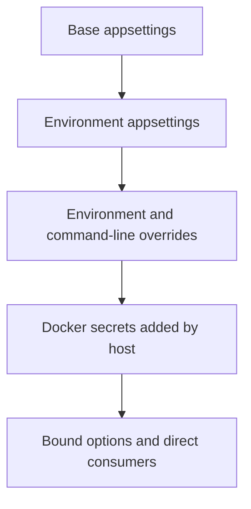

# Configuration reference

This reference inventories the checked-in API configuration keys and environment overrides, with meanings taken from their option types and direct consumers.

## At a glance

| File | Role |
|---|---|
| `src/Api/appsettings.json` | Base JSON defaults |
| `src/Api/appsettings.Docker.json` | Docker-environment overrides; Compose also supplies environment variables and secret files |
| `src/Api/appsettings.Development.json` | Local development overrides |

The key inventory below is generated from these JSON files, ignoring comment-only template branches. Scalar arrays are shown as complete JSON values; policy object arrays use numeric configuration indices. Empty objects are shown explicitly. Defaults here are **file defaults**, not a claim that every key is consumed or that option initializers match them. Options can expose additional settings absent from these JSON files; follow the canonical pages for those settings. `appsettings.LoadTest.json` is a separate load-test profile described in [Load testing](../Testing/Load-Testing.md).

## How it works


*Figure: The host composes configuration before registering infrastructure and modules.*

ASP.NET Core merges configuration by key; arrays are indexed configuration entries, so a shorter override does not necessarily erase base entries. Docker secrets are added after the default providers in `src/Api/Program.cs`. Never copy development credentials to a deployment. The two development credential values and the real payment-provider hostname are deliberately not reproduced below; their source entries are identified by key.

## Configuration

Each section lists every base leaf, followed by Docker and Development entries present in that section. Unlisted environment entries inherit the base value. Refer to deployment environment variables and secrets when assessing effective production behavior; the Docker JSON alone does not select every production setting.

### AppOptions

Options: [AppOptions](../../src/Shared/Shared.Core/Web/AppOptions.cs). Canonical guide: [details](../Architecture/ProjectStructure.md).

**Base defaults**

| Key | Default / override | Meaning | Canonical page |
|---|---|---|---|
| `AppOptions:Name` | `"starterkit"` | Application name used by shared host infrastructure. | [Guide](../Architecture/ProjectStructure.md) |

### ConnectionStrings

Canonical guide: [details](../deployment/Secrets.md).

**Base defaults**

| Key | Default / override | Meaning | Canonical page |
|---|---|---|---|
| `ConnectionStrings:starterkit` | `"Host=localhost;Port=5432;Database=starterkit;Username=postgres;Password=CHANGE_ME;Include Error Detail=true"` | Shared PostgreSQL application connection; environment overrides and Docker secrets supply credentials. | [Guide](../deployment/Secrets.md) |
| `ConnectionStrings:seq` | `"http://localhost:5341"` | Seq log ingestion endpoint; telemetry sink, not a readiness dependency. | [Guide](../deployment/Secrets.md) |

**Docker overrides**

| Key | Default / override | Meaning | Canonical page |
|---|---|---|---|
| `ConnectionStrings:seq` | `"http://seq:80"` | Seq log ingestion endpoint; telemetry sink, not a readiness dependency. | [Guide](../deployment/Secrets.md) |

**Development overrides**

| Key | Default / override | Meaning | Canonical page |
|---|---|---|---|
| `ConnectionStrings:starterkit` | Development-only credential in source (redacted) | Shared PostgreSQL application connection; environment overrides and Docker secrets supply credentials. | [Guide](../deployment/Secrets.md) |

### Database

Options: [DatabaseMigrationOptions](../../src/Shared/Shared.Core/Data/DatabaseMigrationOptions.cs). Canonical guide: [details](../deployment/Database-Migrations.md).

**Base defaults**

| Key | Default / override | Meaning | Canonical page |
|---|---|---|---|
| `Database:MigrateOnStartup` | `true` | Migrate and seed during module initialization; Docker disables this for deploy-time migration. | [Guide](../deployment/Database-Migrations.md) |
| `Database:MigrationConnectionString` | `null` | Optional privileged connection for shared-database migration work; null uses the normal connection. | [Guide](../deployment/Database-Migrations.md) |
| `Database:LockTimeoutSeconds` | `300` | Seconds to wait for the per-database migration advisory lock. | [Guide](../deployment/Database-Migrations.md) |

**Docker overrides**

| Key | Default / override | Meaning | Canonical page |
|---|---|---|---|
| `Database:MigrateOnStartup` | `false` | Migrate and seed during module initialization; Docker disables this for deploy-time migration. | [Guide](../deployment/Database-Migrations.md) |

### RequestTimeouts

Canonical guide: [details](../Architecture/Request-Lifecycle.md).

**Base defaults**

| Key | Default / override | Meaning | Canonical page |
|---|---|---|---|
| `RequestTimeouts:DefaultSeconds` | `30` | Default HTTP request timeout in seconds. | [Guide](../Architecture/Request-Lifecycle.md) |
| `RequestTimeouts:LongRunningSeconds` | `300` | Timeout in seconds for endpoints using the LongRunning policy. | [Guide](../Architecture/Request-Lifecycle.md) |

### Messaging

Options: [MessagingOptions](../../src/Shared/Shared.Messaging/Extensions/MessagingOptions.cs). Canonical guide: [details](../Architecture/Messaging.md).

**Base defaults**

| Key | Default / override | Meaning | Canonical page |
|---|---|---|---|
| `Messaging:Transport` | `"InMemory"` | `MessagingTransport.InMemory` (default: dev / tests - NOT durable, messages in flight are lost on restart), `MessagingTransport.PostgreSql` (durable queues in the existing database, no new infrastructure) or `MessagingTransport.RabbitMq`. | [Guide](../Architecture/Messaging.md) |
| `Messaging:PostgreSql:Schema` | `"transport"` | Schema holding the transport's queue tables/functions. | [Guide](../Architecture/Messaging.md) |
| `Messaging:PostgreSql:CreateInfrastructure` | `true` | Create/upgrade the transport schema, role and functions. Needs DDL + CREATEROLE rights. App instances do it at startup only with `Database:MigrateOnStartup=true` (dev, Aspire, tests); in production the one-shot `--migrate-only` run owns it, under `Database:MigrationConnectionString`. Set false only when a DBA provisions the transport outside the deploy. ADR 0022. | [Guide](../Architecture/Messaging.md) |
| `Messaging:RabbitMq:Host` | `"localhost"` | Server hostname for this connection. | [Guide](../Architecture/Messaging.md) |
| `Messaging:RabbitMq:Port` | `5672` | Server TCP port. | [Guide](../Architecture/Messaging.md) |
| `Messaging:RabbitMq:VirtualHost` | `"/"` | RabbitMQ virtual host used by the bus. | [Guide](../Architecture/Messaging.md) |
| `Messaging:RabbitMq:Username` | `"starterkit"` | Authentication username. | [Guide](../Architecture/Messaging.md) |
| `Messaging:RabbitMq:Password` | `"CHANGE_ME"` | Secret: Docker secret `rabbitmq_password` / env `Messaging__RabbitMq__Password`. Never commit it. | [Guide](../Architecture/Messaging.md) |
| `Messaging:Outbox:BatchSize` | `100` | Maximum outbox rows claimed per delivery batch. | [Guide](../Architecture/Messaging.md) |
| `Messaging:Outbox:MaxAttempts` | `10` | Delivery attempts before an outbox row is dead-lettered. | [Guide](../Architecture/Messaging.md) |
| `Messaging:Outbox:LeaseSeconds` | `60` | Claim lease duration in seconds; crashed claims can be recovered after expiry. | [Guide](../Architecture/Messaging.md) |
| `Messaging:Outbox:SweepCron` | `"* * * * *"` | Recurring recovery sweep cron schedule (UTC). | [Guide](../Architecture/Messaging.md) |
| `Messaging:Outbox:RetentionDays` | `7` | Retention window in days for this subsystem. | [Guide](../Architecture/Messaging.md) |

**Docker overrides**

| Key | Default / override | Meaning | Canonical page |
|---|---|---|---|
| `Messaging:RabbitMq:Host` | `"rabbitmq"` | Server hostname for this connection. | [Guide](../Architecture/Messaging.md) |
| `Messaging:RabbitMq:Password` | `""` | Secret: Docker secret `rabbitmq_password` / env `Messaging__RabbitMq__Password`. Never commit it. | [Guide](../Architecture/Messaging.md) |

**Development overrides**

| Key | Default / override | Meaning | Canonical page |
|---|---|---|---|
| `Messaging:Transport` | `"InMemory"` | `MessagingTransport.InMemory` (default: dev / tests - NOT durable, messages in flight are lost on restart), `MessagingTransport.PostgreSql` (durable queues in the existing database, no new infrastructure) or `MessagingTransport.RabbitMq`. | [Guide](../Architecture/Messaging.md) |
| `Messaging:RabbitMq:Host` | `"localhost"` | Server hostname for this connection. | [Guide](../Architecture/Messaging.md) |

### Attachment

Options: [AttachmentOptions](../../src/Modules/Attachment/Attachment/Infrastructure/Configuration/AttachmentOptions.cs). Canonical guide: [details](../Attachment/Configuration.md).

**Base defaults**

| Key | Default / override | Meaning | Canonical page |
|---|---|---|---|
| `Attachment:Pending:MaxUploadsPerSession` | `20` | Maximum number of live uploads per server-issued session (default: 20). | [Guide](../Attachment/Configuration.md) |
| `Attachment:Pending:MaxUploadsPerMinute` | `5` | Unused: use the `upload` rate-limiting policy (RateLimiting:Policies). | [Guide](../Attachment/Configuration.md) |
| `Attachment:Pending:ExpirationHours` | `48` | Expiration time in hours for pending attachments (default: 48) | [Guide](../Attachment/Configuration.md) |
| `Attachment:Pending:CleanupIntervalHours` | `6` | Cleanup job interval in hours (default: 6). 24 or more = daily. | [Guide](../Attachment/Configuration.md) |
| `Attachment:Pending:CleanupBatchSize` | `100` | Rows per cleanup batch (default: 100). The job loops batches until nothing is left. | [Guide](../Attachment/Configuration.md) |
| `Attachment:Storage:Provider` | `"Local"` | Storage provider type: Local, AzureBlob, S3. The selected provider's settings are required. | [Guide](../Attachment/Configuration.md) |
| `Attachment:Storage:Local:UploadPath` | `"uploads"` | Upload directory (relative to the content root, or absolute). Files are NOT served as static files; they are only reachable through the access-checked download endpoint or a signed read URL. | [Guide](../Attachment/Configuration.md) |
| `Attachment:Storage:Local:BaseUrl` | `"/uploads"` | Obsolete: files are no longer served from a static path. Kept so existing config still binds. | [Guide](../Attachment/Configuration.md) |
| `Attachment:Storage:AzureBlob:ConnectionString` | `null` | Azure storage connection string (must contain an account key so SAS URLs can be signed). | [Guide](../Attachment/Configuration.md) |
| `Attachment:Storage:AzureBlob:ContainerName` | `"attachments"` | Azure Blob container used for attachment objects. | [Guide](../Attachment/Configuration.md) |
| `Attachment:Storage:AzureBlob:UsePublicAccess` | `false` | Obsolete: containers are always created private; reads go through SAS URLs. | [Guide](../Attachment/Configuration.md) |
| `Attachment:Storage:S3:AccessKeyId` | `""` | AWS Access Key ID. Leave AccessKeyId and SecretAccessKey empty to use the default credential chain (IAM role / instance profile / environment variables / shared profile). | [Guide](../Attachment/Configuration.md) |
| `Attachment:Storage:S3:SecretAccessKey` | `""` | AWS secret access key; empty uses the default credential chain. | [Guide](../Attachment/Configuration.md) |
| `Attachment:Storage:S3:Region` | `"us-east-1"` | AWS service region. | [Guide](../Attachment/Configuration.md) |
| `Attachment:Storage:S3:BucketName` | `""` | S3 bucket holding attachment objects. | [Guide](../Attachment/Configuration.md) |
| `Attachment:Storage:S3:UsePublicAccess` | `true` | Obsolete: objects are always read through short-lived presigned URLs. | [Guide](../Attachment/Configuration.md) |
| `Attachment:Storage:S3:CloudFrontDomain` | `null` | Obsolete: unsigned CloudFront URLs are no longer handed out. | [Guide](../Attachment/Configuration.md) |
| `Attachment:Storage:S3:UseServerSideEncryption` | `true` | Request S3 server-side encryption for stored objects. | [Guide](../Attachment/Configuration.md) |
| `Attachment:Storage:S3:StorageClass` | `"STANDARD"` | Storage class (STANDARD, INTELLIGENT_TIERING, GLACIER, etc.) | [Guide](../Attachment/Configuration.md) |
| `Attachment:Storage:S3:PresignedUrlExpirationMinutes` | `60` | Obsolete: use `Attachment:Download:ReadUrlTtlMinutes`. | [Guide](../Attachment/Configuration.md) |
| `Attachment:Validation:MaxFileSizeBytes` | `10485760` | Maximum size for files of type Other (default 10MB). | [Guide](../Attachment/Configuration.md) |
| `Attachment:Validation:MaxImageSizeBytes` | `10485760` | Largest accepted image, in bytes. | [Guide](../Attachment/Configuration.md) |
| `Attachment:Validation:MaxDocumentSizeBytes` | `52428800` | Largest accepted document, in bytes. | [Guide](../Attachment/Configuration.md) |
| `Attachment:Validation:MaxVideoSizeBytes` | `104857600` | Largest accepted video, in bytes. | [Guide](../Attachment/Configuration.md) |
| `Attachment:Validation:MaxAudioSizeBytes` | `20971520` | Largest accepted audio file, in bytes. | [Guide](../Attachment/Configuration.md) |
| `Attachment:Validation:AllowedExtensions` | `[".jpg", ".jpeg", ".png", ".gif", ".bmp", ".webp", ".pdf", ".doc", ".docx", ".xls", ".xlsx", ".ppt", ".pptx", ".txt", ".csv", ".json", ".xml", ".mp4", ".mpeg", ".quicktime", ".avi", ".mp3", ".wav", ".ogg"]` | Allowed file extensions. Every allowed extension must also have a content signature rule (see `FileSignatureCatalog`); extensions without one are rejected. | [Guide](../Attachment/Configuration.md) |
| `Attachment:Validation:AllowedImageTypes` | `["image/jpeg", "image/png", "image/gif", "image/bmp", "image/webp"]` | Accepted image MIME types. | [Guide](../Attachment/Configuration.md) |
| `Attachment:Validation:AllowedDocumentTypes` | `["application/pdf", "application/msword", "application/vnd.openxmlformats-officedocument.wordprocessingml.document", "application/vnd.ms-excel", "application/vnd.openxmlformats-officedocument.spreadsheetml.sheet", "application/vnd.ms-powerpoint", "application/vnd.openxmlformats-officedocument.presentationml.presentation", "text/plain", "text/csv", "application/json", "application/xml"]` | Accepted document MIME types. | [Guide](../Attachment/Configuration.md) |
| `Attachment:Validation:AllowedVideoTypes` | `["video/mp4", "video/mpeg", "video/quicktime", "video/x-msvideo"]` | Accepted video MIME types. | [Guide](../Attachment/Configuration.md) |
| `Attachment:Validation:AllowedAudioTypes` | `["audio/mpeg", "audio/mp3", "audio/wav", "audio/ogg"]` | Accepted audio MIME types. | [Guide](../Attachment/Configuration.md) |
| `Attachment:Validation:EnableVirusScanning` | `false` | Scan uploads with the registered `IMalwareScanner`. When true and no real scanner is registered, the application fails at startup. | [Guide](../Attachment/Configuration.md) |
| `Attachment:Validation:RequireVirusScanning` | `false` | Refuse to start when `EnableVirusScanning` is false. Off by default; production deployments that accept uploads from untrusted users should turn it on (without it startup only logs a warning). | [Guide](../Attachment/Configuration.md) |
| `Attachment:Validation:Scanner:Provider` | `"None"` | Select the adapter used by this subsystem. | [Guide](../Attachment/Configuration.md) |
| `Attachment:Validation:Scanner:Host` | `"localhost"` | clamd host name (the compose service is `clamav`). | [Guide](../Attachment/Configuration.md) |
| `Attachment:Validation:Scanner:Port` | `3310` | Server TCP port. | [Guide](../Attachment/Configuration.md) |
| `Attachment:Validation:Scanner:TimeoutSeconds` | `30` | Connect + scan timeout for one file. Large documents on a busy clamd take seconds. | [Guide](../Attachment/Configuration.md) |
| `Attachment:Validation:Scanner:ChunkSizeBytes` | `65536` | INSTREAM chunk size. clamd's `StreamMaxLength` must be at least the largest upload. | [Guide](../Attachment/Configuration.md) |
| `Attachment:Validation:Scanner:FailOpen` | `false` | When the scanner is unreachable or errors: false (default) rejects the upload with 503 `malware_scanner_unavailable`; true accepts it unscanned and logs an error. Never true in production unless an outage is worse for you than an unscanned file. | [Guide](../Attachment/Configuration.md) |
| `Attachment:Validation:EnableContentVerification` | `true` | Obsolete: content (magic-byte) verification is always on. | [Guide](../Attachment/Configuration.md) |
| `Attachment:Validation:BlockedExtensions` | `[".exe", ".dll", ".bat", ".cmd", ".sh", ".ps1", ".vbs", ".js"]` | Extra blocked extensions. A built-in list (html, htm, svg, js, exe, ...) is always blocked, even if an extension is also listed in `AllowedExtensions`. | [Guide](../Attachment/Configuration.md) |
| `Attachment:Image:EnableThumbnailGeneration` | `true` | Generate image thumbnails on upload. | [Guide](../Attachment/Configuration.md) |
| `Attachment:Image:ThumbnailWidth` | `200` | Thumbnail width in pixels. | [Guide](../Attachment/Configuration.md) |
| `Attachment:Image:ThumbnailHeight` | `200` | Thumbnail height in pixels. | [Guide](../Attachment/Configuration.md) |
| `Attachment:Image:ThumbnailQuality` | `80` | Thumbnail quality (1-100) | [Guide](../Attachment/Configuration.md) |
| `Attachment:Image:EnableOptimization` | `true` | Auto-orient images (EXIF) before generating thumbnails. | [Guide](../Attachment/Configuration.md) |

**Docker overrides**

| Key | Default / override | Meaning | Canonical page |
|---|---|---|---|
| `Attachment:Storage` | `{}` | Empty Docker storage override in this source clone; template generation selects a provider in conditional branches. | [Guide](../Attachment/Configuration.md) |

### BotProtection

Options: [BotProtectionOptions](../../src/Shared/Shared.Core/BotProtection/BotProtectionOptions.cs). Canonical guide: [details](../Identity/Bot-Protection.md).

**Base defaults**

| Key | Default / override | Meaning | Canonical page |
|---|---|---|---|
| `BotProtection:Enabled` | `false` | Master switch. Off (default): every protected endpoint passes without a token. | [Guide](../Identity/Bot-Protection.md) |
| `BotProtection:Provider` | `"Turnstile"` | Select the adapter used by this subsystem. | [Guide](../Identity/Bot-Protection.md) |
| `BotProtection:SecretKey` | `""` | Provider secret. Never commit it: use env `BotProtection__SecretKey` or the Docker secret file of the same name. | [Guide](../Identity/Bot-Protection.md) |
| `BotProtection:SiteKey` | `""` | Public site key the frontend widget uses. Informational for the backend. | [Guide](../Identity/Bot-Protection.md) |
| `BotProtection:AllowedHostnames` | `[]` | When non-empty, the verified token's hostname must be one of these. | [Guide](../Identity/Bot-Protection.md) |
| `BotProtection:TimeoutSeconds` | `5` | Per-request timeout for the provider call. | [Guide](../Identity/Bot-Protection.md) |
| `BotProtection:FailOpen` | `true` | When the provider is unreachable or times out: true (default) lets the request through (logged, counted) so sign-in stays available; false rejects with 503 `captcha_unavailable`. An INVALID token is always rejected. | [Guide](../Identity/Bot-Protection.md) |
| `BotProtection:Actions` | `[]` | Actions that require verification. Empty = every endpoint that declares `.RequireHumanVerification`. | [Guide](../Identity/Bot-Protection.md) |

### Hangfire

Canonical guide: [details](../Modules/DataTransfer.md).

**Base defaults**

| Key | Default / override | Meaning | Canonical page |
|---|---|---|---|
| `Hangfire:DashboardPath` | `"/hangfire"` | Middleware path for the job dashboard. | [Guide](../Modules/DataTransfer.md) |
| `Hangfire:CleanupCron` | `"0 */6 * * *"` | Present in JSON, but no production consumer of this key exists; individual job bootstraps own their schedules. | [Guide](../Modules/DataTransfer.md) |
| `Hangfire:Servers:Default:Enabled` | `true` | Run the default-queue worker server in this replica. | [Guide](../Modules/DataTransfer.md) |
| `Hangfire:Servers:Default:WorkerCount` | `5` | Concurrency of the default-queue worker server. | [Guide](../Modules/DataTransfer.md) |
| `Hangfire:Servers:Notification:Enabled` | `true` | Run the notifications-queue worker server in this replica. | [Guide](../Modules/DataTransfer.md) |
| `Hangfire:Servers:Notification:WorkerCount` | `4` | Concurrency of the notifications-queue server. | [Guide](../Modules/DataTransfer.md) |
| `Hangfire:Servers:DataTransfer:Enabled` | `true` | Run the data-transfer-queue worker server in this replica. | [Guide](../Modules/DataTransfer.md) |
| `Hangfire:Servers:DataTransfer:WorkerCount` | `2` | Concurrency of the data-transfer-queue server. | [Guide](../Modules/DataTransfer.md) |
| `Hangfire:Servers:Agentic:Enabled` | `true` | Run the agentic-queue worker server (agent runs) in this replica. | [Guide](../Modules/Agentic.md) |
| `Hangfire:Servers:Agentic:WorkerCount` | `4` | Concurrency of the agentic-queue server: agent runs executing at the same time in this replica. | [Guide](../Modules/Agentic.md) |
| `Hangfire:DashboardAuth:Enabled` | `true` | Enable this configured subsystem/provider. | [Guide](../Modules/DataTransfer.md) |
| `Hangfire:DashboardAuth:AllowLocalRequestsWithoutAuthentication` | `false` | Permit unauthenticated local dashboard requests when explicitly enabled. | [Guide](../Modules/DataTransfer.md) |
| `Hangfire:DashboardAuth:Username` | `"admin"` | Authentication username. | [Guide](../Modules/DataTransfer.md) |
| `Hangfire:DashboardAuth:Password` | `"CHANGE_ME"` | Authentication password; supply through secrets. | [Guide](../Modules/DataTransfer.md) |

**Development overrides**

| Key | Default / override | Meaning | Canonical page |
|---|---|---|---|
| `Hangfire:DashboardAuth:Enabled` | `false` | Enable this configured subsystem/provider. | [Guide](../Modules/DataTransfer.md) |

### Email

Options: [EmailOptions](../../src/Modules/Notification/Notification/Options/EmailOptions.cs). Canonical guide: [details](../Modules/Notification-Email-Design-System.md).

**Base defaults**

| Key | Default / override | Meaning | Canonical page |
|---|---|---|---|
| `Email:Provider` | `"Auto"` | Transport selection (Email:Provider): `Auto` (default), `Smtp` or `NoOp`. `Auto` = NoOp in Development when no real SMTP host is configured, otherwise Smtp. | [Guide](../Modules/Notification-Email-Design-System.md) |
| `Email:SmtpHost` | `"smtp.example.com"` | SMTP server hostname. | [Guide](../Modules/Notification-Email-Design-System.md) |
| `Email:SmtpPort` | `587` | SMTP server port. | [Guide](../Modules/Notification-Email-Design-System.md) |
| `Email:UseTls` | `true` | Use TLS for SMTP transport. | [Guide](../Modules/Notification-Email-Design-System.md) |
| `Email:FromAddress` | `"no-reply@example.com"` | Sender email address. | [Guide](../Modules/Notification-Email-Design-System.md) |
| `Email:FromName` | `"StarterKit"` | Sender display name. | [Guide](../Modules/Notification-Email-Design-System.md) |
| `Email:SmtpUsername` | `""` | SMTP account username. | [Guide](../Modules/Notification-Email-Design-System.md) |
| `Email:SmtpPassword` | `""` | SMTP account password; supply through secrets. | [Guide](../Modules/Notification-Email-Design-System.md) |
| `Email:BrandName` | `"StarterKit"` | Product/brand name rendered in email layouts and subjects (Email:BrandName). | [Guide](../Modules/Notification-Email-Design-System.md) |
| `Email:AppBaseUrl` | `"https://app.example.com"` | Public base URL of the frontend app, used for links in emails (Email:AppBaseUrl). | [Guide](../Modules/Notification-Email-Design-System.md) |
| `Email:AllowedLinkHosts` | `[]` | Extra hosts (besides the `AppBaseUrl` host) that links in emails may point to (Email:AllowedLinkHosts). Any other href rendered through the `safe_url` filter is replaced by "#". | [Guide](../Modules/Notification-Email-Design-System.md) |
| `Email:SupportEmail` | `"support@example.com"` | Support contact shown in emails (Email:SupportEmail). | [Guide](../Modules/Notification-Email-Design-System.md) |
| `Email:Theme:PrimaryColor` | `"#1a1a2e"` | Primary email design token override. | [Guide](../Modules/Notification-Email-Design-System.md) |
| `Email:Theme:OnPrimaryColor` | `"#ffffff"` | Text color placed over the primary email color. | [Guide](../Modules/Notification-Email-Design-System.md) |
| `Email:Theme:AccentColor` | `"#2563eb"` | Email accent color token override. | [Guide](../Modules/Notification-Email-Design-System.md) |
| `Email:Theme:LogoUrl` | `""` | Email brand logo URL; empty uses the layout fallback. | [Guide](../Modules/Notification-Email-Design-System.md) |
| `Email:Theme:LogoWidth` | `140` | Rendered email logo width in pixels. | [Guide](../Modules/Notification-Email-Design-System.md) |
| `Email:Theme:HelpCenterUrl` | `""` | Optional help-center link in email layouts. | [Guide](../Modules/Notification-Email-Design-System.md) |
| `Email:Theme:PrivacyUrl` | `""` | Optional privacy link in email layouts. | [Guide](../Modules/Notification-Email-Design-System.md) |
| `Email:Theme:CompanyAddress` | `""` | Company address in email footers. | [Guide](../Modules/Notification-Email-Design-System.md) |

### Notification

Options: [NotificationOptions](../../src/Modules/Notification/Notification/Options/NotificationOptions.cs). Canonical guide: [details](../Modules/Notification.md).

**Base defaults**

| Key | Default / override | Meaning | Canonical page |
|---|---|---|---|
| `Notification:DefaultChannelOrder` | `["WhatsApp", "Email"]` | Ordered email/WhatsApp delivery fallback chain; inbox and push are additive. | [Guide](../Modules/Notification.md) |
| `Notification:LogRetentionDays` | `90` | Days to keep rows in `notification.notification_log` (Notification:LogRetentionDays). Default: 90. | [Guide](../Modules/Notification.md) |
| `Notification:LogPurgeBatchSize` | `1000` | Rows deleted per statement by the purge job (Notification:LogPurgeBatchSize). Default: 1000. | [Guide](../Modules/Notification.md) |
| `Notification:FallbackAfterAttempts` | `3` | Failed attempts on one channel (each Hangfire retry is one attempt) after which a transient, definitely-not-delivered failure (5xx / 429 / connection refused) falls back to the next channel (Notification:FallbackAfterAttempts). Ambiguous failures (timeouts) never fall back. Default: 3. | [Guide](../Modules/Notification.md) |
| `Notification:Onboarding:TimeoutMinutes` | `60` | Minutes before an incomplete onboarding process times out. | [Guide](../Modules/Notification.md) |
| `Notification:Onboarding:MaxResends` | `3` | Maximum onboarding OTP resends. | [Guide](../Modules/Notification.md) |

### Inbox

Options: [InboxOptions](../../src/Modules/Notification/Notification/Options/PushOptions.cs). Canonical guide: [details](../Modules/Notification-Realtime-and-Push.md).

**Base defaults**

| Key | Default / override | Meaning | Canonical page |
|---|---|---|---|
| `Inbox:RetentionDays` | `90` | Days an inbox entry is kept (read or not). Default: 90. | [Guide](../Modules/Notification-Realtime-and-Push.md) |

### Realtime

Options: [RealtimeOptions](../../src/Modules/Notification/Notification/Options/PushOptions.cs). Canonical guide: [details](../Modules/Notification-Realtime-and-Push.md).

**Base defaults**

| Key | Default / override | Meaning | Canonical page |
|---|---|---|---|
| `Realtime:Enabled` | `true` | False = no hub is mapped (the inbox still works over REST; clients poll the unread count). | [Guide](../Modules/Notification-Realtime-and-Push.md) |
| `Realtime:Transports` | `"WebSockets,ServerSentEvents,LongPolling"` | Allowed transports, comma-separated: `WebSockets`, `ServerSentEvents`, `LongPolling`. A single string, not a JSON array: configuration merges arrays by index, so an environment file could never REMOVE a transport from an array. Behind a load balancer WITHOUT sticky sessions use `WebSockets` only, and clients connect with `skipNegotiation: true`. | [Guide](../Modules/Notification-Realtime-and-Push.md) |
| `Realtime:KeepAliveInterval` | `"00:00:15"` | Server ping interval. Must be well below the proxy read timeout (nginx: 3600s on /hubs/). | [Guide](../Modules/Notification-Realtime-and-Push.md) |
| `Realtime:ClientTimeoutInterval` | `"00:00:30"` | A client silent this long is dropped. Keep it at about twice the CLIENT's keep-alive. | [Guide](../Modules/Notification-Realtime-and-Push.md) |
| `Realtime:UseRedisBackplane` | `true` | Use the Redis backplane when Redis is enabled (required with more than one API replica: a send on replica A must reach a socket held by replica B). | [Guide](../Modules/Notification-Realtime-and-Push.md) |

**Docker overrides**

| Key | Default / override | Meaning | Canonical page |
|---|---|---|---|
| `Realtime:Transports` | `"WebSockets"` | Allowed transports, comma-separated: `WebSockets`, `ServerSentEvents`, `LongPolling`. A single string, not a JSON array: configuration merges arrays by index, so an environment file could never REMOVE a transport from an array. Behind a load balancer WITHOUT sticky sessions use `WebSockets` only, and clients connect with `skipNegotiation: true`. | [Guide](../Modules/Notification-Realtime-and-Push.md) |

### Push

Options: [PushOptions](../../src/Modules/Notification/Notification/Options/PushOptions.cs). Canonical guide: [details](../Modules/Notification-Realtime-and-Push.md).

**Base defaults**

| Key | Default / override | Meaning | Canonical page |
|---|---|---|---|
| `Push:Provider` | `"Auto"` | Select the adapter used by this subsystem. | [Guide](../Modules/Notification-Realtime-and-Push.md) |
| `Push:ProjectId` | `""` | Firebase project id. Optional: read from the service-account JSON when empty. | [Guide](../Modules/Notification-Realtime-and-Push.md) |
| `Push:DefaultTimeToLive` | `"1.00:00:00"` | How long FCM keeps a message for an offline device when the sender sets none. FCM caps it at 28 days. | [Guide](../Modules/Notification-Realtime-and-Push.md) |
| `Push:MaxAttempts` | `4` | Send attempts per device on transient FCM errors (5xx, 429) before the device is given up for this message. | [Guide](../Modules/Notification-Realtime-and-Push.md) |
| `Push:RetryDelaysSeconds` | `[30, 120, 600]` | Delay before each retry of the transiently failed devices (attempt 2, 3, ...; the last value repeats). | [Guide](../Modules/Notification-Realtime-and-Push.md) |
| `Push:MaxDevicesPerUser` | `10` | Devices kept per user; registering one more evicts the least recently seen. | [Guide](../Modules/Notification-Realtime-and-Push.md) |
| `Push:StaleDeviceDays` | `60` | Devices not re-registered for this many days are purged (FCM treats ~2 months inactive tokens as stale). | [Guide](../Modules/Notification-Realtime-and-Push.md) |
| `Push:Apns:Enabled` | `false` | False (default) = iOS goes through FCM. True needs `KeyId`, `TeamId`, `BundleId` and the key file. | [Guide](../Modules/Notification-Realtime-and-Push.md) |
| `Push:Apns:KeyId` | `""` | The 10-character key id of the APNs auth key (Apple Developer, Keys). | [Guide](../Modules/Notification-Realtime-and-Push.md) |
| `Push:Apns:TeamId` | `""` | Your 10-character Apple team id. | [Guide](../Modules/Notification-Realtime-and-Push.md) |
| `Push:Apns:BundleId` | `"com.example.app"` | The app's bundle id, sent as `apns-topic`. | [Guide](../Modules/Notification-Realtime-and-Push.md) |
| `Push:Apns:PrivateKeyFile` | `""` | Path of the `.p8` key file (PKCS#8 PEM), e.g. `/run/secrets/apns_auth_key.p8`. | [Guide](../Modules/Notification-Realtime-and-Push.md) |
| `Push:Apns:UseSandbox` | `false` | True = the sandbox host, for development-build tokens. A token only works in the environment that issued it. | [Guide](../Modules/Notification-Realtime-and-Push.md) |

### WhatsApp

Options: [WhatsAppOptions](../../src/Modules/Notification/Notification/Options/WhatsAppOptions.cs). Canonical guide: [details](../Modules/Notification.md).

**Base defaults**

| Key | Default / override | Meaning | Canonical page |
|---|---|---|---|
| `WhatsApp:ApiVersion` | `"v25.0"` | WhatsApp Cloud API version. | [Guide](../Modules/Notification.md) |
| `WhatsApp:PhoneNumberId` | `""` | Meta WhatsApp sender phone-number identifier. | [Guide](../Modules/Notification.md) |
| `WhatsApp:AccessToken` | `""` | Provider access token; supply through secrets. | [Guide](../Modules/Notification.md) |
| `WhatsApp:Templates:PasswordResetRequired:MetaTemplateName` | `"password_reset_required"` | Approved Meta template name. | [Guide](../Modules/Notification.md) |
| `WhatsApp:Templates:PasswordResetRequired:LanguageCode` | `"ar"` | Meta template locale. | [Guide](../Modules/Notification.md) |
| `WhatsApp:Templates:PasswordResetRequired:BodyParameters` | `["ResetLink"]` | Ordered model property names sent as Meta body parameters. | [Guide](../Modules/Notification.md) |
| `WhatsApp:Templates:welcome_message:MetaTemplateName` | `"welcome_message"` | Approved Meta template name. | [Guide](../Modules/Notification.md) |
| `WhatsApp:Templates:welcome_message:LanguageCode` | `"en_US"` | Meta template locale. | [Guide](../Modules/Notification.md) |
| `WhatsApp:Templates:welcome_message:BodyParameters` | `["firstName"]` | Ordered model property names sent as Meta body parameters. | [Guide](../Modules/Notification.md) |
| `WhatsApp:Templates:phone_verification_otp:MetaTemplateName` | `"phone_verification_otp"` | Approved Meta template name. | [Guide](../Modules/Notification.md) |
| `WhatsApp:Templates:phone_verification_otp:LanguageCode` | `"ar"` | Meta template locale. | [Guide](../Modules/Notification.md) |
| `WhatsApp:Templates:phone_verification_otp:BodyParameters` | `["code"]` | Ordered model property names sent as Meta body parameters. | [Guide](../Modules/Notification.md) |
| `WhatsApp:Templates:two_factor_otp:MetaTemplateName` | `"two_factor_otp"` | Approved Meta template name. | [Guide](../Modules/Notification.md) |
| `WhatsApp:Templates:two_factor_otp:LanguageCode` | `"ar"` | Meta template locale. | [Guide](../Modules/Notification.md) |
| `WhatsApp:Templates:two_factor_otp:BodyParameters` | `["code"]` | Ordered model property names sent as Meta body parameters. | [Guide](../Modules/Notification.md) |
| `WhatsApp:Templates:subscription_activated:MetaTemplateName` | `"subscription_activated"` | Approved Meta template name. | [Guide](../Modules/Notification.md) |
| `WhatsApp:Templates:subscription_activated:LanguageCode` | `"ar"` | Meta template locale. | [Guide](../Modules/Notification.md) |
| `WhatsApp:Templates:subscription_activated:BodyParameters` | `["planName", "renewalDate"]` | Ordered model property names sent as Meta body parameters. | [Guide](../Modules/Notification.md) |
| `WhatsApp:Templates:subscription_rejected:MetaTemplateName` | `"subscription_rejected"` | Approved Meta template name. | [Guide](../Modules/Notification.md) |
| `WhatsApp:Templates:subscription_rejected:LanguageCode` | `"ar"` | Meta template locale. | [Guide](../Modules/Notification.md) |
| `WhatsApp:Templates:subscription_rejected:BodyParameters` | `["planName", "reason"]` | Ordered model property names sent as Meta body parameters. | [Guide](../Modules/Notification.md) |
| `WhatsApp:Templates:subscription_past_due:MetaTemplateName` | `"subscription_past_due"` | Approved Meta template name. | [Guide](../Modules/Notification.md) |
| `WhatsApp:Templates:subscription_past_due:LanguageCode` | `"ar"` | Meta template locale. | [Guide](../Modules/Notification.md) |
| `WhatsApp:Templates:subscription_past_due:BodyParameters` | `["subscriberName", "gracePeriodEndsAt"]` | Ordered model property names sent as Meta body parameters. | [Guide](../Modules/Notification.md) |
| `WhatsApp:Templates:subscription_renewed:MetaTemplateName` | `"subscription_renewed"` | Approved Meta template name. | [Guide](../Modules/Notification.md) |
| `WhatsApp:Templates:subscription_renewed:LanguageCode` | `"ar"` | Meta template locale. | [Guide](../Modules/Notification.md) |
| `WhatsApp:Templates:subscription_renewed:BodyParameters` | `["planName", "newRenewalDate"]` | Ordered model property names sent as Meta body parameters. | [Guide](../Modules/Notification.md) |
| `WhatsApp:Templates:subscription_expired:MetaTemplateName` | `"subscription_expired"` | Approved Meta template name. | [Guide](../Modules/Notification.md) |
| `WhatsApp:Templates:subscription_expired:LanguageCode` | `"ar"` | Meta template locale. | [Guide](../Modules/Notification.md) |
| `WhatsApp:Templates:subscription_expired:BodyParameters` | `[]` | Ordered model property names sent as Meta body parameters. | [Guide](../Modules/Notification.md) |
| `WhatsApp:Templates:payment_rejected:MetaTemplateName` | `"payment_rejected"` | Approved Meta template name. | [Guide](../Modules/Notification.md) |
| `WhatsApp:Templates:payment_rejected:LanguageCode` | `"ar"` | Meta template locale. | [Guide](../Modules/Notification.md) |
| `WhatsApp:Templates:payment_rejected:BodyParameters` | `["reason", "gracePeriodEndsAt"]` | Ordered model property names sent as Meta body parameters. | [Guide](../Modules/Notification.md) |

<!--#if (sample)-->

### Catalog

Options: [CatalogOptions](../../src/Modules/Catalog/Catalog/Options/CatalogOptions.cs). Canonical guide: [details](../Modules/Catalog.md).

**Base defaults**

| Key | Default / override | Meaning | Canonical page |
|---|---|---|---|
| `Catalog:SoftDeleteRetentionDays` | `30` | Soft-deleted products older than this are hard-deleted by PurgeSoftDeletedProductsJob. | [Guide](../Modules/Catalog.md) |
| `Catalog:PurgeBatchSize` | `100` | Max products purged per job run (keeps each run short). | [Guide](../Modules/Catalog.md) |
| `Catalog:PurgeCron` | `"0 3 * * *"` | Hangfire cron for the purge job (UTC). | [Guide](../Modules/Catalog.md) |

<!--#endif-->

### DataTransfer

Options: [DataTransferOptions](../../src/Modules/DataTransfer/DataTransfer/Options/DataTransferOptions.cs). Canonical guide: [details](../Modules/DataTransfer.md).

**Base defaults**

| Key | Default / override | Meaning | Canonical page |
|---|---|---|---|
| `DataTransfer:BatchSize` | `500` | Rows handed to a definition per unit of work (one transaction, one checkpoint). | [Guide](../Modules/DataTransfer.md) |
| `DataTransfer:LeaseSeconds` | `300` | A running job renews its lease every batch; another worker may take over once it expires. | [Guide](../Modules/DataTransfer.md) |
| `DataTransfer:MaxAttempts` | `3` | Attempts (first run included) before a job that keeps failing is marked `Failed`. | [Guide](../Modules/DataTransfer.md) |
| `DataTransfer:MaxStoredErrors` | `10000` | Row errors stored per job (the error report contains these; further errors are only counted). | [Guide](../Modules/DataTransfer.md) |
| `DataTransfer:ErrorPreviewCount` | `50` | Errors returned with the job detail. | [Guide](../Modules/DataTransfer.md) |
| `DataTransfer:RetentionDays` | `7` | Jobs and their files are deleted this many days after they finished. | [Guide](../Modules/DataTransfer.md) |
| `DataTransfer:StalledAfterMinutes` | `10` | A pending job not started after this many minutes (lost enqueue) is queued again by the sweep. | [Guide](../Modules/DataTransfer.md) |
| `DataTransfer:SweepCron` | `"*/5 * * * *"` | Recurring recovery sweep cron schedule (UTC). | [Guide](../Modules/DataTransfer.md) |
| `DataTransfer:PurgeCron` | `"30 3 * * *"` | Recurring retention purge cron schedule (UTC). | [Guide](../Modules/DataTransfer.md) |
| `DataTransfer:ExportProgressEvery` | `5000` | Export: progress is saved every this many rows (and cancellation checked). | [Guide](../Modules/DataTransfer.md) |
| `DataTransfer:ProgressIntervalMilliseconds` | `1000` | Live progress (hub event `datatransfer.job-progress`): at most one per job per this interval. | [Guide](../Modules/DataTransfer.md) |
| `DataTransfer:Limits:MaxFileBytes` | `52428800` | Largest accepted upload (the Attachment module's own size limit applies too). | [Guide](../Modules/DataTransfer.md) |
| `DataTransfer:Limits:MaxRows` | `200000` | Import: data rows per file. | [Guide](../Modules/DataTransfer.md) |
| `DataTransfer:Limits:MaxExportRows` | `1000000` | Export: rows per file (an .xlsx sheet holds at most 1,048,575 anyway). | [Guide](../Modules/DataTransfer.md) |
| `DataTransfer:Limits:MaxColumns` | `100` | Maximum tabular input columns. | [Guide](../Modules/DataTransfer.md) |
| `DataTransfer:Limits:MaxCellLength` | `10000` | Maximum characters in an input cell. | [Guide](../Modules/DataTransfer.md) |
| `DataTransfer:Limits:MaxUncompressedBytes` | `524288000` | XLSX: total uncompressed size of the zip entries. | [Guide](../Modules/DataTransfer.md) |
| `DataTransfer:Limits:MaxZipEntries` | `1000` | XLSX: number of zip entries. | [Guide](../Modules/DataTransfer.md) |

### Agentic

Options: [AgenticOptions](../../src/Modules/Agentic/Agentic/Options/AgenticOptions.cs). Canonical guide: [details](../Modules/Agentic.md).

**Base defaults**

| Key | Default / override | Meaning | Canonical page |
|---|---|---|---|
| `Agentic:Enabled` | `false` | Master switch. While off, the agent routes answer 404 and queued runs fail with `agents_disabled`. | [Guide](../Modules/Agentic.md) |
| `Agentic:DefaultModel` | `"default"` | Model key (one of `Agentic:Models`) of agents that name none. | [Guide](../Modules/Agentic.md) |
| `Agentic:Models:<key>:Provider` | `"scripted"` | Provider name (one of `Agentic:Providers`) that serves this model. | [Guide](../Modules/Agentic.md) |
| `Agentic:Models:<key>:ModelId` | `"scripted"` | The provider's model id (deployment name for Azure OpenAI). | [Guide](../Modules/Agentic.md) |
| `Agentic:Models:<key>:MaxOutputTokens` | `4096` | Output token limit sent with each model request. | [Guide](../Modules/Agentic.md) |
| `Agentic:Models:<key>:InputPricePerMillionTokens` | `0` | Price per million input tokens for the cost estimate of a run; 0 = not estimated. | [Guide](../Modules/Agentic.md) |
| `Agentic:Models:<key>:OutputPricePerMillionTokens` | `0` | Price per million output tokens for the cost estimate of a run. | [Guide](../Modules/Agentic.md) |
| `Agentic:Providers:<name>:Kind` | `"Scripted"` | `Scripted` (tests and demos; refused in Production), `OpenAiCompatible` or `Anthropic`. | [Guide](../Modules/Agentic.md) |
| `Agentic:Providers:<name>:Endpoint` | unset | Base URL. Optional for OpenAI and Anthropic; required for a self-hosted OpenAI-compatible server. | [Guide](../Modules/Agentic.md) |
| `Agentic:Providers:<name>:ApiKey` | unset | Provider API key. Prefer the Docker secret `agentic_<name>_api_key` (provider name in lower case). | [Guide](../Modules/Agentic.md) |
| `Agentic:Providers:<name>:TimeoutSeconds` | `120` | Time allowed for one model request. | [Guide](../Modules/Agentic.md) |
| `Agentic:Providers:<name>:MaxRetries` | `2` | Retries of a failed model request inside the provider client. | [Guide](../Modules/Agentic.md) |
| `Agentic:Limits:MaxModelTurns` | `12` | Model requests per run. | [Guide](../Modules/Agentic.md) |
| `Agentic:Limits:MaxToolCalls` | `30` | Executed tool calls per run. | [Guide](../Modules/Agentic.md) |
| `Agentic:Limits:MaxToolCallsPerTurn` | `8` | Tool calls taken from one model turn; further calls in that turn are ignored. | [Guide](../Modules/Agentic.md) |
| `Agentic:Limits:MaxTokens` | `200000` | Input plus output tokens per run. | [Guide](../Modules/Agentic.md) |
| `Agentic:Limits:MaxDurationSeconds` | `600` | Active processing time per run. | [Guide](../Modules/Agentic.md) |
| `Agentic:Limits:MaxPromptLength` | `8000` | Characters of the prompt of a new run. | [Guide](../Modules/Agentic.md) |
| `Agentic:Limits:MaxInputBytes` | `32768` | Size of the structured input of a new run. | [Guide](../Modules/Agentic.md) |
| `Agentic:Limits:MaxToolArgumentsBytes` | `32768` | Size of the arguments of one tool call (the typed result included); larger calls are refused when the model's answer is saved, and their arguments are not stored. | [Guide](../Modules/Agentic.md) |
| `Agentic:Limits:MaxModelTextBytes` | `65536` | Size of the text of one model answer; a larger answer is not stored and the run fails with `output_too_large`. | [Guide](../Modules/Agentic.md) |
| `Agentic:Limits:MaxToolResultBytes` | `65536` | Size of one tool result; a larger one is withheld from the model. | [Guide](../Modules/Agentic.md) |
| `Agentic:LeaseSeconds` | `300` | Lease of a running run, renewed at every checkpoint and extended to cover a longer model request or tool timeout. | [Guide](../Modules/Agentic.md) |
| `Agentic:MaxAttempts` | `3` | Consecutive failed attempts (no checkpoint in between) before a run is marked `Failed`. | [Guide](../Modules/Agentic.md) |
| `Agentic:StalledAfterMinutes` | `10` | A run without a live lease that was not queued for this long is queued again by the sweep. | [Guide](../Modules/Agentic.md) |
| `Agentic:SweepCron` | `"*/5 * * * *"` | Schedule of `RequeueStalledAgentRunsJob`, which also refreshes the backlog gauges; keep it under 20 minutes or the gauges (and their alerts) go silent. | [Guide](../Modules/Agentic.md) |
| `Agentic:Limits:MaxConcurrentRunsPerTenant` | `20` | Runs of one tenant that may be queued, running or waiting at once (a plan may lower it); 0 = no limit. | [Guide](../Modules/Agentic.md) |
| `Agentic:ProgressIntervalMilliseconds` | `1000` | Live progress (`agentic.run-progress`): at most one event per run per interval, plus every change of status. | [Guide](../Modules/Agentic.md) |
| `Agentic:Triggers:MaxAutomaticRunsPerHour` | `60` | Runs one agent may be started by events and schedules per tenant and hour; 0 = no limit. | [Guide](../Modules/Agentic.md) |
| `Agentic:Approvals:ExpireAfterHours` | `72` | A request nobody decided within this time expires and its run fails with `approval_expired`. | [Guide](../Modules/Agentic.md) |
| `Agentic:Approvals:RequireDifferentApprover` | `false` | Four-eyes rule: the user a run acts for may not approve its actions. | [Guide](../Modules/Agentic.md) |
| `Agentic:Approvals:ExpiryCron` | `"*/10 * * * *"` | Schedule of `ExpireAgentApprovalsJob`. | [Guide](../Modules/Agentic.md) |
| `Agentic:Telemetry:CaptureContent` | `false` | Adds prompts, tool arguments and results to model spans. Leave off unless the trace store may hold business data. | [Guide](../Modules/Agentic.md) |

| `Agentic:Knowledge:Enabled` | `false` | Knowledge indexing and the `knowledge.search` tool; index commands do nothing while off. | [Guide](../Modules/Agentic.md#knowledge) |
| `Agentic:Knowledge:EmbeddingProvider` | `"scripted"` | Provider (one of `Agentic:Providers`) of the embedding model: `OpenAiCompatible`, or `Scripted` (word hashing, tests only). Anthropic has no embeddings API. | [Guide](../Modules/Agentic.md#knowledge) |
| `Agentic:Knowledge:EmbeddingModelId` | `"hashing"` | The provider's embedding model id. Changing it needs a re-index of the documents. | [Guide](../Modules/Agentic.md#knowledge) |
| `Agentic:Knowledge:Dimensions` | unset | Vector length to request; unset = the model's default. | [Guide](../Modules/Agentic.md#knowledge) |
| `Agentic:Knowledge:EmbeddingBatchSize` | `64` | Passages per embedding request. | [Guide](../Modules/Agentic.md#knowledge) |
| `Agentic:Knowledge:MaxDocumentBytes` | `10485760` | Largest file read for indexing. | [Guide](../Modules/Agentic.md#knowledge) |
| `Agentic:Knowledge:MaxPdfPages` | `500` | Largest PDF indexed. | [Guide](../Modules/Agentic.md#knowledge) |
| `Agentic:Knowledge:MaxTextLength` | `1000000` | Largest extracted or given text, in characters. | [Guide](../Modules/Agentic.md#knowledge) |
| `Agentic:Knowledge:ChunkSize` | `1200` | Passage length in characters. | [Guide](../Modules/Agentic.md#knowledge) |
| `Agentic:Knowledge:ChunkOverlap` | `150` | Overlap of consecutive passages (at most half of `ChunkSize`). | [Guide](../Modules/Agentic.md#knowledge) |
| `Agentic:Knowledge:MaxAttempts` | `4` | Indexing attempts of a revision when the provider fails, before the document is `Failed`. | [Guide](../Modules/Agentic.md#knowledge) |
| `Agentic:Knowledge:SearchCandidates` | `40` | Candidates from each of the keyword and vector searches before they are merged. | [Guide](../Modules/Agentic.md#knowledge) |
| `Agentic:Knowledge:MaxResults` | `8` | Most passages one search returns. | [Guide](../Modules/Agentic.md#knowledge) |
| `Agentic:Knowledge:StalledAfterMinutes` | `15` | A pending document not queued for this long is queued again. | [Guide](../Modules/Agentic.md#knowledge) |
| `Agentic:Memory:RetentionDays` | `365` | A memory expires this many days after it was written; 0 = never. | [Guide](../Modules/Agentic.md#memory) |
| `Agentic:Memory:MaxPerUser` | `100` | Personal memories per user. | [Guide](../Modules/Agentic.md#memory) |
| `Agentic:Memory:MaxPerTenant` | `500` | Tenant memories per tenant. | [Guide](../Modules/Agentic.md#memory) |
| `Agentic:Memory:MaxRecalled` | `50` | Most memories `memory.recall` returns. | [Guide](../Modules/Agentic.md#memory) |
| `Agentic:Content:RetentionDays` | `90` | Content of finished runs is erased this many days after they finished; 0 = keep. | [Guide](../Modules/Agentic.md#erasure-and-retention) |

The section is validated at startup only when `Agentic:Enabled` is true.

### Webhooks

Options: [WebhooksOptions](../../src/Modules/Webhooks/Webhooks/Options/WebhooksOptions.cs). Canonical guide: [details](../Modules/Webhooks.md).

**Base defaults**

| Key | Default / override | Meaning | Canonical page |
|---|---|---|---|
| `Webhooks:MaxAttempts` | `8` | Total attempts per delivery (first try included). | [Guide](../Modules/Webhooks.md) |
| `Webhooks:RetryBaseDelaySeconds` | `10` | Delay before the 2nd attempt; later delays multiply by `RetryBackoffFactor`. | [Guide](../Modules/Webhooks.md) |
| `Webhooks:RetryBackoffFactor` | `6` | Multiplier applied to successive delivery retry delays. | [Guide](../Modules/Webhooks.md) |
| `Webhooks:MaxRetryDelayMinutes` | `360` | Upper bound on webhook retry delay, in minutes. | [Guide](../Modules/Webhooks.md) |
| `Webhooks:AutoDisableAfterConsecutiveFailures` | `10` | An endpoint is auto-disabled (and the tenant owner notified) after this many consecutive failed attempts. | [Guide](../Modules/Webhooks.md) |
| `Webhooks:MaxEndpointsPerTenant` | `20` | Maximum webhook endpoints registered by one tenant. | [Guide](../Modules/Webhooks.md) |
| `Webhooks:RequestTimeoutSeconds` | `10` | Timeout of each outbound webhook attempt, in seconds. | [Guide](../Modules/Webhooks.md) |
| `Webhooks:MaxResponseBytes` | `65536` | Response bytes read at most (the rest is ignored); only a short snippet is stored. | [Guide](../Modules/Webhooks.md) |
| `Webhooks:MaxPayloadBytes` | `262144` | Largest webhook body we send; bigger payloads are not delivered (failed permanently). | [Guide](../Modules/Webhooks.md) |
| `Webhooks:RequireHttps` | `true` | Endpoint URLs must be https. Set false only in development / tests (refused in production). | [Guide](../Modules/Webhooks.md) |
| `Webhooks:AllowPrivateNetworks` | `false` | DEVELOPMENT ONLY: lets endpoints target loopback / private / link-local addresses (a local receiver). The SSRF guard is otherwise always on. Refused at startup outside Development / Testing. | [Guide](../Modules/Webhooks.md) |
| `Webhooks:DispatchSweepCron` | `"* * * * *"` | Recurring sweep that re-enqueues deliveries whose job was lost (crash between commit and enqueue). | [Guide](../Modules/Webhooks.md) |
| `Webhooks:SweepStuckAfterMinutes` | `5` | A pending delivery this overdue is considered lost and is re-enqueued by the sweep. | [Guide](../Modules/Webhooks.md) |
| `Webhooks:RetentionDays` | `30` | Retention window in days for this subsystem. | [Guide](../Modules/Webhooks.md) |
| `Webhooks:PurgeCron` | `"30 3 * * *"` | Recurring retention purge cron schedule (UTC). | [Guide](../Modules/Webhooks.md) |

### Subscriptions

Options: [SubscriptionOptions](../../src/Modules/Subscriptions/Subscriptions/Options/SubscriptionOptions.cs). Canonical guide: [details](../Modules/Subscriptions.md).

**Base defaults**

| Key | Default / override | Meaning | Canonical page |
|---|---|---|---|
| `Subscriptions:Pdf:License` | `"Community"` | QuestPDF license selection: Community, Professional or Enterprise; eligibility must match the deployment. | [Guide](../Modules/Subscriptions.md) |
| `Subscriptions:PaymentGateways:Stripe:Enabled` | `false` | Enable this configured subsystem/provider. | [Guide](../Modules/Subscriptions.md) |
| `Subscriptions:PaymentGateways:Stripe:Mode` | `"Sandbox"` | `PaymentGatewayMode.Sandbox` (default) or `PaymentGatewayMode.Live`. The host refuses to boot when the keys do not match the mode (`sk_test_` in Live, `sk_live_` in Sandbox) and when a Sandbox gateway is enabled in Production without `AllowSandboxInProduction`. | [Guide](../Modules/Subscriptions.md) |
| `Subscriptions:PaymentGateways:Stripe:ApiKey` | `""` | Secret API key used for outbound calls (checkout, refund): Stripe `sk_...`, Paymob secret key. Distinct from `Secret`, which only verifies inbound webhooks (Stripe `whsec_...`, Paymob HMAC secret). | [Guide](../Modules/Subscriptions.md) |
| `Subscriptions:PaymentGateways:Stripe:Secret` | `""` | Webhook signing secret (and/or API key, per adapter). | [Guide](../Modules/Subscriptions.md) |
| `Subscriptions:PaymentGateways:Stripe:WebhookToleranceSeconds` | `300` | Stripe: how old a webhook's signed timestamp may be before it is refused as a replay. | [Guide](../Modules/Subscriptions.md) |
| `Subscriptions:PaymentGateways:Paymob:Enabled` | `false` | Enable this configured subsystem/provider. | [Guide](../Modules/Subscriptions.md) |
| `Subscriptions:PaymentGateways:Paymob:BaseUrl` | Provider API URL (see source; hostname omitted) | Provider base URL; the Fake adapter uses it for the hosted checkout page, Paymob for its API host. Paymob has one host for both modes and tells them apart by the keys, so the default (`the provider endpoint`) is right for Sandbox and Live; set it only for a regional host or a test double. | [Guide](../Modules/Subscriptions.md) |
| `Subscriptions:PaymentGateways:Paymob:ApiKey` | `""` | Secret API key used for outbound calls (checkout, refund): Stripe `sk_...`, Paymob secret key. Distinct from `Secret`, which only verifies inbound webhooks (Stripe `whsec_...`, Paymob HMAC secret). | [Guide](../Modules/Subscriptions.md) |
| `Subscriptions:PaymentGateways:Paymob:PublicKey` | `""` | Paymob public key (`..._pk_...`) for the unified checkout URL. | [Guide](../Modules/Subscriptions.md) |
| `Subscriptions:PaymentGateways:Paymob:Secret` | `""` | Webhook signing secret (and/or API key, per adapter). | [Guide](../Modules/Subscriptions.md) |
| `Subscriptions:PaymentGateways:Paymob:IntegrationIds` | `[]` | Paymob payment integration ids (card, wallet, ...) offered at checkout. | [Guide](../Modules/Subscriptions.md) |
| `Subscriptions:PaymentGateways:Paymob:NotificationUrl` | `"https://api.example.com/api/v1/webhooks/payments/Paymob"` | Optional server-to-server callback URL sent with each Paymob intention (else the dashboard setting is used). | [Guide](../Modules/Subscriptions.md) |
| `Subscriptions:GracePeriodDays` | `7` | Days allowed to settle an overdue subscription before expiry. | [Guide](../Modules/Subscriptions.md) |
| `Subscriptions:UpgradeSlaHours` | `72` | Hours a subscriber has to get an upgrade proration paid (proof approved) before the upgrade is reverted. | [Guide](../Modules/Subscriptions.md) |
| `Subscriptions:ProratedDeferralThresholdPercent` | `15` | Proration threshold percentage used to defer small upgrade charges. | [Guide](../Modules/Subscriptions.md) |
| `Subscriptions:TrustMinCycles` | `2` | Paid-cycle threshold for the billing trust policy. | [Guide](../Modules/Subscriptions.md) |
| `Subscriptions:RefundFullWindowDays` | `14` | Age limit in days for a full refund. | [Guide](../Modules/Subscriptions.md) |
| `Subscriptions:RefundProratedWindowDays` | `45` | Age limit in days for a prorated refund. | [Guide](../Modules/Subscriptions.md) |
| `Subscriptions:Trials:ReminderDaysBeforeEnd` | `3` | The "trial ending" email goes out this many days before the trial ends. | [Guide](../Modules/Subscriptions.md) |
| `Subscriptions:Trials:PostTrialGraceDays` | `3` | When a trial ends, the first paid period is billed and the subscriber has this many days to pay (PastDue) before the subscription expires. Shorter than the regular grace period: nothing was ever paid. | [Guide](../Modules/Subscriptions.md) |
| `Subscriptions:Dunning:Enabled` | `true` | Enable this configured subsystem/provider. | [Guide](../Modules/Subscriptions.md) |
| `Subscriptions:Dunning:ScheduleDays` | `[1, 3, 5]` | Days after past due to remind on. Null/empty = `DefaultScheduleDays` (1, 3, 5). | [Guide](../Modules/Subscriptions.md) |
| `Subscriptions:Dunning:FinalNoticeDaysBeforeGraceEnd` | `1` | The last reminder goes out this many days before the grace period ends. | [Guide](../Modules/Subscriptions.md) |
| `Subscriptions:Metering:MonthlyCounterTtlDays` | `62` | Days a monthly Redis counter lives after its last increment (the database keeps the record). | [Guide](../Modules/Subscriptions.md) |
| `Subscriptions:Tax:PricesIncludeTax` | `true` | True (default): plan prices are tax-inclusive (gross). False: prices are net and tax is added. | [Guide](../Modules/Subscriptions.md) |
| `Subscriptions:Tax:Rate` | `0.15` | Decimal fraction, e.g. 0.15 = 15%, 0.075 = 7.5%. Must be within [0, 1]. | [Guide](../Modules/Subscriptions.md) |
| `Subscriptions:Invoice:CompanyName` | `"StarterKit"` | Seller display name snapshotted on invoices. | [Guide](../Modules/Subscriptions.md) |
| `Subscriptions:Invoice:Website` | `"example.com"` | Seller website printed on invoice documents. | [Guide](../Modules/Subscriptions.md) |
| `Subscriptions:Invoice:SupportEmail` | `"support@example.com"` | Support contact shown in generated content. | [Guide](../Modules/Subscriptions.md) |
| `Subscriptions:Invoice:Address` | `null` | Seller postal address snapshotted on invoices. | [Guide](../Modules/Subscriptions.md) |
| `Subscriptions:Invoice:TaxId` | `null` | Seller tax identifier snapshotted on invoices. | [Guide](../Modules/Subscriptions.md) |
| `Subscriptions:Invoice:NumberPrefix` | `"INV"` | Prefix of invoice and credit note numbers (max 20 chars), e.g. `INV` gives `INV-2026-000001`. | [Guide](../Modules/Subscriptions.md) |

### RateLimiting

Canonical guide: [details](../Architecture/ApiGuidelines.md).

**Base defaults**

| Key | Default / override | Meaning | Canonical page |
|---|---|---|---|
| `RateLimiting:Policies:0:Name` | `"upload"` | Named endpoint rate-limit policy. | [Guide](../Architecture/ApiGuidelines.md) |
| `RateLimiting:Policies:0:PermitLimit` | `20` | Request permits per fixed window. | [Guide](../Architecture/ApiGuidelines.md) |
| `RateLimiting:Policies:0:WindowSeconds` | `60` | Fixed-window duration in seconds. | [Guide](../Architecture/ApiGuidelines.md) |
| `RateLimiting:Policies:0:QueueLimit` | `0` | Requests allowed to queue after permits are exhausted. | [Guide](../Architecture/ApiGuidelines.md) |
| `RateLimiting:Policies:1:Name` | `"create"` | Named endpoint rate-limit policy. | [Guide](../Architecture/ApiGuidelines.md) |
| `RateLimiting:Policies:1:PermitLimit` | `20` | Request permits per fixed window. | [Guide](../Architecture/ApiGuidelines.md) |
| `RateLimiting:Policies:1:WindowSeconds` | `60` | Fixed-window duration in seconds. | [Guide](../Architecture/ApiGuidelines.md) |
| `RateLimiting:Policies:1:QueueLimit` | `0` | Requests allowed to queue after permits are exhausted. | [Guide](../Architecture/ApiGuidelines.md) |
| `RateLimiting:Policies:2:Name` | `"search"` | Named endpoint rate-limit policy. | [Guide](../Architecture/ApiGuidelines.md) |
| `RateLimiting:Policies:2:PermitLimit` | `60` | Request permits per fixed window. | [Guide](../Architecture/ApiGuidelines.md) |
| `RateLimiting:Policies:2:WindowSeconds` | `60` | Fixed-window duration in seconds. | [Guide](../Architecture/ApiGuidelines.md) |
| `RateLimiting:Policies:2:QueueLimit` | `0` | Requests allowed to queue after permits are exhausted. | [Guide](../Architecture/ApiGuidelines.md) |
| `RateLimiting:Policies:3:Name` | `"auth"` | Named endpoint rate-limit policy. | [Guide](../Architecture/ApiGuidelines.md) |
| `RateLimiting:Policies:3:PermitLimit` | `10` | Request permits per fixed window. | [Guide](../Architecture/ApiGuidelines.md) |
| `RateLimiting:Policies:3:WindowSeconds` | `60` | Fixed-window duration in seconds. | [Guide](../Architecture/ApiGuidelines.md) |
| `RateLimiting:Policies:3:QueueLimit` | `0` | Requests allowed to queue after permits are exhausted. | [Guide](../Architecture/ApiGuidelines.md) |
| `RateLimiting:Policies:3:PartitionBy` | `"Ip"` | Partition key: Ip, IpAndUser or the default user/IP behavior. | [Guide](../Architecture/ApiGuidelines.md) |
| `RateLimiting:Policies:4:Name` | `"otp"` | Named endpoint rate-limit policy. | [Guide](../Architecture/ApiGuidelines.md) |
| `RateLimiting:Policies:4:PermitLimit` | `3` | Request permits per fixed window. | [Guide](../Architecture/ApiGuidelines.md) |
| `RateLimiting:Policies:4:WindowSeconds` | `600` | Fixed-window duration in seconds. | [Guide](../Architecture/ApiGuidelines.md) |
| `RateLimiting:Policies:4:QueueLimit` | `0` | Requests allowed to queue after permits are exhausted. | [Guide](../Architecture/ApiGuidelines.md) |
| `RateLimiting:Policies:4:PartitionBy` | `"IpAndUser"` | Partition key: Ip, IpAndUser or the default user/IP behavior. | [Guide](../Architecture/ApiGuidelines.md) |
| `RateLimiting:Tenant:PermitLimit` | `0` | Per-tenant request permits per window; 0 disables the tenant limiter. | [Guide](../Architecture/ApiGuidelines.md) |
| `RateLimiting:Tenant:WindowSeconds` | `60` | Window length of the tenant-wide limiter, in seconds. | [Guide](../Architecture/ApiGuidelines.md) |
| `RateLimiting:Tenant:QueueLimit` | `0` | Requests queued while the tenant-wide window has no permits. | [Guide](../Architecture/ApiGuidelines.md) |

**Development overrides**

| Key | Default / override | Meaning | Canonical page |
|---|---|---|---|
| `RateLimiting:Policies:0:Name` | `"upload"` | Named endpoint rate-limit policy. | [Guide](../Architecture/ApiGuidelines.md) |
| `RateLimiting:Policies:0:PermitLimit` | `100` | Request permits per fixed window. | [Guide](../Architecture/ApiGuidelines.md) |
| `RateLimiting:Policies:0:WindowSeconds` | `60` | Fixed-window duration in seconds. | [Guide](../Architecture/ApiGuidelines.md) |
| `RateLimiting:Policies:0:QueueLimit` | `0` | Requests allowed to queue after permits are exhausted. | [Guide](../Architecture/ApiGuidelines.md) |
| `RateLimiting:Policies:1:Name` | `"create"` | Named endpoint rate-limit policy. | [Guide](../Architecture/ApiGuidelines.md) |
| `RateLimiting:Policies:1:PermitLimit` | `100` | Request permits per fixed window. | [Guide](../Architecture/ApiGuidelines.md) |
| `RateLimiting:Policies:1:WindowSeconds` | `60` | Fixed-window duration in seconds. | [Guide](../Architecture/ApiGuidelines.md) |
| `RateLimiting:Policies:1:QueueLimit` | `0` | Requests allowed to queue after permits are exhausted. | [Guide](../Architecture/ApiGuidelines.md) |
| `RateLimiting:Policies:2:Name` | `"search"` | Named endpoint rate-limit policy. | [Guide](../Architecture/ApiGuidelines.md) |
| `RateLimiting:Policies:2:PermitLimit` | `200` | Request permits per fixed window. | [Guide](../Architecture/ApiGuidelines.md) |
| `RateLimiting:Policies:2:WindowSeconds` | `60` | Fixed-window duration in seconds. | [Guide](../Architecture/ApiGuidelines.md) |
| `RateLimiting:Policies:2:QueueLimit` | `0` | Requests allowed to queue after permits are exhausted. | [Guide](../Architecture/ApiGuidelines.md) |
| `RateLimiting:Policies:3:Name` | `"auth"` | Named endpoint rate-limit policy. | [Guide](../Architecture/ApiGuidelines.md) |
| `RateLimiting:Policies:3:PermitLimit` | `60` | Request permits per fixed window. | [Guide](../Architecture/ApiGuidelines.md) |
| `RateLimiting:Policies:3:WindowSeconds` | `60` | Fixed-window duration in seconds. | [Guide](../Architecture/ApiGuidelines.md) |
| `RateLimiting:Policies:3:QueueLimit` | `0` | Requests allowed to queue after permits are exhausted. | [Guide](../Architecture/ApiGuidelines.md) |
| `RateLimiting:Policies:3:PartitionBy` | `"Ip"` | Partition key: Ip, IpAndUser or the default user/IP behavior. | [Guide](../Architecture/ApiGuidelines.md) |
| `RateLimiting:Policies:4:Name` | `"otp"` | Named endpoint rate-limit policy. | [Guide](../Architecture/ApiGuidelines.md) |
| `RateLimiting:Policies:4:PermitLimit` | `20` | Request permits per fixed window. | [Guide](../Architecture/ApiGuidelines.md) |
| `RateLimiting:Policies:4:WindowSeconds` | `600` | Fixed-window duration in seconds. | [Guide](../Architecture/ApiGuidelines.md) |
| `RateLimiting:Policies:4:QueueLimit` | `0` | Requests allowed to queue after permits are exhausted. | [Guide](../Architecture/ApiGuidelines.md) |
| `RateLimiting:Policies:4:PartitionBy` | `"IpAndUser"` | Partition key: Ip, IpAndUser or the default user/IP behavior. | [Guide](../Architecture/ApiGuidelines.md) |

### MultiTenancy

Options: [MultiTenancyOptions](../../src/Shared/Shared.Core/MultiTenancy/MultiTenancyOptions.cs). Canonical guide: [details](../MultiTenancy/Overview.md).

**Base defaults**

| Key | Default / override | Meaning | Canonical page |
|---|---|---|---|
| `MultiTenancy:Enabled` | `false` | Master switch. `false` = single tenant (Default tenant everywhere, no tenant endpoints). | [Guide](../MultiTenancy/Overview.md) |
| `MultiTenancy:DefaultIsolation` | `"Shared"` | Isolation used for new tenants unless the creator chooses otherwise. | [Guide](../MultiTenancy/Overview.md) |
| `MultiTenancy:SuspendedTenantMode` | `"Block"` | What suspended tenants may still do. | [Guide](../MultiTenancy/Overview.md) |
| `MultiTenancy:AllowSelfServiceSignup` | `true` | Self-service tenant creation by any authenticated user (sign-up flow). | [Guide](../MultiTenancy/Overview.md) |
| `MultiTenancy:MaxBranchDepth` | `6` | Maximum depth of the branch tree (HQ = depth 1). | [Guide](../MultiTenancy/Overview.md) |
| `MultiTenancy:DeletionGracePeriodDays` | `30` | Days between a deletion request and the irreversible purge. | [Guide](../MultiTenancy/Overview.md) |
| `MultiTenancy:Resolution:ClaimType` | `"tid"` | JWT claim holding the active tenant id. The primary, unforgeable source. | [Guide](../MultiTenancy/Overview.md) |
| `MultiTenancy:Resolution:HeaderName` | `"X-Tenant"` | Header carrying a tenant id or identifier (anonymous pre-login calls, SPAs, service calls). | [Guide](../MultiTenancy/Overview.md) |
| `MultiTenancy:Resolution:BranchHeaderName` | `"X-Branch"` | Optional header that selects the active branch (must be inside the user's branch scope). | [Guide](../MultiTenancy/Overview.md) |
| `MultiTenancy:Resolution:EnableHeader` | `true` | Enable header-based tenant resolution. | [Guide](../MultiTenancy/Overview.md) |
| `MultiTenancy:Resolution:EnableHost` | `true` | Enable host-based tenant resolution. | [Guide](../MultiTenancy/Overview.md) |
| `MultiTenancy:Resolution:RootDomain` | `""` | Root domain for subdomain resolution, e.g. `api.example.com` → `acme.api.example.com` is tenant `acme`. Empty = subdomain resolution off (verified custom domains still work). | [Guide](../MultiTenancy/Overview.md) |
| `MultiTenancy:Database:EnableRowLevelSecurity` | `true` | PostgreSQL row-level security complements EF filters. When `false`, the session requests bypass with `app.bypass_rls = on`; policies stay installed and role-hardened policies still require the bypass role. RLS does not apply to superusers - run the app with a dedicated non-superuser role in production. | [Guide](../MultiTenancy/Isolation-and-Dedicated-Databases.md) |
| `MultiTenancy:Database:ConnectionsSection` | `"MultiTenancy:Connections"` | Configuration section that holds dedicated-tenant connection strings by `TenantInfo.ConnectionSecretRef` (e.g. `MultiTenancy:Connections:acme`, or a Docker secret mapped to that key). `ConnectionStrings:{ref}` is checked as well. | [Guide](../MultiTenancy/Overview.md) |
| `MultiTenancy:Database:DedicatedDatabaseNameFormat` | `"{database}_t_{identifier}"` | Database name of a dedicated tenant that has NO `TenantInfo.ConnectionSecretRef`: the shared connection string is reused (same server and credentials) with this database name. Tokens: `{database}` (shared database name), `{identifier}` (tenant slug). The app role needs `CREATEDB` to provision such databases. | [Guide](../MultiTenancy/Overview.md) |
| `MultiTenancy:Database:MaxDedicatedPoolSize` | `20` | Npgsql `Maximum Pool Size` applied to dedicated-tenant connections (bounds total connections). | [Guide](../MultiTenancy/Overview.md) |
| `MultiTenancy:Database:MigrationParallelism` | `4` | Parallelism of the dedicated-database migrator. | [Guide](../MultiTenancy/Overview.md) |
| `MultiTenancy:Database:MigrateDedicatedOnStartup` | `true` | Read directly by DedicatedTenantDatabaseMigrator to control automatic dedicated-database migrations. | [Guide](../MultiTenancy/Overview.md) |
| `MultiTenancy:Cache:LocalSeconds` | `30` | In-process (L1) cache lifetime of tenant/membership snapshots. | [Guide](../MultiTenancy/Overview.md) |
| `MultiTenancy:Cache:DistributedSeconds` | `600` | Distributed (L2, Redis) cache lifetime of tenant/membership snapshots. | [Guide](../MultiTenancy/Overview.md) |
| `MultiTenancy:Invitations:SendEmail` | `true` | E-mail the invitation link (template `TenantInvitation`). | [Guide](../MultiTenancy/Overview.md) |
| `MultiTenancy:Invitations:AcceptUrl` | `"/invitations/accept?token={token}"` | Frontend URL of the accept page. `{token}` is replaced by the (URL-encoded) invitation token; a relative value is appended to `Email:AppBaseUrl`. | [Guide](../MultiTenancy/Overview.md) |
| `MultiTenancy:Invitations:ReturnTokenInResponse` | `false` | Also return the raw token in the invite response (apps that deliver invitations themselves, tests). Off by default: the token then exists only in the e-mail. | [Guide](../MultiTenancy/Overview.md) |
| `MultiTenancy:Cors:Enabled` | `true` | Enable this configured subsystem/provider. | [Guide](../MultiTenancy/Overview.md) |
| `MultiTenancy:Cors:FrontendRootDomain` | `""` | Root domain of tenant frontends, e.g. `app.example.com` → `https://acme.app.example.com`. | [Guide](../MultiTenancy/Overview.md) |
| `MultiTenancy:Cors:AllowVerifiedCustomDomains` | `true` | Allow the tenants' verified custom domains as origins (`https://{host}`). | [Guide](../MultiTenancy/Overview.md) |
| `MultiTenancy:Impersonation:Enabled` | `true` | Enable this configured subsystem/provider. | [Guide](../MultiTenancy/Overview.md) |
| `MultiTenancy:Impersonation:MaxMinutes` | `30` | Lifetime of an impersonation access token (no refresh token is issued). 5-60 minutes. | [Guide](../MultiTenancy/Overview.md) |
| `MultiTenancy:Connections` | `{}` | Map from connection secret reference to dedicated-tenant connection string; empty in the base file. | [Guide](../MultiTenancy/Overview.md) |

### ForwardedHeaders

Canonical guide: [details](../deployment/Nginx.md).

**Base defaults**

| Key | Default / override | Meaning | Canonical page |
|---|---|---|---|
| `ForwardedHeaders:Enabled` | `true` | Enable trusted forwarded-header processing before authentication. | [Guide](../deployment/Nginx.md) |
| `ForwardedHeaders:KnownProxies` | `[]` | Explicit trusted proxy addresses. | [Guide](../deployment/Nginx.md) |
| `ForwardedHeaders:KnownNetworks` | `[]` | Explicit trusted proxy network ranges. | [Guide](../deployment/Nginx.md) |
| `ForwardedHeaders:TrustPrivateNetworks` | `false` | Trust private network proxy ranges; enable only in a controlled proxy network. | [Guide](../deployment/Nginx.md) |
| `ForwardedHeaders:ForwardLimit` | `1` | Maximum forwarded hops processed. | [Guide](../deployment/Nginx.md) |

**Docker overrides**

| Key | Default / override | Meaning | Canonical page |
|---|---|---|---|
| `ForwardedHeaders:TrustPrivateNetworks` | `true` | Trust private network proxy ranges; enable only in a controlled proxy network. | [Guide](../deployment/Nginx.md) |

### Paging

Options: [PagingOptions](../../src/Shared/Shared.Core/Pagination/PagingOptions.cs). Canonical guide: [details](../Architecture/ApiGuidelines.md).

**Base defaults**

| Key | Default / override | Meaning | Canonical page |
|---|---|---|---|
| `Paging:DefaultPageSize` | `10` | Page size used when the client sends none or a non-positive value (config `Paging:DefaultPageSize`). | [Guide](../Architecture/ApiGuidelines.md) |
| `Paging:MaxPageSize` | `100` | Upper bound for any page size (config `Paging:MaxPageSize`, default 100). | [Guide](../Architecture/ApiGuidelines.md) |
| `Paging:AnonymousMaxPageSize` | `20` | Upper bound for anonymous callers on PageGate endpoints (config `Paging:AnonymousMaxPageSize`, default 20). | [Guide](../Architecture/ApiGuidelines.md) |

### Logging

Canonical guide: [details](../Architecture/Observability.md).

**Base defaults**

| Key | Default / override | Meaning | Canonical page |
|---|---|---|---|
| `Logging:LogLevel:Default` | `"Information"` | Minimum log level for Default. | [Guide](../Architecture/Observability.md) |
| `Logging:LogLevel:Microsoft` | `"Information"` | Minimum log level for Microsoft. | [Guide](../Architecture/Observability.md) |
| `Logging:LogLevel:Microsoft.AspNetCore` | `"Warning"` | Minimum log level for Microsoft.AspNetCore. | [Guide](../Architecture/Observability.md) |
| `Logging:LogLevel:Microsoft.EntityFrameworkCore` | `"Warning"` | Minimum log level for Microsoft.EntityFrameworkCore. | [Guide](../Architecture/Observability.md) |
| `Logging:LogLevel:System` | `"Warning"` | Minimum log level for System. | [Guide](../Architecture/Observability.md) |

**Development overrides**

| Key | Default / override | Meaning | Canonical page |
|---|---|---|---|
| `Logging:LogLevel:Default` | `"Information"` | Minimum log level for Default. | [Guide](../Architecture/Observability.md) |
| `Logging:LogLevel:Microsoft.AspNetCore` | `"Warning"` | Minimum log level for Microsoft.AspNetCore. | [Guide](../Architecture/Observability.md) |

### Application

Options: [ApplicationOptions](../../src/Modules/Identity/Identity/Options/ApplicationOptions.cs). Canonical guide: [details](../Identity/README.md).

**Base defaults**

| Key | Default / override | Meaning | Canonical page |
|---|---|---|---|
| `Application:FrontendBaseUrl` | `"http://localhost:3000"` | Frontend base URL for generated application links. | [Guide](../Identity/README.md) |

### PaymentInstructions

Canonical guide: [details](../Subscriptions/Billing.md).

**Base defaults**

| Key | Default / override | Meaning | Canonical page |
|---|---|---|---|
| `PaymentInstructions:SupportWhatsApp` | `"+20 100 000 0000"` | Support number included in payment instructions (placeholder, replace for the product). | [Guide](../Subscriptions/Billing.md) |
| `PaymentInstructions:SupportEmail` | `"support@example.com"` | Support email included in payment instructions. | [Guide](../Subscriptions/Billing.md) |

### AllowedHosts

Canonical guide: [details](../deployment/Nginx.md).

**Base defaults**

| Key | Default / override | Meaning | Canonical page |
|---|---|---|---|
| `AllowedHosts` | `"*"` | ASP.NET Core host-filtering allowlist; * permits any Host header. | [Guide](../deployment/Nginx.md) |

### Cors

Options: [CorsSettings](../../src/Shared/Shared.Core/Web/CorsSettings.cs). Canonical guide: [details](../Architecture/ApiGuidelines.md).

**Base defaults**

| Key | Default / override | Meaning | Canonical page |
|---|---|---|---|
| `Cors:AllowedOrigins` | `["https://www.example.com", "https://example.com", "http://localhost:3000", "https://localhost:3000"]` | Browser origins allowed by this subsystem. | [Guide](../Architecture/ApiGuidelines.md) |
| `Cors:AllowCredentials` | `true` | Allow browser credentials in CORS responses. | [Guide](../Architecture/ApiGuidelines.md) |
| `Cors:AllowedMethods` | `["*"]` | HTTP methods allowed by CORS. | [Guide](../Architecture/ApiGuidelines.md) |
| `Cors:AllowedHeaders` | `["*"]` | Request headers allowed by CORS. | [Guide](../Architecture/ApiGuidelines.md) |

**Development overrides**

| Key | Default / override | Meaning | Canonical page |
|---|---|---|---|
| `Cors:AllowedOrigins` | `["http://localhost:3000", "https://localhost:3000"]` | Browser origins allowed by this subsystem. | [Guide](../Architecture/ApiGuidelines.md) |

### JwtSettings

Options: [JwtOptions](../../src/Modules/Identity/Identity/Options/JwtOptions.cs). Canonical guide: [details](../Identity/jwt/JWT-AUTH-TECHNICAL-GUIDE.md).

**Base defaults**

| Key | Default / override | Meaning | Canonical page |
|---|---|---|---|
| `JwtSettings:SecretKey` | `"CHANGE_ME_TO_A_RANDOM_SECRET_OF_AT_LEAST_32_CHARS"` | Signs new tokens (with a `kid` header). | [Guide](../Identity/jwt/JWT-AUTH-TECHNICAL-GUIDE.md) |
| `JwtSettings:PreviousSecretKeys` | `[]` | Key rotation: former `SecretKey` values that still VALIDATE tokens (never sign). Optional; leave empty when not rotating. Drop an entry once the tokens it signed have expired. | [Guide](../Identity/jwt/JWT-AUTH-TECHNICAL-GUIDE.md) |
| `JwtSettings:Issuer` | `"StarterKitAPI"` | Token issuer / authenticator display issuer for this subsystem. | [Guide](../Identity/jwt/JWT-AUTH-TECHNICAL-GUIDE.md) |
| `JwtSettings:Audience` | `"StarterKitClient"` | Expected JWT audience. | [Guide](../Identity/jwt/JWT-AUTH-TECHNICAL-GUIDE.md) |
| `JwtSettings:AccessTokenExpirationMinutes` | `30` | JWT access-token lifetime, in minutes. | [Guide](../Identity/jwt/JWT-AUTH-TECHNICAL-GUIDE.md) |
| `JwtSettings:RefreshTokenExpirationDays` | `7` | Refresh-token lifetime, in days. | [Guide](../Identity/jwt/JWT-AUTH-TECHNICAL-GUIDE.md) |
| `JwtSettings:ValidateIssuer` | `true` | Validate the JWT issuer. | [Guide](../Identity/jwt/JWT-AUTH-TECHNICAL-GUIDE.md) |
| `JwtSettings:ValidateAudience` | `true` | Validate the JWT audience. | [Guide](../Identity/jwt/JWT-AUTH-TECHNICAL-GUIDE.md) |
| `JwtSettings:ValidateLifetime` | `true` | Validate JWT expiry and validity window. | [Guide](../Identity/jwt/JWT-AUTH-TECHNICAL-GUIDE.md) |
| `JwtSettings:ValidateIssuerSigningKey` | `true` | Validate the JWT signing key. | [Guide](../Identity/jwt/JWT-AUTH-TECHNICAL-GUIDE.md) |
| `JwtSettings:RequireHttpsMetadata` | `false` | Require HTTPS for authentication metadata. | [Guide](../Identity/jwt/JWT-AUTH-TECHNICAL-GUIDE.md) |

**Docker overrides**

| Key | Default / override | Meaning | Canonical page |
|---|---|---|---|
| `JwtSettings:Issuer` | `"StarterKitAPI"` | Token issuer / authenticator display issuer for this subsystem. | [Guide](../Identity/jwt/JWT-AUTH-TECHNICAL-GUIDE.md) |
| `JwtSettings:Audience` | `"StarterKitClient"` | Expected JWT audience. | [Guide](../Identity/jwt/JWT-AUTH-TECHNICAL-GUIDE.md) |
| `JwtSettings:AccessTokenExpirationMinutes` | `15` | JWT access-token lifetime, in minutes. | [Guide](../Identity/jwt/JWT-AUTH-TECHNICAL-GUIDE.md) |

**Development overrides**

| Key | Default / override | Meaning | Canonical page |
|---|---|---|---|
| `JwtSettings:SecretKey` | Development-only credential in source (redacted) | Signs new tokens (with a `kid` header). | [Guide](../Identity/jwt/JWT-AUTH-TECHNICAL-GUIDE.md) |

### Redis

Options: [RedisOptions](../../src/Shared/Shared.Core/Options/RedisOptions.cs). Canonical guide: [details](../Infrastructure/Redis.md).

**Base defaults**

| Key | Default / override | Meaning | Canonical page |
|---|---|---|---|
| `Redis:Host` | `"redis"` | Redis host when no connection string is configured (default: localhost). | [Guide](../Infrastructure/Redis.md) |
| `Redis:Port` | `6379` | Redis port when no connection string is configured (default: 6379). | [Guide](../Infrastructure/Redis.md) |
| `Redis:Password` | `""` | Redis password for non-production environments (production reads `PasswordSecretPath`). | [Guide](../Infrastructure/Redis.md) |
| `Redis:InstanceName` | `"StarterKit:"` | Key prefix for all cache entries (default: "StarterKit:"). | [Guide](../Infrastructure/Redis.md) |
| `Redis:Enabled` | `true` | Whether Redis is enabled (default: true). False = in-process memory cache (single instance only). | [Guide](../Infrastructure/Redis.md) |
| `Redis:AbortOnConnectFail` | `false` | Whether the first connect failure aborts (default: false). Keep false: the multiplexer then retries in the background, so a Redis restart degrades the cache instead of failing application startup. | [Guide](../Infrastructure/Redis.md) |
| `Redis:ConnectTimeout` | `5000` | Connection timeout in milliseconds (default: 5000). | [Guide](../Infrastructure/Redis.md) |
| `Redis:SyncTimeout` | `5000` | Sync and async operation timeout in milliseconds (default: 5000). | [Guide](../Infrastructure/Redis.md) |
| `Redis:UseSsl` | `false` | Use TLS when no connection string is configured (default: false). | [Guide](../Infrastructure/Redis.md) |
| `Redis:Database` | `0` | Database number when no connection string is configured (default: 0). | [Guide](../Infrastructure/Redis.md) |

**Docker overrides**

| Key | Default / override | Meaning | Canonical page |
|---|---|---|---|
| `Redis:Host` | `"redis"` | Redis host when no connection string is configured (default: localhost). | [Guide](../Infrastructure/Redis.md) |
| `Redis:Port` | `6379` | Redis port when no connection string is configured (default: 6379). | [Guide](../Infrastructure/Redis.md) |
| `Redis:Password` | `""` | Redis password for non-production environments (production reads `PasswordSecretPath`). | [Guide](../Infrastructure/Redis.md) |
| `Redis:InstanceName` | `"StarterKit:"` | Key prefix for all cache entries (default: "StarterKit:"). | [Guide](../Infrastructure/Redis.md) |
| `Redis:Enabled` | `true` | Whether Redis is enabled (default: true). False = in-process memory cache (single instance only). | [Guide](../Infrastructure/Redis.md) |
| `Redis:AbortOnConnectFail` | `false` | Whether the first connect failure aborts (default: false). Keep false: the multiplexer then retries in the background, so a Redis restart degrades the cache instead of failing application startup. | [Guide](../Infrastructure/Redis.md) |
| `Redis:ConnectTimeout` | `5000` | Connection timeout in milliseconds (default: 5000). | [Guide](../Infrastructure/Redis.md) |
| `Redis:SyncTimeout` | `5000` | Sync and async operation timeout in milliseconds (default: 5000). | [Guide](../Infrastructure/Redis.md) |
| `Redis:UseSsl` | `false` | Use TLS when no connection string is configured (default: false). | [Guide](../Infrastructure/Redis.md) |
| `Redis:Database` | `0` | Database number when no connection string is configured (default: 0). | [Guide](../Infrastructure/Redis.md) |

**Development overrides**

| Key | Default / override | Meaning | Canonical page |
|---|---|---|---|
| `Redis:Host` | `"localhost"` | Redis host when no connection string is configured (default: localhost). | [Guide](../Infrastructure/Redis.md) |

### Authentication

Options: [AuthenticationOptions](../../src/Modules/Identity/Identity/Options/AuthenticationOptions.cs). Canonical guide: [details](../Identity/README.md).

**Base defaults**

| Key | Default / override | Meaning | Canonical page |
|---|---|---|---|
| `Authentication:Google:ClientId` | `""` | OAuth client identifier. | [Guide](../Identity/README.md) |
| `Authentication:Google:ClientSecret` | `""` | OAuth client secret; supply through secrets. | [Guide](../Identity/README.md) |
| `Authentication:Google:Enabled` | `false` | Enable this configured subsystem/provider. | [Guide](../Identity/README.md) |
| `Authentication:Facebook:AppId` | `""` | Facebook application identifier. | [Guide](../Identity/README.md) |
| `Authentication:Facebook:AppSecret` | `""` | Facebook application secret; supply through secrets. | [Guide](../Identity/README.md) |
| `Authentication:Facebook:Enabled` | `false` | Enable this configured subsystem/provider. | [Guide](../Identity/README.md) |
| `Authentication:SaveTokens` | `true` | Retain external provider tokens in authentication properties. | [Guide](../Identity/README.md) |

### IdentitySettings

Options: [IdentityOptions](../../src/Modules/Identity/Identity/Options/IdentityOptions.cs). Canonical guide: [details](../Identity/README.md).

**Base defaults**

| Key | Default / override | Meaning | Canonical page |
|---|---|---|---|
| `IdentitySettings:Password:RequireDigit` | `true` | Require a password digit. | [Guide](../Identity/README.md) |
| `IdentitySettings:Password:RequiredLength` | `8` | Minimum password length. | [Guide](../Identity/README.md) |
| `IdentitySettings:Password:RequireNonAlphanumeric` | `true` | Require a password symbol. | [Guide](../Identity/README.md) |
| `IdentitySettings:Password:RequireUppercase` | `true` | Require an uppercase password character. | [Guide](../Identity/README.md) |
| `IdentitySettings:Password:RequireLowercase` | `true` | Require a lowercase password character. | [Guide](../Identity/README.md) |
| `IdentitySettings:Password:RequiredUniqueChars` | `1` | Minimum distinct password characters. | [Guide](../Identity/README.md) |
| `IdentitySettings:Lockout:DefaultLockoutTimeSpanMinutes` | `15` | Account lockout duration in minutes. | [Guide](../Identity/README.md) |
| `IdentitySettings:Lockout:MaxFailedAccessAttempts` | `5` | Failed sign-in attempts before lockout. | [Guide](../Identity/README.md) |
| `IdentitySettings:Lockout:AllowedForNewUsers` | `true` | Enable lockout for newly created accounts. | [Guide](../Identity/README.md) |
| `IdentitySettings:User:RequireUniqueEmail` | `true` | Require unique account email addresses. | [Guide](../Identity/README.md) |
| `IdentitySettings:User:AllowedUserNameCharacters` | `"abcdefghijklmnopqrstuvwxyzABCDEFGHIJKLMNOPQRSTUVWXYZ0123456789-._@+"` | Allowlist of username characters. | [Guide](../Identity/README.md) |
| `IdentitySettings:SignIn:RequireConfirmedEmail` | `false` | Require confirmed email for Identity sign-in. | [Guide](../Identity/README.md) |
| `IdentitySettings:SignIn:RequireConfirmedPhoneNumber` | `false` | Require confirmed phone number for Identity sign-in. | [Guide](../Identity/README.md) |

### PhoneVerification

Options: [PhoneVerificationOptions](../../src/Modules/Identity/Identity/Options/PhoneVerificationOptions.cs). Canonical guide: [details](../Identity/README.md).

**Base defaults**

| Key | Default / override | Meaning | Canonical page |
|---|---|---|---|
| `PhoneVerification:CodeLength` | `6` | OTP length in digits. | [Guide](../Identity/README.md) |
| `PhoneVerification:CodeExpirationMinutes` | `10` | Phone OTP lifetime in minutes. | [Guide](../Identity/README.md) |
| `PhoneVerification:MaxVerificationAttempts` | `5` | Maximum wrong OTP attempts. | [Guide](../Identity/README.md) |
| `PhoneVerification:ResendCooldownSeconds` | `60` | Minimum interval between OTP sends in seconds. | [Guide](../Identity/README.md) |
| `PhoneVerification:MaxSendsPerDay` | `10` | Maximum codes sent per user and purpose in a rolling 24h window (SMS cost + brute-force cap). | [Guide](../Identity/README.md) |

### SmsSettings

Options: [SmsOptions](../../src/Modules/Identity/Identity/Options/SmsOptions.cs). Canonical guide: [details](../Identity/README.md).

**Base defaults**

| Key | Default / override | Meaning | Canonical page |
|---|---|---|---|
| `SmsSettings:Provider` | `"Mock"` | Select the adapter used by this subsystem. | [Guide](../Identity/README.md) |
| `SmsSettings:Twilio:AccountSid` | `""` | Twilio account identifier (configuration shape; no shipped Twilio adapter). | [Guide](../Identity/README.md) |
| `SmsSettings:Twilio:AuthToken` | `""` | Twilio auth token (configuration shape; no shipped Twilio adapter). | [Guide](../Identity/README.md) |
| `SmsSettings:Twilio:PhoneNumber` | `""` | SMS sender number. | [Guide](../Identity/README.md) |
| `SmsSettings:AwsSns:AccessKey` | `""` | AWS SNS access key (configuration shape; no shipped SNS adapter). | [Guide](../Identity/README.md) |
| `SmsSettings:AwsSns:SecretKey` | `""` | Secret key for this subsystem; supply through secrets. | [Guide](../Identity/README.md) |
| `SmsSettings:AwsSns:Region` | `"us-east-1"` | AWS service region. | [Guide](../Identity/README.md) |

### LoginPolicy

Options: [LoginPolicyOptions](../../src/Modules/Identity/Identity/Options/LoginPolicyOptions.cs). Canonical guide: [details](../Identity/README.md).

**Base defaults**

| Key | Default / override | Meaning | Canonical page |
|---|---|---|---|
| `LoginPolicy:RequirePhoneVerification` | `false` | Require phone verification before generating tokens Default: false (allow login without phone verification) | [Guide](../Identity/README.md) |
| `LoginPolicy:RequireEmailVerification` | `false` | Require email verification before generating tokens Default: false (allow login without email verification) | [Guide](../Identity/README.md) |
| `LoginPolicy:RequireProfileCompletion` | `false` | Require profile completion before generating tokens Default: false (allow login with incomplete profile) | [Guide](../Identity/README.md) |
| `LoginPolicy:AllowPartialLogin` | `true` | Allow partial login (return user info without tokens) when verification requirements are not met Default: false (always return tokens) | [Guide](../Identity/README.md) |

**Development overrides**

| Key | Default / override | Meaning | Canonical page |
|---|---|---|---|
| `LoginPolicy:RequirePhoneVerification` | `false` | Require phone verification before generating tokens Default: false (allow login without phone verification) | [Guide](../Identity/README.md) |
| `LoginPolicy:RequireEmailVerification` | `false` | Require email verification before generating tokens Default: false (allow login without email verification) | [Guide](../Identity/README.md) |
| `LoginPolicy:RequireProfileCompletion` | `false` | Require profile completion before generating tokens Default: false (allow login with incomplete profile) | [Guide](../Identity/README.md) |
| `LoginPolicy:AllowPartialLogin` | `false` | Allow partial login (return user info without tokens) when verification requirements are not met Default: false (always return tokens) | [Guide](../Identity/README.md) |

### Identity

Options: `TwoFactorOptions`, `PasskeyOptions`, `SsoOptions`, `DataProtectionKeyOptions` in `src/Modules/Identity/Identity/Options/`. Canonical guide: [details](../Identity/README.md).

**Base defaults**

| Key | Default / override | Meaning | Canonical page |
|---|---|---|---|
| `Identity:TwoFactor:RequiredForRoles` | `["SuperAdmin", "Admin", "Finance"]` | Roles whose callers must present an MFA session (token with `amr=mfa`) on permission and admin policies. Default: SuperAdmin, Admin, Finance. An empty array turns the rule off. (Null in config = default; arrays are not pre-filled because the config binder appends to them.) | [Guide](../Identity/README.md) |
| `Identity:TwoFactor:ChallengeTokenLifetimeMinutes` | `5` | Lifetime of the login challenge token returned when a password login needs a second factor. | [Guide](../Identity/README.md) |
| `Identity:TwoFactor:RecoveryCodeCount` | `10` | Recovery codes issued on enable/regenerate. Each is single-use; only hashes are stored. | [Guide](../Identity/README.md) |
| `Identity:TwoFactor:Issuer` | `"StarterKit"` | Issuer label shown in authenticator apps (`otpauth://totp/{Issuer}:{email}`). | [Guide](../Identity/README.md) |
| `Identity:Passkeys:Enabled` | `true` | Master switch. When false every passkey endpoint returns 404 `passkeys_disabled`. | [Guide](../Identity/README.md) |
| `Identity:Passkeys:ServerDomain` | `"localhost"` | Relying-party id (RP ID): the registrable domain the passkeys are bound to, e.g. `example.com` so `app.example.com` and `admin.example.com` share them. Never a URL, never a port. Changing it later orphans every registered passkey. Null = the request host (development only). | [Guide](../Identity/README.md) |
| `Identity:Passkeys:AllowedOrigins` | `["http://localhost:3000"]` | Exact origins (scheme + host + port) of the frontends allowed to run WebAuthn ceremonies, e.g. `https://app.example.com`. Empty = only the API's own origin (the built-in default). | [Guide](../Identity/README.md) |
| `Identity:Passkeys:CeremonyTimeoutMinutes` | `5` | Lifetime of a registration/sign-in ceremony (options → browser prompt → verify). Default 5 min. | [Guide](../Identity/README.md) |
| `Identity:Passkeys:FreshAuthMinutes` | `15` | Step-up rule for adding a passkey: the current session must have signed in within this many minutes (403 `reauthentication_required` otherwise). Stops a stolen long-lived session from planting a credential. | [Guide](../Identity/README.md) |
| `Identity:Passkeys:MaxPasskeysPerUser` | `10` | Upper bound of passkeys per account (409 `passkey_limit_reached`). | [Guide](../Identity/README.md) |
| `Identity:Sso:Enabled` | `true` | Master switch for SSO sign-in and SCIM (the admin endpoints stay readable). | [Guide](../Identity/README.md) |
| `Identity:Sso:PublicBaseUrl` | `""` | The PUBLIC base URL of this API as the identity provider sees it, e.g. `https://api.example.com`. Redirect URI, SAML ACS URL and SP entity id are derived from it, so it must never change once customers have configured their IdP. Null = the request's scheme and host (development only). | [Guide](../Identity/README.md) |
| `Identity:Sso:AllowedReturnOrigins` | `["http://localhost:3000"]` | Frontend origins a sign-in may return to (`returnUrl`), e.g. `https://app.example.com`. A return URL on any other origin is refused (open-redirect guard). Empty = `Application:FrontendBaseUrl` only. | [Guide](../Identity/README.md) |
| `Identity:Sso:LoginTimeoutMinutes` | `10` | How long the IdP round trip may take (state, nonce, PKCE verifier lifetime). | [Guide](../Identity/README.md) |
| `Identity:Sso:ExchangeCodeLifetimeSeconds` | `60` | Lifetime of the one-time code handed to the frontend after the callback. | [Guide](../Identity/README.md) |
| `Identity:Sso:AllowInsecureIdentityProviders` | `false` | Allow IdP URLs that are not HTTPS or that resolve to private networks (a local Keycloak in development). Never in production: tenant admins type these URLs, so this is an SSRF boundary. | [Guide](../Identity/README.md) |
| `Identity:Sso:ClockSkewSeconds` | `120` | Accepted clock skew for IdP tokens and assertions. | [Guide](../Identity/README.md) |
| `Identity:Sso:AllowBreakGlassPasswordLogin` | `true` | Platform staff (SuperAdmin, Admin, ...) and tenant owners may still use a password when their domain enforces SSO - the break-glass path if the IdP is down or misconfigured. | [Guide](../Identity/README.md) |
| `Identity:DataProtection:ApplicationName` | `"StarterKit"` | Shared application discriminator (`SetApplicationName`). Every instance that must read the same protected payloads needs the same value. Changing it makes existing payloads (encrypted authenticator keys, outstanding reset links) unreadable - treat it as permanent. | [Guide](../Identity/README.md) |
| `Identity:DataProtection:RequireKeyEncryption` | `false` | Outside Development/Testing: true = refuse to start with unencrypted keys; false (default) = start and log a warning at startup. Default false so an upgrade or a fresh deploy without a provisioned certificate keeps working; set true once the certificate is in place (docker-compose.dataprotection.yml does). | [Guide](../Identity/README.md) |
| `Identity:DataProtection:Certificate:Thumbprint` | `""` | Thumbprint of a certificate (with private key) in `StoreName`/`StoreLocation`. | [Guide](../Identity/README.md) |
| `Identity:DataProtection:Certificate:StoreName` | `"My"` | X.509 certificate store name. | [Guide](../Identity/README.md) |
| `Identity:DataProtection:Certificate:StoreLocation` | `"CurrentUser"` | X.509 certificate store location. | [Guide](../Identity/README.md) |
| `Identity:DataProtection:Certificate:Path` | `""` | PFX file path, e.g. the Docker secret `/run/secrets/dataprotection_cert.pfx`. | [Guide](../Identity/README.md) |
| `Identity:DataProtection:Certificate:PreviousPaths` | `[]` | Old PFX files still needed to DECRYPT keys written before a certificate rotation (never used to encrypt). Same `Password`. Keep each until every key it protected has expired (default key lifetime 90 days). | [Guide](../Identity/README.md) |

**Docker overrides**

| Key | Default / override | Meaning | Canonical page |
|---|---|---|---|
| `Identity:Passkeys:ServerDomain` | `"example.com"` | Relying-party id (RP ID): the registrable domain the passkeys are bound to, e.g. `example.com` so `app.example.com` and `admin.example.com` share them. Never a URL, never a port. Changing it later orphans every registered passkey. Null = the request host (development only). | [Guide](../Identity/README.md) |
| `Identity:Passkeys:AllowedOrigins` | `["https://app.example.com"]` | Exact origins (scheme + host + port) of the frontends allowed to run WebAuthn ceremonies, e.g. `https://app.example.com`. Empty = only the API's own origin (the built-in default). | [Guide](../Identity/README.md) |
| `Identity:Sso:PublicBaseUrl` | `"https://api.example.com"` | The PUBLIC base URL of this API as the identity provider sees it, e.g. `https://api.example.com`. Redirect URI, SAML ACS URL and SP entity id are derived from it, so it must never change once customers have configured their IdP. Null = the request's scheme and host (development only). | [Guide](../Identity/README.md) |
| `Identity:Sso:AllowedReturnOrigins` | `["https://app.example.com"]` | Frontend origins a sign-in may return to (`returnUrl`), e.g. `https://app.example.com`. A return URL on any other origin is refused (open-redirect guard). Empty = `Application:FrontendBaseUrl` only. | [Guide](../Identity/README.md) |
| `Identity:Sso:AllowInsecureIdentityProviders` | `false` | Allow IdP URLs that are not HTTPS or that resolve to private networks (a local Keycloak in development). Never in production: tenant admins type these URLs, so this is an SSRF boundary. | [Guide](../Identity/README.md) |

### EmailConfirmation

Options: [EmailConfirmationOptions](../../src/Modules/Identity/Identity/Options/EmailConfirmationOptions.cs). Canonical guide: [details](../Identity/README.md).

**Base defaults**

| Key | Default / override | Meaning | Canonical page |
|---|---|---|---|
| `EmailConfirmation:FrontendBaseUrl` | `"http://localhost:3000"` | Base URL of the frontend app that hosts `/confirm-email`, e.g. https://app.example.com | [Guide](../Identity/README.md) |
| `EmailConfirmation:TokenExpiryHours` | `24` | Lifetime of a confirmation link. Independent of the (short) password-reset token lifetime. | [Guide](../Identity/README.md) |
| `EmailConfirmation:SendOnRegister` | `true` | Send the confirmation email automatically when an email account registers or adds an email. | [Guide](../Identity/README.md) |

### PasswordReset

Options: [PasswordResetOptions](../../src/Modules/Identity/Identity/Options/PasswordResetOptions.cs). Canonical guide: [details](../Identity/README.md).

**Base defaults**

| Key | Default / override | Meaning | Canonical page |
|---|---|---|---|
| `PasswordReset:FrontendBaseUrl` | `"http://localhost:3000"` | Base URL of the frontend app, e.g. https://app.example.com | [Guide](../Identity/README.md) |
| `PasswordReset:TokenExpiryHours` | `1` | Token lifetime in hours. | [Guide](../Identity/README.md) |
| `PasswordReset:OtpExpiryMinutes` | `15` | Password-reset OTP lifetime in minutes. | [Guide](../Identity/README.md) |
| `PasswordReset:MaxOtpAttempts` | `3` | Maximum password-reset OTP attempts. | [Guide](../Identity/README.md) |

### ObservabilityOptions

Options: [ObservabilityOptions](../../src/Shared/Shared.Core/OpenTelemetryCollector/ObservabilityOptions.cs). Canonical guide: [details](../Architecture/Observability.md).

**Base defaults**

| Key | Default / override | Meaning | Canonical page |
|---|---|---|---|
| `ObservabilityOptions:InstrumentationName` | `"starterkit_service"` | OpenTelemetry instrumentation source name. | [Guide](../Architecture/Observability.md) |
| `ObservabilityOptions:ServiceName` | `"StarterKit Service"` | Service resource name in telemetry. | [Guide](../Architecture/Observability.md) |
| `ObservabilityOptions:UsePrometheusExporter` | `true` | Expose the Prometheus metric exporter. | [Guide](../Architecture/Observability.md) |
| `ObservabilityOptions:UseOTLPExporter` | `false` | Adds a second OTLP destination (`OTLPOptions`) next to the standard `OTEL_EXPORTER_OTLP_*` one - see `OtlpExporterPlan`. Off by default. | [Guide](../Architecture/Observability.md) |
| `ObservabilityOptions:UseGrafanaExporter` | `false` | Enable Grafana distribution export setup. | [Guide](../Architecture/Observability.md) |
| `ObservabilityOptions:OTLPOptions:OTLPGrpcExporterEndpoint` | `"http://localhost:4317"` | Configured OTLP gRPC destination. | [Guide](../Architecture/Observability.md) |
| `ObservabilityOptions:ZipkinOptions:HttpExporterEndpoint` | `"http://localhost:9411/api/v2/spans"` | Gets or sets endpoint address to receive telemetry | [Guide](../Architecture/Observability.md) |
| `ObservabilityOptions:JaegerOptions:OTLPGrpcExporterEndpoint` | `"http://localhost:14317"` | Configured OTLP gRPC destination. | [Guide](../Architecture/Observability.md) |
| `ObservabilityOptions:JaegerOptions:HttpExporterEndpoint` | `"http://localhost:14268/api/traces"` | Configured HTTP telemetry destination. | [Guide](../Architecture/Observability.md) |

**Docker overrides**

| Key | Default / override | Meaning | Canonical page |
|---|---|---|---|
| `ObservabilityOptions:ServiceName` | `"StarterKit.API"` | Service resource name in telemetry. | [Guide](../Architecture/Observability.md) |
| `ObservabilityOptions:InstrumentationName` | `"StarterKit.API"` | OpenTelemetry instrumentation source name. | [Guide](../Architecture/Observability.md) |
| `ObservabilityOptions:TracingEnabled` | `true` | Enable tracing instrumentation. | [Guide](../Architecture/Observability.md) |
| `ObservabilityOptions:MetricsEnabled` | `true` | Enable metric instrumentation. | [Guide](../Architecture/Observability.md) |
| `ObservabilityOptions:LoggingEnabled` | `true` | Enable telemetry logging. | [Guide](../Architecture/Observability.md) |
| `ObservabilityOptions:UseOTLPExporter` | `false` | Adds a second OTLP destination (`OTLPOptions`) next to the standard `OTEL_EXPORTER_OTLP_*` one - see `OtlpExporterPlan`. Off by default. | [Guide](../Architecture/Observability.md) |
| `ObservabilityOptions:UsePrometheusExporter` | `true` | Expose the Prometheus metric exporter. | [Guide](../Architecture/Observability.md) |
| `ObservabilityOptions:UseConsoleExporter` | `false` | Enable console telemetry export. | [Guide](../Architecture/Observability.md) |
| `ObservabilityOptions:UseJaegerExporter` | `false` | Enable the configured Jaeger exporter path. | [Guide](../Architecture/Observability.md) |
| `ObservabilityOptions:UseZipkinExporter` | `false` | Enable Zipkin export. | [Guide](../Architecture/Observability.md) |
| `ObservabilityOptions:UseGrafanaExporter` | `false` | Enable Grafana distribution export setup. | [Guide](../Architecture/Observability.md) |
| `ObservabilityOptions:OTLPOptions:OTLPGrpcExporterEndpoint` | `"http://otel-collector:4317"` | Configured OTLP gRPC destination. | [Guide](../Architecture/Observability.md) |

### HealthOptions

Options: [HealthOptions](../../src/Shared/Shared.Core/HealthCheck/HealthOptions.cs). Canonical guide: [details](../deployment/Production-Testing.md).

**Docker overrides**

| Key | Default / override | Meaning | Canonical page |
|---|---|---|---|
| `HealthOptions:Enabled` | `true` | Enable this configured subsystem/provider. | [Guide](../deployment/Production-Testing.md) |

### whatsapp_access_token

Canonical guide: [details](../Modules/Notification.md).

**Development overrides**

| Key | Default / override | Meaning | Canonical page |
|---|---|---|---|
| `whatsapp_access_token` | `"DEV_TOKEN_OR_EMPTY"` | Legacy flat Docker-secret alias; Notification post-configuration overrides WhatsApp:AccessToken from it. | [Guide](../Modules/Notification.md) |

### whatsapp_phone_number_id

Canonical guide: [details](../Modules/Notification.md).

**Development overrides**

| Key | Default / override | Meaning | Canonical page |
|---|---|---|---|
| `whatsapp_phone_number_id` | `"DEV_PHONE_NUMBER_ID_OR_EMPTY"` | Legacy flat Docker-secret alias; Notification post-configuration overrides WhatsApp:PhoneNumberId from it. | [Guide](../Modules/Notification.md) |

## Usage

The API host registers secret-file configuration before module options (`src/Api/Program.cs`):

```csharp
builder.Configuration.AddDockerSecrets();
```

Environment variables use `__` for `:`. See [Secrets](../deployment/Secrets.md) for mounted filenames and provider-specific credentials.

## Failure modes and guarantees

- `ProductionConfigurationGuard` validates production settings; placeholder secrets and an in-memory production transport must not be treated as deployment-ready defaults.
- Placeholders (`CHANGE_ME`) are reserved for values every deployment provides: the database connection
  (`postgres_password` secret), the JWT signing key (`jwt_secret` secret), the Hangfire dashboard password and the
  RabbitMQ password. Secrets of optional features that ship disabled (APNs, the Stripe and Paymob gateways) default to
  `""`: the guard refuses to boot on any remaining placeholder, so a disabled feature must not carry one; the
  feature's own options validation rejects it as incomplete when it is enabled.
  `ProductionConfigurationGuardTests` pins both rules against the shipped settings.
- `Attachment:Storage:Local:BaseUrl`, Azure/S3 public-access settings, `CloudFrontDomain`, `PresignedUrlExpirationMinutes` and `EnableContentVerification` remain compatibility keys; the option comments mark them obsolete. Downloads are access-checked or signed; content verification is always on. `MaxUploadsPerMinute` is unused; the upload rate-limit policy applies.
- `SmsSettings` defines Mock/Twilio/AwsSns configuration shapes. Only the mock adapter is shipped; selecting an unimplemented provider fails startup. OTP delivery uses Notification.
- Configuration has settings read directly rather than through the listed options: `MultiTenancy:Connections` and `MultiTenancy:Database:MigrateDedicatedOnStartup` are examples. Flat WhatsApp keys are supported secret aliases, not unused development entries.
- Enabling a feature can require external infrastructure, credentials and a plan entitlement. File defaults alone do not prove that delivery or enforcement is operational.

## Guardrails

`ThirdPartyIsolationTests` checks adapter boundaries, `AdminEndpointAuthorizationTests` checks declared access policy, and `PendingModelChangesTests` checks the model produced by the real host. None is a complete configuration schema validator. Module option validators and the production configuration guard provide runtime checks.

## Related

[Feature catalog](Features.md), [Endpoint authorization](Endpoint-Authorization.md), [Deployment](../deployment/README.md), [ADR-0019](../Decisions/0019-module-manifests-and-discovery.md), and `/starterkit:update-docs`.
