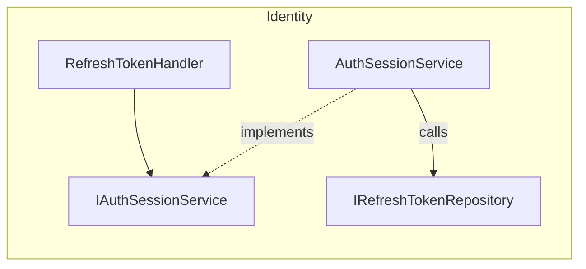
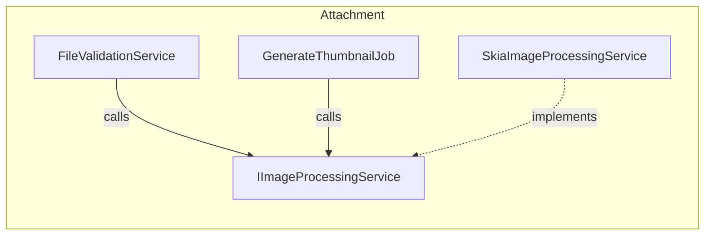
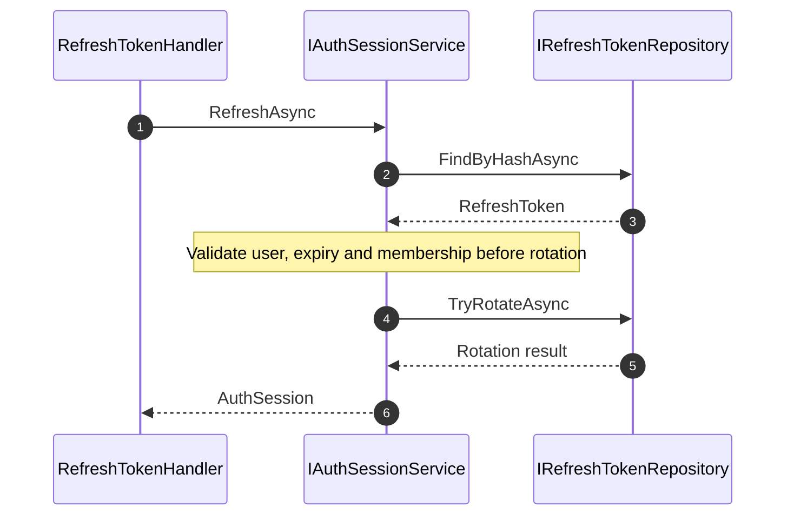
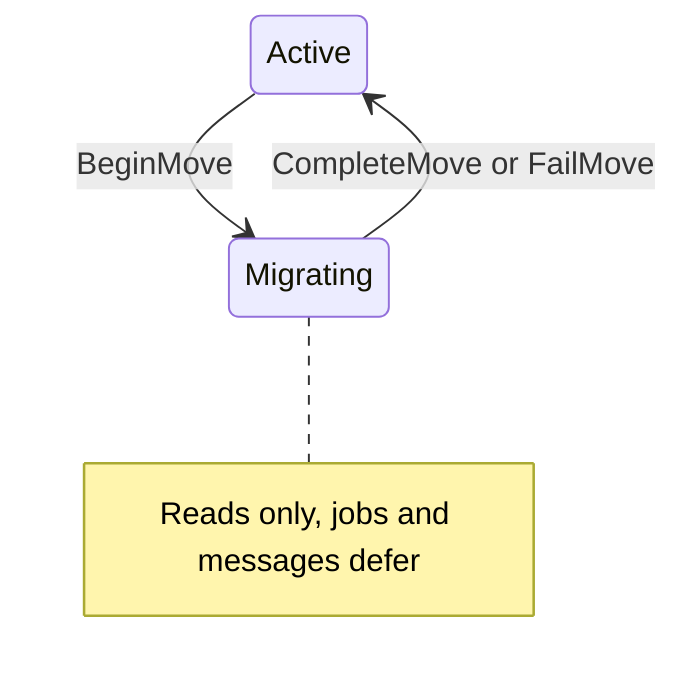
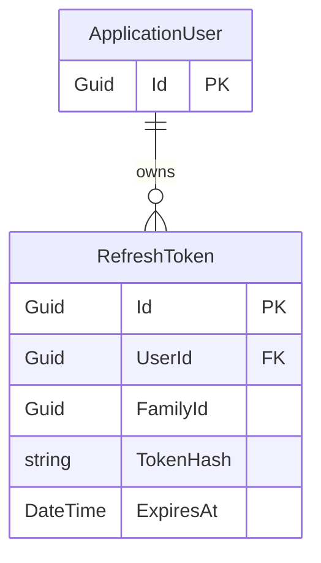
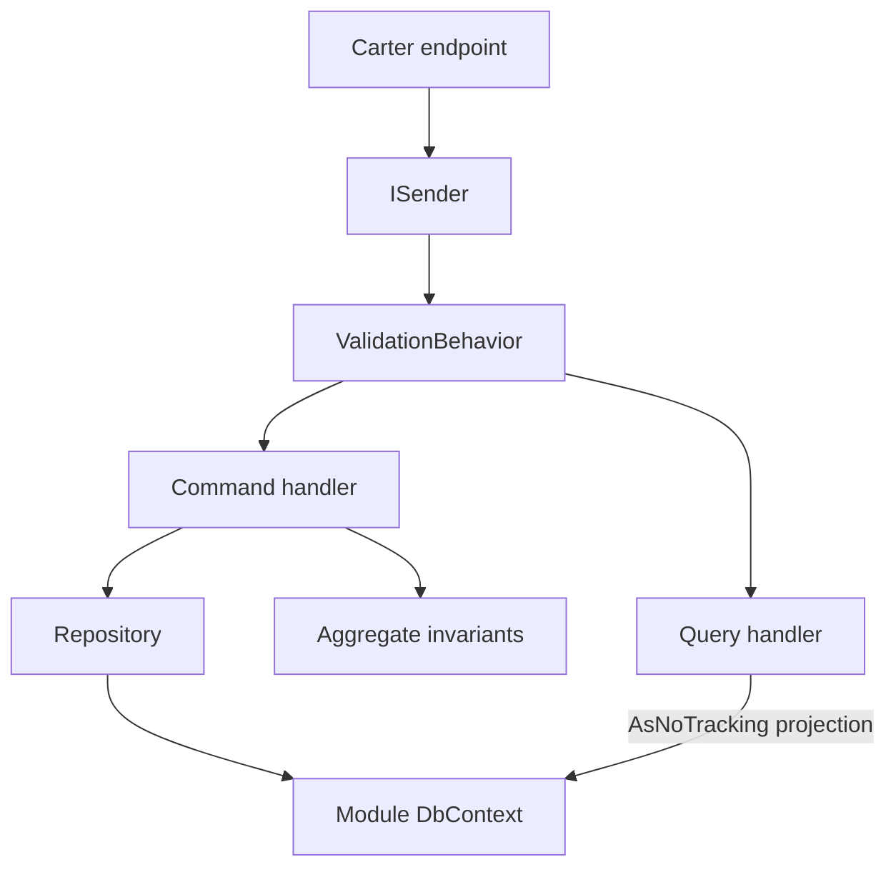
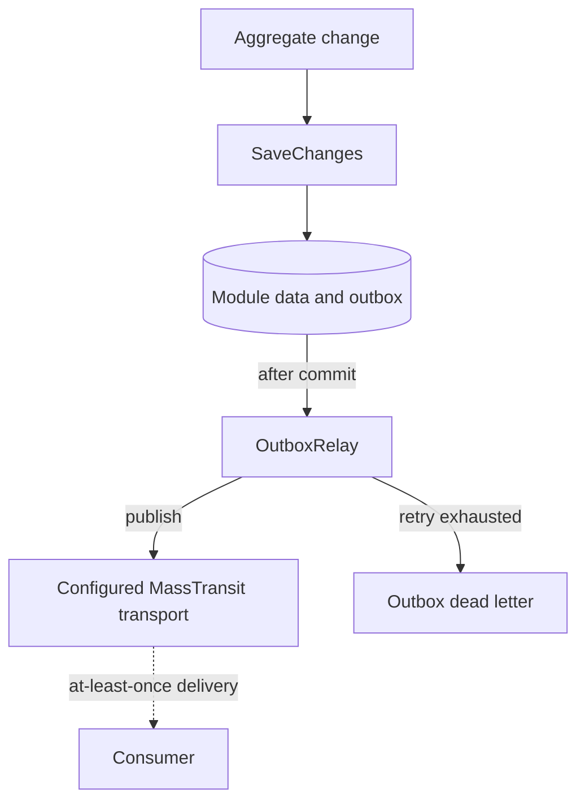

# Diagram style

Use Mermaid in plain Markdown so diagrams work in GitHub and the documentation site.

Each diagram explains one
idea. Keep labels short and aim for at most about 15 nodes; split larger subjects into focused diagrams. Group
nodes by module or system boundary with subgraphs. Describe external actors in ordinary language, and use only
real names from the code when labeling types, classes, methods or tables. Verify those names in `src/` before
publishing. Do not invent an implementation to illustrate a pattern.

Design for a **615px content column**, including the figure's padding. Prefer `flowchart TB` for chains longer
than about five nodes. Measure the SVG `viewBox` width using the local Mermaid CLI: aim for **760px or less**,
so the diagram fits at roughly 75% of natural size after padding. Anything above about 1.4 times the column
width (860px) needs a new layout: use vertical flow, shorten labels and move detail into prose, or split it into
focused diagrams. Apply the same width budget to sequence participants and state transitions. The site's Expand
button is useful for natural-size inspection on small screens; it does not replace a readable inline layout.

Use these forms:

| Subject | Mermaid form |
|---|---|
| Short flow or decision | `flowchart LR` |
| Long flow (more than about five nodes) | `flowchart TB` |
| Layers or containment | `flowchart TB` |
| Interaction over time | `sequenceDiagram` with `autonumber` |
| Lifecycle | `stateDiagram-v2` |
| Data relationships | `erDiagram` |
| Types and implementation relationships | `classDiagram` |
| System context, containers, a module's runtime dependencies, deployment | A view of the LikeC4 architecture model (see [Which diagram tool](#which-diagram-tool)), not Mermaid |
| Schedules and experience maps | `gantt` and `journey` when the subject calls for them |

Directly below every closing diagram fence, add an italic caption in the form `*Figure: <one sentence>.*`.
Explain what the diagram establishes, including important scope limits, rather than repeating its title.

Do not use ASCII box/arrow diagrams. Directory and file trees are fine in fenced `text` blocks. Avoid inline
colors, `style` directives, `classDef` colors and theme initialization directives: the site owns presentation.
V2 defines shared semantic classes in its theme module, `apps/docs-v2/lib/mermaid-theme.mjs`. Use `class A,B api`
to assign roles without embedding color values in the document. Ink edges and flat tinted surfaces match the site's
module chart; each responsibility has its own tint. Each role has a separate light and dark pair.
GitHub and preserved Starlight V1 use their own theme; labels and edge annotations must communicate every meaning
without color. Sequence, ER and state diagrams inherit the shared base theme rather than unsupported flowchart classes.

| Class | Responsibility | Visual distinction in V2 |
| --- | --- | --- |
| `api` | HTTP boundary, middleware, endpoint | Blue-tinted surface |
| `application` | Handler, use case, orchestration | Purple-tinted surface |
| `domain` | Aggregate, entity, value object | Green-tinted surface |
| `infrastructure` | Persistence implementation, adapter, job | Amber-tinted surface |
| `data` | Database, cache, stored records | Slate-tinted surface; cylinder for a store |
| `external` | Caller or third-party system | Rose-tinted surface |
| `event` | Event, queue, outbox, asynchronous delivery | Teal-tinted surface |
| `port` | Interface, combined with a responsibility class | Dashed node boundary |

## Which diagram tool

| Tool | Use it for | Where it lives |
|---|---|---|
| LikeC4 architecture model | Structure and topology: the landscape, containers, a module's components and the stores, queues, jobs and providers it touches, cross-component flows ("what happens when a user does X"), deployment | `wiki/Architecture/model/*.c4`, embedded with a `likec4-view` fence |
| Mermaid | Detail next to the prose: a sequence inside one module, a state machine, an ER model, types, a decision | A `mermaid` fence in the page |
| Excalidraw | Only the hand-drawn big picture at the top of [System Design](../Architecture/System-Design.md) | `wiki/Architecture/diagrams/system-big-picture.excalidraw.svg` |

Rules for the architecture model ([ADR-0035](../Decisions/0035-architecture-model-likec4-and-excalidraw-hero.md)):

- **One file per module.** A module extends `starterkit.app` in its own `<module>.c4`, and every relationship that
  mentions the module lives in that file, so a product without an optional module has no file and no dangling edge.
- **Real names only.** Elements carry the real class, queue, schema and route names in `technology` and
  `description`; verify them in `src/` as for any diagram.
- **Kinds carry the color.** Use the element kinds of `specification.c4` (`endpoint`, `component`, `adapter`, `job`,
  `consumer`, `database`, `cache`, `queue`, `blob`, `external`, ...). Never set colors in a view or on an element.
- **Asynchronous edges are `-[async]->`**: integration events through the outbox and enqueued jobs. Name the event
  in the label and `outbox, MassTransit` in the technology.
- **Every view has a `title`, a one-sentence `description` and an `autoLayout`.** Prefer `TopBottom`; use
  `LeftRight` when a view fans out to many neighbors.
- **Embed a view** with a fence whose language is `likec4-view` and whose body is the view id, followed by the usual
  italic `*Figure: …*` caption. Every module page also keeps a runtime-components table, because GitHub shows the
  fence as text.
- **Check it:** `npx likec4 validate wiki/Architecture/model`, and browse it with `npx likec4 start wiki/Architecture/model`.
<!--#if (templateSource)-->
  In V2, `npm run sync` compiles the model and rejects an unknown view id; record each changed `.c4` file (and the
  hero) under `architecture` in `apps/docs-v2/quality/diagram-review.json` with its SHA-256.
<!--#endif-->

The hero SVG embeds its Excalidraw scene: open it in [Excalidraw](https://excalidraw.com) or the VS Code Excalidraw
extension, edit, and save it back as `.excalidraw.svg` with a white background. Name only modules every product has.

## Relationship and accessibility rules

- State whether the view describes runtime flow, compile-time references, state transitions or data relationships.
  Split mixed views into labelled subgraphs or separate diagrams. An arrow to an interface is not a runtime call
  to its implementation: show the adapter pointing to the port with a labelled `implements` dependency.
- In runtime flowcharts, `-->` is a call or ordered processing step; `-.->` with a delivery label is asynchronous.
  In dependency views, use labelled `-.->` references. The view title and labels disambiguate the two uses.
- In sequences, `->>` is a call, `-->>` is a return, and `-)` is an asynchronous message. Use `alt`, `opt` and
  `loop` for real branches and retries. Keep a small participant set and move long payloads to surrounding prose.
- Rectangles describe components or steps; rounded rectangles describe services, diamonds decisions, cylinders
  stores, and subgraphs boundaries. Never change an entity relationship or cardinality for a more attractive layout.
- Use exact type names when naming implementation; use concise human labels otherwise. Distinguish EF entities
  from mapped SQL tables. Mark lifecycle diagrams as subsets when transitions are intentionally omitted; do not
  invent terminal states for entities that can be reopened.
- Add `accTitle:` and a one-sentence `accDescr:` immediately after the diagram declaration. Keep the visible
  caption. Source code, selectable SVG text and a keyboard-scrollable canvas provide alternatives to color.
- Text-to-surface contrast must be at least 4.5:1; component boundaries and edges at least 3:1. Check both palettes.
  Never encode success/failure only by color. Prefer no animation and no embedded HTML.

## Layout and rendering

V2 uses Mermaid 12.3.0; preserved V1 uses 12.2.0. Both support the syntax used here. V2 uses compact Dagre layout
by default. ELK is bundled in these Mermaid versions, so a complex graph can opt in without another dependency:
place Mermaid frontmatter containing `config:` then an indented `layout: elk` before `flowchart TB` inside the fence.
The module-contract map is an example. Do not add theme overrides to that frontmatter. Test the actual result;
ELK is not automatically more readable for small diagrams.

The V2 renderer serializes Mermaid initialization and rendering to avoid theme races, rerenders on theme changes,
and uses unique SVG identifiers. Inline diagrams preserve a readable canvas and scroll inside their frame on mobile.
Use Expand, keyboard scrolling, zoom/reset, source copy and SVG download for detailed inspection. The expanded view
moves the original SVG instead of cloning identifiers. SVG exports contain the active theme's concrete colors.

## Flow

*Figure: The refresh handler delegates session rotation to the session service and repository.*

## Layers

*Figure: Attachment callers use an image-processing port implemented by the SkiaSharp adapter.*

## Interactions

*Figure: A successful refresh validates the existing session before atomically replacing its refresh token.*

## Lifecycles

*Figure: This TenantStatus subset shows a database move that starts and ends with an active tenant.*

## Data relationships

*Figure: Each RefreshToken belongs to one ApplicationUser and identifies its session family.*

## CQRS request flow

*Figure: This focused runtime view omits other mediator behaviors, which remain part of the request pipeline.*

## Event delivery

*Figure: A failed publish is retried from the outbox; a consumer failure follows the transport's retry and error-queue policy.*

## Adding and testing diagrams

1. Verify components and relationships in source. Pick one view and the smallest appropriate diagram type.
2. Add a portable Mermaid fence, accessible title/description, semantic classes where supported, and a visible caption.
3. Update the corresponding record in `apps/docs-v2/quality/diagram-review.json`: record source evidence, review
   changes, and the SHA-256 hash of the Mermaid source (without the trailing newline). Add a record for a new diagram.
4. Run `npm run sync`, `npm run test`, `npm run check:mermaid`, `npm run typecheck` and `npm run build` from V2.
   The checker discovers canonical fences across tracked and unignored Markdown/MDX, renders both themes, checks SVG
   alternatives and writes `.generated/diagram-rendering.json` plus SVG previews. It also checks the eight supported
   families, even when the current docs do not contain all eight.
5. Check representative SVGs at desktop and mobile widths, including long labels, a sequence, ER, state and ELK view.
   Test Expand, keyboard scrolling, zoom, export and theme switching in the production site. Run V1's Mermaid check
   and build separately to verify portable sources still work. Run the repository link checker before review.

The review inventory distinguishes intended duplication (focused overviews and detailed views of the same topic)
from accidental copies. Keep independent diagrams only where their scope, audience or level of detail differs.

These are entity names; `RefreshTokenConfiguration` maps `RefreshToken` to `refresh_tokens`. Use actual mapped
table names when a diagram describes SQL rather than entities. For larger examples see
[architecture](../Architecture/Overview.md), [messaging](../Architecture/Messaging.md) and
[tenant isolation](../MultiTenancy/Overview.md).
