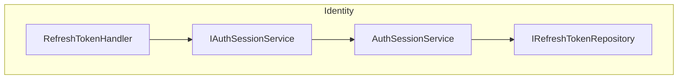
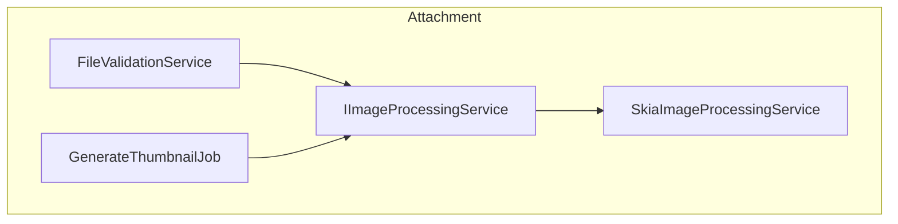
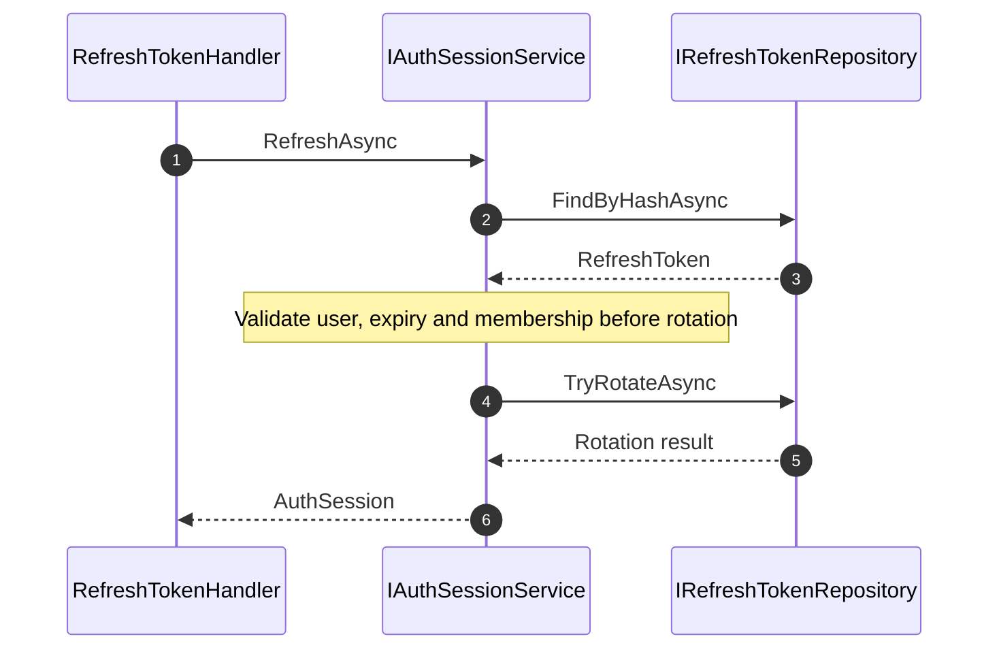
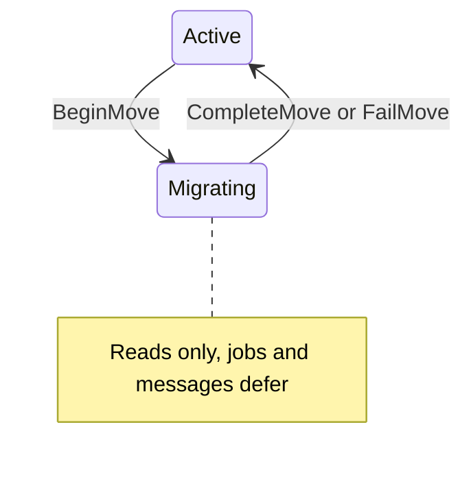
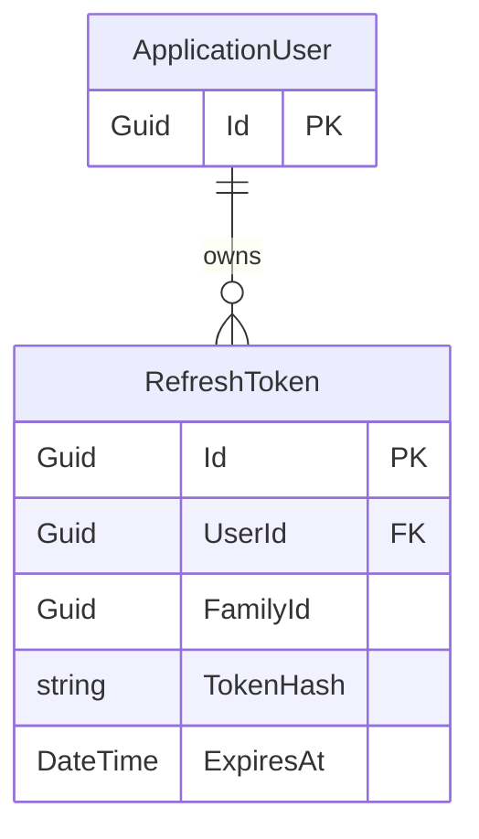

# Diagram style

Use Mermaid in plain Markdown so diagrams work in GitHub and the documentation site.

Each diagram explains one
idea. Keep labels short and aim for at most about 15 nodes; split larger subjects into focused diagrams. Group
nodes by module or system boundary with subgraphs. Describe external actors in ordinary language, and use only
real names from the code when labeling types, classes, methods or tables. Verify those names in `src/` before
publishing. Do not invent an implementation to illustrate a pattern.

Design for a **615px content column**, including the figure's padding. Prefer `flowchart TB` for chains longer
than about five nodes. Measure the SVG `viewBox` width using the local Mermaid CLI: aim for **760px or less**,
so the diagram fits at roughly 75% of natural size after padding. Anything above about 1.4 times the column
width (860px) needs a new layout: use vertical flow, shorten labels and move detail into prose, or split it into
focused diagrams. Apply the same width budget to sequence participants and state transitions. The site's Expand
button is useful for natural-size inspection on small screens; it does not replace a readable inline layout.

Use these forms:

| Subject | Mermaid form |
|---|---|
| Short flow or decision | `flowchart LR` |
| Long flow (more than about five nodes) | `flowchart TB` |
| Layers or containment | `flowchart TB` |
| Interaction over time | `sequenceDiagram` with `autonumber` |
| Lifecycle | `stateDiagram-v2` |
| Data relationships | `erDiagram` |

Directly below every closing diagram fence, add an italic caption in the form `*Figure: <one sentence>.*`.
Explain what the diagram establishes, including important scope limits, rather than repeating its title.

Do not use ASCII box/arrow diagrams. Directory and file trees are fine in fenced `text` blocks. Avoid inline
colors, `style` directives, `classDef` colors and theme initialization directives: the site owns presentation.
No shared semantic color classes are currently defined. Use labels to express success, failure or other meaning.
The site uses indigo nodes, teal edges, slate text and Inter, with its own light and dark palettes; GitHub chooses
its own Mermaid theme.

## Flow

*Figure: The refresh handler delegates session rotation to the session service and repository.*

## Layers

*Figure: Attachment callers use an image-processing port implemented by the SkiaSharp adapter.*

## Interactions

*Figure: A successful refresh validates the existing session before atomically replacing its refresh token.*

## Lifecycles

*Figure: This TenantStatus subset shows a database move that starts and ends with an active tenant.*

## Data relationships

*Figure: Each RefreshToken belongs to one ApplicationUser and identifies its session family.*

These are entity names; `RefreshTokenConfiguration` maps `RefreshToken` to `refresh_tokens`. Use actual mapped
table names when a diagram describes SQL rather than entities. For larger examples see
[architecture](../Architecture/Overview.md), [messaging](../Architecture/Messaging.md) and
[tenant isolation](../MultiTenancy/Overview.md).
