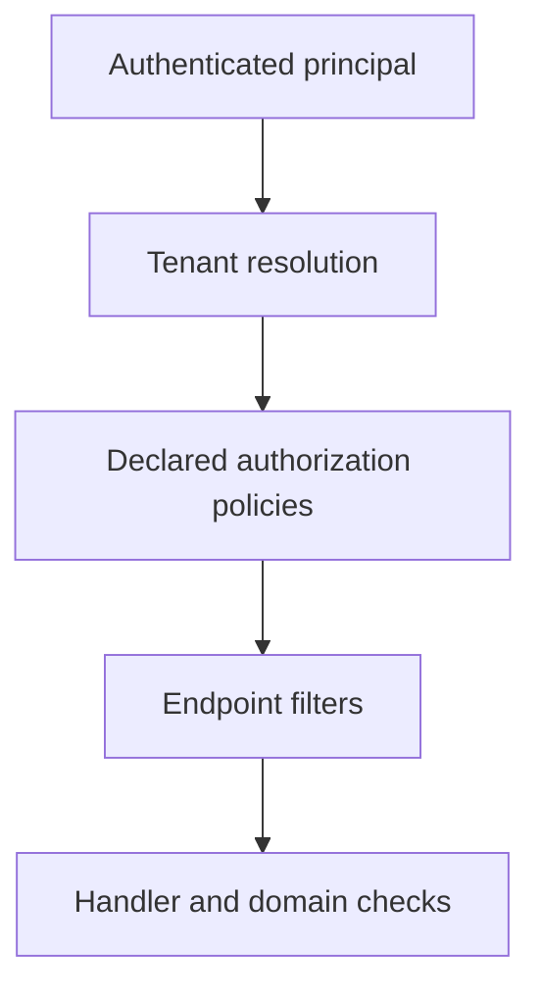

# Endpoint authorization

This inventory records declared route and group authorization so changes to access policy and request filters can be reviewed against the source.

## At a glance

| Surface | Source of truth |
|---|---|
| Application routes | Every production `ICarterModule` under `src/` |
| Platform permissions | `Shared.Core.Authorization.Permissions` and `RolePermissionMap` |
| Tenant permissions | `Shared.Core.MultiTenancy.Authorization.TenantPermissions` and `SystemTenantRoles` |
| Non-Carter surfaces | Host middleware, shared health/OpenAPI endpoints and Notification hub |

## How it works

Authorization entries below include inherited group metadata. Versioned route templates retain `{version:apiVersion}` (the mapped version is 1.0); Identity also exposes deliberately unversioned routes. `HostOnly()` marks a route as independent of tenant resolution; it is not an admin permission. `RequireTenant()` requires tenant context and is listed separately from membership/permission checks.


*Figure: Declared policies and filters precede handler-specific ownership and business checks.*

`RequirePermission` uses `perm:` policies; `RequireTenantPermission` uses `tperm:` policies. Permissions are derived per request from roles. API key scopes intersect the owner's permissions, and tenant permission checks also enforce key scopes. In multi-tenant mode platform permission claims do not grant tenant membership permissions. `AllowAnonymous()` bypasses authorization even when a group carries authorization metadata.

The restrictions column lists `DisallowImpersonation()` and `DisallowApiKey()`. The filters column records feature, quota, runtime flag, idempotency, human-verification and rate-limit declarations; `—` means none declared at that route/group, not that the handler has no additional checks. SCIM resource handlers check the `sso` entitlement inside `Run`; transfer definitions and subscription self-service can enforce further permissions in handlers.

## Usage

The declarations on `src/Modules/Webhooks/Webhooks/Domains/Endpoints/Features/WebhookEndpointsModule.cs` include:

```csharp
.RequireTenantPermission(TenantPermissions.WebhooksManage)
.DisallowImpersonation();
```

## Route inventory

### Host

Source: [DashboardEndPoint](../../src/Api/Endpoints/DashboardEndPoint.cs).

| Method | Route | Authorization / tenant scope | Restrictions | Filters |
|---|---|---|---|---|
| GET | `/api/v{version:apiVersion}/dashboard/stats` | `RequireAuthorization(PolicyConstants.AdminOnly)` | — | — |

Source: [EnumsEndpoint](../../src/Api/Endpoints/EnumsEndpoint.cs).

| Method | Route | Authorization / tenant scope | Restrictions | Filters |
|---|---|---|---|---|
| GET | `/api/v{version:apiVersion}/enums/{enumName}` | `AllowAnonymous()` | — | — |
| GET | `/api/v{version:apiVersion}/enums` | `AllowAnonymous()` | — | — |

Source: [OutboxAdminEndPoint](../../src/Api/Endpoints/OutboxAdminEndPoint.cs).

| Method | Route | Authorization / tenant scope | Restrictions | Filters |
|---|---|---|---|---|
| GET | `/api/v{version:apiVersion}/admin/outbox/{context}/dead-letters` | `RequirePermission(Permissions.OutboxManage)` | — | — |
| POST | `/api/v{version:apiVersion}/admin/outbox/{context}/dead-letters/{id:guid}/requeue` | `RequirePermission(Permissions.OutboxManage)` | `DisallowImpersonation()` | — |
| POST | `/api/v{version:apiVersion}/admin/outbox/{context}/dead-letters/requeue` | `RequirePermission(Permissions.OutboxManage)` | `DisallowImpersonation()` | — |

Source: [PhoneEndpoint](../../src/Api/Endpoints/PhoneEndpoint.cs).

| Method | Route | Authorization / tenant scope | Restrictions | Filters |
|---|---|---|---|---|
| POST | `/api/v{version:apiVersion}/phone/validate` | `AllowAnonymous()` | — | — |
| GET | `/api/v{version:apiVersion}/phone/validate` | `AllowAnonymous()` | — | — |

### Identity

Source: [AssignRoleEndPoint](../../src/Modules/Identity/Identity/Domains/Admins/Features/AssignRole/AssignRoleEndPoint.cs).

| Method | Route | Authorization / tenant scope | Restrictions | Filters |
|---|---|---|---|---|
| POST | `/api/identity/users/{id:guid}/roles` | `RequirePermission(Permissions.UsersManage)` | — | — |

Source: [ChangeAdminPasswordEndPoint](../../src/Modules/Identity/Identity/Domains/Admins/Features/ChangeAdminPassword/ChangeAdminPasswordEndPoint.cs).

| Method | Route | Authorization / tenant scope | Restrictions | Filters |
|---|---|---|---|---|
| PUT | `/api/identity/admins/{id:guid}/change-password` | `RequirePermission(Permissions.AdminsManage)` | `DisallowApiKey()` | — |

Source: [CreateAdminEndPoint](../../src/Modules/Identity/Identity/Domains/Admins/Features/CreateAdmin/CreateAdminEndPoint.cs).

| Method | Route | Authorization / tenant scope | Restrictions | Filters |
|---|---|---|---|---|
| POST | `/api/identity/admins` | `RequirePermission(Permissions.AdminsManage)` | — | — |

Source: [DemoteAdminEndPoint](../../src/Modules/Identity/Identity/Domains/Admins/Features/DemoteAdmin/DemoteAdminEndPoint.cs).

| Method | Route | Authorization / tenant scope | Restrictions | Filters |
|---|---|---|---|---|
| POST | `/api/identity/admins/{id:guid}/demote` | `RequirePermission(Permissions.AdminsManage)` | — | — |

Source: [GetAdminByIdEndPoint](../../src/Modules/Identity/Identity/Domains/Admins/Features/GetAdminById/GetAdminByIdEndPoint.cs).

| Method | Route | Authorization / tenant scope | Restrictions | Filters |
|---|---|---|---|---|
| GET | `/api/identity/admins/{id:guid}` | `RequirePermission(Permissions.AdminsManage)` | — | — |

Source: [GetAdminsEndPoint](../../src/Modules/Identity/Identity/Domains/Admins/Features/GetAdmins/GetAdminsEndPoint.cs).

| Method | Route | Authorization / tenant scope | Restrictions | Filters |
|---|---|---|---|---|
| GET | `/api/identity/admins` | `RequirePermission(Permissions.AdminsManage)` | — | — |

Source: [PromoteToAdminEndPoint](../../src/Modules/Identity/Identity/Domains/Admins/Features/PromoteToAdmin/PromoteToAdminEndPoint.cs).

| Method | Route | Authorization / tenant scope | Restrictions | Filters |
|---|---|---|---|---|
| POST | `/api/identity/users/{id:guid}/promote-admin` | `RequirePermission(Permissions.AdminsManage)` | — | — |

Source: [RevokeRoleEndPoint](../../src/Modules/Identity/Identity/Domains/Admins/Features/RevokeRole/RevokeRoleEndPoint.cs).

| Method | Route | Authorization / tenant scope | Restrictions | Filters |
|---|---|---|---|---|
| DELETE | `/api/identity/users/{id:guid}/roles/{roleName}` | `RequirePermission(Permissions.UsersManage)` | — | — |

Source: [StartImpersonationEndPoint](../../src/Modules/Identity/Identity/Domains/Admins/Features/StartImpersonation/StartImpersonationEndPoint.cs).

| Method | Route | Authorization / tenant scope | Restrictions | Filters |
|---|---|---|---|---|
| POST | `/api/identity/impersonations` | `HostOnly()`; `RequirePermission(Permissions.TenantsImpersonate)` | `DisallowApiKey()` | `RequireRateLimiting("auth")` |

Source: [UpdateAdminEndPoint](../../src/Modules/Identity/Identity/Domains/Admins/Features/UpdateAdmin/UpdateAdminEndPoint.cs).

| Method | Route | Authorization / tenant scope | Restrictions | Filters |
|---|---|---|---|---|
| PUT | `/api/identity/admins/{id:guid}` | `RequirePermission(Permissions.AdminsManage)` | — | — |

Source: [MyApiKeysModule](../../src/Modules/Identity/Identity/Domains/ApiKeys/Features/MyApiKeys/MyApiKeysModule.cs).

| Method | Route | Authorization / tenant scope | Restrictions | Filters |
|---|---|---|---|---|
| POST | `/api/v{version:apiVersion}/me/api-keys` | `RequireAuthorization()` | `DisallowApiKey()`; `DisallowImpersonation()` | `RequireRateLimiting(RateLimitPolicyNames.Create)` |
| GET | `/api/v{version:apiVersion}/me/api-keys` | `RequireAuthorization()` | `DisallowApiKey()` | — |
| DELETE | `/api/v{version:apiVersion}/me/api-keys/{id:guid}` | `RequireAuthorization()` | `DisallowApiKey()`; `DisallowImpersonation()` | — |

Source: [UserApiKeysModule](../../src/Modules/Identity/Identity/Domains/ApiKeys/Features/UserApiKeys/UserApiKeysModule.cs).

| Method | Route | Authorization / tenant scope | Restrictions | Filters |
|---|---|---|---|---|
| GET | `/api/v{version:apiVersion}/admin/users/{id:guid}/api-keys` | `RequirePermission(Permissions.ApiKeysManage)` | `DisallowApiKey()` | — |
| DELETE | `/api/v{version:apiVersion}/admin/users/{id:guid}/api-keys/{keyId:guid}` | `RequirePermission(Permissions.ApiKeysManage)` | `DisallowApiKey()`; `DisallowImpersonation()` | — |

Source: [GetIdentityAuditLogEndPoint](../../src/Modules/Identity/Identity/Domains/Audit/Features/GetIdentityAuditLog/GetIdentityAuditLogEndPoint.cs).

| Method | Route | Authorization / tenant scope | Restrictions | Filters |
|---|---|---|---|---|
| GET | `/api/v{version:apiVersion}/admin/identity/audit` | `RequirePermission(Permissions.AuditRead)` | — | `RequireRateLimiting("search")` |

Source: [ChangePasswordEndPoint](../../src/Modules/Identity/Identity/Domains/Auth/Features/ChangePassword/ChangePasswordEndPoint.cs).

| Method | Route | Authorization / tenant scope | Restrictions | Filters |
|---|---|---|---|---|
| POST | `/api/auth/change-password` | `RequireAuthorization()` | `DisallowApiKey()` | `RequireRateLimiting("auth")` |

Source: [CompleteProfileEndPoint](../../src/Modules/Identity/Identity/Domains/Auth/Features/CompleteProfile/CompleteProfileEndPoint.cs).

| Method | Route | Authorization / tenant scope | Restrictions | Filters |
|---|---|---|---|---|
| PUT | `/api/identity/profile/complete` | `RequireAuthorization()` | — | — |

Source: [ConfirmEmailEndPoint](../../src/Modules/Identity/Identity/Domains/Auth/Features/ConfirmEmail/ConfirmEmailEndPoint.cs).

| Method | Route | Authorization / tenant scope | Restrictions | Filters |
|---|---|---|---|---|
| POST | `/api/auth/email/confirm` | `AllowAnonymous()` | — | `RequireRateLimiting("auth")` |

Source: [DisableTwoFactorEndPoint](../../src/Modules/Identity/Identity/Domains/Auth/Features/DisableTwoFactor/DisableTwoFactorEndPoint.cs).

| Method | Route | Authorization / tenant scope | Restrictions | Filters |
|---|---|---|---|---|
| POST | `/api/auth/2fa/disable` | `RequireAuthorization()` | `DisallowApiKey()` | `RequireRateLimiting("auth")` |

Source: [EnableTwoFactorEndPoint](../../src/Modules/Identity/Identity/Domains/Auth/Features/EnableTwoFactor/EnableTwoFactorEndPoint.cs).

| Method | Route | Authorization / tenant scope | Restrictions | Filters |
|---|---|---|---|---|
| POST | `/api/auth/2fa/enable` | `RequireAuthorization()` | `DisallowApiKey()` | `RequireRateLimiting("auth")` |

Source: [ExternalLoginEndPoint](../../src/Modules/Identity/Identity/Domains/Auth/Features/ExternalLogin/ExternalLoginEndPoint.cs).

| Method | Route | Authorization / tenant scope | Restrictions | Filters |
|---|---|---|---|---|
| GET | `/api/identity/auth/external-login` | `AllowAnonymous()` | — | `RequireRateLimiting("auth")` |
| GET | `/api/identity/auth/challenge/{provider}` | `AllowAnonymous()` | — | `RequireRateLimiting("auth")` |
| GET | `/api/identity/auth/external-callback` | `AllowAnonymous()` | — | `RequireRateLimiting("auth")` |

Source: [ForgotPasswordEndPoint](../../src/Modules/Identity/Identity/Domains/Auth/Features/ForgotPassword/ForgotPasswordEndPoint.cs).

| Method | Route | Authorization / tenant scope | Restrictions | Filters |
|---|---|---|---|---|
| POST | `/api/auth/forgot-password` | `AllowAnonymous()` | — | `RequireRateLimiting("otp")`; `RequireHumanVerification("forgot-password")` |

Source: [LoginEndPoint](../../src/Modules/Identity/Identity/Domains/Auth/Features/Login/LoginEndPoint.cs).

| Method | Route | Authorization / tenant scope | Restrictions | Filters |
|---|---|---|---|---|
| POST | `/api/auth/login` | `AllowAnonymous()` | — | `RequireRateLimiting("auth")`; `RequireHumanVerification("login")` |

Source: [LogoutEndPoint](../../src/Modules/Identity/Identity/Domains/Auth/Features/Logout/LogoutEndPoint.cs).

| Method | Route | Authorization / tenant scope | Restrictions | Filters |
|---|---|---|---|---|
| POST | `/api/auth/logout` | `RequireAuthorization()` | `DisallowApiKey()` | — |

Source: [RefreshTokenEndPoint](../../src/Modules/Identity/Identity/Domains/Auth/Features/RefreshToken/RefreshTokenEndPoint.cs).

| Method | Route | Authorization / tenant scope | Restrictions | Filters |
|---|---|---|---|---|
| POST | `/api/auth/refresh` | `AllowAnonymous()` | — | `RequireRateLimiting("auth")` |

Source: [RegenerateRecoveryCodesEndPoint](../../src/Modules/Identity/Identity/Domains/Auth/Features/RegenerateRecoveryCodes/RegenerateRecoveryCodesEndPoint.cs).

| Method | Route | Authorization / tenant scope | Restrictions | Filters |
|---|---|---|---|---|
| POST | `/api/auth/2fa/recovery-codes/regenerate` | `RequireAuthorization()` | `DisallowApiKey()` | `RequireRateLimiting("auth")` |

Source: [RegisterEndPoint](../../src/Modules/Identity/Identity/Domains/Auth/Features/Register/RegisterEndPoint.cs).

| Method | Route | Authorization / tenant scope | Restrictions | Filters |
|---|---|---|---|---|
| POST | `/api/auth/register` | `AllowAnonymous()` | — | `RequireRateLimiting("auth")`; `RequireHumanVerification("register")` |

Source: [ResetPasswordEndPoint](../../src/Modules/Identity/Identity/Domains/Auth/Features/ResetPassword/ResetPasswordEndPoint.cs).

| Method | Route | Authorization / tenant scope | Restrictions | Filters |
|---|---|---|---|---|
| POST | `/api/auth/reset-password` | `AllowAnonymous()` | — | `RequireRateLimiting("auth")` |

Source: [SendEmailConfirmationEndPoint](../../src/Modules/Identity/Identity/Domains/Auth/Features/SendEmailConfirmation/SendEmailConfirmationEndPoint.cs).

| Method | Route | Authorization / tenant scope | Restrictions | Filters |
|---|---|---|---|---|
| POST | `/api/auth/email/send-confirmation` | `RequireAuthorization()` | — | `RequireRateLimiting("otp")` |

Source: [SendPhoneVerificationEndPoint](../../src/Modules/Identity/Identity/Domains/Auth/Features/SendPhoneVerification/SendPhoneVerificationEndPoint.cs).

| Method | Route | Authorization / tenant scope | Restrictions | Filters |
|---|---|---|---|---|
| POST | `/api/identity/phone/send-verification` | `RequireAuthorization()` | — | `RequireRateLimiting("otp")` |

Source: [SetupTwoFactorEndPoint](../../src/Modules/Identity/Identity/Domains/Auth/Features/SetupTwoFactor/SetupTwoFactorEndPoint.cs).

| Method | Route | Authorization / tenant scope | Restrictions | Filters |
|---|---|---|---|---|
| POST | `/api/auth/2fa/setup` | `RequireAuthorization()` | `DisallowApiKey()` | `RequireRateLimiting("auth")` |

Source: [SwitchTenantEndPoint](../../src/Modules/Identity/Identity/Domains/Auth/Features/SwitchTenant/SwitchTenantEndPoint.cs).

| Method | Route | Authorization / tenant scope | Restrictions | Filters |
|---|---|---|---|---|
| POST | `/api/auth/switch-tenant` | `HostOnly()`; `RequireAuthorization()` | `DisallowApiKey()` | `RequireRateLimiting("auth")` |

Source: [VerifyPhoneEndPoint](../../src/Modules/Identity/Identity/Domains/Auth/Features/VerifyPhone/VerifyPhoneEndPoint.cs).

| Method | Route | Authorization / tenant scope | Restrictions | Filters |
|---|---|---|---|---|
| POST | `/api/identity/phone/verify` | `RequireAuthorization()` | — | `RequireRateLimiting("auth")` |

Source: [VerifyResetOtpEndPoint](../../src/Modules/Identity/Identity/Domains/Auth/Features/VerifyResetOtp/VerifyResetOtpEndPoint.cs).

| Method | Route | Authorization / tenant scope | Restrictions | Filters |
|---|---|---|---|---|
| POST | `/api/auth/verify-reset-otp` | `AllowAnonymous()` | — | `RequireRateLimiting("auth")` |

Source: [VerifyTwoFactorEndPoint](../../src/Modules/Identity/Identity/Domains/Auth/Features/VerifyTwoFactor/VerifyTwoFactorEndPoint.cs).

| Method | Route | Authorization / tenant scope | Restrictions | Filters |
|---|---|---|---|---|
| POST | `/api/auth/2fa/verify` | `AllowAnonymous()` | `DisallowApiKey()` | `RequireRateLimiting("auth")` |

Source: [RegisterEndPoint](../../src/Modules/Identity/Identity/Domains/Onboarding/Features/Register/RegisterEndPoint.cs).

| Method | Route | Authorization / tenant scope | Restrictions | Filters |
|---|---|---|---|---|
| POST | `/api/identity/onboarding/register` | `AllowAnonymous()` | — | `RequireRateLimiting("otp")`; `RequireHumanVerification("onboarding-register")` |

Source: [ResendOtpEndPoint](../../src/Modules/Identity/Identity/Domains/Onboarding/Features/ResendOtp/ResendOtpEndPoint.cs).

| Method | Route | Authorization / tenant scope | Restrictions | Filters |
|---|---|---|---|---|
| POST | `/api/identity/onboarding/resend-otp` | `AllowAnonymous()` | — | `RequireRateLimiting("otp")`; `RequireHumanVerification("resend-otp")` |

Source: [VerifyPhoneEndPoint](../../src/Modules/Identity/Identity/Domains/Onboarding/Features/VerifyPhone/VerifyPhoneEndPoint.cs).

| Method | Route | Authorization / tenant scope | Restrictions | Filters |
|---|---|---|---|---|
| POST | `/api/identity/onboarding/verify-phone` | `AllowAnonymous()` | — | `RequireRateLimiting("auth")` |

Source: [MyPasskeysModule](../../src/Modules/Identity/Identity/Domains/Passkeys/Features/MyPasskeys/MyPasskeysModule.cs).

| Method | Route | Authorization / tenant scope | Restrictions | Filters |
|---|---|---|---|---|
| POST | `/api/auth/passkeys/registration/options` | `RequireAuthorization()` | `DisallowApiKey()`; `DisallowImpersonation()` | `RequireRateLimiting("auth")` |
| POST | `/api/auth/passkeys/registration` | `RequireAuthorization()` | `DisallowApiKey()`; `DisallowImpersonation()` | `RequireRateLimiting("auth")` |
| GET | `/api/auth/passkeys` | `RequireAuthorization()` | `DisallowApiKey()` | — |
| PATCH | `/api/auth/passkeys/{id}` | `RequireAuthorization()` | `DisallowApiKey()`; `DisallowImpersonation()` | — |
| DELETE | `/api/auth/passkeys/{id}` | `RequireAuthorization()` | `DisallowApiKey()`; `DisallowImpersonation()` | — |

Source: [PasskeyLoginModule](../../src/Modules/Identity/Identity/Domains/Passkeys/Features/PasskeyLogin/PasskeyLoginModule.cs).

| Method | Route | Authorization / tenant scope | Restrictions | Filters |
|---|---|---|---|---|
| POST | `/api/auth/passkeys/assertion/options` | `AllowAnonymous()` | — | `RequireRateLimiting("auth")` |
| POST | `/api/auth/passkeys/assertion` | `AllowAnonymous()` | — | `RequireRateLimiting("auth")` |

Source: [ScimDirectoriesModule](../../src/Modules/Identity/Identity/Domains/Scim/Features/ScimDirectories/ScimDirectoriesModule.cs).

| Method | Route | Authorization / tenant scope | Restrictions | Filters |
|---|---|---|---|---|
| GET | `/api/v{version:apiVersion}/tenant/scim/directories` | `RequireTenantPermission(TenantPermissions.SsoManage)` | `DisallowApiKey()` | `RequireFeature(EntitlementKeys.Sso)` |
| POST | `/api/v{version:apiVersion}/tenant/scim/directories` | `RequireTenantPermission(TenantPermissions.SsoManage)` | `DisallowApiKey()`; `DisallowImpersonation()` | `RequireFeature(EntitlementKeys.Sso)` |
| POST | `/api/v{version:apiVersion}/tenant/scim/directories/{id:guid}/rotate-token` | `RequireTenantPermission(TenantPermissions.SsoManage)` | `DisallowApiKey()`; `DisallowImpersonation()` | `RequireFeature(EntitlementKeys.Sso)` |
| PUT | `/api/v{version:apiVersion}/tenant/scim/directories/{id:guid}/enabled` | `RequireTenantPermission(TenantPermissions.SsoManage)` | `DisallowApiKey()`; `DisallowImpersonation()` | `RequireFeature(EntitlementKeys.Sso)` |
| DELETE | `/api/v{version:apiVersion}/tenant/scim/directories/{id:guid}` | `RequireTenantPermission(TenantPermissions.SsoManage)` | `DisallowApiKey()`; `DisallowImpersonation()` | `RequireFeature(EntitlementKeys.Sso)` |
| GET | `/api/v{version:apiVersion}/tenant/scim/directories/{id:guid}/groups` | `RequireTenantPermission(TenantPermissions.SsoManage)` | `DisallowApiKey()` | `RequireFeature(EntitlementKeys.Sso)` |
| PUT | `/api/v{version:apiVersion}/tenant/scim/directories/{id:guid}/groups/{groupId:guid}/role` | `RequireTenantPermission(TenantPermissions.SsoManage)` | `DisallowApiKey()`; `DisallowImpersonation()` | `RequireFeature(EntitlementKeys.Sso)` |

Source: [ScimModule](../../src/Modules/Identity/Identity/Domains/Scim/Features/ScimProtocol/ScimModule.cs).

| Method | Route | Authorization / tenant scope | Restrictions | Filters |
|---|---|---|---|---|
| GET | `/scim/v2/ServiceProviderConfig` | `RequireAuthorization(ScimAuthentication.PolicyName)` | — | — |
| GET | `/scim/v2/ResourceTypes` | `RequireAuthorization(ScimAuthentication.PolicyName)` | — | — |
| GET | `/scim/v2/Schemas` | `RequireAuthorization(ScimAuthentication.PolicyName)` | — | — |
| GET | `/scim/v2/Users` | `RequireAuthorization(ScimAuthentication.PolicyName)` | — | — |
| GET | `/scim/v2/Users/{id:guid}` | `RequireAuthorization(ScimAuthentication.PolicyName)` | — | — |
| POST | `/scim/v2/Users` | `RequireAuthorization(ScimAuthentication.PolicyName)` | — | — |
| PUT | `/scim/v2/Users/{id:guid}` | `RequireAuthorization(ScimAuthentication.PolicyName)` | — | — |
| PATCH | `/scim/v2/Users/{id:guid}` | `RequireAuthorization(ScimAuthentication.PolicyName)` | — | — |
| DELETE | `/scim/v2/Users/{id:guid}` | `RequireAuthorization(ScimAuthentication.PolicyName)` | — | — |
| GET | `/scim/v2/Groups` | `RequireAuthorization(ScimAuthentication.PolicyName)` | — | — |
| GET | `/scim/v2/Groups/{id:guid}` | `RequireAuthorization(ScimAuthentication.PolicyName)` | — | — |
| POST | `/scim/v2/Groups` | `RequireAuthorization(ScimAuthentication.PolicyName)` | — | — |
| PUT | `/scim/v2/Groups/{id:guid}` | `RequireAuthorization(ScimAuthentication.PolicyName)` | — | — |
| PATCH | `/scim/v2/Groups/{id:guid}` | `RequireAuthorization(ScimAuthentication.PolicyName)` | — | — |
| DELETE | `/scim/v2/Groups/{id:guid}` | `RequireAuthorization(ScimAuthentication.PolicyName)` | — | — |

Source: [MySessionsModule](../../src/Modules/Identity/Identity/Domains/Sessions/Features/MySessions/MySessionsModule.cs).

| Method | Route | Authorization / tenant scope | Restrictions | Filters |
|---|---|---|---|---|
| GET | `/api/v{version:apiVersion}/me/sessions` | `RequireAuthorization()` | `DisallowApiKey()` | — |
| DELETE | `/api/v{version:apiVersion}/me/sessions/{id:guid}` | `RequireAuthorization()` | `DisallowApiKey()`; `DisallowImpersonation()` | — |
| POST | `/api/v{version:apiVersion}/me/sessions/revoke-others` | `RequireAuthorization()` | `DisallowApiKey()`; `DisallowImpersonation()` | — |

Source: [UserSessionsModule](../../src/Modules/Identity/Identity/Domains/Sessions/Features/UserSessions/UserSessionsModule.cs).

| Method | Route | Authorization / tenant scope | Restrictions | Filters |
|---|---|---|---|---|
| GET | `/api/v{version:apiVersion}/admin/users/{id:guid}/sessions` | `RequirePermission(Permissions.SessionsManage)` | `DisallowApiKey()` | — |
| DELETE | `/api/v{version:apiVersion}/admin/users/{id:guid}/sessions/{sessionId:guid}` | `RequirePermission(Permissions.SessionsManage)` | `DisallowApiKey()`; `DisallowImpersonation()` | — |

Source: [SsoConnectionsModule](../../src/Modules/Identity/Identity/Domains/Sso/Features/SsoConnections/SsoConnectionsModule.cs).

| Method | Route | Authorization / tenant scope | Restrictions | Filters |
|---|---|---|---|---|
| GET | `/api/v{version:apiVersion}/tenant/sso/connections` | `RequireTenantPermission(TenantPermissions.SsoManage)` | `DisallowApiKey()` | `RequireFeature(EntitlementKeys.Sso)` |
| GET | `/api/v{version:apiVersion}/tenant/sso/connections/{id:guid}` | `RequireTenantPermission(TenantPermissions.SsoManage)` | `DisallowApiKey()` | `RequireFeature(EntitlementKeys.Sso)` |
| POST | `/api/v{version:apiVersion}/tenant/sso/connections` | `RequireTenantPermission(TenantPermissions.SsoManage)` | `DisallowApiKey()`; `DisallowImpersonation()` | `RequireFeature(EntitlementKeys.Sso)` |
| PUT | `/api/v{version:apiVersion}/tenant/sso/connections/{id:guid}` | `RequireTenantPermission(TenantPermissions.SsoManage)` | `DisallowApiKey()`; `DisallowImpersonation()` | `RequireFeature(EntitlementKeys.Sso)` |
| POST | `/api/v{version:apiVersion}/tenant/sso/connections/{id:guid}/activate` | `RequireTenantPermission(TenantPermissions.SsoManage)` | `DisallowApiKey()`; `DisallowImpersonation()` | `RequireFeature(EntitlementKeys.Sso)` |
| POST | `/api/v{version:apiVersion}/tenant/sso/connections/{id:guid}/disable` | `RequireTenantPermission(TenantPermissions.SsoManage)` | `DisallowApiKey()`; `DisallowImpersonation()` | `RequireFeature(EntitlementKeys.Sso)` |
| DELETE | `/api/v{version:apiVersion}/tenant/sso/connections/{id:guid}` | `RequireTenantPermission(TenantPermissions.SsoManage)` | `DisallowApiKey()`; `DisallowImpersonation()` | `RequireFeature(EntitlementKeys.Sso)` |
| POST | `/api/v{version:apiVersion}/tenant/sso/connections/{id:guid}/refresh-metadata` | `RequireTenantPermission(TenantPermissions.SsoManage)` | `DisallowApiKey()`; `DisallowImpersonation()` | `RequireRateLimiting("create")`; `RequireFeature(EntitlementKeys.Sso)` |
| POST | `/api/v{version:apiVersion}/tenant/sso/connections/{id:guid}/domains` | `RequireTenantPermission(TenantPermissions.SsoManage)` | `DisallowApiKey()`; `DisallowImpersonation()` | `RequireFeature(EntitlementKeys.Sso)` |
| POST | `/api/v{version:apiVersion}/tenant/sso/connections/{id:guid}/domains/{domain}/verify` | `RequireTenantPermission(TenantPermissions.SsoManage)` | `DisallowApiKey()`; `DisallowImpersonation()` | `RequireRateLimiting("create")`; `RequireFeature(EntitlementKeys.Sso)` |
| DELETE | `/api/v{version:apiVersion}/tenant/sso/connections/{id:guid}/domains/{domain}` | `RequireTenantPermission(TenantPermissions.SsoManage)` | `DisallowApiKey()`; `DisallowImpersonation()` | `RequireFeature(EntitlementKeys.Sso)` |
| POST | `/api/v{version:apiVersion}/tenant/sso/connections/{id:guid}/test` | `RequireTenantPermission(TenantPermissions.SsoManage)` | `DisallowApiKey()`; `DisallowImpersonation()` | `RequireFeature(EntitlementKeys.Sso)` |
| GET | `/api/v{version:apiVersion}/tenant/sso/test-results/{code}` | `RequireTenantPermission(TenantPermissions.SsoManage)` | `DisallowApiKey()` | `RequireFeature(EntitlementKeys.Sso)` |
| GET | `/api/v{version:apiVersion}/admin/sso/connections` | `RequirePermission(Permissions.TenantsRead)` | — | — |

Source: [SsoLoginModule](../../src/Modules/Identity/Identity/Domains/Sso/Features/SsoLogin/SsoLoginModule.cs).

| Method | Route | Authorization / tenant scope | Restrictions | Filters |
|---|---|---|---|---|
| POST | `/api/auth/sso/discover` | `AllowAnonymous()` | — | `RequireRateLimiting("auth")` |
| GET | `/api/auth/sso/{connectionId:guid}/start` | `AllowAnonymous()` | — | `RequireRateLimiting("auth")` |
| GET | `/api/auth/sso/oidc/callback` | `AllowAnonymous()` | — | `RequireRateLimiting("auth")` |
| POST | `/api/auth/sso/saml/{connectionId:guid}/acs` | `AllowAnonymous()` | — | `RequireRateLimiting("auth")` |
| GET | `/api/auth/sso/saml/{connectionId:guid}/metadata` | `AllowAnonymous()` | — | — |
| POST | `/api/auth/sso/exchange` | `AllowAnonymous()` | — | `RequireRateLimiting("auth")` |

Source: [DeleteMyAccountEndPoint](../../src/Modules/Identity/Identity/Domains/Users/Features/DeleteMyAccount/DeleteMyAccountEndPoint.cs).

| Method | Route | Authorization / tenant scope | Restrictions | Filters |
|---|---|---|---|---|
| DELETE | `/api/identity/profile` | `RequireAuthorization()` | `DisallowImpersonation()`; `DisallowApiKey()` | `RequireRateLimiting("auth")` |
| POST | `/api/identity/profile/delete-code` | `RequireAuthorization()` | `DisallowImpersonation()`; `DisallowApiKey()` | `RequireRateLimiting("otp")` |

Source: [DeleteUserEndPoint](../../src/Modules/Identity/Identity/Domains/Users/Features/DeleteUser/DeleteUserEndPoint.cs).

| Method | Route | Authorization / tenant scope | Restrictions | Filters |
|---|---|---|---|---|
| DELETE | `/api/identity/users/{id:guid}` | `RequireAuthorization(PolicyConstants.SuperAdminOnly)` | — | — |

Source: [EditUserEndPoint](../../src/Modules/Identity/Identity/Domains/Users/Features/EditUser/EditUserEndPoint.cs).

| Method | Route | Authorization / tenant scope | Restrictions | Filters |
|---|---|---|---|---|
| PUT | `/api/identity/users/{id:guid}` | `RequirePermission(Permissions.UsersManage)` | — | — |

Source: [ExportMyDataEndPoint](../../src/Modules/Identity/Identity/Domains/Users/Features/ExportMyData/ExportMyDataEndPoint.cs).

| Method | Route | Authorization / tenant scope | Restrictions | Filters |
|---|---|---|---|---|
| GET | `/api/identity/profile/export` | `RequireAuthorization()` | `DisallowApiKey()` | `RequireRateLimiting("auth")` |

Source: [GetMyProfileEndPoint](../../src/Modules/Identity/Identity/Domains/Users/Features/GetMyProfile/GetMyProfileEndPoint.cs).

| Method | Route | Authorization / tenant scope | Restrictions | Filters |
|---|---|---|---|---|
| GET | `/api/identity/profile` | `RequireAuthorization()` | — | — |

Source: [GetUserByIdEndPoint](../../src/Modules/Identity/Identity/Domains/Users/Features/GetUserById/GetUserByIdEndPoint.cs).

| Method | Route | Authorization / tenant scope | Restrictions | Filters |
|---|---|---|---|---|
| GET | `/api/identity/users/{id:guid}` | `RequirePermission(Permissions.UsersRead)` | — | — |

Source: [GetUsersEndPoint](../../src/Modules/Identity/Identity/Domains/Users/Features/GetUsers/GetUsersEndPoint.cs).

| Method | Route | Authorization / tenant scope | Restrictions | Filters |
|---|---|---|---|---|
| GET | `/api/identity/users` | `RequirePermission(Permissions.UsersRead)` | — | — |

Source: [LockUserEndPoint](../../src/Modules/Identity/Identity/Domains/Users/Features/LockUser/LockUserEndPoint.cs).

| Method | Route | Authorization / tenant scope | Restrictions | Filters |
|---|---|---|---|---|
| POST | `/api/identity/users/{id:guid}/lock` | `RequirePermission(Permissions.UsersManage)` | — | — |

Source: [ResetUserTwoFactorEndPoint](../../src/Modules/Identity/Identity/Domains/Users/Features/ResetUserTwoFactor/ResetUserTwoFactorEndPoint.cs).

| Method | Route | Authorization / tenant scope | Restrictions | Filters |
|---|---|---|---|---|
| POST | `/api/identity/users/{id:guid}/2fa/reset` | `RequirePermission(Permissions.AdminsManage)` | `DisallowApiKey()` | — |

Source: [UnlockUserEndPoint](../../src/Modules/Identity/Identity/Domains/Users/Features/UnlockUser/UnlockUserEndPoint.cs).

| Method | Route | Authorization / tenant scope | Restrictions | Filters |
|---|---|---|---|---|
| POST | `/api/identity/users/{id:guid}/unlock` | `RequirePermission(Permissions.UsersManage)` | — | — |

Source: [UpdateUserStatusEndPoint](../../src/Modules/Identity/Identity/Domains/Users/Features/UpdateUserStatus/UpdateUserStatusEndPoint.cs).

| Method | Route | Authorization / tenant scope | Restrictions | Filters |
|---|---|---|---|---|
| PATCH | `/api/identity/users/{id:guid}/status` | `RequirePermission(Permissions.UsersManage)` | — | — |

Source: [SendVerificationCodeEndPoint](../../src/Modules/Identity/Identity/Domains/Verification/Features/SendVerificationCode/SendVerificationCodeEndPoint.cs).

| Method | Route | Authorization / tenant scope | Restrictions | Filters |
|---|---|---|---|---|
| POST | `/api/v{version:apiVersion}/notifications/verification/send` | `RequireAuthorization()` | — | `RequireRateLimiting("otp")` |

Source: [ValidateVerificationCodeEndPoint](../../src/Modules/Identity/Identity/Domains/Verification/Features/ValidateVerificationCode/ValidateVerificationCodeEndPoint.cs).

| Method | Route | Authorization / tenant scope | Restrictions | Filters |
|---|---|---|---|---|
| POST | `/api/v{version:apiVersion}/notifications/verification/validate` | `RequireAuthorization()` | — | `RequireRateLimiting("auth")` |

### Tenancy

Source: [BranchesModule](../../src/Modules/Tenancy/Tenancy/Domains/Branches/Features/BranchesModule.cs).

| Method | Route | Authorization / tenant scope | Restrictions | Filters |
|---|---|---|---|---|
| GET | `/api/v{version:apiVersion}/branches/` | `RequireTenant()`; `RequireTenantPermission(TenantPermissions.BranchesRead)` | — | — |
| GET | `/api/v{version:apiVersion}/branches/{id:guid}` | `RequireTenant()`; `RequireTenantPermission(TenantPermissions.BranchesRead)` | — | — |
| POST | `/api/v{version:apiVersion}/branches/` | `RequireTenant()`; `RequireTenantPermission(TenantPermissions.BranchesManage)` | — | — |
| PUT | `/api/v{version:apiVersion}/branches/{id:guid}` | `RequireTenant()`; `RequireTenantPermission(TenantPermissions.BranchesManage)` | — | — |
| POST | `/api/v{version:apiVersion}/branches/{id:guid}/move` | `RequireTenant()`; `RequireTenantPermission(TenantPermissions.BranchesManage)` | — | — |
| POST | `/api/v{version:apiVersion}/branches/{id:guid}/activate` | `RequireTenant()`; `RequireTenantPermission(TenantPermissions.BranchesManage)` | — | — |
| POST | `/api/v{version:apiVersion}/branches/{id:guid}/deactivate` | `RequireTenant()`; `RequireTenantPermission(TenantPermissions.BranchesManage)` | — | — |

Source: [FeatureFlagsModule](../../src/Modules/Tenancy/Tenancy/Domains/FeatureFlags/Features/FeatureFlagsModule.cs).

| Method | Route | Authorization / tenant scope | Restrictions | Filters |
|---|---|---|---|---|
| GET | `/api/v{version:apiVersion}/admin/feature-flags/` | `HostOnly()`; `RequirePermission(Permissions.FeatureFlagsManage)` | — | — |
| GET | `/api/v{version:apiVersion}/admin/feature-flags/{key}` | `HostOnly()`; `RequirePermission(Permissions.FeatureFlagsManage)` | — | — |
| POST | `/api/v{version:apiVersion}/admin/feature-flags/` | `HostOnly()`; `RequirePermission(Permissions.FeatureFlagsManage)` | `DisallowImpersonation()` | — |
| PUT | `/api/v{version:apiVersion}/admin/feature-flags/{key}` | `HostOnly()`; `RequirePermission(Permissions.FeatureFlagsManage)` | `DisallowImpersonation()` | — |
| DELETE | `/api/v{version:apiVersion}/admin/feature-flags/{key}` | `HostOnly()`; `RequirePermission(Permissions.FeatureFlagsManage)` | `DisallowImpersonation()` | — |
| PUT | `/api/v{version:apiVersion}/admin/feature-flags/{key}/overrides` | `HostOnly()`; `RequirePermission(Permissions.FeatureFlagsManage)` | `DisallowImpersonation()` | — |
| DELETE | `/api/v{version:apiVersion}/admin/feature-flags/{key}/overrides/{overrideId:guid}` | `HostOnly()`; `RequirePermission(Permissions.FeatureFlagsManage)` | `DisallowImpersonation()` | — |
| GET | `/api/v{version:apiVersion}/me/feature-flags` | `RequireAuthorization()` | — | — |

Source: [MembersModule](../../src/Modules/Tenancy/Tenancy/Domains/Members/Features/MembersModule.cs).

| Method | Route | Authorization / tenant scope | Restrictions | Filters |
|---|---|---|---|---|
| GET | `/api/v{version:apiVersion}/members/` | `RequireTenant()`; `RequireTenantPermission(TenantPermissions.MembersRead)` | — | — |
| GET | `/api/v{version:apiVersion}/members/me` | `RequireTenant()`; `RequireTenantMember()` | — | — |
| PUT | `/api/v{version:apiVersion}/members/{userId:guid}` | `RequireTenant()`; `RequireTenantPermission(TenantPermissions.MembersManage)` | — | — |
| POST | `/api/v{version:apiVersion}/members/{userId:guid}/suspend` | `RequireTenant()`; `RequireTenantPermission(TenantPermissions.MembersManage)` | — | — |
| POST | `/api/v{version:apiVersion}/members/{userId:guid}/reactivate` | `RequireTenant()`; `RequireTenantPermission(TenantPermissions.MembersManage)` | — | — |
| DELETE | `/api/v{version:apiVersion}/members/{userId:guid}` | `RequireTenant()`; `RequireTenantPermission(TenantPermissions.MembersManage)` | — | — |
| POST | `/api/v{version:apiVersion}/members/leave` | `RequireTenant()`; `RequireTenantMember()` | `DisallowImpersonation()` | — |
| GET | `/api/v{version:apiVersion}/tenant-invitations/` | `RequireTenant()`; `RequireTenantPermission(TenantPermissions.MembersManage)` | — | — |
| POST | `/api/v{version:apiVersion}/tenant-invitations/` | `RequireTenant()`; `RequireTenantPermission(TenantPermissions.MembersManage)` | — | `RequireRateLimiting(RateLimitPolicyNames.Create)` |
| POST | `/api/v{version:apiVersion}/tenant-invitations/{id:guid}/resend` | `RequireTenant()`; `RequireTenantPermission(TenantPermissions.MembersManage)` | — | `RequireRateLimiting(RateLimitPolicyNames.Create)` |
| DELETE | `/api/v{version:apiVersion}/tenant-invitations/{id:guid}` | `RequireTenant()`; `RequireTenantPermission(TenantPermissions.MembersManage)` | — | — |

Source: [TenantRolesModule](../../src/Modules/Tenancy/Tenancy/Domains/Roles/Features/TenantRolesModule.cs).

| Method | Route | Authorization / tenant scope | Restrictions | Filters |
|---|---|---|---|---|
| GET | `/api/v{version:apiVersion}/tenant-roles` | `RequireTenant()`; `RequireTenantPermission(TenantPermissions.MembersRead)` | — | — |
| GET | `/api/v{version:apiVersion}/tenant-permissions` | `RequireTenant()`; `RequireTenantMember()` | — | — |
| POST | `/api/v{version:apiVersion}/tenant-roles` | `RequireTenant()`; `RequireTenantPermission(TenantPermissions.RolesManage)` | — | — |
| PUT | `/api/v{version:apiVersion}/tenant-roles/{id:guid}` | `RequireTenant()`; `RequireTenantPermission(TenantPermissions.RolesManage)` | — | — |
| DELETE | `/api/v{version:apiVersion}/tenant-roles/{id:guid}` | `RequireTenant()`; `RequireTenantPermission(TenantPermissions.RolesManage)` | — | — |
| GET | `/api/v{version:apiVersion}/tenant-audit` | `RequireTenant()`; `RequireTenantPermission(TenantPermissions.AuditRead)` | — | — |

Source: [TenantsModule](../../src/Modules/Tenancy/Tenancy/Domains/Tenants/Features/TenantsModule.cs).

| Method | Route | Authorization / tenant scope | Restrictions | Filters |
|---|---|---|---|---|
| POST | `/api/v{version:apiVersion}/tenants` | `HostOnly()`; `RequireAuthorization()` | — | `RequireRateLimiting(RateLimitPolicyNames.Create)` |
| GET | `/api/v{version:apiVersion}/me/tenants` | `HostOnly()`; `RequireAuthorization()` | — | — |
| POST | `/api/v{version:apiVersion}/tenant-invitations/accept` | `HostOnly()`; `RequireAuthorization()` | — | `RequireRateLimiting(RateLimitPolicyNames.Create)` |
| GET | `/api/v{version:apiVersion}/tenants/current/` | `RequireTenant()`; `RequireTenantMember()` | — | — |
| PUT | `/api/v{version:apiVersion}/tenants/current/` | `RequireTenant()`; `RequireTenantPermission(TenantPermissions.SettingsManage)` | — | — |
| GET | `/api/v{version:apiVersion}/tenants/current/domains` | `RequireTenant()`; `RequireTenantPermission(TenantPermissions.SettingsManage)` | — | — |
| POST | `/api/v{version:apiVersion}/tenants/current/domains` | `RequireTenant()`; `RequireTenantPermission(TenantPermissions.SettingsManage)` | — | — |
| POST | `/api/v{version:apiVersion}/tenants/current/domains/{host}/verify` | `RequireTenant()`; `RequireTenantPermission(TenantPermissions.SettingsManage)` | — | `RequireRateLimiting(RateLimitPolicyNames.Create)` |
| DELETE | `/api/v{version:apiVersion}/tenants/current/domains/{host}` | `RequireTenant()`; `RequireTenantPermission(TenantPermissions.SettingsManage)` | — | — |
| POST | `/api/v{version:apiVersion}/tenants/current/transfer-ownership` | `RequireTenant()`; `RequireTenantMember()` | `DisallowImpersonation()` | — |
| POST | `/api/v{version:apiVersion}/tenants/current/export` | `RequireTenant()`; `RequireTenantMember()` | `DisallowImpersonation()` | `RequireRateLimiting(RateLimitPolicyNames.Create)` |
| POST | `/api/v{version:apiVersion}/tenants/current/deletion` | `RequireTenant()`; `RequireTenantMember()` | `DisallowImpersonation()` | — |
| GET | `/api/v{version:apiVersion}/host/tenants/` | `HostOnly()`; `RequirePermission(Permissions.TenantsRead)` | — | — |
| POST | `/api/v{version:apiVersion}/host/tenants/{id:guid}/suspend` | `HostOnly()`; `RequirePermission(Permissions.TenantsManage)` | — | — |
| POST | `/api/v{version:apiVersion}/host/tenants/{id:guid}/reactivate` | `HostOnly()`; `RequirePermission(Permissions.TenantsManage)` | — | — |
| DELETE | `/api/v{version:apiVersion}/host/tenants/{id:guid}` | `HostOnly()`; `RequirePermission(Permissions.TenantsManage)` | — | — |
| POST | `/api/v{version:apiVersion}/host/tenants/{id:guid}/cancel-deletion` | `HostOnly()`; `RequirePermission(Permissions.TenantsManage)` | — | — |
| PUT | `/api/v{version:apiVersion}/host/tenants/{id:guid}/isolation` | `HostOnly()`; `RequirePermission(Permissions.TenantsManage)` | — | — |
| POST | `/api/v{version:apiVersion}/host/tenants/{id:guid}/move` | `HostOnly()`; `RequirePermission(Permissions.TenantsManage)` | — | — |
| POST | `/api/v{version:apiVersion}/host/tenants/{id:guid}/move/retry` | `HostOnly()`; `RequirePermission(Permissions.TenantsManage)` | — | — |
| POST | `/api/v{version:apiVersion}/host/tenants/{id:guid}/move/abort` | `HostOnly()`; `RequirePermission(Permissions.TenantsManage)` | — | — |
| POST | `/api/v{version:apiVersion}/host/tenants/{id:guid}/provision` | `HostOnly()`; `RequirePermission(Permissions.TenantsManage)` | — | — |

### Attachment

Source: [AssociatePendingAttachmentsEndPoint](../../src/Modules/Attachment/Attachment/Domains/Attachments/Features/AssociatePendingAttachments/AssociatePendingAttachmentsEndPoint.cs).

| Method | Route | Authorization / tenant scope | Restrictions | Filters |
|---|---|---|---|---|
| POST | `/api/v{version:apiVersion}/attachments/pending/associate` | `RequireAuthorization()` | — | — |

Source: [DeleteAttachmentEndPoint](../../src/Modules/Attachment/Attachment/Domains/Attachments/Features/DeleteAttachment/DeleteAttachmentEndPoint.cs).

| Method | Route | Authorization / tenant scope | Restrictions | Filters |
|---|---|---|---|---|
| DELETE | `/api/v{version:apiVersion}/attachments/{id:guid}` | `RequireAuthorization()` | — | — |

Source: [DeletePendingAttachmentEndPoint](../../src/Modules/Attachment/Attachment/Domains/Attachments/Features/DeletePendingAttachment/DeletePendingAttachmentEndPoint.cs).

| Method | Route | Authorization / tenant scope | Restrictions | Filters |
|---|---|---|---|---|
| DELETE | `/api/v{version:apiVersion}/attachments/pending/{id:guid}` | `AllowAnonymous()` | — | — |

Source: [DownloadAttachmentEndPoint](../../src/Modules/Attachment/Attachment/Domains/Attachments/Features/DownloadAttachment/DownloadAttachmentEndPoint.cs).

| Method | Route | Authorization / tenant scope | Restrictions | Filters |
|---|---|---|---|---|
| GET | `/api/v{version:apiVersion}/attachments/{id:guid}/download` | `AllowAnonymous()` | — | — |

Source: [GetLocalFileEndPoint](../../src/Modules/Attachment/Attachment/Domains/Attachments/Features/DownloadAttachment/GetLocalFileEndPoint.cs).

| Method | Route | Authorization / tenant scope | Restrictions | Filters |
|---|---|---|---|---|
| GET | `/api/v{version:apiVersion}/attachments/files` | `AllowAnonymous()`; `HostOnly()` | — | — |

Source: [GetAttachmentByIdEndPoint](../../src/Modules/Attachment/Attachment/Domains/Attachments/Features/GetAttachmentById/GetAttachmentByIdEndPoint.cs).

| Method | Route | Authorization / tenant scope | Restrictions | Filters |
|---|---|---|---|---|
| GET | `/api/v{version:apiVersion}/attachments/{id:guid}` | `RequireAuthorization()` | — | — |

Source: [GetAttachmentsByEntityEndPoint](../../src/Modules/Attachment/Attachment/Domains/Attachments/Features/GetAttachmentsByEntity/GetAttachmentsByEntityEndPoint.cs).

| Method | Route | Authorization / tenant scope | Restrictions | Filters |
|---|---|---|---|---|
| GET | `/api/v{version:apiVersion}/attachments/entity/{entityType}/{entityId:guid}` | `RequireAuthorization()` | — | — |

Source: [GetPendingAttachmentsBySessionEndPoint](../../src/Modules/Attachment/Attachment/Domains/Attachments/Features/GetPendingAttachmentsBySession/GetPendingAttachmentsBySessionEndPoint.cs).

| Method | Route | Authorization / tenant scope | Restrictions | Filters |
|---|---|---|---|---|
| GET | `/api/v{version:apiVersion}/attachments/pending/session/{sessionId:guid}` | `AllowAnonymous()` | — | — |

Source: [UploadAttachmentEndPoint](../../src/Modules/Attachment/Attachment/Domains/Attachments/Features/UploadAttachment/UploadAttachmentEndPoint.cs).

| Method | Route | Authorization / tenant scope | Restrictions | Filters |
|---|---|---|---|---|
| POST | `/api/v{version:apiVersion}/attachments/upload` | `RequireAuthorization()` | — | — |

Source: [UploadPendingAttachmentEndPoint](../../src/Modules/Attachment/Attachment/Domains/Attachments/Features/UploadPendingAttachment/UploadPendingAttachmentEndPoint.cs).

| Method | Route | Authorization / tenant scope | Restrictions | Filters |
|---|---|---|---|---|
| POST | `/api/v{version:apiVersion}/attachments/pending/sessions` | `AllowAnonymous()` | — | `RequireRateLimiting("upload")` |
| POST | `/api/v{version:apiVersion}/attachments/pending/upload` | `AllowAnonymous()` | — | `RequireRateLimiting("upload")` |

### Subscriptions

Source: [CouponsModule](../../src/Modules/Subscriptions/Subscriptions/Domains/Coupons/Features/CouponsModule.cs).

| Method | Route | Authorization / tenant scope | Restrictions | Filters |
|---|---|---|---|---|
| GET | `/api/v{version:apiVersion}/admin/coupons/` | `RequirePermission(Permissions.BillingCouponsManage)` | — | — |
| GET | `/api/v{version:apiVersion}/admin/coupons/{id:guid}` | `RequirePermission(Permissions.BillingCouponsManage)` | — | — |
| POST | `/api/v{version:apiVersion}/admin/coupons/` | `RequirePermission(Permissions.BillingCouponsManage)` | — | `RequireRateLimiting("create")` |
| PUT | `/api/v{version:apiVersion}/admin/coupons/{id:guid}` | `RequirePermission(Permissions.BillingCouponsManage)` | — | — |
| DELETE | `/api/v{version:apiVersion}/admin/coupons/{id:guid}` | `RequirePermission(Permissions.BillingCouponsManage)` | `DisallowImpersonation()` | — |

Source: [RedeemCouponEndPoint](../../src/Modules/Subscriptions/Subscriptions/Domains/Coupons/Features/RedeemCoupon/RedeemCouponEndPoint.cs).

| Method | Route | Authorization / tenant scope | Restrictions | Filters |
|---|---|---|---|---|
| POST | `/api/v{version:apiVersion}/subscriptions/me/coupons/redeem` | `RequireAuthorization()` | — | `RequireRateLimiting("create")`; `WithIdempotency()` |

Source: [GetBillingDashboardEndPoint](../../src/Modules/Subscriptions/Subscriptions/Domains/Ledger/Features/GetBillingDashboard/GetBillingDashboardEndPoint.cs).

| Method | Route | Authorization / tenant scope | Restrictions | Filters |
|---|---|---|---|---|
| GET | `/api/v{version:apiVersion}/admin/billing/dashboard` | `RequirePermission(Permissions.BillingRead)` | — | `RequireRateLimiting("search")` |

Source: [GetLedgerEntriesEndPoint](../../src/Modules/Subscriptions/Subscriptions/Domains/Ledger/Features/GetLedgerEntries/GetLedgerEntriesEndPoint.cs).

| Method | Route | Authorization / tenant scope | Restrictions | Filters |
|---|---|---|---|---|
| GET | `/api/v{version:apiVersion}/admin/billing/ledger` | `RequirePermission(Permissions.BillingRead)` | — | `RequireRateLimiting("search")` |

Source: [GetMyUsageEndPoint](../../src/Modules/Subscriptions/Subscriptions/Domains/Metering/Features/GetMyUsage/GetMyUsageEndPoint.cs).

| Method | Route | Authorization / tenant scope | Restrictions | Filters |
|---|---|---|---|---|
| GET | `/api/v{version:apiVersion}/subscriptions/me/usage` | `RequireAuthorization()` | — | — |

Source: [CreateOnlineCheckoutEndPoint](../../src/Modules/Subscriptions/Subscriptions/Domains/OnlinePayments/Features/CreateOnlineCheckout/CreateOnlineCheckoutEndPoint.cs).

| Method | Route | Authorization / tenant scope | Restrictions | Filters |
|---|---|---|---|---|
| POST | `/api/v{version:apiVersion}/subscriptions/{subscriptionId:guid}/online-payment` | `RequireAuthorization()` | — | `RequireRateLimiting("create")` |

Source: [GetFailedWebhookEventsEndPoint](../../src/Modules/Subscriptions/Subscriptions/Domains/OnlinePayments/Features/GetFailedWebhookEvents/GetFailedWebhookEventsEndPoint.cs).

| Method | Route | Authorization / tenant scope | Restrictions | Filters |
|---|---|---|---|---|
| GET | `/api/v{version:apiVersion}/admin/subscriptions/webhook-events/failed` | `RequirePermission(Permissions.BillingRead)` | — | `RequireRateLimiting("search")` |

Source: [GetSavedPaymentMethodsEndPoint](../../src/Modules/Subscriptions/Subscriptions/Domains/OnlinePayments/Features/GetSavedPaymentMethods/GetSavedPaymentMethodsEndPoint.cs).

| Method | Route | Authorization / tenant scope | Restrictions | Filters |
|---|---|---|---|---|
| GET | `/api/v{version:apiVersion}/subscriptions/saved-payment-methods` | `RequireAuthorization()` | `DisallowApiKey()` | — |

Source: [ReceivePaymentWebhookEndPoint](../../src/Modules/Subscriptions/Subscriptions/Domains/OnlinePayments/Features/ReceivePaymentWebhook/ReceivePaymentWebhookEndPoint.cs).

| Method | Route | Authorization / tenant scope | Restrictions | Filters |
|---|---|---|---|---|
| POST | `/api/v{version:apiVersion}/webhooks/payments/{provider}` | `AllowAnonymous()` | — | `RequireRateLimiting(RateLimitPolicyNames.Webhook)` |

Source: [RemoveSavedPaymentMethodEndPoint](../../src/Modules/Subscriptions/Subscriptions/Domains/OnlinePayments/Features/RemoveSavedPaymentMethod/RemoveSavedPaymentMethodEndPoint.cs).

| Method | Route | Authorization / tenant scope | Restrictions | Filters |
|---|---|---|---|---|
| DELETE | `/api/v{version:apiVersion}/subscriptions/saved-payment-methods/{methodId:guid}` | `RequireAuthorization()` | `DisallowImpersonation()`; `DisallowApiKey()` | `RequireRateLimiting("create")` |

Source: [SetDefaultSavedPaymentMethodEndPoint](../../src/Modules/Subscriptions/Subscriptions/Domains/OnlinePayments/Features/SetDefaultSavedPaymentMethod/SetDefaultSavedPaymentMethodEndPoint.cs).

| Method | Route | Authorization / tenant scope | Restrictions | Filters |
|---|---|---|---|---|
| POST | `/api/v{version:apiVersion}/subscriptions/saved-payment-methods/{methodId:guid}/default` | `RequireAuthorization()` | `DisallowImpersonation()`; `DisallowApiKey()` | `RequireRateLimiting("create")` |

Source: [AddPaymentMethodEndPoint](../../src/Modules/Subscriptions/Subscriptions/Domains/PaymentSettings/Features/AddPaymentMethod/AddPaymentMethodEndPoint.cs).

| Method | Route | Authorization / tenant scope | Restrictions | Filters |
|---|---|---|---|---|
| POST | `/api/v{version:apiVersion}/admin/payment-methods` | `RequirePermission(Permissions.PaymentSettingsManage)` | — | — |

Source: [DeletePaymentMethodEndPoint](../../src/Modules/Subscriptions/Subscriptions/Domains/PaymentSettings/Features/DeletePaymentMethod/DeletePaymentMethodEndPoint.cs).

| Method | Route | Authorization / tenant scope | Restrictions | Filters |
|---|---|---|---|---|
| DELETE | `/api/v{version:apiVersion}/admin/payment-methods/{id:guid}` | `RequirePermission(Permissions.PaymentSettingsManage)` | — | — |

Source: [GetPaymentInstructionsEndPoint](../../src/Modules/Subscriptions/Subscriptions/Domains/PaymentSettings/Features/GetPaymentInstructions/GetPaymentInstructionsEndPoint.cs).

| Method | Route | Authorization / tenant scope | Restrictions | Filters |
|---|---|---|---|---|
| GET | `/api/v{version:apiVersion}/payment-instructions` | `AllowAnonymous()` | — | — |

Source: [GetPaymentMethodsEndPoint](../../src/Modules/Subscriptions/Subscriptions/Domains/PaymentSettings/Features/GetPaymentMethods/GetPaymentMethodsEndPoint.cs).

| Method | Route | Authorization / tenant scope | Restrictions | Filters |
|---|---|---|---|---|
| GET | `/api/v{version:apiVersion}/payment-methods` | `AllowAnonymous()` | — | — |
| GET | `/api/v{version:apiVersion}/admin/payment-methods` | `RequirePermission(Permissions.PaymentSettingsManage)` | — | — |

Source: [UpdatePaymentMethodEndPoint](../../src/Modules/Subscriptions/Subscriptions/Domains/PaymentSettings/Features/UpdatePaymentMethod/UpdatePaymentMethodEndPoint.cs).

| Method | Route | Authorization / tenant scope | Restrictions | Filters |
|---|---|---|---|---|
| PUT | `/api/v{version:apiVersion}/admin/payment-methods/{id:guid}` | `RequirePermission(Permissions.PaymentSettingsManage)` | — | — |

Source: [UpsertPaymentInstructionsEndPoint](../../src/Modules/Subscriptions/Subscriptions/Domains/PaymentSettings/Features/UpsertPaymentInstructions/UpsertPaymentInstructionsEndPoint.cs).

| Method | Route | Authorization / tenant scope | Restrictions | Filters |
|---|---|---|---|---|
| PUT | `/api/v{version:apiVersion}/admin/payment-instructions` | `RequirePermission(Permissions.PaymentSettingsManage)` | — | — |

Source: [AddPlanFeatureEndPoint](../../src/Modules/Subscriptions/Subscriptions/Domains/Plans/Features/AddPlanFeature/AddPlanFeatureEndPoint.cs).

| Method | Route | Authorization / tenant scope | Restrictions | Filters |
|---|---|---|---|---|
| POST | `/api/v{version:apiVersion}/admin/plans/{id:guid}/features` | `RequirePermission(Permissions.PlansManage)` | — | — |

Source: [CancelScheduledPriceChangeEndPoint](../../src/Modules/Subscriptions/Subscriptions/Domains/Plans/Features/CancelScheduledPriceChange/CancelScheduledPriceChangeEndPoint.cs).

| Method | Route | Authorization / tenant scope | Restrictions | Filters |
|---|---|---|---|---|
| DELETE | `/api/v{version:apiVersion}/admin/plans/{id:guid}/schedule-price-change` | `RequirePermission(Permissions.PlansManage)` | — | — |

Source: [CreateFeatureDefinitionEndPoint](../../src/Modules/Subscriptions/Subscriptions/Domains/Plans/Features/CreateFeatureDefinition/CreateFeatureDefinitionEndPoint.cs).

| Method | Route | Authorization / tenant scope | Restrictions | Filters |
|---|---|---|---|---|
| POST | `/api/v{version:apiVersion}/admin/feature-definitions` | `RequirePermission(Permissions.PlansManage)` | — | — |

Source: [CreatePlanEndPoint](../../src/Modules/Subscriptions/Subscriptions/Domains/Plans/Features/CreatePlan/CreatePlanEndPoint.cs).

| Method | Route | Authorization / tenant scope | Restrictions | Filters |
|---|---|---|---|---|
| POST | `/api/v{version:apiVersion}/admin/plans` | `RequirePermission(Permissions.PlansManage)` | — | `RequireRateLimiting("create")` |

Source: [DeletePlanEndPoint](../../src/Modules/Subscriptions/Subscriptions/Domains/Plans/Features/DeletePlan/DeletePlanEndPoint.cs).

| Method | Route | Authorization / tenant scope | Restrictions | Filters |
|---|---|---|---|---|
| DELETE | `/api/v{version:apiVersion}/admin/plans/{id:guid}` | `RequirePermission(Permissions.PlansManage)` | — | — |

Source: [DeletePlanFeatureEndPoint](../../src/Modules/Subscriptions/Subscriptions/Domains/Plans/Features/DeletePlanFeature/DeletePlanFeatureEndPoint.cs).

| Method | Route | Authorization / tenant scope | Restrictions | Filters |
|---|---|---|---|---|
| DELETE | `/api/v{version:apiVersion}/admin/plans/{planId:guid}/features/{key}` | `RequirePermission(Permissions.PlansManage)` | — | — |

Source: [ForceApplyPriceChangeEndPoint](../../src/Modules/Subscriptions/Subscriptions/Domains/Plans/Features/ForceApplyPriceChange/ForceApplyPriceChangeEndPoint.cs).

| Method | Route | Authorization / tenant scope | Restrictions | Filters |
|---|---|---|---|---|
| POST | `/api/v{version:apiVersion}/admin/plans/{id:guid}/force-price-change` | `RequirePermission(Permissions.PlansManage)` | — | — |

Source: [GetAdminPlansEndPoint](../../src/Modules/Subscriptions/Subscriptions/Domains/Plans/Features/GetAdminPlans/GetAdminPlansEndPoint.cs).

| Method | Route | Authorization / tenant scope | Restrictions | Filters |
|---|---|---|---|---|
| GET | `/api/v{version:apiVersion}/admin/plans` | `RequirePermission(Permissions.PlansManage)` | — | `RequireRateLimiting("search")` |

Source: [GetFeatureCatalogEndPoint](../../src/Modules/Subscriptions/Subscriptions/Domains/Plans/Features/GetFeatureCatalog/GetFeatureCatalogEndPoint.cs).

| Method | Route | Authorization / tenant scope | Restrictions | Filters |
|---|---|---|---|---|
| GET | `/api/v{version:apiVersion}/admin/feature-definitions` | `RequirePermission(Permissions.PlansManage)` | — | — |

Source: [GetPlanByIdEndPoint](../../src/Modules/Subscriptions/Subscriptions/Domains/Plans/Features/GetPlanById/GetPlanByIdEndPoint.cs).

| Method | Route | Authorization / tenant scope | Restrictions | Filters |
|---|---|---|---|---|
| GET | `/api/v{version:apiVersion}/admin/plans/{id:guid}` | `RequirePermission(Permissions.PlansManage)` | — | — |

Source: [GetPlanFeaturesEndPoint](../../src/Modules/Subscriptions/Subscriptions/Domains/Plans/Features/GetPlanFeatures/GetPlanFeaturesEndPoint.cs).

| Method | Route | Authorization / tenant scope | Restrictions | Filters |
|---|---|---|---|---|
| GET | `/api/v{version:apiVersion}/admin/plans/{id:guid}/features` | `RequirePermission(Permissions.PlansManage)` | — | — |

Source: [GetPlansEndPoint](../../src/Modules/Subscriptions/Subscriptions/Domains/Plans/Features/GetPlans/GetPlansEndPoint.cs).

| Method | Route | Authorization / tenant scope | Restrictions | Filters |
|---|---|---|---|---|
| GET | `/api/v{version:apiVersion}/plans` | `AllowAnonymous()` | — | `RequireRateLimiting("search")` |

Source: [SchedulePriceChangeEndPoint](../../src/Modules/Subscriptions/Subscriptions/Domains/Plans/Features/SchedulePriceChange/SchedulePriceChangeEndPoint.cs).

| Method | Route | Authorization / tenant scope | Restrictions | Filters |
|---|---|---|---|---|
| POST | `/api/v{version:apiVersion}/admin/plans/{id:guid}/schedule-price-change` | `RequirePermission(Permissions.PlansManage)` | — | — |

Source: [UpdateFeatureDefinitionEndPoint](../../src/Modules/Subscriptions/Subscriptions/Domains/Plans/Features/UpdateFeatureDefinition/UpdateFeatureDefinitionEndPoint.cs).

| Method | Route | Authorization / tenant scope | Restrictions | Filters |
|---|---|---|---|---|
| PUT | `/api/v{version:apiVersion}/admin/feature-definitions/{key}` | `RequirePermission(Permissions.PlansManage)` | — | — |

Source: [UpdatePlanEndPoint](../../src/Modules/Subscriptions/Subscriptions/Domains/Plans/Features/UpdatePlan/UpdatePlanEndPoint.cs).

| Method | Route | Authorization / tenant scope | Restrictions | Filters |
|---|---|---|---|---|
| PUT | `/api/v{version:apiVersion}/admin/plans/{id:guid}` | `RequirePermission(Permissions.PlansManage)` | — | — |

Source: [GetAdminInvoicesEndPoint](../../src/Modules/Subscriptions/Subscriptions/Domains/Subscriptions/Features/AdminInvoices/GetAdminInvoicesEndPoint.cs).

| Method | Route | Authorization / tenant scope | Restrictions | Filters |
|---|---|---|---|---|
| GET | `/api/v{version:apiVersion}/admin/invoices` | `RequirePermission(Permissions.BillingRead)` | — | — |

Source: [ResendInvoiceEndPoint](../../src/Modules/Subscriptions/Subscriptions/Domains/Subscriptions/Features/AdminInvoices/ResendInvoiceEndPoint.cs).

| Method | Route | Authorization / tenant scope | Restrictions | Filters |
|---|---|---|---|---|
| POST | `/api/v{version:apiVersion}/admin/invoices/{id:guid}/resend` | `RequirePermission(Permissions.BillingApprove)` | — | — |

Source: [RetryInvoiceEndPoint](../../src/Modules/Subscriptions/Subscriptions/Domains/Subscriptions/Features/AdminInvoices/RetryInvoiceEndPoint.cs).

| Method | Route | Authorization / tenant scope | Restrictions | Filters |
|---|---|---|---|---|
| POST | `/api/v{version:apiVersion}/admin/invoices/{id:guid}/retry` | `RequirePermission(Permissions.BillingApprove)` | — | — |

Source: [AdminReviewRefundEndPoint](../../src/Modules/Subscriptions/Subscriptions/Domains/Subscriptions/Features/AdminReviewRefund/AdminReviewRefundEndPoint.cs).

| Method | Route | Authorization / tenant scope | Restrictions | Filters |
|---|---|---|---|---|
| POST | `/api/v{version:apiVersion}/admin/refunds/{refundId:guid}/review` | `RequirePermission(Permissions.BillingRefund)` | — | — |

Source: [ApproveProrationPaymentEndPoint](../../src/Modules/Subscriptions/Subscriptions/Domains/Subscriptions/Features/ApproveProrationPayment/ApproveProrationPaymentEndPoint.cs).

| Method | Route | Authorization / tenant scope | Restrictions | Filters |
|---|---|---|---|---|
| POST | `/api/v{version:apiVersion}/admin/subscriptions/{id:guid}/proration/approve` | `RequirePermission(Permissions.BillingApprove)` | — | `RequireRateLimiting("create")` |

Source: [ApproveRenewalEndPoint](../../src/Modules/Subscriptions/Subscriptions/Domains/Subscriptions/Features/ApproveRenewal/ApproveRenewalEndPoint.cs).

| Method | Route | Authorization / tenant scope | Restrictions | Filters |
|---|---|---|---|---|
| POST | `/api/v{version:apiVersion}/admin/subscriptions/{id:guid}/renewal/approve` | `RequirePermission(Permissions.BillingApprove)` | — | `RequireRateLimiting("create")` |

Source: [ApproveSubscriptionEndPoint](../../src/Modules/Subscriptions/Subscriptions/Domains/Subscriptions/Features/ApproveSubscription/ApproveSubscriptionEndPoint.cs).

| Method | Route | Authorization / tenant scope | Restrictions | Filters |
|---|---|---|---|---|
| POST | `/api/v{version:apiVersion}/admin/subscriptions/{id:guid}/approve` | `RequirePermission(Permissions.BillingApprove)` | — | `RequireRateLimiting("create")` |

Source: [CancelScheduledDowngradeEndPoint](../../src/Modules/Subscriptions/Subscriptions/Domains/Subscriptions/Features/CancelScheduledDowngrade/CancelScheduledDowngradeEndPoint.cs).

| Method | Route | Authorization / tenant scope | Restrictions | Filters |
|---|---|---|---|---|
| DELETE | `/api/v{version:apiVersion}/subscriptions/{id:guid}/scheduled-downgrade` | `RequireAuthorization()` | — | — |

Source: [CancelSubscriptionEndPoint](../../src/Modules/Subscriptions/Subscriptions/Domains/Subscriptions/Features/CancelSubscription/CancelSubscriptionEndPoint.cs).

| Method | Route | Authorization / tenant scope | Restrictions | Filters |
|---|---|---|---|---|
| POST | `/api/v{version:apiVersion}/subscriptions/{id:guid}/cancel` | `RequireAuthorization()` | — | — |
| POST | `/api/v{version:apiVersion}/admin/subscriptions/{id:guid}/cancel` | `RequirePermission(Permissions.BillingApprove)` | — | — |

Source: [CompSubscriptionEndPoint](../../src/Modules/Subscriptions/Subscriptions/Domains/Subscriptions/Features/CompSubscription/CompSubscriptionEndPoint.cs).

| Method | Route | Authorization / tenant scope | Restrictions | Filters |
|---|---|---|---|---|
| POST | `/api/v{version:apiVersion}/admin/subscriptions/{id:guid}/comp` | `RequirePermission(Permissions.BillingApprove)` | — | `RequireRateLimiting("create")` |

Source: [CreateSubscriptionEndPoint](../../src/Modules/Subscriptions/Subscriptions/Domains/Subscriptions/Features/CreateSubscription/CreateSubscriptionEndPoint.cs).

| Method | Route | Authorization / tenant scope | Restrictions | Filters |
|---|---|---|---|---|
| POST | `/api/v{version:apiVersion}/subscriptions` | `RequireAuthorization()` | — | `RequireRateLimiting("create")`; `WithIdempotency()` |

Source: [ExtendSubscriptionEndPoint](../../src/Modules/Subscriptions/Subscriptions/Domains/Subscriptions/Features/ExtendSubscription/ExtendSubscriptionEndPoint.cs).

| Method | Route | Authorization / tenant scope | Restrictions | Filters |
|---|---|---|---|---|
| POST | `/api/v{version:apiVersion}/admin/subscriptions/{id:guid}/extend` | `RequirePermission(Permissions.BillingApprove)` | — | `RequireRateLimiting("create")` |

Source: [GetAdminAuditLogEndPoint](../../src/Modules/Subscriptions/Subscriptions/Domains/Subscriptions/Features/GetAdminAuditLog/GetAdminAuditLogEndPoint.cs).

| Method | Route | Authorization / tenant scope | Restrictions | Filters |
|---|---|---|---|---|
| GET | `/api/v{version:apiVersion}/superadmin/subscriptions/audit` | `RequirePermission(Permissions.AuditRead)` | — | `RequireRateLimiting("search")` |

Source: [GetAdminRefundRequestsEndPoint](../../src/Modules/Subscriptions/Subscriptions/Domains/Subscriptions/Features/GetAdminRefundRequests/GetAdminRefundRequestsEndPoint.cs).

| Method | Route | Authorization / tenant scope | Restrictions | Filters |
|---|---|---|---|---|
| GET | `/api/v{version:apiVersion}/admin/refunds` | `RequirePermission(Permissions.BillingRead)` | — | — |

Source: [GetAdminSubscriptionByIdEndPoint](../../src/Modules/Subscriptions/Subscriptions/Domains/Subscriptions/Features/GetAdminSubscriptionById/GetAdminSubscriptionByIdEndPoint.cs).

| Method | Route | Authorization / tenant scope | Restrictions | Filters |
|---|---|---|---|---|
| GET | `/api/v{version:apiVersion}/admin/subscriptions/{id:guid}` | `RequirePermission(Permissions.BillingRead)` | — | `RequireRateLimiting("search")` |

Source: [GetAdminSubscriptionsEndPoint](../../src/Modules/Subscriptions/Subscriptions/Domains/Subscriptions/Features/GetAdminSubscriptions/GetAdminSubscriptionsEndPoint.cs).

| Method | Route | Authorization / tenant scope | Restrictions | Filters |
|---|---|---|---|---|
| GET | `/api/v{version:apiVersion}/admin/subscriptions` | `RequirePermission(Permissions.BillingRead)` | — | `RequireRateLimiting("search")` |

Source: [GetAllFeaturesEndPoint](../../src/Modules/Subscriptions/Subscriptions/Domains/Subscriptions/Features/GetAllFeatures/GetAllFeaturesEndPoint.cs).

| Method | Route | Authorization / tenant scope | Restrictions | Filters |
|---|---|---|---|---|
| GET | `/api/v{version:apiVersion}/admin/subscriptions/{subscriberId:guid}/features` | `RequirePermission(Permissions.PlansManage)` | — | — |

Source: [GetInvoicePdfEndPoint](../../src/Modules/Subscriptions/Subscriptions/Domains/Subscriptions/Features/GetInvoicePdf/GetInvoicePdfEndPoint.cs).

| Method | Route | Authorization / tenant scope | Restrictions | Filters |
|---|---|---|---|---|
| GET | `/api/v{version:apiVersion}/invoices/{id:guid}/pdf` | `RequireAuthorization()` | — | — |

Source: [GetMySubscriptionEndPoint](../../src/Modules/Subscriptions/Subscriptions/Domains/Subscriptions/Features/GetMySubscription/GetMySubscriptionEndPoint.cs).

| Method | Route | Authorization / tenant scope | Restrictions | Filters |
|---|---|---|---|---|
| GET | `/api/v{version:apiVersion}/subscriptions/me` | `RequireAuthorization()` | — | — |

Source: [GetMySubscriptionInvoicesEndPoint](../../src/Modules/Subscriptions/Subscriptions/Domains/Subscriptions/Features/GetMySubscriptionInvoices/GetMySubscriptionInvoicesEndPoint.cs).

| Method | Route | Authorization / tenant scope | Restrictions | Filters |
|---|---|---|---|---|
| GET | `/api/v{version:apiVersion}/subscriptions/me/invoices` | `RequireAuthorization()` | — | — |

Source: [GetPastDueSubscriptionsEndPoint](../../src/Modules/Subscriptions/Subscriptions/Domains/Subscriptions/Features/GetPastDueSubscriptions/GetPastDueSubscriptionsEndPoint.cs).

| Method | Route | Authorization / tenant scope | Restrictions | Filters |
|---|---|---|---|---|
| GET | `/api/v{version:apiVersion}/admin/subscriptions/past-due` | `RequirePermission(Permissions.BillingRead)` | — | `RequireRateLimiting("search")` |

Source: [GetPaymentByIdEndPoint](../../src/Modules/Subscriptions/Subscriptions/Domains/Subscriptions/Features/GetPaymentById/GetPaymentByIdEndPoint.cs).

| Method | Route | Authorization / tenant scope | Restrictions | Filters |
|---|---|---|---|---|
| GET | `/api/v{version:apiVersion}/admin/payments/{paymentId:guid}` | `RequirePermission(Permissions.BillingRead)` | — | — |

Source: [GetPaymentHistoryEndPoint](../../src/Modules/Subscriptions/Subscriptions/Domains/Subscriptions/Features/GetPaymentHistory/GetPaymentHistoryEndPoint.cs).

| Method | Route | Authorization / tenant scope | Restrictions | Filters |
|---|---|---|---|---|
| GET | `/api/v{version:apiVersion}/subscriptions/me/payments` | `RequireAuthorization()` | — | — |

Source: [GetPaymentProofEndPoint](../../src/Modules/Subscriptions/Subscriptions/Domains/Subscriptions/Features/GetPaymentProof/GetPaymentProofEndPoint.cs).

| Method | Route | Authorization / tenant scope | Restrictions | Filters |
|---|---|---|---|---|
| GET | `/api/v{version:apiVersion}/subscriptions/payments/{paymentId:guid}/proof` | `RequireAuthorization()` | — | — |
| GET | `/api/v{version:apiVersion}/admin/payments/{paymentId:guid}/proof` | `RequirePermission(Permissions.BillingRead)` | — | — |

Source: [GetPendingPaymentsEndPoint](../../src/Modules/Subscriptions/Subscriptions/Domains/Subscriptions/Features/GetPendingPayments/GetPendingPaymentsEndPoint.cs).

| Method | Route | Authorization / tenant scope | Restrictions | Filters |
|---|---|---|---|---|
| GET | `/api/v{version:apiVersion}/admin/payments/pending` | `RequirePermission(Permissions.BillingRead)` | — | `RequireRateLimiting("search")` |

Source: [GetPendingSubscriptionsEndPoint](../../src/Modules/Subscriptions/Subscriptions/Domains/Subscriptions/Features/GetPendingSubscriptions/GetPendingSubscriptionsEndPoint.cs).

| Method | Route | Authorization / tenant scope | Restrictions | Filters |
|---|---|---|---|---|
| GET | `/api/v{version:apiVersion}/admin/subscriptions/pending` | `RequirePermission(Permissions.BillingRead)` | — | `RequireRateLimiting("search")` |

Source: [GetRenewalStatusEndPoint](../../src/Modules/Subscriptions/Subscriptions/Domains/Subscriptions/Features/GetRenewalStatus/GetRenewalStatusEndPoint.cs).

| Method | Route | Authorization / tenant scope | Restrictions | Filters |
|---|---|---|---|---|
| GET | `/api/v{version:apiVersion}/subscriptions/me/renewal` | `RequireAuthorization()` | — | — |

Source: [GetSubscriptionInvoicesEndPoint](../../src/Modules/Subscriptions/Subscriptions/Domains/Subscriptions/Features/GetSubscriptionInvoices/GetSubscriptionInvoicesEndPoint.cs).

| Method | Route | Authorization / tenant scope | Restrictions | Filters |
|---|---|---|---|---|
| GET | `/api/v{version:apiVersion}/subscriptions/{id:guid}/invoices` | `RequireAuthorization()` | — | — |

Source: [IssueCreditNoteEndPoint](../../src/Modules/Subscriptions/Subscriptions/Domains/Subscriptions/Features/IssueCreditNote/IssueCreditNoteEndPoint.cs).

| Method | Route | Authorization / tenant scope | Restrictions | Filters |
|---|---|---|---|---|
| POST | `/api/v{version:apiVersion}/admin/invoices/{id:guid}/credit-note` | `RequirePermission(Permissions.BillingRefund)` | — | `RequireRateLimiting("create")`; `WithIdempotency()` |

Source: [MarkRefundProcessedEndPoint](../../src/Modules/Subscriptions/Subscriptions/Domains/Subscriptions/Features/MarkRefundProcessed/MarkRefundProcessedEndPoint.cs).

| Method | Route | Authorization / tenant scope | Restrictions | Filters |
|---|---|---|---|---|
| POST | `/api/v{version:apiVersion}/admin/refunds/{refundId:guid}/mark-processed` | `RequirePermission(Permissions.BillingRefund)` | — | — |

Source: [ReactivateSubscriptionEndPoint](../../src/Modules/Subscriptions/Subscriptions/Domains/Subscriptions/Features/ReactivateSubscription/ReactivateSubscriptionEndPoint.cs).

| Method | Route | Authorization / tenant scope | Restrictions | Filters |
|---|---|---|---|---|
| POST | `/api/v{version:apiVersion}/admin/subscriptions/{id:guid}/reactivate` | `RequirePermission(Permissions.BillingApprove)` | — | `RequireRateLimiting("create")` |

Source: [RecordManualPaymentEndPoint](../../src/Modules/Subscriptions/Subscriptions/Domains/Subscriptions/Features/RecordManualPayment/RecordManualPaymentEndPoint.cs).

| Method | Route | Authorization / tenant scope | Restrictions | Filters |
|---|---|---|---|---|
| POST | `/api/v{version:apiVersion}/admin/subscriptions/{id:guid}/payments/manual` | `RequirePermission(Permissions.BillingApprove)` | — | `RequireRateLimiting("create")`; `WithIdempotency()` |

Source: [RejectProrationPaymentEndPoint](../../src/Modules/Subscriptions/Subscriptions/Domains/Subscriptions/Features/RejectProrationPayment/RejectProrationPaymentEndPoint.cs).

| Method | Route | Authorization / tenant scope | Restrictions | Filters |
|---|---|---|---|---|
| POST | `/api/v{version:apiVersion}/admin/subscriptions/{id:guid}/proration/reject` | `RequirePermission(Permissions.BillingApprove)` | — | — |

Source: [RejectRenewalPaymentEndPoint](../../src/Modules/Subscriptions/Subscriptions/Domains/Subscriptions/Features/RejectRenewalPayment/RejectRenewalPaymentEndPoint.cs).

| Method | Route | Authorization / tenant scope | Restrictions | Filters |
|---|---|---|---|---|
| POST | `/api/v{version:apiVersion}/admin/subscriptions/{id:guid}/renewal/reject` | `RequirePermission(Permissions.BillingApprove)` | — | — |

Source: [RejectSubscriptionEndPoint](../../src/Modules/Subscriptions/Subscriptions/Domains/Subscriptions/Features/RejectSubscription/RejectSubscriptionEndPoint.cs).

| Method | Route | Authorization / tenant scope | Restrictions | Filters |
|---|---|---|---|---|
| POST | `/api/v{version:apiVersion}/admin/subscriptions/{id:guid}/reject` | `RequirePermission(Permissions.BillingApprove)` | — | — |

Source: [RequestRefundEndPoint](../../src/Modules/Subscriptions/Subscriptions/Domains/Subscriptions/Features/RequestRefund/RequestRefundEndPoint.cs).

| Method | Route | Authorization / tenant scope | Restrictions | Filters |
|---|---|---|---|---|
| POST | `/api/v{version:apiVersion}/subscriptions/{id:guid}/refund` | `RequireAuthorization()` | — | `WithIdempotency()` |
| GET | `/api/v{version:apiVersion}/subscriptions/{id:guid}/refund` | `RequireAuthorization()` | — | — |

Source: [ScheduleDowngradeEndPoint](../../src/Modules/Subscriptions/Subscriptions/Domains/Subscriptions/Features/ScheduleDowngrade/ScheduleDowngradeEndPoint.cs).

| Method | Route | Authorization / tenant scope | Restrictions | Filters |
|---|---|---|---|---|
| POST | `/api/v{version:apiVersion}/subscriptions/{id:guid}/schedule-downgrade` | `RequireAuthorization()` | — | `RequireRateLimiting("create")` |

Source: [StartTrialEndPoint](../../src/Modules/Subscriptions/Subscriptions/Domains/Subscriptions/Features/StartTrial/StartTrialEndPoint.cs).

| Method | Route | Authorization / tenant scope | Restrictions | Filters |
|---|---|---|---|---|
| POST | `/api/v{version:apiVersion}/subscriptions/trial` | `RequireAuthorization()` | — | `RequireRateLimiting("create")`; `WithIdempotency()` |

Source: [UpgradeSubscriptionEndPoint](../../src/Modules/Subscriptions/Subscriptions/Domains/Subscriptions/Features/UpgradeSubscription/UpgradeSubscriptionEndPoint.cs).

| Method | Route | Authorization / tenant scope | Restrictions | Filters |
|---|---|---|---|---|
| POST | `/api/v{version:apiVersion}/subscriptions/{id:guid}/upgrade` | `RequireAuthorization()` | — | `RequireRateLimiting("create")`; `WithIdempotency()` |

Source: [UploadPaymentProofEndPoint](../../src/Modules/Subscriptions/Subscriptions/Domains/Subscriptions/Features/UploadPaymentProof/UploadPaymentProofEndPoint.cs).

| Method | Route | Authorization / tenant scope | Restrictions | Filters |
|---|---|---|---|---|
| POST | `/api/v{version:apiVersion}/subscriptions/{subscriptionId:guid}/proof` | `RequireAuthorization()` | — | `RequireRateLimiting("upload")`; `WithIdempotency()` |

Source: [UploadProrationProofEndPoint](../../src/Modules/Subscriptions/Subscriptions/Domains/Subscriptions/Features/UploadProrationProof/UploadProrationProofEndPoint.cs).

| Method | Route | Authorization / tenant scope | Restrictions | Filters |
|---|---|---|---|---|
| POST | `/api/v{version:apiVersion}/subscriptions/{subscriptionId:guid}/proration/proof` | `RequireAuthorization()` | — | `RequireRateLimiting("upload")`; `WithIdempotency()` |

Source: [UploadRenewalProofEndPoint](../../src/Modules/Subscriptions/Subscriptions/Domains/Subscriptions/Features/UploadRenewalProof/UploadRenewalProofEndPoint.cs).

| Method | Route | Authorization / tenant scope | Restrictions | Filters |
|---|---|---|---|---|
| POST | `/api/v{version:apiVersion}/subscriptions/{subscriptionId:guid}/renewal/proof` | `RequireAuthorization()` | — | `RequireRateLimiting("upload")`; `WithIdempotency()` |

### Notification

Source: [GetNotificationHistoryEndPoint](../../src/Modules/Notification/Notification/Features/Deliveries/GetNotificationHistoryEndPoint.cs).

| Method | Route | Authorization / tenant scope | Restrictions | Filters |
|---|---|---|---|---|
| GET | `/api/v{version:apiVersion}/notifications/history` | `RequireAuthorization(PolicyConstants.AdminOnly)` | — | `RequireRateLimiting("search")` |

Source: [ReEnqueueNotificationEndPoint](../../src/Modules/Notification/Notification/Features/Deliveries/ReEnqueueNotificationEndPoint.cs).

| Method | Route | Authorization / tenant scope | Restrictions | Filters |
|---|---|---|---|---|
| POST | `/api/v{version:apiVersion}/notifications/{id:guid}/reenqueue` | `RequireAuthorization(PolicyConstants.AdminOnly)` | — | `RequireRateLimiting("create")` |

Source: [SendTestEmailEndPoint](../../src/Modules/Notification/Notification/Features/Deliveries/SendTestEmailEndPoint.cs).

| Method | Route | Authorization / tenant scope | Restrictions | Filters |
|---|---|---|---|---|
| POST | `/api/v{version:apiVersion}/notifications/email/test` | `RequireAuthorization(PolicyConstants.AdminOnly)` | — | `RequireRateLimiting("create")` |

Source: [PushDevicesModule](../../src/Modules/Notification/Notification/Features/Devices/PushDevicesModule.cs).

| Method | Route | Authorization / tenant scope | Restrictions | Filters |
|---|---|---|---|---|
| PUT | `/api/v{version:apiVersion}/notifications/devices/` | `RequireAuthorization()` | `DisallowApiKey()` | `RequireRateLimiting("create")` |
| GET | `/api/v{version:apiVersion}/notifications/devices/` | `RequireAuthorization()` | `DisallowApiKey()` | `RequireRateLimiting("search")` |
| DELETE | `/api/v{version:apiVersion}/notifications/devices/{id:guid}` | `RequireAuthorization()` | `DisallowApiKey()` | `RequireRateLimiting("create")` |

Source: [InboxModule](../../src/Modules/Notification/Notification/Features/Inbox/InboxModule.cs).

| Method | Route | Authorization / tenant scope | Restrictions | Filters |
|---|---|---|---|---|
| GET | `/api/v{version:apiVersion}/notifications/inbox/` | `RequireAuthorization()` | — | `RequireRateLimiting("search")` |
| GET | `/api/v{version:apiVersion}/notifications/inbox/unread-count` | `RequireAuthorization()` | — | `RequireRateLimiting("search")` |
| POST | `/api/v{version:apiVersion}/notifications/inbox/{id:guid}/read` | `RequireAuthorization()` | — | `RequireRateLimiting("create")` |
| POST | `/api/v{version:apiVersion}/notifications/inbox/read-all` | `RequireAuthorization()` | — | `RequireRateLimiting("create")` |
| DELETE | `/api/v{version:apiVersion}/notifications/inbox/{id:guid}` | `RequireAuthorization()` | — | `RequireRateLimiting("create")` |

Source: [GetCategoryGroupsEndPoint](../../src/Modules/Notification/Notification/Features/Preferences/GetCategoryGroupsEndPoint.cs).

| Method | Route | Authorization / tenant scope | Restrictions | Filters |
|---|---|---|---|---|
| GET | `/api/v{version:apiVersion}/notifications/preferences/category-groups` | `RequireAuthorization()` | — | `RequireRateLimiting("search")` |

Source: [GetMyPreferenceEndPoint](../../src/Modules/Notification/Notification/Features/Preferences/GetMyPreferenceEndPoint.cs).

| Method | Route | Authorization / tenant scope | Restrictions | Filters |
|---|---|---|---|---|
| GET | `/api/v{version:apiVersion}/notifications/preferences` | `RequireAuthorization()` | — | `RequireRateLimiting("search")` |

Source: [GetUserPreferenceEndPoint](../../src/Modules/Notification/Notification/Features/Preferences/GetUserPreferenceEndPoint.cs).

| Method | Route | Authorization / tenant scope | Restrictions | Filters |
|---|---|---|---|---|
| GET | `/api/v{version:apiVersion}/notifications/preferences/{userId:guid}` | `RequireAuthorization(PolicyConstants.AdminOnly)` | — | `RequireRateLimiting("search")` |

Source: [UpdateMyPreferenceEndPoint](../../src/Modules/Notification/Notification/Features/Preferences/UpdateMyPreferenceEndPoint.cs).

| Method | Route | Authorization / tenant scope | Restrictions | Filters |
|---|---|---|---|---|
| PUT | `/api/v{version:apiVersion}/notifications/preferences` | `RequireAuthorization()` | — | `RequireRateLimiting("create")` |

Source: [UpdateUserPreferenceEndPoint](../../src/Modules/Notification/Notification/Features/Preferences/UpdateUserPreferenceEndPoint.cs).

| Method | Route | Authorization / tenant scope | Restrictions | Filters |
|---|---|---|---|---|
| PUT | `/api/v{version:apiVersion}/notifications/preferences/{userId:guid}` | `RequireAuthorization(PolicyConstants.AdminOnly)` | — | `RequireRateLimiting("create")` |

### Webhooks

Source: [WebhookDeliveriesModule](../../src/Modules/Webhooks/Webhooks/Domains/Deliveries/Features/WebhookDeliveriesModule.cs).

| Method | Route | Authorization / tenant scope | Restrictions | Filters |
|---|---|---|---|---|
| GET | `/api/v{version:apiVersion}/webhooks/deliveries/` | `RequireTenantPermission(TenantPermissions.WebhooksManage)` | — | — |
| GET | `/api/v{version:apiVersion}/webhooks/deliveries/{id:guid}` | `RequireTenantPermission(TenantPermissions.WebhooksManage)` | — | — |
| POST | `/api/v{version:apiVersion}/webhooks/deliveries/{id:guid}/redeliver` | `RequireTenantPermission(TenantPermissions.WebhooksManage)` | — | — |

Source: [WebhookEndpointsModule](../../src/Modules/Webhooks/Webhooks/Domains/Endpoints/Features/WebhookEndpointsModule.cs).

| Method | Route | Authorization / tenant scope | Restrictions | Filters |
|---|---|---|---|---|
| GET | `/api/v{version:apiVersion}/webhooks/event-types` | `RequireTenantPermission(TenantPermissions.WebhooksManage)` | — | — |
| GET | `/api/v{version:apiVersion}/webhooks/endpoints` | `RequireTenantPermission(TenantPermissions.WebhooksManage)` | — | — |
| GET | `/api/v{version:apiVersion}/webhooks/endpoints/{id:guid}` | `RequireTenantPermission(TenantPermissions.WebhooksManage)` | — | — |
| POST | `/api/v{version:apiVersion}/webhooks/endpoints` | `RequireTenantPermission(TenantPermissions.WebhooksManage)` | `DisallowImpersonation()` | — |
| PUT | `/api/v{version:apiVersion}/webhooks/endpoints/{id:guid}` | `RequireTenantPermission(TenantPermissions.WebhooksManage)` | `DisallowImpersonation()` | — |
| DELETE | `/api/v{version:apiVersion}/webhooks/endpoints/{id:guid}` | `RequireTenantPermission(TenantPermissions.WebhooksManage)` | `DisallowImpersonation()` | — |
| POST | `/api/v{version:apiVersion}/webhooks/endpoints/{id:guid}/rotate-secret` | `RequireTenantPermission(TenantPermissions.WebhooksManage)` | `DisallowImpersonation()` | — |
| POST | `/api/v{version:apiVersion}/webhooks/endpoints/{id:guid}/ping` | `RequireTenantPermission(TenantPermissions.WebhooksManage)` | — | — |

<!--#if (agentic)-->
### Agentic

Sources: [AgentRunsModule](../../src/Modules/Agentic/Agentic/Domains/AgentRuns/Features/AgentRunsModule.cs), [AgentApprovalsModule](../../src/Modules/Agentic/Agentic/Domains/Approvals/Features/AgentApprovalsModule.cs), [AgentPoliciesModule](../../src/Modules/Agentic/Agentic/Domains/Policies/Features/AgentPoliciesModule.cs), [KnowledgeModule](../../src/Modules/Agentic/Agentic/Domains/Knowledge/Features/KnowledgeModule.cs), [AgentMemoriesModule](../../src/Modules/Agentic/Agentic/Domains/Memory/Features/AgentMemoriesModule.cs). Every route answers 404 while `Agentic:Enabled` is false.

| Method | Route | Authorization / tenant scope | Restrictions | Filters |
|---|---|---|---|---|
| GET | `/api/v{version:apiVersion}/agents` | `RequireTenantMember()` | — | `RequireFeature(EntitlementKeys.Agents)` |
| GET | `/api/v{version:apiVersion}/agents/{key}` | `RequireTenantMember()` | — | `RequireFeature(EntitlementKeys.Agents)` |
| POST | `/api/v{version:apiVersion}/agent-runs` | `RequireTenantPermission(TenantPermissions.AgentRunsStart)` | `DisallowImpersonation()` | `RequireFeature(EntitlementKeys.Agents)`; `RequireRateLimiting("create")`; `WithIdempotency()` |
| GET | `/api/v{version:apiVersion}/agent-runs` | `RequireTenantMember()` | — | — |
| GET | `/api/v{version:apiVersion}/agent-runs/{id:guid}` | `RequireTenantMember()` | — | — |
| GET | `/api/v{version:apiVersion}/agent-runs/{id:guid}/steps` | `RequireTenantMember()` | — | — |
| POST | `/api/v{version:apiVersion}/agent-runs/{id:guid}/cancel` | `RequireTenantMember()` | `DisallowImpersonation()` | — |
| GET | `/api/v{version:apiVersion}/agent-approvals` | `RequireTenantMember()` | — | — |
| GET | `/api/v{version:apiVersion}/agent-approvals/{id:guid}` | `RequireTenantMember()` | — | — |
| POST | `/api/v{version:apiVersion}/agent-approvals/{id:guid}/approve` | `RequireTenantPermission(TenantPermissions.AgentApprovalsDecide)` | `DisallowImpersonation()`; `DisallowApiKey()` | — |
| POST | `/api/v{version:apiVersion}/agent-approvals/{id:guid}/reject` | `RequireTenantPermission(TenantPermissions.AgentApprovalsDecide)` | `DisallowImpersonation()`; `DisallowApiKey()` | — |
| GET | `/api/v{version:apiVersion}/agent-policies/{agentKey}` | `RequireTenantPermission(TenantPermissions.AgentsManage)` | — | — |
| PUT | `/api/v{version:apiVersion}/agent-policies/{agentKey}` | `RequireTenantPermission(TenantPermissions.AgentsManage)` | `DisallowImpersonation()` | — |
| GET | `/api/v{version:apiVersion}/agent-usage` | `RequireTenantPermission(TenantPermissions.AgentRunsRead)` | — | — |
| GET | `/api/v{version:apiVersion}/knowledge-documents` | `RequireTenantPermission(TenantPermissions.AgentsManage)` | — | — |
| GET | `/api/v{version:apiVersion}/agent-memories` | `RequireTenantPermission(TenantPermissions.AgentRunsStart)` | — | — |
| POST | `/api/v{version:apiVersion}/agent-memories` | `RequireTenantPermission(TenantPermissions.AgentRunsStart)` | `DisallowImpersonation()` | — |
| DELETE | `/api/v{version:apiVersion}/agent-memories/{id:guid}` | `RequireTenantPermission(TenantPermissions.AgentRunsStart)` | `DisallowImpersonation()` | — |
| POST, GET, DELETE | `/api/v1/mcp/{agentKey}` (MCP Streamable HTTP; mapped only while `Agentic:Mcp:Enabled`) | `RequireTenantPermission(TenantPermissions.AgentRunsStart)` | `DisallowImpersonation()` | `RequireFeature(agents)`; each call is decided by `AgentMcpGateway` |

The handlers narrow further: an agent with a `RequiredPermission` exists only for callers who hold it; a run is readable by its initiator or with `agentic.runs.read` (an API key without that scope reads only the runs it started); cancel is for the initiator or `agentic.manage`; approval requests are listed for deciders and for the user the run acts for; an approver must also hold the proposed tool's own permission; a tenant memory needs `agentic.manage` (403 `memory_tenant_scope_forbidden`) and someone else's personal memory is 404. Anything else is 404.

<!--#endif-->
<!--#if (sample)-->

<!--#if (agentic)-->
### Shipping (sample)

Source: [ShipmentsModule](../../src/Modules/Shipping/Shipping/Domains/Shipments/Features/ShipmentsModule.cs). Present only when the template's `sample` switch is on.

| Method | Route | Authorization / tenant scope | Restrictions | Filters |
|---|---|---|---|---|
| POST | `/api/v{version:apiVersion}/shipping/shipments` | `RequireTenantPermission(TenantPermissions.ShipmentsManage)` | — | — |
| GET | `/api/v{version:apiVersion}/shipping/shipments` | `RequireTenantMember()` | — | — |
| GET | `/api/v{version:apiVersion}/shipping/shipments/{id:guid}` | `RequireTenantMember()` | — | — |
| POST | `/api/v{version:apiVersion}/shipping/shipments/{id:guid}/ready-for-clearance` | `RequireTenantPermission(TenantPermissions.ShipmentsManage)` | `DisallowImpersonation()` | — |
| GET | `/api/v{version:apiVersion}/shipping/shipments/{id:guid}/duties` | `RequireTenantMember()` | — | — |
| GET | `/api/v{version:apiVersion}/shipping/shipments/{id:guid}/declaration` | `RequireTenantMember()` | — | — |
| POST | `/api/v{version:apiVersion}/shipping/shipments/{id:guid}/declaration` | `RequireTenantPermission(TenantPermissions.ShipmentsManage)` | — | — |
| POST | `/api/v{version:apiVersion}/shipping/declarations/{id:guid}/submit` | `RequireTenantPermission(TenantPermissions.DeclarationsSubmit)` | `DisallowImpersonation()` | — |

Its tenant permissions:

| Constant | Value | Default tenant grants |
|---|---|---|
| `TenantPermissions.ShipmentsManage` | `shipping.shipments.manage` | Owner; Administrator |
| `TenantPermissions.DeclarationsSubmit` | `shipping.declarations.submit` | Owner; Administrator |

<!--#endif-->
<!--#endif-->

### DataTransfer

Source: [TransferJobsModule](../../src/Modules/DataTransfer/DataTransfer/Domains/TransferJobs/Features/TransferJobsModule.cs).

| Method | Route | Authorization / tenant scope | Restrictions | Filters |
|---|---|---|---|---|
| GET | `/api/v{version:apiVersion}/data-transfer/definitions` | `RequireTenantMember()` | — | — |
| GET | `/api/v{version:apiVersion}/data-transfer/definitions/{key}/template` | `RequireTenantPermission(TenantPermissions.DataImport)` | — | `RequireFeature(EntitlementKeys.BulkImport)` |
| POST | `/api/v{version:apiVersion}/data-transfer/imports` | `RequireTenantPermission(TenantPermissions.DataImport)` | `DisallowImpersonation()` | `RequireFeature(EntitlementKeys.BulkImport)`; `RequireRateLimiting("create")` |
| POST | `/api/v{version:apiVersion}/data-transfer/imports/{id:guid}/commit` | `RequireTenantPermission(TenantPermissions.DataImport)` | `DisallowImpersonation()` | `RequireFeature(EntitlementKeys.BulkImport)`; `WithIdempotency()` |
| POST | `/api/v{version:apiVersion}/data-transfer/exports` | `RequireTenantPermission(TenantPermissions.DataExport)` | — | `RequireFeature(EntitlementKeys.BulkExport)`; `RequireRateLimiting("create")`; `WithIdempotency()` |
| GET | `/api/v{version:apiVersion}/data-transfer/jobs` | `RequireTenantMember()` | — | — |
| GET | `/api/v{version:apiVersion}/data-transfer/jobs/{id:guid}` | `RequireTenantMember()` | — | — |
| GET | `/api/v{version:apiVersion}/data-transfer/jobs/{id:guid}/files/{kind}` | `RequireTenantMember()` | — | — |
| POST | `/api/v{version:apiVersion}/data-transfer/jobs/{id:guid}/cancel` | `RequireTenantMember()` | — | — |

<!--#if (search)-->
### Search

Sources: [SearchIndexesModule](../../src/Modules/Search/Search/Domains/Indexes/Features/SearchIndexes/SearchIndexesModule.cs), [SearchAnalyticsModule](../../src/Modules/Search/Search/Domains/Analytics/Features/SearchAnalytics/SearchAnalyticsModule.cs), [SearchPlatformModule](../../src/Modules/Search/Search/Domains/Platform/Features/SearchPlatform/SearchPlatformModule.cs). Searching itself has no route here: each owning module's search endpoint decides who may search.

| Method | Route | Authorization / tenant scope | Restrictions | Filters |
|---|---|---|---|---|
| GET | `/api/v{version:apiVersion}/search/indexes/` | `RequireTenantPermission(TenantPermissions.SearchManage)` | — | — |
| GET | `/api/v{version:apiVersion}/search/indexes/{key}` | `RequireTenantPermission(TenantPermissions.SearchManage)` | — | — |
| POST | `/api/v{version:apiVersion}/search/indexes/{key}/rebuild` | `RequireTenantPermission(TenantPermissions.SearchManage)` | `DisallowImpersonation()` | — |
| POST | `/api/v{version:apiVersion}/search/indexes/{key}/drift-check` | `RequireTenantPermission(TenantPermissions.SearchManage)` | `DisallowImpersonation()` | — |
| GET | `/api/v{version:apiVersion}/search/analytics/zero-results` | `RequireTenantPermission(TenantPermissions.SearchManage)` | — | — |
| GET | `/api/v{version:apiVersion}/search/analytics/daily` | `RequireTenantPermission(TenantPermissions.SearchManage)` | — | — |
| GET | `/api/v{version:apiVersion}/admin/search/engine` | `HostOnly()`; `RequirePermission(Permissions.SearchOperate)` | — | — |
| POST | `/api/v{version:apiVersion}/admin/search/indexes/{key}/rebuild-all` | `HostOnly()`; `RequirePermission(Permissions.SearchOperate)` | `DisallowImpersonation()` | — |

<!--#endif-->
<!--#if (sample)-->

### Catalog

Source: [AttributeTypesModule](../../src/Modules/Catalog/Catalog/Domains/AttributeTypes/Features/AttributeTypesModule.cs).

| Method | Route | Authorization / tenant scope | Restrictions | Filters |
|---|---|---|---|---|
| GET | `/api/v{version:apiVersion}/attribute-types` | `AllowAnonymous()` | — | — |
| POST | `/api/v{version:apiVersion}/attribute-types` | `RequireAuthorization(PolicyConstants.AdminOnly)` | — | — |
| PUT | `/api/v{version:apiVersion}/attribute-types/{id:guid}` | `RequireAuthorization(PolicyConstants.AdminOnly)` | — | — |
| DELETE | `/api/v{version:apiVersion}/attribute-types/{id:guid}` | `RequireAuthorization(PolicyConstants.AdminOnly)` | — | — |

Source: [CategoryEndPoints](../../src/Modules/Catalog/Catalog/Domains/Categories/Features/CategoryEndPoints.cs).

| Method | Route | Authorization / tenant scope | Restrictions | Filters |
|---|---|---|---|---|
| GET | `/api/v{version:apiVersion}/categories/tree` | `AllowAnonymous()` | — | — |
| GET | `/api/v{version:apiVersion}/categories` | `RequireTenantPermission(TenantPermissions.CategoriesManage)` | — | — |
| POST | `/api/v{version:apiVersion}/categories` | `RequireTenantPermission(TenantPermissions.CategoriesManage)` | — | — |
| PUT | `/api/v{version:apiVersion}/categories/{id:guid}` | `RequireTenantPermission(TenantPermissions.CategoriesManage)` | — | — |
| DELETE | `/api/v{version:apiVersion}/categories/{id:guid}` | `RequireTenantPermission(TenantPermissions.CategoriesManage)` | — | — |

Source: [ApproveProductEndPoint](../../src/Modules/Catalog/Catalog/Domains/Products/Features/ApproveProduct/ApproveProductEndPoint.cs).

| Method | Route | Authorization / tenant scope | Restrictions | Filters |
|---|---|---|---|---|
| POST | `/api/v{version:apiVersion}/products/{id:guid}/approve` | `RequirePermission(Permissions.CatalogModerate)` | — | — |

Source: [ArchiveProductEndPoint](../../src/Modules/Catalog/Catalog/Domains/Products/Features/ArchiveProduct/ArchiveProductEndPoint.cs).

| Method | Route | Authorization / tenant scope | Restrictions | Filters |
|---|---|---|---|---|
| POST | `/api/v{version:apiVersion}/products/{id:guid}/archive` | `RequireAuthorization()` | — | — |

Source: [CreateProductEndPoint](../../src/Modules/Catalog/Catalog/Domains/Products/Features/CreateProduct/CreateProductEndPoint.cs).

| Method | Route | Authorization / tenant scope | Restrictions | Filters |
|---|---|---|---|---|
| POST | `/api/v{version:apiVersion}/products` | `RequireAuthorization()` | — | `RequireRateLimiting("create")` |

Source: [DeleteProductEndPoint](../../src/Modules/Catalog/Catalog/Domains/Products/Features/DeleteProduct/DeleteProductEndPoint.cs).

| Method | Route | Authorization / tenant scope | Restrictions | Filters |
|---|---|---|---|---|
| DELETE | `/api/v{version:apiVersion}/products/{id:guid}` | `RequireAuthorization()` | — | — |

Source: [DeleteProductImageEndPoint](../../src/Modules/Catalog/Catalog/Domains/Products/Features/DeleteProductImage/DeleteProductImageEndPoint.cs).

| Method | Route | Authorization / tenant scope | Restrictions | Filters |
|---|---|---|---|---|
| DELETE | `/api/v{version:apiVersion}/products/{id:guid}/images/{imageId:guid}` | `RequireAuthorization()` | — | — |

Source: [GetAdminProductByIdEndPoint](../../src/Modules/Catalog/Catalog/Domains/Products/Features/GetAdminProductById/GetAdminProductByIdEndPoint.cs).

| Method | Route | Authorization / tenant scope | Restrictions | Filters |
|---|---|---|---|---|
| GET | `/api/v{version:apiVersion}/admin/products/{id:guid}` | `RequireAuthorization(PolicyConstants.AdminOnly)` | — | — |

Source: [GetAdminProductsEndPoint](../../src/Modules/Catalog/Catalog/Domains/Products/Features/GetAdminProducts/GetAdminProductsEndPoint.cs).

| Method | Route | Authorization / tenant scope | Restrictions | Filters |
|---|---|---|---|---|
| GET | `/api/v{version:apiVersion}/admin/products` | `RequireAuthorization(PolicyConstants.AdminOnly)` | — | — |

Source: [GetMyProductsEndPoint](../../src/Modules/Catalog/Catalog/Domains/Products/Features/GetMyProducts/GetMyProductsEndPoint.cs).

| Method | Route | Authorization / tenant scope | Restrictions | Filters |
|---|---|---|---|---|
| GET | `/api/v{version:apiVersion}/products/my` | `RequireAuthorization()` | — | — |

Source: [GetPendingProductsEndPoint](../../src/Modules/Catalog/Catalog/Domains/Products/Features/GetPendingProducts/GetPendingProductsEndPoint.cs).

| Method | Route | Authorization / tenant scope | Restrictions | Filters |
|---|---|---|---|---|
| GET | `/api/v{version:apiVersion}/admin/products/pending` | `RequirePermission(Permissions.CatalogModerate)` | — | — |

Source: [GetProductByIdEndPoint](../../src/Modules/Catalog/Catalog/Domains/Products/Features/GetProductById/GetProductByIdEndPoint.cs).

| Method | Route | Authorization / tenant scope | Restrictions | Filters |
|---|---|---|---|---|
| GET | `/api/v{version:apiVersion}/products/{id:guid}` | `AllowAnonymous()` | — | — |

Source: [GetProductHistoryEndPoint](../../src/Modules/Catalog/Catalog/Domains/Products/Features/GetProductHistory/GetProductHistoryEndPoint.cs).

| Method | Route | Authorization / tenant scope | Restrictions | Filters |
|---|---|---|---|---|
| GET | `/api/v{version:apiVersion}/products/{id:guid}/history` | `RequireTenantPermission(TenantPermissions.AuditRead)` | — | — |

Source: [GetProductsEndPoint](../../src/Modules/Catalog/Catalog/Domains/Products/Features/GetProducts/GetProductsEndPoint.cs).

| Method | Route | Authorization / tenant scope | Restrictions | Filters |
|---|---|---|---|---|
| GET | `/api/v{version:apiVersion}/products` | `RequireAuthorization("PageGate")` | — | `RequireRateLimiting("search")` |

Source: [PublishProductEndPoint](../../src/Modules/Catalog/Catalog/Domains/Products/Features/PublishProduct/PublishProductEndPoint.cs).

| Method | Route | Authorization / tenant scope | Restrictions | Filters |
|---|---|---|---|---|
| POST | `/api/v{version:apiVersion}/products/{id:guid}/publish` | `RequirePermission(Permissions.CatalogModerate)` | — | — |

Source: [RejectProductEndPoint](../../src/Modules/Catalog/Catalog/Domains/Products/Features/RejectProduct/RejectProductEndPoint.cs).

| Method | Route | Authorization / tenant scope | Restrictions | Filters |
|---|---|---|---|---|
| POST | `/api/v{version:apiVersion}/products/{id:guid}/reject` | `RequirePermission(Permissions.CatalogModerate)` | — | — |

Source: [ReorderProductImagesEndPoint](../../src/Modules/Catalog/Catalog/Domains/Products/Features/ReorderProductImages/ReorderProductImagesEndPoint.cs).

| Method | Route | Authorization / tenant scope | Restrictions | Filters |
|---|---|---|---|---|
| PUT | `/api/v{version:apiVersion}/products/{id:guid}/images/reorder` | `RequireAuthorization()` | — | — |

Source: [RequestProductChangesEndPoint](../../src/Modules/Catalog/Catalog/Domains/Products/Features/RequestProductChanges/RequestProductChangesEndPoint.cs).

| Method | Route | Authorization / tenant scope | Restrictions | Filters |
|---|---|---|---|---|
| POST | `/api/v{version:apiVersion}/products/{id:guid}/request-changes` | `RequirePermission(Permissions.CatalogModerate)` | — | — |

Source: [RestoreProductEndPoint](../../src/Modules/Catalog/Catalog/Domains/Products/Features/RestoreProduct/RestoreProductEndPoint.cs).

| Method | Route | Authorization / tenant scope | Restrictions | Filters |
|---|---|---|---|---|
| POST | `/api/v{version:apiVersion}/admin/products/{id:guid}/restore` | `RequireAuthorization(PolicyConstants.AdminOnly)` | — | — |

Source: [SearchProductsEndPoint](../../src/Modules/Catalog/Catalog/Domains/Products/Features/SearchProducts/SearchProductsEndPoint.cs).

| Method | Route | Authorization / tenant scope | Restrictions | Filters |
|---|---|---|---|---|
| GET | `/api/v{version:apiVersion}/products/search` | `RequireAuthorization("PageGate")` | — | `RequireRateLimiting("search")` |
<!--#if (search)-->
| GET | `/api/v{version:apiVersion}/products/suggest` | `RequireAuthorization("PageGate")` | — | `RequireRateLimiting("search")` |
<!--#endif-->

Source: [SetPrimaryProductImageEndPoint](../../src/Modules/Catalog/Catalog/Domains/Products/Features/SetPrimaryProductImage/SetPrimaryProductImageEndPoint.cs).

| Method | Route | Authorization / tenant scope | Restrictions | Filters |
|---|---|---|---|---|
| PUT | `/api/v{version:apiVersion}/products/{id:guid}/images/{imageId:guid}/set-primary` | `RequireAuthorization()` | — | — |

Source: [SubmitProductForReviewEndPoint](../../src/Modules/Catalog/Catalog/Domains/Products/Features/SubmitProductForReview/SubmitProductForReviewEndPoint.cs).

| Method | Route | Authorization / tenant scope | Restrictions | Filters |
|---|---|---|---|---|
| POST | `/api/v{version:apiVersion}/products/{id:guid}/submit-for-review` | `RequireAuthorization()` | — | — |

Source: [ToggleProductFeaturedEndPoint](../../src/Modules/Catalog/Catalog/Domains/Products/Features/ToggleProductFeatured/ToggleProductFeaturedEndPoint.cs).

| Method | Route | Authorization / tenant scope | Restrictions | Filters |
|---|---|---|---|---|
| PATCH | `/api/v{version:apiVersion}/admin/products/{id:guid}/featured` | `RequireAuthorization(PolicyConstants.AdminOnly)` | — | — |

Source: [UnarchiveProductEndPoint](../../src/Modules/Catalog/Catalog/Domains/Products/Features/UnarchiveProduct/UnarchiveProductEndPoint.cs).

| Method | Route | Authorization / tenant scope | Restrictions | Filters |
|---|---|---|---|---|
| POST | `/api/v{version:apiVersion}/products/{id:guid}/unarchive` | `RequireAuthorization()` | — | — |

Source: [UpdateProductEndPoint](../../src/Modules/Catalog/Catalog/Domains/Products/Features/UpdateProduct/UpdateProductEndPoint.cs).

| Method | Route | Authorization / tenant scope | Restrictions | Filters |
|---|---|---|---|---|
| PUT | `/api/v{version:apiVersion}/products/{id:guid}` | `RequireAuthorization()` | — | — |

Source: [UploadProductImageEndPoint](../../src/Modules/Catalog/Catalog/Domains/Products/Features/UploadProductImage/UploadProductImageEndPoint.cs).

| Method | Route | Authorization / tenant scope | Restrictions | Filters |
|---|---|---|---|---|
| POST | `/api/v{version:apiVersion}/products/{id:guid}/images/upload` | `RequireAuthorization()` | — | `RequireRateLimiting("upload")` |

Source: [TagsModule](../../src/Modules/Catalog/Catalog/Domains/Tags/Features/TagsModule.cs).

| Method | Route | Authorization / tenant scope | Restrictions | Filters |
|---|---|---|---|---|
| GET | `/api/v{version:apiVersion}/tags` | `AllowAnonymous()` | — | — |
| POST | `/api/v{version:apiVersion}/tags` | `RequireAuthorization(PolicyConstants.AdminOnly)` | — | — |
| PUT | `/api/v{version:apiVersion}/tags/{id:guid}` | `RequireAuthorization(PolicyConstants.AdminOnly)` | — | — |
| DELETE | `/api/v{version:apiVersion}/tags/{id:guid}` | `RequireAuthorization(PolicyConstants.AdminOnly)` | — | — |

Source: [WishlistModule](../../src/Modules/Catalog/Catalog/Domains/Wishlist/Features/WishlistModule.cs).

| Method | Route | Authorization / tenant scope | Restrictions | Filters |
|---|---|---|---|---|
| GET | `/api/v{version:apiVersion}/products/wishlist` | `RequireAuthorization()` | — | — |
| POST | `/api/v{version:apiVersion}/products/{id:guid}/wishlist` | `RequireAuthorization()` | — | — |
| DELETE | `/api/v{version:apiVersion}/products/{id:guid}/wishlist` | `RequireAuthorization()` | — | — |

<!--#endif-->

### Non-Carter surfaces

| Surface | Access and conditions | Source |
|---|---|---|
| `/hubs/notifications` (SignalR, including negotiation) | `RequireAuthorization()` + `DisallowApiKey()`; mapped only when realtime is enabled; validated bearer token, including the hub-only query-token path | `src/Modules/Notification/Notification/NotificationModule.cs` |
| GET `/` | No explicit endpoint authorization; writes `AppOptions:Name` | `src/Api/Extensions/SharedInfrastructureExtensions.cs` |
| `/metrics` | Prometheus scraping middleware when `ObservabilityOptions:UsePrometheusExporter=true`; no explicit authorization | `src/Shared/Shared.Core/OpenTelemetryCollector/Extensions.cs` |
| `/hangfire` (configurable) | `HangfireDashboardAuthorizationFilter`: authenticated Admin/SuperAdmin without API key, or configured Basic credentials; disabled auth permits access; optional local-request bypass | `src/Api/Program.cs`, `src/Api/Infrastructure/HangfireDashboardAuthorizationFilter.cs` |
| `/health`, `/alive` | No explicit endpoint authorization; readiness checks dependencies, liveness checks only `Live` checks | `src/Shared/Shared.Core/HealthCheck/Extensions.cs` |
| `/health-ui` | Health UI enabled outside Production when health options enable it; no explicit endpoint authorization | Same health extensions |
| `/openapi/{documentName}.json`, `/swagger`, `/scalar` | Mapped in Development only; no explicit authorization on these OpenAPI/UI mappings | `src/Shared/Shared.Core/OpenApi/Extensions.cs`, `src/Api/Extensions/SharedInfrastructureExtensions.cs` |

These surfaces are not captured by `AdminEndpointAuthorizationTests`, whose endpoint loader maps Carter modules only.

No current Carter route declares `RequireQuota` or `RequireFlag`; quota consumption and runtime flag APIs can still operate in handlers/services. The endpoint extension ports exist for future opt-in use. SSO `.Read()` / `.Write()` and SCIM `.Gate(write: ...)` are expanded into their underlying declarations in the tables.

Impersonation also has middleware-wide restrictions beyond the explicit markers: state-changing HostOnly calls and writes to configured read-only assemblies are blocked (`ImpersonationGuardMiddleware`). Tenant-data assemblies require a tenant by default unless endpoint metadata opts out; the tables show explicit declarations rather than synthesizing that default as a method call.

## Platform permissions and roles

`src/Shared/Shared.Core/Authorization/Permissions.cs` defines the constants below. `ClaimType = "permission"` and `PolicyPrefix = "perm:"` are metadata constants, not grantable permissions. The grants come from `src/Shared/Shared.Core/Authorization/RolePermissionMap.cs`.

| Constant | Value | Platform roles |
|---|---|---|
| `Permissions.BillingRead` | `billing.read` | SuperAdmin, Admin, Finance, Support |
| `Permissions.BillingApprove` | `billing.approve` | SuperAdmin, Admin, Finance |
| `Permissions.BillingRefund` | `billing.refund` | SuperAdmin, Admin, Finance |
| `Permissions.BillingExport` | `billing.export` | SuperAdmin, Admin, Finance |
| `Permissions.PlansManage` | `plans.manage` | SuperAdmin, Admin, Finance |
| `Permissions.PaymentSettingsManage` | `payment-settings.manage` | SuperAdmin, Admin, Finance |
| `Permissions.BillingCouponsManage` | `billing.coupons.manage` | SuperAdmin, Admin, Finance |
| `Permissions.UsersRead` | `users.read` | SuperAdmin, Admin, Support |
| `Permissions.UsersManage` | `users.manage` | SuperAdmin, Admin |
| `Permissions.AdminsManage` | `admins.manage` | SuperAdmin |
| `Permissions.AuditRead` | `audit.read` | SuperAdmin, Admin, Finance |
| `Permissions.CatalogModerate` | `catalog.moderate` | SuperAdmin, Admin |
| `Permissions.TenantsRead` | `tenants.read` | SuperAdmin, Admin, Support |
| `Permissions.TenantsManage` | `tenants.manage` | SuperAdmin, Admin |
| `Permissions.TenantsImpersonate` | `tenants.impersonate` | SuperAdmin, Admin, Support |
| `Permissions.OutboxManage` | `outbox.manage` | SuperAdmin |
| `Permissions.FeatureFlagsManage` | `feature-flags.manage` | SuperAdmin |
| `Permissions.SessionsManage` | `sessions.manage` | SuperAdmin, Admin, Support |
| `Permissions.ApiKeysManage` | `api-keys.manage` | SuperAdmin, Admin |
<!--#if (search)-->
| `Permissions.SearchOperate` | `search.operate` | SuperAdmin |
<!--#endif-->

`User` and unknown roles have no platform grants. Multiple roles grant the union. Admin and SuperAdmin also receive every grantable tenant permission as platform claims, honored for tenant authorization only in single-tenant mode.

## Tenant permissions and system roles

Sources: `src/Shared/Shared.Core/MultiTenancy/Authorization/TenantPermissions.cs` and `src/Modules/Tenancy/Tenancy/Domains/Roles/Models/TenantRole.cs`.

The owner flag grants every permission; it is not a tenant role. The system `Administrator` (`admin`) grants all permissions. `Branch manager` (`branch-manager`) and `Member` (`member`) receive the subsets below. Custom roles store a validated subset of `TenantPermissions.All`; system role grants come from code through `EffectivePermissions` and cannot be edited or deleted. `PolicyPrefix = "tperm:"` is policy metadata.

| Constant | Value | Default tenant grants |
|---|---|---|
| `TenantPermissions.Member` | `tenant.member` | Any active membership; pseudo-permission, not grantable |
| `TenantPermissions.SettingsManage` | `tenant.settings.manage` | Owner; Administrator |
| `TenantPermissions.MembersRead` | `tenant.members.read` | Owner; Administrator; Branch manager |
| `TenantPermissions.MembersManage` | `tenant.members.manage` | Owner; Administrator |
| `TenantPermissions.RolesManage` | `tenant.roles.manage` | Owner; Administrator |
| `TenantPermissions.BranchesRead` | `tenant.branches.read` | Owner; Administrator; Branch manager; Member |
| `TenantPermissions.BranchesManage` | `tenant.branches.manage` | Owner; Administrator |
| `TenantPermissions.BranchesAll` | `tenant.branches.all` | Owner; Administrator |
| `TenantPermissions.AuditRead` | `tenant.audit.read` | Owner; Administrator |
| `TenantPermissions.BillingManage` | `tenant.billing.manage` | Owner; Administrator |
| `TenantPermissions.ProductsManage` | `catalog.products.manage` | Owner; Administrator; Branch manager |
| `TenantPermissions.CategoriesManage` | `catalog.categories.manage` | Owner; Administrator |
| `TenantPermissions.WebhooksManage` | `webhooks.manage` | Owner; Administrator |
| `TenantPermissions.SsoManage` | `tenant.sso.manage` | Owner; Administrator |
| `TenantPermissions.DataImport` | `datatransfer.import` | Owner; Administrator |
| `TenantPermissions.DataExport` | `datatransfer.export` | Owner; Administrator |
<!--#if (search)-->
| `TenantPermissions.SearchManage` | `search.manage` | Owner; Administrator |
<!--#endif-->
<!--#if (agentic)-->
| `TenantPermissions.AgentRunsStart` | `agentic.runs.start` | Owner; Administrator |
| `TenantPermissions.AgentRunsRead` | `agentic.runs.read` | Owner; Administrator |
| `TenantPermissions.AgentApprovalsDecide` | `agentic.approvals.decide` | Owner; Administrator |
| `TenantPermissions.AgentsManage` | `agentic.manage` | Owner; Administrator |
<!--#endif-->

## Configuration

See [Configuration](Configuration.md) for JSON defaults. Human verification is inert while `BotProtection:Enabled=false`. Entitlements can be permissive until configured for enforcement. Runtime flags are distinct from plan features. Idempotency is opt-in on the listed routes and uses an optional client `Idempotency-Key`.

## Failure modes and guarantees

- Authentication normally challenges with 401; missing permission or forbidden impersonation/API-key access returns 403. Endpoint metadata is not a substitute for ownership checks in handlers.
- Human verification returns 400 `captcha_required` / `captcha_invalid`, or 503 `captcha_unavailable` when configured to fail closed.
- Missing plan features return 403 `feature_not_in_plan`; exhausted metered quotas return 429 `quota_exceeded`; a disabled runtime flag returns 404.
- Idempotency returns 409 while a request is in flight and 422 for the same key with a different body. Redis reservation failure can fail open. See [Request lifecycle](../Architecture/Request-Lifecycle.md).

## Guardrails

`AdminEndpointAuthorizationTests` checks explicit Carter authorization, admin-grade policies for `/admin` and `/superadmin` segments, permission policy registration and the runtime default-auth safety net. It does not assert that every business operation chose the correct permission. See [Architecture guardrails](Architecture-Guardrails.md).

## Related

[API guidelines](../Architecture/ApiGuidelines.md), [Permissions, 2FA and admin audit](../Identity/Permissions-2FA-and-Admin-Audit.md), [Identity route details](../Identity/Users-and-Admins-API.md), [ADR-0002](../Decisions/0002-carter-minimal-apis.md), and `/starterkit:add-permission`.
