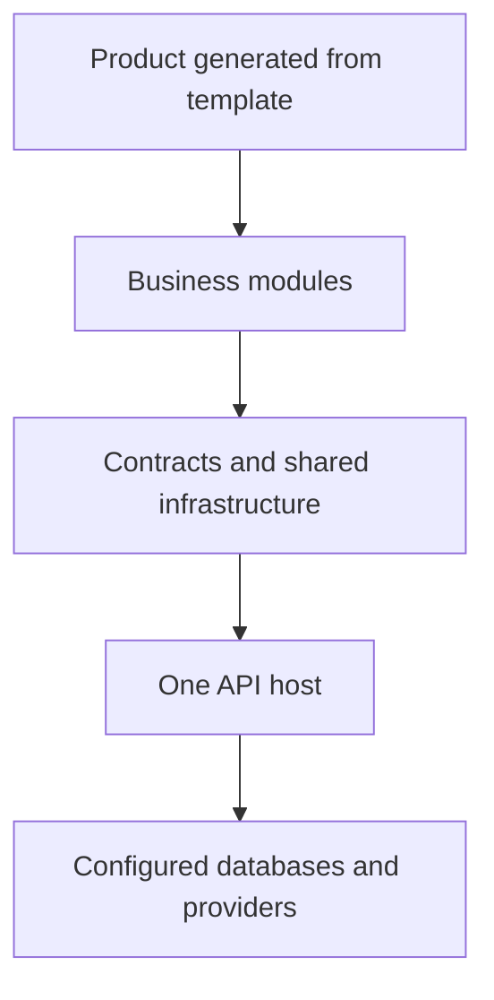

# Feature catalog

This catalog maps StarterKit capabilities to their canonical documentation so engineers can reuse existing behavior and identify the configuration it requires.
<!--#if (templateSource)-->
Backlog and status: [Template backlog](Template-Backlog.md).
<!--#endif-->

## At a glance

| Area | Owner |
|---|---|
| Accounts and authentication | Identity; provider-neutral users via `UserDirectory.Contracts` |
| Tenant control plane | Tenancy |
| Billing | Subscriptions |
| Files | Attachment |
| Human communication | Notification |
| Customer integrations | Webhooks and DataTransfer |
| Technical infrastructure | Host and Shared projects |

## How it works

The catalog describes shipped capabilities, not enabled-by-default integrations. Generation switches select sample/tooling/deployment content; runtime configuration selects providers and enforcement.


*Figure: Generated products compose the listed capabilities in one host and configure external dependencies per environment.*

## Identity and access

| Feature | Highlights | Docs |
|---|---|---|
| Accounts | Email or phone registration, phone onboarding, email confirmation, profile completion, self-service account deletion and data export | [Identity](../Identity/README.md) |
| Sessions | JWT access tokens + rotating refresh-token families (reuse detection), `sid` claim, list/revoke my sessions, revoke others, admin revoke, signing-key rotation | [Identity](../Identity/README.md), [JWT guide](../Identity/jwt/JWT-AUTH-TECHNICAL-GUIDE.md) |
| One-time codes | One OTP system (HMAC, attempt caps, cooldowns, daily caps) for reset, phone, onboarding; delivery by WhatsApp **or email** (`OneTimeCode` template) | [Identity](../Identity/README.md#one-time-codes-otp) |
| Two-factor | TOTP with encrypted keys, hashed single-use recovery codes, replay guard, challenge tokens, enforced for privileged roles | [Permissions, 2FA and admin audit](../Identity/Permissions-2FA-and-Admin-Audit.md) |
| Passkeys | WebAuthn on .NET 10 Identity, usernameless + autofill, MFA sessions, step-up to add, last-method guard, security emails | [Passkeys](../Identity/Passkeys.md) |
| Enterprise SSO | Per-tenant OIDC and SAML 2.0, DNS-verified domains, home-realm discovery, JIT provisioning, enforced SSO with break-glass, test mode | [Enterprise SSO](../Identity/Enterprise-SSO.md) |
| SCIM 2.0 | Users + Groups, Okta/Entra compatible, deprovision = suspend + revoke sessions, group → tenant-role mapping | [SCIM](../Identity/SCIM.md) |
| Social login | Google, Facebook (never bypasses 2FA or SSO enforcement) | [Identity](../Identity/README.md) |
| Authorization | Roles → fine-grained permissions per request, tenant permissions, deny-by-default endpoints, `DisallowImpersonation`, `DisallowApiKey` | [Permissions](../Identity/Permissions-2FA-and-Admin-Audit.md), [API guidelines](../Architecture/ApiGuidelines.md) |
| API keys | Personal access tokens, scopes ∩ owner permissions, tenant-scoped | [Users and admins API](../Identity/Users-and-Admins-API.md) |
| Admin | User/admin management with role hierarchy, audited impersonation, append-only Identity admin audit | [Users and admins API](../Identity/Users-and-Admins-API.md) |
| Bot protection | `.RequireHumanVerification` (Turnstile adapter) on anonymous account flows | [Bot protection](../Identity/Bot-Protection.md) |
| Key management | Data Protection keys in the DB, encrypted by certificate or KMS (Azure Key Vault, AWS KMS) | [Identity](../Identity/README.md) |

## Multi-tenancy

| Feature | Highlights | Docs |
|---|---|---|
| Tenants | Optional multi-tenancy, subdomain / custom domain (DNS-verified) resolution, suspension, deletion, export | [Overview](../MultiTenancy/Overview.md), [Tenancy](../Modules/Tenancy.md) |
| Isolation | Named EF filters + Postgres RLS, shared or dedicated databases, automated moves | [Isolation](../MultiTenancy/Isolation-and-Dedicated-Databases.md) |
| Organization | Branch trees with scoped access, memberships, tenant roles, invitations, tenant audit | [Branches](../MultiTenancy/Branches-and-Scoping.md) |
| Directory provisioning | Membership provisioning for SSO JIT and SCIM (`ProvisionMemberCommand`, seat limits, owner-safe) | [Tenancy](../Modules/Tenancy.md), [SCIM](../Identity/SCIM.md) |
| Tenant operations | Default tenant, shared/dedicated provisioning, database moves with read-only migration state, purge/export, Redis cache eviction across replicas | [Operations](../MultiTenancy/Operations.md) |
| Feature flags | Per tenant/user, percentage rollout, kill switch, `.RequireFlag` | [Feature flags](../Architecture/Feature-Flags.md) |

## Billing

| Feature | Highlights | Docs |
|---|---|---|
| Plans and subscriptions | Lifecycle state machine, upgrades/downgrades with proration, renewals, trials, coupons, dunning | [Subscriptions](../Modules/Subscriptions.md), [Billing](../Subscriptions/Billing.md) |
| Payments | Proof-based payments, Stripe and Paymob adapters, idempotent webhook inbox, refunds to the ledger | [Online payments](../Subscriptions/Online-Payments.md) |
| Money integrity | Append-only ledger, gapless invoice numbers, immutable invoices + credit notes, tax snapshot | [Billing](../Subscriptions/Billing.md) |
| Entitlements | `.RequireFeature`, `.RequireQuota`, usage metering per plan | [Subscriptions](../Modules/Subscriptions.md) |

## Communication and integration

| Feature | Highlights | Docs |
|---|---|---|
| Email | Liquid templates en/ar, design system (tokens, components, dark mode, branding, plain-text part), fallback chain, delivery log | [Notification](../Modules/Notification.md), [Email design system](../Modules/Notification-Email-Design-System.md) |
| WhatsApp | Cloud API templates, fallback with email | [Notification](../Modules/Notification.md) |
| In-app + push | Inbox, SignalR hub (Redis backplane), FCM push to session-bound devices | [Realtime and push](../Modules/Notification-Realtime-and-Push.md) |
| Notification preferences | Category/group and channel preferences, quiet hours, security/billing restrictions, independent additive delivery jobs | [Notification](../Modules/Notification.md), [Realtime and push](../Modules/Notification-Realtime-and-Push.md) |
| Outbound webhooks | Standard Webhooks signatures, retries, delivery log, SSRF guard, auto-disable | [Webhooks](../Modules/Webhooks.md) |
| Bulk import/export | CSV/XLSX jobs, dry run, error report, progress, cancel, resumable, worker replicas | [DataTransfer](../Modules/DataTransfer.md) |
| Durable sagas | Owning-module state and migrations, tenant RLS where applicable, explicit durable registration | [Messaging](../Architecture/Messaging.md), [ADR 0023](../Decisions/0023-durable-sagas-on-module-dbcontexts.md) |
| Messaging | Domain + integration events, transactional outbox, dead letters admin, InMemory / PostgreSQL / RabbitMQ | [Messaging](../Architecture/Messaging.md) |

## Files

| Feature | Highlights | Docs |
|---|---|---|
| Attachments | Magic-byte validation, ClamAV malware scanning (fail-closed, `docker-compose.clamav.yml`), signed URLs, pending uploads, thumbnails (SkiaSharp), reconciliation; Local / Azure Blob / S3 | [Attachment](../Attachment/README.md) |

## Platform

| Feature | Highlights | Docs |
|---|---|---|
| API conventions | Versioned Carter endpoints, bounded pagination, localized enum lookup, explicit authorization, CORS | [API guidelines](../Architecture/ApiGuidelines.md) |
| Responses and failures | Typed exceptions, validation, numeric/string codes, safe 5xx messages and trace correlation | [Errors and responses](../Architecture/Errors-and-Responses.md) |
| Request controls | Idempotency replay, per-user/IP rate limiting, timeouts, trusted forwarded headers, feature/quota/flag/human filters | [Request lifecycle](../Architecture/Request-Lifecycle.md) |
| CQRS and units of work | Owned mediator, automatic validators, telemetry, concurrency translation, committed domain-event dispatch; background runner | [Design patterns](../Architecture/DesignPatterns.md), [Messaging](../Architecture/Messaging.md) |
| Persistence | Per-module schemas, named soft-delete/isolation filters, string enums, optimistic versions including child changes, UTC timestamps | [Database conventions](../Architecture/DatabaseConventions.md), [ADR 0021](../Decisions/0021-aggregate-version-covers-child-collections.md) |
| Localization | English/Arabic resources, `LocalizedText` data and localized enum lookup | [Coding standards](../Architecture/CodingStandards.md), [Shared services](../Shared/README.md) |
| Outbound URL protection | `GuardedConnector` validates connections to customer-supplied IdP and webhook URLs | [Enterprise SSO](../Identity/Enterprise-SSO.md), [Webhooks](../Modules/Webhooks.md) |
| Caching | `IDistributedCache`, tenant-scoped cache keys, explicit domain-event invalidation, fail-open request behavior | [Redis](../Infrastructure/Redis.md) |
| Audit trail | Same-transaction `audit_entries` for `IAuditable` entities | [ADR 0011](../Decisions/0011-audit-trail.md) |
| Observability | OpenTelemetry traces/metrics/logs, Seq, Grafana stack, outbox alerts | [Observability](../Architecture/Observability.md) |
| Operations | Deploy-time migrator, health/readiness, Docker secrets, Nginx, CI/CD with approval, backups, rollback | [Deployment](../deployment/README.md) |
| Guardrails | Architecture tests (boundaries, naming, tenant isolation, auth, messaging, migrations) | [Testing strategy](../Testing/Testing-Strategy.md) |

## Development and delivery

| Feature | Highlights | Docs |
|---|---|---|
| Product and module generation | `dotnet new` switches, manifest discovery, four module projects, optional sample with products/categories/tags/attributes/wishlist | [Templates](../Getting-Started/Templates.md), [Project structure](../Architecture/ProjectStructure.md) |
| Local orchestration | Aspire dashboard, PostgreSQL, Redis, Seq, optional full observability stack; compose alternative | [Aspire](../Infrastructure/Aspire.md), [Docker Compose](../deployment/Docker-Compose.md) |
| Background work | Hangfire tenant propagation, per-item unit of work, separate queues and worker replica configuration on the same image | [DataTransfer](../Modules/DataTransfer.md), [Messaging](../Architecture/Messaging.md) |
| Test layers | xUnit v3, FluentAssertions, Moq, Testcontainers PostgreSQL, HTTP and multi-tenant E2E, Playwright smoke | [Testing strategy](../Testing/Testing-Strategy.md) |
| Load testing | k6 scenarios and isolated LoadTest-profile stack | [Load testing](../Testing/Load-Testing.md) |
| Supply-chain boundaries | Centrally managed packages, adapter-local third-party dependencies and license constraints | [Third-party licenses](Third-Party-Licenses.md), [Technology stack](../Architecture/TechnologyStack.md) |
| Change procedures | Skills for modules, aggregates, endpoints, migrations, events, jobs, permissions, email, tests, review and docs | [New project](../Getting-Started/New-Project.md), [Coding standards](../Architecture/CodingStandards.md) |

## Configuration

Use the linked capability page for its complete settings. These host defaults distinguish shipped features from enabled enforcement (`src/Api/appsettings.json` and module options):

| Key | Default | Meaning |
|---|---|---|
| `BotProtection:Enabled` | `false` | Human-verification filters are inert until enabled. |
| `Subscriptions:Entitlements:Enforce` | `false` | Plan entitlement checks are permissive until enabled. |
| `RequestTimeouts:DefaultSeconds` | `30` | Default endpoint timeout. |

## Usage

The composition entry point in `src/Api/Program.cs` is:

```csharp
builder.AddModules();
```

Start from [New project](../Getting-Started/New-Project.md), then use the owning module's contracts or the matching `/starterkit:*` procedure. Shared projects own infrastructure, not business state.

## Failure modes and guarantees

Capabilities have different reliability contracts: outbox delivery is at-least-once; caches and idempotency can fail open; malware scanning fails closed; tenant database moves reject writes while migrating. Production transport must be durable. Provider credentials, domains, plan definitions and operational access remain product decisions. Canonical pages above define retries, error codes and limits.

## Guardrails

`ModuleBoundaryTests`, `ThirdPartyIsolationTests`, `MessagingArchitectureTests`, `SagaArchitectureTests`, `TenantIsolationArchitectureTests`, `AdminEndpointAuthorizationTests` and `ModuleDiscoveryTests` enforce the platform boundaries. Module tests and HTTP E2E suites verify individual capabilities.

## Related

[Overview](../Architecture/Overview.md), [Documentation index](../INDEX.md), [ADRs](../Decisions/README.md), and `/starterkit:update-docs`.
