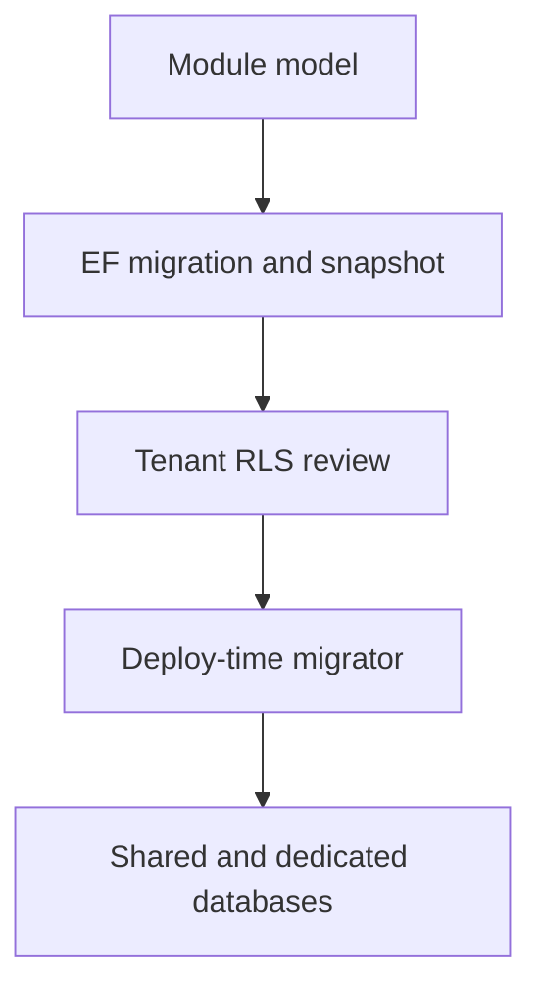

# Database migrations

Each module owns its EF Core model, PostgreSQL schema and migration history; migration tooling must target the owning assembly.

## Goal

Create, inspect and apply a migration without losing module ownership or tenant isolation.

## At a glance

| Module | DbContext | Schema | Migrations folder | Scope |
|---|---|---|---|---|
| Identity | `ApplicationIdentityDbContext` | `identity` | `src/Modules/Identity/Identity/Data/Migrations` | Control plane |
| Tenancy | `TenancyDbContext` | `tenancy` | `src/Modules/Tenancy/Tenancy/Data/Migrations` | Control plane |
| Attachment | `AttachmentDbContext` | `attachment` | `src/Modules/Attachment/Attachment/Data/Migrations` | Tenant data |
| Catalog (optional sample) | `CatalogDbContext` | `catalog` | `src/Modules/Catalog/Catalog/Data/Migrations` | Tenant data |
| Subscriptions | `SubscriptionsDbContext` | `subscriptions` | `src/Modules/Subscriptions/Subscriptions/Data/Migrations` | Control plane |
| Webhooks | `WebhooksDbContext` | `webhooks` | `src/Modules/Webhooks/Webhooks/Data/Migrations` | Tenant data |
| DataTransfer | `DataTransferDbContext` | `datatransfer` | `src/Modules/DataTransfer/DataTransfer/Data/Migrations` | Tenant data |
| Agentic | `AgenticDbContext` | `agentic` | `src/Modules/Agentic/Agentic/Data/Migrations` | Tenant data |
| Notification | `NotificationDbContext` | `notification` | `src/Modules/Notification/Notification/Data/Migrations` | Control plane |

Notification's context lives in `Persistence/`; its migrations still live in `Data/Migrations`. The shared connection is `ConnectionStrings:starterkit`; tenant-data contexts can also target dedicated tenant databases. The message transport owns the separate `transport` schema, not another module DbContext.

## Prerequisites

- Run from the repository root with the SDK pinned by `global.json`.
- Start PostgreSQL through Aspire (`dotnet run --project src/Aspire/AppHost`) or `docker compose up -d postgres`.
- Restore the local EF tool before running any EF command:

```bash
dotnet tool restore
```

`.config/dotnet-tools.json` pins the tool; `ToolManifestTests` checks it against `Directory.Packages.props`.

## How it works


*Figure: Migration review covers schema changes and RLS before the deploy-time migrator applies them.*

## Steps

### Add a migration

1. Choose the context and project from the table above. `--output-dir` is relative to that project; `--startup-project` is always `src/Api`.
2. Run the matching command (replace `<Name>` with the migration name):

```bash
dotnet ef migrations add <Name> --context ApplicationIdentityDbContext --project src/Modules/Identity/Identity --startup-project src/Api --output-dir Data/Migrations
dotnet ef migrations add <Name> --context TenancyDbContext --project src/Modules/Tenancy/Tenancy --startup-project src/Api --output-dir Data/Migrations
dotnet ef migrations add <Name> --context AttachmentDbContext --project src/Modules/Attachment/Attachment --startup-project src/Api --output-dir Data/Migrations
dotnet ef migrations add <Name> --context CatalogDbContext --project src/Modules/Catalog/Catalog --startup-project src/Api --output-dir Data/Migrations
dotnet ef migrations add <Name> --context SubscriptionsDbContext --project src/Modules/Subscriptions/Subscriptions --startup-project src/Api --output-dir Data/Migrations
dotnet ef migrations add <Name> --context WebhooksDbContext --project src/Modules/Webhooks/Webhooks --startup-project src/Api --output-dir Data/Migrations
dotnet ef migrations add <Name> --context DataTransferDbContext --project src/Modules/DataTransfer/DataTransfer --startup-project src/Api --output-dir Data/Migrations
dotnet ef migrations add <Name> --context NotificationDbContext --project src/Modules/Notification/Notification --startup-project src/Api --output-dir Data/Migrations
```

3. Review the migration and snapshot. For every new tenant table, including outbox, audit or saga tables, call `migrationBuilder.EnableTenantRowLevelSecurity("<schema>", "<table>")` after creating it. The extension lives in `src/Shared/Shared.Core/MultiTenancy/Data/TenantRlsMigrationExtensions.cs`; it enables and forces RLS and installs `tenant_isolation`.
4. Follow `/starterkit:add-migration` for model and migration review. Keep `ApplyTenantFilters(builder)` last in `OnModelCreating`; model filters do not replace database policies.

### Apply migrations

`UseMigration<TDbContext>()` runs through each module's initialization under a PostgreSQL advisory lock. `Database:MigrateOnStartup` is `true` in the base settings and `false` in Docker. Production applies migrations and seeds through the one-shot migrator:

```bash
dotnet run --project src/Api -- --migrate-only
```

The published image runs `dotnet Api.dll --migrate-only`. See [Deploy-time migrations](../deployment/Database-Migrations.md) for the privileged migration connection and dedicated-database handling. An EF database update targets one context only:

```bash
dotnet ef database update --context TenancyDbContext --project src/Modules/Tenancy/Tenancy --startup-project src/Api
```

### Generate SQL without applying

```bash
dotnet ef migrations script --idempotent --context TenancyDbContext --project src/Modules/Tenancy/Tenancy --startup-project src/Api -o ./migrations-tenancy.sql
```

Inspect the generated SQL; do not commit the scratch SQL file. Substitute the context/project pair from the table for other modules.

### Roll back / remove

```bash
dotnet ef database update <PreviousMigrationName> --context TenancyDbContext --project src/Modules/Tenancy/Tenancy --startup-project src/Api
dotnet ef migrations remove --context TenancyDbContext --project src/Modules/Tenancy/Tenancy --startup-project src/Api
```

Remove a migration only if it has not been applied anywhere. Never edit or delete a migration already applied to a shared environment; add a forward migration that reverses it.

### Resetting migrations for a new project

A new product with disposable databases may replace a module's migration set with a fresh `Initial<Module>` after a large model redesign. This is a deliberate reset of migration history, not a repair for a deployed database. Follow [New project](../Getting-Started/New-Project.md).

## Configuration

| Key | Base default | Meaning |
|---|---|---|
| `Database:MigrateOnStartup` | `true` (`false` in Docker) | Migrate and seed during module initialization. |
| `Database:MigrationConnectionString` | `null` | Optional privileged connection used for migration work. |
| `Database:LockTimeoutSeconds` | `300` | Advisory-lock wait budget. |

## Verify

```bash
dotnet build StarterKit.slnx
dotnet test src/Api.Tests
dotnet test src/Api.E2ETests --filter "FullyQualifiedName~PendingModelChangesTests|FullyQualifiedName~TenantRowLevelSecurityCoverageTests"
```

The E2E fixture requires Docker. `PendingModelChangesTests` checks every registered `IDbContext` for model drift **and unapplied migrations**; its expected-name list is a minimum, not the complete context inventory. `TenantRowLevelSecurityCoverageTests` inspects actual PostgreSQL tables with `tenant_id` in tenant-data schemas for enabled/forced RLS and the policy.

## Pitfalls

- A successful EF generation does not prove that tenant RLS was added.
- A control-plane context is not an `ITenantDataContext`; some of its rows still have tenant filters.
- `dotnet ef database update` alone does not run all module seeds or migrate every dedicated database.
- A failed migration or dedicated-tenant migration fails the deploy-time run; investigate before starting the new API image.

## Related

[Database conventions](../Architecture/DatabaseConventions.md), [Architecture guardrails](Architecture-Guardrails.md), [ADR-0001](../Decisions/0001-modular-monolith-schema-per-module.md), [ADR-0005](../Decisions/0005-tenant-isolation-model.md), and `/starterkit:add-migration`.
