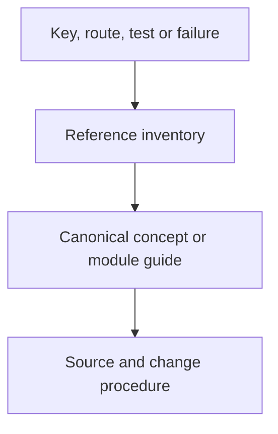

# Reference

The reference section collects inventories, commands and failure diagnosis for engineers changing or operating a generated product.

## At a glance

| Document | Use it for |
|---|---|
| [Feature catalog](Features.md) | Find a shipped capability and its canonical guide. |
| [Configuration](Configuration.md) | Inspect base JSON keys, defaults, Docker and Development overrides, and option meanings. |
| [Endpoint authorization](Endpoint-Authorization.md) | Review methods/routes, inherited policies, restrictions, filters and default role grants. |
| [Architecture guardrails](Architecture-Guardrails.md) | Diagnose each architecture test and the migration/RLS E2E guardrails. |
| [Migrations](Migrations.md) | Select the owning DbContext/project, generate/apply SQL, handle tenant RLS and undo changes. |
| [Third-party licenses](Third-Party-Licenses.md) | Review central versions, license constraints, dependency isolation and exit paths. |
| [PostgreSQL authentication](Troubleshooting-PostgreSQL-Authentication.md) | Diagnose password/configuration mismatches and distinguish rotation from a disposable reset. |
| [Diagram style](Diagram-Style.md) | Write and validate Mermaid diagrams for the documentation column. |
<!--#if (templateSource)-->
| [Template backlog](Template-Backlog.md) | Inspect template issues and roadmap. |
| [Brand](Brand.md) | Use the documentation identity, palette and voice. |
<!--#endif-->

## How it works

Use these pages to look up a concrete key, route, test or command. Follow their links to the canonical concept/module guide for lifecycle and implementation detail. The reference records repository behavior; external provider terms and deployment-specific overrides require separate review.

*Figure: Reference pages connect concrete lookups to canonical explanations and verified source.*

## Usage

Before a change, find the owning module and read its canonical page. Use [Configuration](Configuration.md) for checked-in defaults, [Endpoint authorization](Endpoint-Authorization.md) for access declarations, and [Migrations](Migrations.md) for schema work.

AI-agent rules live in [CLAUDE.md](../../CLAUDE.md).
<!--#if (aiTooling)-->
The step-by-step procedures are the [StarterKit plugin skills](../../tools/claude/starterkit-plugin/README.md).
<!--#endif-->

## Failure modes and guarantees

Inventories describe checked-in declarations, not effective secrets or proof that an external service is configured. Route metadata can coexist with additional handler checks. EF filters do not replace RLS; generating a migration does not apply it.

## Guardrails

[Architecture guardrails](Architecture-Guardrails.md) maps assertions to fixes. `bash scripts/check-docs.sh` checks documentation links and placeholders; the site build also validates links and anchors.

## Related

[Wiki index](../INDEX.md), [Architecture overview](../Architecture/Overview.md), [Templates](../Getting-Started/Templates.md), [ADRs](../Decisions/README.md), and `/starterkit:update-docs`.
