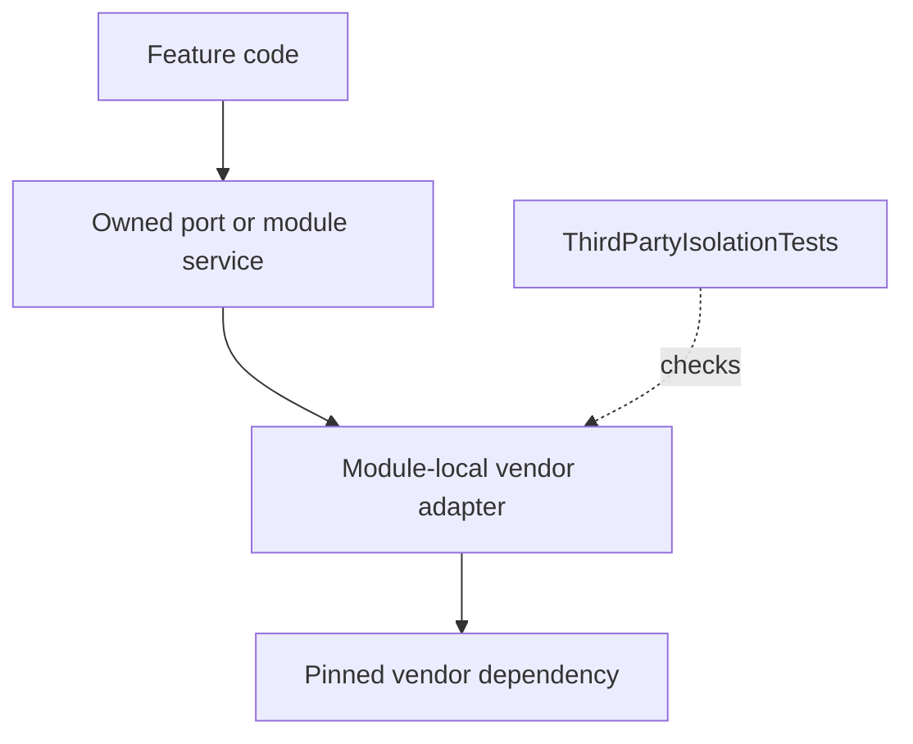

# Third-party licenses

This reference records dependency license constraints, pinned versions and adapter boundaries so products can review upgrades without spreading vendor dependencies across modules.

## At a glance

Versions below come from `Directory.Packages.props`. License classifications retain the repository's 2026-11-04 audit of package `.nuspec` files; they are not a fresh verification of vendor terms or service pricing. Recheck terms when upgrading or choosing a commercial deployment license.

| Boundary | Owner / seam |
|---|---|
| Image processing | Attachment, `IImageProcessingService` |
| Invoice PDFs | Subscriptions, `PdfConfiguration` / `InvoiceDocument` |
| Push SDK and Redis backplane | Notification, `IPushProvider` |
| CSV/XLSX readers | DataTransfer |
| In-process mediation | Owned `Shared.Contracts.Mediation` port |

## How it works

*Figure: Assembly reference checks keep licensed dependencies at the module seam that owns their behavior.*

## Action needed per product

These are the only dependencies whose terms depend on **who you are** (revenue, company type) rather than
being permissive.

| Dependency | License | Free when | Otherwise | Where it lives | Exit path |
|---|---|---|---|---|---|
| **QuestPDF 2026.9.1** | QuestPDF Community / Professional / Enterprise | Individuals, non-profits, academia, OSI open source, companies under USD 1M revenue. Public-sector bodies and publicly traded companies are **never** eligible | Buy Professional/Enterprise and set `Subscriptions:Pdf:License` | Subscriptions module only (invoice PDFs), `PdfConfiguration` + `InvoiceDocument` | Another renderer behind the invoice PDF service |
| **Seq** (`datalust/seq` container, production `docker-compose.yml`) | Datalust commercial EULA | One user (Individual license) | Team license | Logging sink only (`ConnectionStrings:seq`, registered by `AddSeqEndpoint`); the app talks OTLP/Serilog-style HTTP | Remove the service and send logs to Loki/OTLP (`docker-compose.observability.yml`) |
| **Firebase Cloud Messaging** (the Google service behind `docker-compose.push.yml`; the FirebaseAdmin SDK itself is Apache-2.0) | Google APIs Terms + Firebase Terms of Service | No charge for FCM sends | n/a (no paid tier); accept Google's data-processing terms in the Firebase console, since push titles/bodies transit Google (and Apple for iOS). Use `PushContent.Sensitive` for anything personal | Notification module only, behind `IPushProvider` (`FcmPushProvider`; a direct APNs adapter is also available); guarded by `ThirdPartyIsolationTests` | Another `IPushProvider` (direct APNs, OneSignal, ...) or `Push:Provider=NoOp` |
| **Redis 7.4+** (the floating `redis:7-alpine` tag; inspect the deployed image to determine its version) | RSALv2 / SSPLv1 | Using it as your own app's cache (StarterKit's case) | Only restricted if you sell Redis itself as a service | Cache + pub/sub through `IDistributedCache` / `IConnectionMultiplexer`, and the SignalR backplane | `valkey/valkey` (BSD-3), a wire-compatible drop-in |

**Copyleft that is fine as used:**

- Hangfire.Core / Hangfire.AspNetCore / Hangfire.PostgreSql are LGPL-3.0, used as unmodified NuGet libraries. If you
  patch Hangfire itself, publish the patch.
- Grafana, Loki and Tempo are AGPL-3.0, run as separate, unmodified containers.
- SonarAnalyzer.CSharp is LGPL-3.0 and build-time only.

## Replaced (decided 2026-11-04)

| Was | License problem | Now |
|---|---|---|
| SixLabors.ImageSharp 3.2 | Six Labors Split License: revenue-gated, and Release builds fail without a license key | **SkiaSharp 4.155.0 (MIT)** behind `IImageProcessingService` ([Image processing](../Attachment/Image-Processing.md)). An ImageSharp adapter is documented there for teams that buy a license |

## Pinned to the last free major (decided 2026-11-04)

| Package | Pinned | License of the pin | Newer major | Decision |
|---|---|---|---|---|
| ~~MediatR~~ | removed | n/a | 13+ commercial (Lucky Penny) | **Replaced** by the owned mediator port, `Shared.Contracts.Mediation` + `Shared.Core.Mediation.Mediator` ([ADR-0007](../Decisions/0007-owned-mediator-port.md)). `ThirdPartyIsolationTests` fails if MediatR comes back |
| MassTransit (+ Abstractions, RabbitMQ, SqlTransport.PostgreSql) | 8.5.12 | Apache-2.0, permanently for this version | 9+ commercial | **Keep 8.x.** Publishing is already behind our outbox (`AddIntegrationEvent`, with one `IPublishEndpoint` call in `OutboxRelay`). Module consumers, durable sagas, transport setup and the `[MessageUrn]` attribute touch MassTransit; contracts may use only `MassTransit.Abstractions` (guarded). **Support review:** the 2026-11-04 audit reported v8 security fixes through at least the end of 2026; verify the current support policy before relying on it. Options at that point: buy v9, stay on unpatched 8.5.12 (an internal-only attack surface), or move to Wolverine/Rebus. Any replacement must cover consumers, durable saga persistence/scheduling, bus configuration and the outbox publish seam; `TenantMessagingBusTests` and `DurableSagaTests` are acceptance suites |
| FluentAssertions | 7.2.2 | Apache-2.0 | 8+ commercial (Xceed) | **Keep 7.x.** Test-only, never shipped. Exit: `AwesomeAssertions` (Apache-2.0 fork of 7.x): swap the package and the `using` |

Dependabot ignores major bumps of MassTransit and FluentAssertions (`.github/dependabot.yml`), so a
commercial major never arrives by an automated PR.

## Everything else: permissive

| License | Packages |
|---|---|
| MIT | SkiaSharp (+ `NativeAssets.Linux.NoDependencies`), Sylvan.Data.Csv + Sylvan.Data.Excel (DataTransfer only), Microsoft.Extensions.AI (+ `.Abstractions`, `.OpenAI`) and the OpenAI SDK (Agentic only), ASP.NET Core / EF Core / Microsoft.Extensions.* 10.x (incl. `Microsoft.AspNetCore.SignalR.StackExchangeRedis`, `.SignalR.Client`, `.TestHost`), Aspire 13.x, Asp.Versioning, Carter, Swashbuckle, Scalar, Mapster, Scrutor, MailKit, Fluid.Core, System.IdentityModel.Tokens.Jwt, Microsoft.IdentityModel.Protocols.OpenIdConnect, Azure.Storage.Blobs, Roslyn (Microsoft.CodeAnalysis.*), Testcontainers, coverlet, Microsoft.NET.Test.Sdk, Bogus |
| Apache-2.0 | Anthropic (official C# SDK, Agentic only), FirebaseAdmin, Google.Apis / Google.Apis.Auth / Google.Apis.Core (FCM, Notification module only), FluentValidation, OpenTelemetry.*, Grafana.OpenTelemetry, AspNetCore.HealthChecks.*, EFCore.NamingConventions, libphonenumber-csharp, Figgle, AWSSDK.*, KubernetesClient, xunit |
| BSD-3-Clause | ITfoxtec.Identity.Saml2 (SAML 2.0 SP, Identity module only), Polly, Moq, Google.Protobuf, Google.Api.Gax / Google.Api.Gax.Rest (transitive, via FirebaseAdmin) |
| PostgreSQL | Npgsql, Npgsql.EntityFrameworkCore.PostgreSQL, Npgsql.OpenTelemetry |
| Apache-2.0 OR MPL-2.0 | RabbitMQ.Client (transitive) |
| Microsoft EULA | Microsoft.VisualStudio.Azure.Containers.Tools.Targets (Visual Studio container tooling, design-time only) |

Container images: postgres (PostgreSQL License), rabbitmq (MPL-2.0), nginx (BSD-2), pgbackrest (MIT), Prometheus,
node-exporter, postgres-exporter, cAdvisor, Jaeger and the OTel Collector (Apache-2.0), redis_exporter,
redis-commander and MailHog (MIT), pgAdmin (PostgreSQL License), .NET base images (MIT).

The 2026-11-04 audit counted 341 resolved packages (including transitive ones), of which 314 were MIT or Apache-2.0; these are historical counts, not the current resolved graph. The rest are listed above.
`Grafana.OpenTelemetry` pulls in many instrumentations you may not use (Cassandra, AWS Lambda, ...). Switch to
`Grafana.OpenTelemetry.Base` if image size matters.

## How to re-run the audit

After `dotnet restore`, every resolved package is in `src/**/obj/project.assets.json`, and its license is in
`~/.nuget/packages/<id>/<version>/<id>.nuspec` (`<license type="expression">`, or a license file for the custom ones
above). Anything that is not MIT, Apache-2.0, BSD or PostgreSQL gets a row in the tables above before it merges.

## Centrally pinned versions

This is the complete `PackageVersion` inventory in `Directory.Packages.props`, including transitive security pins and test/build dependencies; it is not a transitive lockfile. FirebaseAdmin's Google.Apis dependencies are transitive and therefore have no independent central version row here.

| Package | Pinned version |
|---|---|
| `Asp.Versioning.Abstractions` | `10.2.1` |
| `Asp.Versioning.Http` | `10.2.3` |
| `Asp.Versioning.Mvc` | `10.2.1` |
| `Asp.Versioning.Mvc.ApiExplorer` | `10.2.1` |
| `Aspire.Seq` | `13.6.4` |
| `AspNetCore.HealthChecks.NpgSql` | `9.0.0` |
| `AspNetCore.HealthChecks.Redis` | `9.0.0` |
| `AspNetCore.HealthChecks.Publisher.Seq` | `9.0.0` |
| `AspNetCore.HealthChecks.UI` | `9.0.0` |
| `AspNetCore.HealthChecks.UI.Client` | `9.0.0` |
| `AspNetCore.HealthChecks.UI.InMemory.Storage` | `9.0.0` |
| `EFCore.NamingConventions` | `10.0.1` |
| `Figgle` | `0.6.6` |
| `Figgle.Fonts` | `0.6.6` |
| `Microsoft.AspNetCore.OpenApi` | `10.0.14` |
| `Microsoft.CodeAnalysis.Common` | `5.0.0` |
| `Microsoft.CodeAnalysis.CSharp` | `5.0.0` |
| `Microsoft.CodeAnalysis.Workspaces.Common` | `5.0.0` |
| `Microsoft.CodeAnalysis.CSharp.Workspaces` | `5.0.0` |
| `Scalar.AspNetCore` | `2.19.0` |
| `SonarAnalyzer.CSharp` | `10.35.0.4138` |
| `Swashbuckle.AspNetCore` | `10.3.1` |
| `Swashbuckle.AspNetCore.SwaggerGen` | `10.3.1` |
| `Swashbuckle.AspNetCore.SwaggerUI` | `10.3.1` |
| `Carter` | `10.0.0` |
| `Microsoft.VisualStudio.Azure.Containers.Tools.Targets` | `1.23.0` |
| `FluentValidation` | `12.2.0` |
| `FluentValidation.AspNetCore` | `11.3.1` |
| `FluentValidation.DependencyInjectionExtensions` | `12.2.0` |
| `libphonenumber-csharp` | `9.0.43` |
| `Microsoft.EntityFrameworkCore` | `10.0.14` |
| `Microsoft.EntityFrameworkCore.Design` | `10.0.14` |
| `Microsoft.EntityFrameworkCore.InMemory` | `10.0.14` |
| `Microsoft.EntityFrameworkCore.Tools` | `10.0.14` |
| `Npgsql.EntityFrameworkCore.PostgreSQL` | `10.0.3` |
| `Microsoft.Extensions.Caching.StackExchangeRedis` | `10.0.14` |
| `Microsoft.AspNetCore.SignalR.StackExchangeRedis` | `10.0.14` |
| `FirebaseAdmin` | `3.7.0` |
| `Mapster` | `10.0.14` |
| `QuestPDF` | `2026.9.1` |
| `Stripe.net` | `53.1.0` |
| `Scrutor` | `7.0.0` |
| `Microsoft.Extensions.Configuration.Abstractions` | `10.0.14` |
| `Microsoft.Extensions.DependencyInjection.Abstractions` | `10.0.14` |
| `Microsoft.Extensions.Http.Resilience` | `10.11.0` |
| `Microsoft.Extensions.Localization` | `10.0.14` |
| `Microsoft.Extensions.ServiceDiscovery` | `10.11.0` |
| `Npgsql.OpenTelemetry` | `10.0.3` |
| `OpenTelemetry.Exporter.OpenTelemetryProtocol` | `1.20.1` |
| `OpenTelemetry.Extensions.Hosting` | `1.20.1` |
| `OpenTelemetry.Instrumentation.AspNetCore` | `1.20.2` |
| `OpenTelemetry.Instrumentation.GrpcNetClient` | `1.20.1-beta.1` |
| `OpenTelemetry.Instrumentation.Http` | `1.20.2` |
| `OpenTelemetry.Instrumentation.Process` | `1.20.1-rc.1` |
| `OpenTelemetry.Instrumentation.Runtime` | `1.20.1` |
| `OpenTelemetry.Exporter.Prometheus.AspNetCore` | `1.20.1-beta.1` |
| `Grafana.OpenTelemetry` | `1.14.1` |
| `OpenTelemetry.Exporter.Console` | `1.20.1` |
| `OpenTelemetry.Exporter.Zipkin` | `1.20.1` |
| `Polly` | `8.9.1` |
| `MassTransit` | `8.5.12` |
| `MassTransit.Abstractions` | `8.5.12` |
| `MassTransit.EntityFrameworkCore` | `8.5.12` |
| `MassTransit.RabbitMQ` | `8.5.12` |
| `MassTransit.SqlTransport.PostgreSql` | `8.5.12` |
| `Microsoft.AspNetCore.Identity.EntityFrameworkCore` | `10.0.14` |
| `Microsoft.AspNetCore.Authentication.Google` | `10.0.14` |
| `Microsoft.AspNetCore.Authentication.Facebook` | `10.0.14` |
| `Microsoft.AspNetCore.Authentication.JwtBearer` | `10.0.14` |
| `System.IdentityModel.Tokens.Jwt` | `8.23.0` |
| `Microsoft.IdentityModel.Protocols.OpenIdConnect` | `8.23.0` |
| `ITfoxtec.Identity.Saml2` | `4.21.0` |
| `Azure.Storage.Blobs` | `12.30.1` |
| `AWSSDK.S3` | `4.0.104.11` |
| `AWSSDK.Core` | `4.0.102.19` |
| `AWSSDK.Extensions.NETCore.Setup` | `4.0.102.10` |
| `SkiaSharp` | `4.155.0` |
| `SkiaSharp.NativeAssets.Linux.NoDependencies` | `4.155.0` |
| `Microsoft.Extensions.Hosting.Abstractions` | `10.0.14` |
| `Sylvan.Data.Csv` | `1.4.4` |
| `Sylvan.Data.Excel` | `0.5.8` |
| `Microsoft.Extensions.AI` | `10.11.0` |
| `Microsoft.Extensions.AI.Abstractions` | `10.11.0` |
| `Microsoft.Extensions.AI.OpenAI` | `10.11.0` |
| `OpenAI` | `2.14.0` |
| `Anthropic` | `13.8.0` |
| `Azure.Extensions.AspNetCore.DataProtection.Keys` | `1.6.5` |
| `Azure.Identity` | `1.21.0` |
| `AWSSDK.KeyManagementService` | `4.0.101.4` |
| `Hangfire.Core` | `1.8.25` |
| `Hangfire.AspNetCore` | `1.8.25` |
| `Hangfire.PostgreSql` | `1.21.1` |
| `MailKit` | `4.18.2` |
| `Fluid.Core` | `2.41.1` |
| `KubernetesClient` | `21.0.8` |
| `System.Security.Cryptography.Xml` | `10.0.14` |
| `System.Security.Cryptography.Pkcs` | `10.0.14` |
| `Aspire.Hosting.AppHost` | `13.6.4` |
| `Aspire.Hosting.Testing` | `13.6.4` |
| `Aspire.Hosting.PostgreSQL` | `13.6.4` |
| `Aspire.Hosting.Redis` | `13.6.4` |
| `Aspire.Hosting.RabbitMQ` | `13.6.4` |
| `Aspire.Hosting.Seq` | `13.6.4` |
| `Microsoft.NET.Test.Sdk` | `18.11.0` |
| `xunit.v3.mtp-off` | `4.0.2` |
| `xunit.runner.visualstudio` | `4.0.1` |
| `coverlet.collector` | `10.1.0` |
| `FluentAssertions` | `7.2.2` |
| `Moq` | `4.21.0` |
| `Microsoft.AspNetCore.Mvc.Testing` | `10.0.14` |
| `Microsoft.AspNetCore.SignalR.Client` | `10.0.14` |
| `Microsoft.AspNetCore.TestHost` | `10.0.14` |
| `Testcontainers.PostgreSql` | `4.16.0` |
| `Testcontainers.Redis` | `4.16.0` |
| `Bogus` | `35.6.5` |

## Configuration

| Key | JSON default | Meaning |
|---|---|---|
| `Subscriptions:Pdf:License` | `Community` | Select the QuestPDF license your organization is eligible to use. |
| `Push:Provider` | `Auto` | Resolve FCM or NoOp based on configuration/environment; direct APNs has separate settings. |
| `Push:Apns:Enabled` | `false` | Enable the direct APNs adapter with its own key file. |

See [Configuration](Configuration.md) and each provider's canonical page before enabling it.

## Usage

Inspect central pins and project references before upgrading. Package references omit versions because central management owns them. To repeat the local audit without changing dependency resolution, read existing `src/**/obj/project.assets.json` and the matching NuGet-cache `.nuspec` license expression/file; a restore is needed only when those artifacts are absent or stale.

## Failure modes and guarantees

An assembly boundary does not establish license eligibility, vendor support or service terms. Container tags and transitive versions may change independently of the central package list. The historical audit and exit paths above identify review work; they are not approval to upgrade a commercially licensed major.

## Guardrails

`ThirdPartyIsolationTests` checks production assembly references: no MediatR or SixLabors references; SkiaSharp only in Attachment; QuestPDF only in Subscriptions; Sylvan only in DataTransfer; Microsoft.Extensions.AI and the model-provider SDKs (OpenAI, Anthropic) only in Agentic; FirebaseAdmin/Google.Apis only in Notification; and SignalR Redis backplane references confined to Notification. Contracts may reference `MassTransit.Abstractions`, not the bus packages. Notification handlers must target concrete event types because the owned mediator dispatches exact runtime types.

The test **does not check license text, versions, or FluentAssertions' test-only use**. MassTransit 8.x and FluentAssertions 7.x pins are maintained in `Directory.Packages.props`; `.github/dependabot.yml` suppresses their automatic major bumps. [Architecture guardrails](Architecture-Guardrails.md) describes the exact assertions.

## Related

[Technology stack](../Architecture/TechnologyStack.md), [Image processing](../Attachment/Image-Processing.md), [Messaging](../Architecture/Messaging.md), [ADR-0007](../Decisions/0007-owned-mediator-port.md), and `/starterkit:review`.
