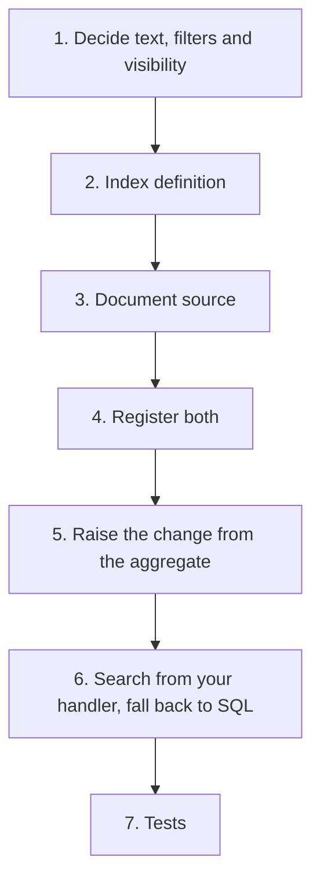

# Adding a search index to your module

A step-by-step guide, from "people need to search my records" to a ranked, faceted, tenant-safe search with a SQL
fallback. The example is an `Orders` module with an `Order` aggregate; every type it uses is in `Search.Contracts`.

Part of the [Search module](../Modules/Search.md).

<!--#if (sample)-->

The complete, running reference is Catalog's product search: `src/Modules/Catalog/Catalog/Domains/Products/SearchIndex/`
([Catalog](../Modules/Catalog.md#search-index)).

<!--#endif-->

## The path


*Figure: Search never references your module: you give it a definition and a source, tell it what changed, and ask it for ids.*

Nothing else is needed: no migration, no job, no deployment step. On the next start, reconcile builds the index in
every tenant, and your module answers from SQL until it is ready.

## 1. Decide what is searchable

| Question | For orders |
|---|---|
| What do people type? (text fields, each with a weight and a language) | order number (exact codes), customer name, notes |
| What do they narrow by? (filter fields, typed) | status, total, placed date, sales channel |
| What do they count? (facets: keyword, list or boolean filters) | status, channel |
| What can they sort by? (sortable filters) | total, placed date |
| Who may see a record? (visibility) | tenant and branch (automatic), plus your own rules, re-checked when you load the hits |

Index only what a search needs. Names of related records (a customer, a tag) are better kept as **ids** in filter
fields: indexing their text means re-indexing every record that refers to them when a name changes.

## 2. Define the index

```csharp
using Search.Contracts.Indexing;
using Search.Contracts.Querying;

namespace Orders.Domains.Orders.SearchIndex;

public static class OrderSearchIndex
{
    public const string Key = "orders.orders"; // <module>.<entity>; stored with every document, never renamed

    public static class Fields
    {
        public const string Number = "number";
        public const string Customer = "customer";
        public const string Notes = "notes";
        public const string Status = "status";
        public const string Channel = "channel";
        public const string Total = "total";
        public const string PlacedAt = "placed_at";
    }

    public static readonly SearchIndexDefinition Definition = new()
    {
        Key = Key,
        Name = LocalizedText.Create("Orders", "الطلبات"),
        TextFields =
        [
            new SearchTextField(Fields.Number, SearchWeight.Highest, SearchAnalyzer.Simple) { Suggest = true },
            new SearchTextField(Fields.Customer, SearchWeight.High, SearchAnalyzer.Bilingual) { Suggest = true, Highlight = true },
            new SearchTextField(Fields.Notes, SearchWeight.Low, SearchAnalyzer.Bilingual) { Highlight = true, MaxLength = 2000 }
        ],
        FilterFields =
        [
            new SearchFilterField(Fields.Status, SearchFieldType.Keyword) { Facetable = true },
            new SearchFilterField(Fields.Channel, SearchFieldType.Keyword) { Facetable = true },
            new SearchFilterField(Fields.Total, SearchFieldType.Number) { Sortable = true },
            new SearchFilterField(Fields.PlacedAt, SearchFieldType.Date) { Sortable = true }
        ],
        DefaultSort = new SearchSort(Fields.PlacedAt, Descending: true) // the order without text
    };
}
```

- **Weights** (`Low` to `Highest`) rank a match in the number above a match in the notes.
- **Analyzers**: `Simple` for codes, `English` / `Arabic` for prose in one language, `Bilingual` when either may
  appear ([Text and languages](Text-And-Languages.md#analyzers-and-word-forms)).
- **`Suggest`** feeds close spellings and as-you-type suggestions; **`Highlight`** keeps the original text for
  snippets.
- Field names start with a lower-case letter, then lower-case letters, digits or `_` (40 at most). The host refuses to start on an invalid or duplicate
  definition, and changing one rebuilds the index in every tenant on the next reconcile.

## 3. Write the document source

The source is how Search reads your data: the current documents for some ids, and all of them for a rebuild.

```csharp
using System.Runtime.CompilerServices;
using Search.Contracts.Indexing;
using Shared.Core.MultiTenancy.Data;
using static Orders.Domains.Orders.SearchIndex.OrderSearchIndex;

namespace Orders.Domains.Orders.SearchIndex;

public sealed class OrderSearchDocumentSource(OrdersDbContext db) : ISearchDocumentSource
{
    private const int BatchSize = 500;

    public async Task<IReadOnlyList<SearchDocument>> GetAsync(IReadOnlyCollection<string> ids, CancellationToken ct)
    {
        var orderIds = ids.Select(id => Guid.TryParse(id, out var g) ? g : Guid.Empty).Where(g => g != Guid.Empty).ToList();
        if (orderIds.Count == 0)
            return [];
        var rows = await Rows().Where(o => orderIds.Contains(o.Id)).ToListAsync(ct);
        return rows.Select(ToDocument).ToList(); // an id not returned is removed from the index
    }

    public async IAsyncEnumerable<SearchDocument> StreamAllAsync([EnumeratorCancellation] CancellationToken ct)
    {
        var after = Guid.Empty; // keyset pages: short queries, no reader held open while Search writes
        while (true)
        {
            var last = after;
            var batch = await Rows().Where(o => o.Id > last).OrderBy(o => o.Id).Take(BatchSize).ToListAsync(ct);
            foreach (var row in batch)
                yield return ToDocument(row);
            if (batch.Count < BatchSize)
                yield break;
            after = batch[^1].Id;
        }
    }

    // Every branch of the tenant (the reader's branch is applied at search time); soft-deleted rows are filtered by
    // the DbContext, so they are never indexed.
    private IQueryable<OrderRow> Rows() =>
        db.Orders.AsNoTracking().IgnoreBranchScope().Select(o => new OrderRow(
            o.Id, o.Version, o.BranchId, o.Number, o.CustomerName, o.Notes, o.Status, o.Channel, o.Total, o.PlacedAt));

    private static SearchDocument ToDocument(OrderRow o) =>
        SearchDocument.For(o.Id, o.Version) // Version: an older write never replaces a newer one
            .InBranch(o.BranchId)
            .Text(Fields.Number, o.Number)
            .Text(Fields.Customer, o.CustomerName)
            .Text(Fields.Notes, o.Notes)
            .Keyword(Fields.Status, o.Status.ToString())
            .Keyword(Fields.Channel, o.Channel.ToString())
            .Number(Fields.Total, o.Total)
            .Date(Fields.PlacedAt, o.PlacedAt)
            .Build();

    private sealed record OrderRow(Guid Id, long Version, Guid? BranchId, string Number, string CustomerName,
        string? Notes, OrderStatus Status, SalesChannel Channel, decimal Total, DateTime PlacedAt);
}
```

The source runs in the tenant of the change (consumer) or of the rebuild (job), so your DbContext's tenant filter
applies as usual. Project in SQL; never load aggregates. For large tables, also override `StreamStampsAsync` with a
query that reads only `Id` and `Version` (the drift check uses it).
<!--#if (sample)-->
Catalog's source shows it.
<!--#endif-->

## 4. Register both

In `AddOrdersModule`, and reference `Search.Contracts` from the module's csproj (inside the template's `search`
condition if your product keeps Search optional):

```csharp
services.AddSearchIndex<OrderSearchDocumentSource>(OrderSearchIndex.Definition);
```

`SearchIndexArchitectureTests` then checks that the source lives in your module and that the key starts with your
module's name.

## 5. Raise the change from the aggregate

Every save that changes a searchable value, creates, deletes, restores or purges the record raises **one** event,
through the outbox, in the same transaction:

```csharp
public class Order : Aggregate<Guid>, IMustHaveTenant, IBranchScoped
{
    public static Order Place(/* ... */)
    {
        var order = new Order { /* ... */ };
        order.RaiseSearchChange();
        return order;
    }

    public void ChangeStatus(OrderStatus status) { /* invariants, then */ Status = status; RaiseSearchChange(); }
    public void Delete() { /* soft delete */ RaiseSearchChange(); }

    // At most one per save, however many methods ran.
    private void RaiseSearchChange()
    {
        if (!IntegrationEvents.OfType<SearchDocumentsChangedIntegrationEvent>().Any())
            AddIntegrationEvent(SearchDocumentsChangedIntegrationEvent.For(OrderSearchIndex.Key, Id));
    }
}
```

A method every mutation already calls (a `Touch()` that stamps the update time, for example) is the easiest place, so
a new method cannot forget it. Bulk changes can send up to 500 ids in one event: `SearchDocumentsChangedIntegrationEvent.For(key, ids)`. Never
call Search or an engine from a handler: the event is what makes the index survive crashes and rollbacks.

## 6. Search from your handler

Ask the index for ids, load them through your DbContext with **every** rule applied again, keep the index's order,
and answer from SQL whenever the status is not `Ok`:

```csharp
public sealed class SearchOrdersHandler(ISender sender, OrdersDbContext db, SqlOrderSearch sql)
    : IQueryHandler<SearchOrdersQuery, SearchOrdersResult>
{
    public async Task<SearchOrdersResult> Handle(SearchOrdersQuery query, CancellationToken ct)
    {
        if (string.IsNullOrWhiteSpace(query.Text))
            return await sql.SearchAsync(query, ct); // browsing and lists people check after editing stay in SQL

        var found = await sender.Send(new SearchDocumentsQuery
        {
            IndexKey = OrderSearchIndex.Key,
            Text = query.Text,
            Filters = query.Status is { } status
                ? [new KeywordFilter(OrderSearchIndex.Fields.Status, status.ToString())]
                : [],
            Facets = [OrderSearchIndex.Fields.Status, OrderSearchIndex.Fields.Channel],
            Page = query.Page,
            PageSize = query.PageSize,
            Highlight = true
        }, ct);

        if (found.Status != SearchStatus.Ok)
            return await sql.SearchAsync(query, ct); // not built yet, or the engine is down

        var ids = found.Hits.Select(h => Guid.Parse(h.Id)).ToList();
        var rows = await db.Orders.AsNoTracking()
            .Where(o => ids.Contains(o.Id))
            /* + every visibility rule of this route, exactly as the SQL search applies it */
            .Select(o => new OrderListItemDto(o.Id, o.Number, o.CustomerName, o.Status, o.Total))
            .ToListAsync(ct);

        var byId = rows.ToDictionary(r => r.Id);
        return new SearchOrdersResult
        {
            Items = ids.Where(byId.ContainsKey).Select(id => byId[id]).ToList(), // the index's order
            Total = found.Total,
            MatchMode = found.MatchMode,
            Facets = found.Facets,
            Highlights = found.Hits.ToDictionary(h => h.Id, h => h.Highlights)
        };
    }
}
```

- The tenant and the caller's branch scope are applied by Search; your other rules (status, ownership, soft delete)
  are applied by your load, so a stale index entry can never show a record the caller may not see.
- Use `SearchMode.Autocomplete` for an as-you-type route (the last word is a prefix) and return an empty list when
  the status is not `Ok`.
- Validation (unknown facet, a sort on a field that is not sortable, a filter of the wrong type) is a 400 from
  Search's validator; map only what your route allows.
- Protect the route as any other ([Endpoint authorization](../Reference/Endpoint-Authorization.md)); Search adds no
  permission of its own for searching.

## 7. Tests

| Level | What to prove |
|---|---|
| Unit (`<M>.Tests`) | Each mutation raises exactly one `SearchDocumentsChangedIntegrationEvent` per save, with the right key and id |
| Integration (`<M>.IntegrationTests`) | With the real Search module on Testcontainers: a saved record is found by its words, its new words after a change, not at all after a delete; a record the caller may not see is not returned even if indexed; the SQL fallback answers when the index is not built |
| Architecture (`Api.Tests`) | Automatic: `SearchIndexArchitectureTests` checks your source and key |
| End to end (`Api.E2ETests`) | Optional: a record saved over HTTP is found through the outbox, bus and consumer |

<!--#if (sample)-->
Catalog's fixture is the pattern for the integration level: `Catalog.IntegrationTests/Search/CatalogSearchFixture.cs`
adds the Search module (`AddSearchModule`), migrates `SearchDbContext`, and delivers the outbox's search events to
the consumer on demand (`DeliverSearchEventsAsync`), so a test is deterministic without a running bus.

<!--#endif-->

## Checklist

- [ ] Key `<module>.<entity>`, never renamed; fields named in a constants class.
- [ ] Source: every branch, no soft-deleted records, projected in SQL, `Version` as the document version.
- [ ] `AddSearchIndex<TSource>(definition)` in `Add<M>Module`.
- [ ] One event per save from create, every searchable change, delete, restore and purge.
- [ ] Your route: index first, hydrate with every rule, keep the order, fall back to SQL when not `Ok`.
- [ ] Lists people check right after editing stay on SQL (no read-your-writes).
- [ ] Tests at each level above.

## Related

[Search module](../Modules/Search.md), [How search works](How-It-Works.md),
[Searching from a client](Using-Search.md), [ADR-0036](../Decisions/0036-search-module-and-engine-port.md).
