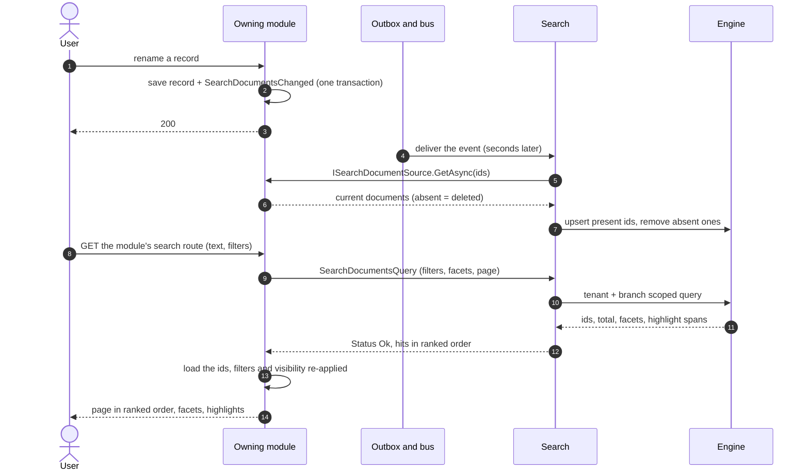
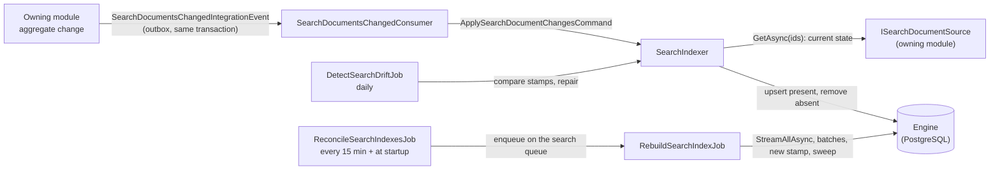

# How search works

Search has two paths that never wait for each other: **changes flow into the index** in the background, and
**searches read from it** in the request. This page follows both, then lists what is guaranteed and what happens when
something fails.

Part of the [Search module](../Modules/Search.md).

## End to end

*Figure: Search stores and ranks; the owner stays the source of truth. Search never decides what a caller may see: the owner loads every hit again through its own DbContext.*

## Keeping an index in sync

- **Live changes.** The owning aggregate raises `SearchDocumentsChangedIntegrationEvent` in the same transaction as
  the change. The consumer, in the event's tenant, sends `ApplySearchDocumentChangesCommand`; `SearchIndexer` reads
  the current documents from the source, writes those that exist and removes the others. The event carries only ids,
  so repeats and reordering are harmless: the index always ends with the current state. A change is searchable
  seconds after it commits (metric `search.index.lag`).
- **Rebuild** (`RebuildSearchIndexJob`, Hangfire queue `search`, per tenant). It takes the lease on the index state,
  streams the whole source in `Indexing:BatchSize` batches under a new stamp (extending the lease every batch), sweeps
  the documents the stamp did not reach, and makes the stamp live. The previous build keeps answering throughout, and
  live changes during the rebuild carry the new stamp, so the sweep keeps them. An unavailable engine is retried by
  Hangfire; any other failure is recorded (`LastErrorCode`) and the previous build stays live.
- **Reconcile** (`ReconcileSearchIndexesJob`, `Reconcile:Cron`, and once at startup when indexes exist). It enqueues
  a rebuild in every tenant whose index was never built or was built from another definition (the fingerprint
  changes with any field, weight, analyzer or the normalizer). A failed rebuild is retried at most once an hour.
- **Drift** (`DetectSearchDriftJob`, `Drift:Cron`). It compares the ids and versions of the source with the index:
  missing, stale and orphaned documents are recorded on the index state and, with `Drift:AutoRepair`, re-indexed.
  Indexes above `Drift:MaxDocuments` are skipped.
- **Tenant purge.** `TenantDataPurgeRequestedEvent` removes the tenant's documents from the engine (the database rows
  are purged centrally by Tenancy).
- **Worker replicas.** The `search` queue has its own Hangfire server, `Hangfire:Servers:Search` (enabled with 2
  workers by default). An instance without it logs a warning at startup: some replica must run it.

## Answering a search

An owner sends `SearchDocumentsQuery` through `ISender`; `SearchDocumentsHandler` answers it.

1. **Validation.** The index must be registered; facets must name facetable fields and the sort a sortable one; each
   filter must match its field's type; at most 32 filters and 10 facets; `Page x PageSize` within `Query:MaxWindow`.
   A violation is a 400 with localized messages, before the engine is asked.
2. **Parsing.** The text goes through the [query syntax](Text-And-Languages.md#query-syntax) and the normalizer.
3. **Readiness.** If the tenant's index was never built, the answer is `Status = IndexNotReady`, at once.
4. **Scope.** The engine query always carries the tenant and the caller's branch scope (`ITenantContext`); the owner
   adds the rest of its visibility rules as filters (a public search adds, for example, `status = Published`).
5. **Engine.** Exact matching first; when nothing matches and a word is long enough, close spellings
   (`MatchMode = Fuzzy`). A timeout or outage answers `Status = EngineUnavailable`.
6. **Result.** Hits (id, score, highlights), the total, facets, `FacetsExhaustive` and `MatchMode`. The outcome is
   counted for [zero-result analytics](Managing-Indexes-And-Analytics.md#search-analytics), in memory.

The owner then **hydrates**: it loads the hit ids through its own DbContext with every filter and visibility rule
applied again, and keeps the engine's order. When the status is not `Ok`, it answers from its own SQL search
instead, so a search never fails because of the index.

## Guarantees

| Guarantee | How |
|---|---|
| A search never shows what the caller may not see | The owner re-applies tenant, branch, soft-delete and status rules when it loads the hits; the index only narrows |
| A search never fails because of the index | `IndexNotReady` and `EngineUnavailable` are statuses, not exceptions; the owner falls back to SQL |
| Every committed change reaches the index | The event is in the owner's outbox, in the same transaction (at-least-once); drift repairs anything lost |
| An older write never replaces a newer one | Documents carry the owner's `Version`; PostgreSQL guards on it, Meilisearch within a batch, drift repairs the rest |
| Rebuilds have no downtime | The previous build answers until the new stamp is complete and swept |
| One tenant never sees another's documents | Every engine statement names the tenant; PostgreSQL also has forced row-level security |

What is **not** guaranteed: read-your-writes. A change is searchable seconds after it commits, so a list a person
checks right after editing should read from SQL.
<!--#if (sample)-->
Catalog's "my products" and moderation lists do.
<!--#endif-->

## Failure modes

| What fails | What callers see | What repairs it |
|---|---|---|
| Index never built (first deploy, new tenant, new definition) | The owner's SQL search answers | Reconcile at startup and every 15 minutes |
| Engine down or slow | SQL answers; indexing retries | The consumer's retries, then Hangfire; alert `SearchEngineUnavailable` |
| A search event is lost or dead-lettered | The old document until the next change | The daily drift check; alert `SearchDriftRecurring` |
| A rebuild fails | The previous build keeps answering | Reconcile retries hourly; `lastErrorCode` on the index |
| A worker dies mid-rebuild | The previous build keeps answering | The lease expires after `Indexing:LeaseMinutes`; rebuild again |
| Definition changed in a deploy | The old build answers until each tenant is rebuilt | Reconcile (fingerprint) |

The answer to each alert is in [Search operations](Operations.md#4-answer-an-alert).

## Related

[Search module](../Modules/Search.md), [Adding a search index](Adding-A-Search-Index.md),
[PostgreSQL engine](Postgres-Engine.md), [Meilisearch engine](Meilisearch.md),
[Messaging](../Architecture/Messaging.md).
