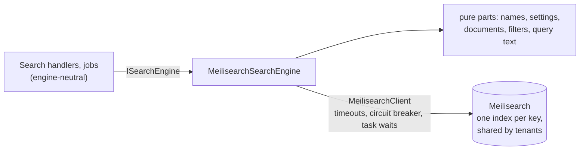

# Meilisearch engine

The Search module can store and answer its indexes on a [Meilisearch](https://www.meilisearch.com) server instead of
PostgreSQL. Nothing changes for owning modules: the same index definitions, documents, queries and results, checked by
the same engine conformance suite ([ADR-0036](../Decisions/0036-search-module-and-engine-port.md)).

## At a glance

| | PostgreSQL (default) | Meilisearch |
|---|---|---|
| Infrastructure | none (the application database) | a Meilisearch server (`docker-compose.meilisearch.yml`) |
| Isolation | row-level security per tenant, dedicated tenant databases | one index per index key shared by all tenants, a tenant filter on every request |
| Word forms ("running" finds "run") | yes (English and Arabic stemming) | no |
| Close spellings | trigram similarity (`Query:Fuzzy:Threshold`) | typo tolerance: one typo from 5 letters, two from 9 |
| Version guard (an older write never replaces a newer one) | yes | within a batch only; the drift check repairs the rest |
| `OR` alternatives | exact total, exact facets | federated search: estimated total, facets not exhaustive |
| Best for | most products, strict isolation, no extra moving parts | large catalogs, as-you-type speed, offloading search from the database |

Choose Meilisearch when search load or catalog size starts to weigh on the database. Products that promise
database-level isolation per tenant (dedicated tenant databases) should keep the PostgreSQL engine.

## Setup

1. Create the secrets (`./deployment/secrets-setup.sh` generates `secrets/meilisearch_master_key.txt` once and an empty
   `secrets/meilisearch_api_key.txt`).
2. Start the server with the overlay:

   ```bash
   docker compose -f docker-compose.yml -f docker-compose.meilisearch.yml up -d meilisearch
   ```

3. Create the API's key: least privilege, never the master key. The API needs `search`, `documents.*`, `indexes.*`,
   `settings.*` and `tasks.get` on its indexes, and nothing that manages keys:

   ```bash
   curl -s -X POST http://127.0.0.1:7700/keys \
     -H "Authorization: Bearer $(cat secrets/meilisearch_master_key.txt)" -H 'Content-Type: application/json' \
     -d '{"name":"starterkit-api","actions":["search","documents.*","indexes.*","settings.*","tasks.get"],
          "indexes":["*"],"expiresAt":null}'
   ```

   Put the returned `key` into `secrets/meilisearch_api_key.txt` (read as `Search:Meilisearch:ApiKey`). With an
   `IndexPrefix`, scope the key to `"<prefix>*"` instead of `"*"`.
4. Start everything with the overlay (add `docker-compose.meilisearch-worker.yml` when worker replicas run the
   `search` queue):

   ```bash
   docker compose -f docker-compose.yml -f docker-compose.meilisearch.yml up -d
   ```

5. Fill the indexes: as SuperAdmin, `POST /api/v1/admin/search/indexes/{key}/rebuild-all` for each key of
   `GET /api/v1/admin/search/engine`. Until a tenant's index is rebuilt, its searches are answered by the owner's SQL
   search.

In Development the API skips Docker secrets: set `MEILISEARCH_API_KEY` (and optionally `MEILISEARCH_MASTER_KEY`) in
`.env`; the master key is acceptable there.

## Configuration

| Key | Default | Meaning |
|---|---|---|
| `Search:Engine` | `Postgres` | `Meilisearch` to use this engine (the overlay sets it) |
| `Search:Meilisearch:Url` | | the server, for example `http://meilisearch:7700` (required) |
| `Search:Meilisearch:ApiKey` | | the scoped key (required; Docker secret `meilisearch_api_key`) |
| `Search:Meilisearch:IndexPrefix` | empty | prefix of the index names, so several deployments can share a server |
| `Search:Meilisearch:TimeoutSeconds` | 10 | per request; also sizes the circuit breaker |
| `Search:Meilisearch:TaskTimeoutSeconds` | 30 | how long a write waits for its Meilisearch task |

The host refuses to start when `Engine=Meilisearch` lacks a valid URL or a key.

## How it works



- **Layout.** One Meilisearch index per index key (`catalog.products` becomes `catalog--products`, after the prefix).
  A document's key is `<tenant>_<id>`; it carries `_tenant`, `_branch`, `_version`, `_stamp` and `_indexed_at`, its
  text fields as `t_<field>` (normalized by Search, like on PostgreSQL) and its filter fields as `f_<field>`. The
  original text of highlight fields is stored for highlighting; hits are always loaded by the owner.
- **Isolation.** Every search, count, stream, sweep and delete starts its filter with the tenant, and the reader's
  branch scope (`_branch IS NULL OR _branch IN [...]`). Values are always quoted and escaped.
- **Settings.** Applied from the definition by the reconcile job (and before the first read or write of a process):
  searchable fields in weight order, `sort` as the first ranking rule (a requested sort is strict), analyzers as
  localized attributes, facet values by count.
- **Matching.** Every word must match. Words are sent quoted (exact word); the autocomplete word is a prefix. When
  nothing matches, a second query lets long words match with typos and the result says `Fuzzy`. Exclusions are
  `-"word"`; `OR` alternatives run as one federated search.
- **Writes** wait until Meilisearch has applied them, so an indexed change is searchable when the call returns.
- **Failures.** A down, slow or overloaded server is `EngineUnavailable` (owners fall back to SQL; indexing is
  retried by its consumer or job); after repeated failures the circuit breaker fails fast. A request Meilisearch
  refuses is a bug and is not hidden. `/health` reports `search-engine` as Degraded, never Unhealthy.

## Operations

- **Switching engines** does not move documents: rebuild every index after the switch (step 5 of Setup).
- **An index deleted on the server** is recreated with its settings by the next reconcile run (every 15 minutes);
  rebuild it to refill it.
- **Upgrading Meilisearch** may need a dump and import between major versions; keep the image tag of
  `docker-compose.meilisearch.yml` in step with the conformance tests (`MeilisearchFixture.Image`).
- **Tenant deletion** removes the tenant's documents from every index.

## Guardrails

| Test | Covers |
|---|---|
| `Search.IntegrationTests/Conformance/MeilisearchSearchEngineConformanceTests` | the whole engine conformance suite against a real server (Testcontainers) |
| `Search.IntegrationTests/Conformance/MeilisearchEngineTests` | settings applied, the documented scoped key is enough, an unreachable server is unavailable and Degraded, missing indexes, `OR` facets not exhaustive |
| `Search.Tests/Engine/Meilisearch/*` | index names are unique, filters escape values and always start with the tenant, query text, settings, documents, requests and responses, the client's error and task handling |

## Related

[Search module](../Modules/Search.md), [ADR-0036](../Decisions/0036-search-module-and-engine-port.md),
[Docker Compose](../deployment/Docker-Compose.md), [Secrets](../deployment/Secrets.md).
