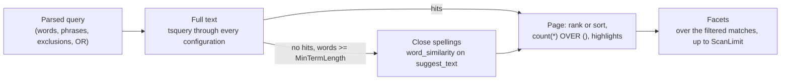

# PostgreSQL engine

The default engine of the Search module (`Search:Engine=Postgres`). It keeps the indexes in the application database,
so search needs no extra infrastructure and inherits the database's isolation, backups and dedicated tenant databases.
Code: `src/Modules/Search/Search/Engine/Postgres/` ([ADR-0036](../Decisions/0036-search-module-and-engine-port.md)).

## Storage

One table, `search.search_documents` (tenant data: forced row-level security), one row per tenant, index and document
(primary key `(tenant_id, index_key, document_id)`):

| Column | Index | Content |
|---|---|---|
| `branch_id` | | the document's branch, or null for every branch |
| `search_vector` (`tsvector`) | GIN | built by PostgreSQL from the normalized text: per field and analysis `setweight(to_tsvector(config, text), weight)` |
| `suggest_text` | GIN `gin_trgm_ops` | the normalized suggest fields, for close spellings and suggestions |
| `filters` (`jsonb`) | GIN `jsonb_path_ops` | the filter values, typed (dates as epoch milliseconds) |
| `content` (`jsonb`) | | the original text of the highlight fields |
| `source_version` | | the owner's version of the document (the version guard) |
| `rebuild_stamp`, `indexed_at` | btree with tenant and index | which build wrote the row, for the rebuild sweep |

Build state per tenant and index is in `search.search_index_states`. Both tables come from the `AddSearch` migration,
which also creates the `pg_trgm` extension. The migration role needs `CREATE` on the database for that; a hardened
deployment creates the extension once in `deployment/postgres/scripts/init-rls-roles.sql` instead, and the migration
then finds it.

### Analyzers

| Analyzer | Configurations | Use for |
|---|---|---|
| `Simple` | `simple` | codes, SKUs, names that must not be stemmed |
| `English` | `english` | English prose ("running" finds "run") |
| `Arabic` | `arabic` | Arabic prose (Snowball Arabic stemmer, after Search's own normalization) |
| `Bilingual` | `english` and `arabic` | a field that may hold either language |

Each field, and each analysis of a bilingual field, is separated from the next by a gap in word positions, so a phrase
never matches across two fields. The weight of a field (`Low` to `Highest`) becomes the `tsvector` weight D to A.

## Writing

- **Upsert.** One statement per batch (`unnest` of arrays), built once per index (`PostgresIndexSql`) from the
  definition. Within a batch the newest version of each id wins.
- **Version guard.** `ON CONFLICT ... DO UPDATE ... WHERE source_version <= EXCLUDED.source_version`: an older write
  that arrives late never replaces a newer one (`Capabilities.VersionGuard`).
- **Delete** removes ids; **sweep** removes the rows a rebuild did not reach (older stamp and indexed before the
  rebuild started), so live changes made during a rebuild survive it.
- **Tenant purge** deletes every row of the tenant.

## Searching

- **Scope.** Every statement names the tenant and the index in its `WHERE` as well as relying on row-level security,
  and adds the reader's branch scope (`branch_id IS NULL OR branch_id = ANY(...)`).
- **Matching.** Every clause of the query must match. A word is matched through each configuration the index uses; a
  word one configuration drops as a stop word ("the") is dropped entirely, so it never empties the result. Phrases use
  `phraseto_tsquery`, the autocomplete word a `:*` prefix, exclusions `!!`, and `OR` alternatives `||`.
- **Close spellings.** When nothing matches and a word has at least `Query:Fuzzy:MinTermLength` letters, the search
  runs again with `<%` (`word_similarity` above `Query:Fuzzy:Threshold`) on the suggest text, and the result says
  `Fuzzy`.
- **Ranking.** `ts_rank_cd` with the field weights, or a sortable filter field when the caller asks; ties are broken
  by document id, so paging is stable. Without text, the index's default sort.
- **Totals and facets.** The total is exact (`count(*) OVER ()`). Facets are counted over the filtered matches, up to
  `Facets:ScanLimit` of them; `FacetsExhaustive` is false when the cap was reached.
- **Highlights** come from `content` through the shared highlighter, identical on every engine.

## Safety

- Words, values and field names are always parameters. Only configuration names, weight letters and casts, all from
  closed enums, are written into SQL text (`PostgresSqlTests` pins this).
- Searches run in a short transaction with `SET LOCAL statement_timeout` (`Postgres:StatementTimeoutMs`) and the
  trigram threshold.
- A timeout, a lost connection or an overloaded server (`57014`, `57P0x`, `53300`, `53400`, transient Npgsql errors)
  becomes `SearchEngineUnavailableException`: owners fall back to SQL and indexing is retried. Any other error is a
  bug and is not hidden.
- The connection is the `SearchDbContext`'s own, so the tenant session settings of row-level security apply. Never
  write `search_documents` from anywhere but this engine.

## Capacity

The engine shares the database with everything else, so its cost is visible in the same place:

- Each document costs a `tsvector`, a trigram index entry and a `jsonb` row. The GIN indexes grow with the number of
  distinct words; `VACUUM` keeps up with them like any write-heavy table.
- A broad query (a frequent word) ranks and counts every match before it pages. `Query:MaxWindow` bounds how deep a
  caller may page, `Facets:ScanLimit` bounds facet counting, and the statement timeout bounds the rest.
- `search.query.duration` (by index) and `pg_stat_statements` show the cost. When search starts to weigh on the
  database, or a catalog grows into millions of documents per tenant, move to the
  [Meilisearch engine](Meilisearch.md): nothing changes for the owning modules.

## Guardrails

| Test | Covers |
|---|---|
| `Search.IntegrationTests/Conformance/PostgresSearchEngineConformanceTests` | the engine conformance suite on a real PostgreSQL (tenant and branch isolation, version guard, normalization, stemming, prefixes, close spellings, every filter type, facets, sort, relevance, paging, highlights, sweep, tenant delete) |
| `Search.Tests/Engine/PostgresSqlTests` | analyzer configurations, weights and gaps, the version guard, typed filter values, and that words, values and field names are parameters |
| `Search.IntegrationTests` (`SearchPostgresFixture`) | the migrations on a real database, through an application role without `BYPASSRLS` |
| `TenantRowLevelSecurityCoverageTests` (`Api.E2ETests`) | the `search` tables have forced RLS and the tenant policy |

## Related

[Search module](../Modules/Search.md), [Meilisearch engine](Meilisearch.md), [Search operations](Operations.md),
[Database conventions](../Architecture/DatabaseConventions.md).
