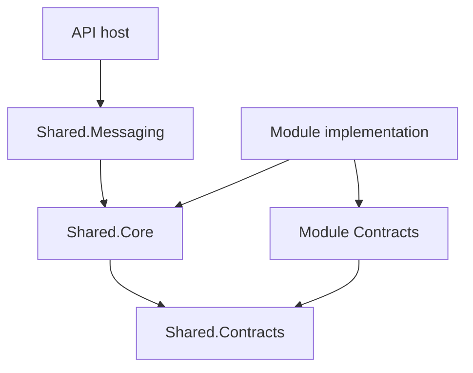

# Shared projects

The Shared projects provide contracts and infrastructure used by every module while keeping business state and module implementations out of the shared kernel.

## At a glance

| Project / source | Responsibility |
|---|---|
| `src/Shared/Shared.Contracts/` | Owned mediator and CQRS ports, domain/integration-event contracts, pagination, localization, enum/lookup DTOs and runtime feature-flag port |
| `src/Shared/Shared.Core/` | Implementations and ASP.NET/EF helpers: behaviors, exceptions, multi-tenancy, authorization, web context, networking, bot protection, mediation and outbox |
| `src/Shared/Shared.Messaging/` | MassTransit registration and transport selection, referencing Shared.Core for tenant propagation |
| `src/Shared/Shared.Core.Tests/` | Runtime contracts for the shared infrastructure |

**No business state:** an area that owns business aggregates, a schema, business jobs or endpoints belongs in a module. Shared may implement infrastructure such as outbox rows and generic audit mappings, but the owning module's DbContext stores them. Shared never references a module or its Contracts. Module-to-module communication stays behind `ISender` plus the other module's Contracts, or integration events; users come from `UserDirectory.Contracts`.

## How it works

### Dependencies


*Figure: Arrows mean project dependencies; the Shared chain points toward contracts and never back into a module.*

The project files establish `Shared.Messaging` → `Shared.Core` → `Shared.Contracts`. Module Contracts normally depend only on Shared.Contracts; Tenancy.Contracts has the explicitly whitelisted Shared.Core exception. `MassTransit.Abstractions` in contracts supports stable `[MessageUrn]` attributes without pulling in a transport. Host composition and module discovery are described in [Architecture](../Architecture/Overview.md) and the [request lifecycle](../Architecture/Request-Lifecycle.md).

### Shared.Contracts

| Area | Types and purpose |
|---|---|
| `Mediation/` | `ISender`, `IPublisher`, `IRequest`, `IRequestHandler`, `IPipelineBehavior`, `INotification`, `INotificationHandler`, `Unit` |
| `CQRS/` | `ICommand`, `ICommandHandler`, `IQuery`, `IQueryHandler`, `BaseQuery`, `BaseSortQuery` |
| `Events/`, `Messaging/` | `IDomainEvent`, `IIntegrationEvent`, `IntegrationEvent`; immutable event identity/time and stable versioned URNs |
| `Pagination/` | `PaginatedResult<T>`, `PageInfoResult` |
| `Localization/`, `Attributes/` | `LocalizedText`, `LocalizedDescriptionAttribute` |
| `Enums/`, `Lookups/`, `FeatureFlags/` | `EnumItemDto`, `EnumResponseDto`, `LookupDto`, `IFeatureFlags` |

Keep handlers, validators, EF models and provider SDKs out of contract assemblies. Domain events use the owned mediator notification port; integration events carry ids/minimal projections and travel through the outbox. A shared interface does not authorize access to another module's data.

### Shared.Core areas

| Area under `src/Shared/Shared.Core/` | Role / main types |
|---|---|
| `Behaviors/` | `ValidationBehavior`, `ConcurrencyHandlingBehavior`, `LoggingBehavior`, `DispatchDomainEventsBehavior` |
| `Mediation/`, `Extensions/MediatorExtensions.cs` | Owned `Mediator` adapter; `AddMediator` discovers handlers/validators and installs behaviors |
| `Exceptions/`, `Response/`, `Web/` | Typed exceptions, `ApiResponse`, response wrapping and the global error boundary |
| `MultiTenancy/` | `ITenantContext`, `TenantScope`, tenant resolution, data filters/RLS, tenant job and messaging scope |
| `Authorization/` | Permission constants and endpoint authorization helpers, deny-by-default Carter convention |
| `Web/` | `IHttpContextService`, `HttpContextService`, `ActingUser`, trusted proxy handling, correlation, timeouts and idempotency |
| `Net/` | `GuardedConnector`, address policy and guarded outbound connections |
| `BotProtection/` | `IHumanVerifier`, `TurnstileHumanVerifier`, verification endpoint filter and options |
| `DDD/`, `Data/`, `Auditing/` | Entity/aggregate bases, DbContext setup, optimistic versions, audit fields/trail and committed domain-event dispatch |
| `Messaging/Outbox/`, `Messaging/Sagas/` | Outbox staging/delivery/recovery and durable saga registration helpers |
| `Entitlements/`, `FeatureFlags/` | Feature/quota ports and endpoint filters; plan implementations live in Subscriptions, runtime flag state in Tenancy |
| `Extensions/`, `Pagination/`, `Localization/`, `Mapster/` | Infrastructure registration, query/paging helpers, localization and mapping |
| `HealthCheck/`, `OpenTelemetryCollector/`, `Modularity/` | Health/telemetry and module discovery infrastructure |

The host adds request telemetry around the mediator's validation → concurrency → logging → event-dispatch pipeline. A handler uses its module's repository/DbContext; shared infrastructure never makes another module's model globally accessible. [Request lifecycle](../Architecture/Request-Lifecycle.md#mediator-and-handler) defines exact ordering and the Identity-specific audit transaction behavior.

Typed shared exceptions map through `GlobalExceptionHandler` and `ExceptionStatusMapper`. A `CustomException.ErrorCode` becomes `errorCode` for clients. Do not introduce a second exception mapping layer or hand-roll response envelopes; see [Errors and responses](../Architecture/Errors-and-Responses.md).

### HTTP context, acting user and auditing

`IHttpContextService` lives in `Shared.Core.Web`; add that using explicitly. Carter resolves endpoint service parameters; avoid `[FromServices]`. It is scoped around `IHttpContextAccessor`, with test doubles injected through the interface.

| Methods | Behavior |
|---|---|
| `GetUserId`, `GetUserIdAsLong`, `GetUserIdAsGuid` | Nullable identity; parsing helpers return null for incompatible formats |
| `GetUserName`, `GetEmail`, `GetRoles`, `IsAuthenticated` | Request principal information |
| `GetClaimValue`, `GetClaimValues`, `GetAllClaims`, `HasClaim` | Claims access; inspect validated principal, not raw tokens |
| `HasAnyRole`, `HasAllRoles` | Extensions for case-insensitive role checks; endpoint permission policies remain the normal authorization boundary |
| `GetIpAddress`, `GetUserAgent` | Resolved remote address and request User-Agent |
| `GetRequestPath`, `GetRequestMethod`, `GetRequestUrl`, `GetHost`, `GetScheme`, `GetHeaderValue` | Request metadata; nullable when no request exists |
| `GetCorrelationId` | Correlation item, header or trace identifier fallback |
| `GetTenantId` | Resolved tenant from `ITenantContext` in request services, not a raw claim/header |
| `GetUserDisplayName`, `GetAuditInfo`, `GetRequestContext` | Display-name fallback and audit/request metadata extensions |

`GetIpAddress` uses `Connection.RemoteIpAddress` after trusted forwarded-header middleware; it never trusts arbitrary `X-Forwarded-For` or `X-Real-IP` values. Tenant data uses ambient `ITenantContext`, named filters and RLS rather than manual filtering with a request header. See [multi-tenancy](../MultiTenancy/Overview.md).

Outside HTTP, `GetUserId` falls back to `ActingUser.Current`; otherwise it is null. `ActingUser.Begin(userId)` is an AsyncLocal scope restored on disposal; `ActingUser.Begin(userId, correlationId)` also names the origin of the work (for example `agent-run:<id>`), which `GetCorrelationId` returns outside HTTP so audit entries point at it. It grants no roles, claims or permissions and does not make `IsAuthenticated()` true. Background work must re-check the user's access and establish its tenant/branch scope before entering it. An active HTTP request always takes precedence over ActingUser.

`AuditableEntityInterceptor` stamps created/modified fields and manages `Version` using `TimeProvider`. Its actor fallback is id → username → email → `authenticated-user` → `system`. Do not set audit fields or versions manually. `GetAuditInfo` supplies contextual metadata, not a persisted audit entry; business audit storage is owned by the mapped module context.

### EF helpers and events

`AppDbContextBase`, `AddCustomDbContext`, snake-case/model helpers and `ConfigureVersionConcurrencyTokens` standardize persistence. Critical commands take `long? Version` and call `ExpectVersion`; child-only aggregate changes request `BumpVersionOnSave`. Tenant contexts require tenant-owned rows, tenant-first unique indexes, forced RLS migrations and `ApplyTenantFilters` last; maintenance bypasses only named non-isolation filters. See [Design patterns](../Architecture/DesignPatterns.md) and [multi-tenancy](../MultiTenancy/Overview.md).

`DispatchDomainEventsInterceptor` stages events only from committed saves. `DispatchDomainEventsBehavior` dispatches after the successful outermost mediator call. `IUnitOfWorkRunner` provides the corresponding scope/dispatch boundary for jobs, hosted services and consumers; use one call per item. It does not add a transaction around all saves. A later failure cannot undo earlier committed writes.

`OutboxInterceptor` persists `AddIntegrationEvent` events in the same save as aggregate changes. Each owning context maps `AddOutbox` or `AddTenantOutbox`; `OutboxRelay` and the sweep recover delivery. Stable `EventId` becomes the transport message id; consumers must tolerate at-least-once delivery. Use the [Messaging guide](../Architecture/Messaging.md) for outbox operations, tenant headers, dead letters and durable sagas.

### Guarded outbound connections and bot protection

`Shared.Core.Net.GuardedConnector` resolves DNS at connection time, rejects a mixed answer containing any blocked address when private networks are disallowed, and connects to the checked address without resolving again. TLS still validates the original hostname. Use it for customer-supplied outbound destinations, together with the owning module's URL policy and redirect/proxy restrictions; see [Webhooks](../Modules/Webhooks.md#retries-and-health).

Bot protection uses `IHumanVerifier` and the Turnstile adapter. Opt-in endpoints declare `RequireHumanVerification(action)` and read `X-Captcha-Token`. Invalid/missing tokens return 400 `captcha_invalid` / `captcha_required`; provider outage returns 503 `captcha_unavailable` when fail-open is disabled. It defaults off and does not substitute for rate limiting. See [Bot protection](../Identity/Bot-Protection.md).

### Shared.Messaging

`Extensions/MassTransitExtensions.cs` registers the bus, consumers and tenant propagation filters; `MessagingOptions.cs` selects InMemory, PostgreSql or RabbitMq. InMemory is for development/tests and is not durable. The Docker deployment selects PostgreSql; production configuration rejects InMemory. Transport infrastructure migration runs through the host's migration mechanism. The bus owns transport, while module contexts own outbox/business rows. See [Messaging](../Architecture/Messaging.md) and [ADR-0022](../Decisions/0022-production-message-transport.md).

## Configuration

Selected cross-cutting defaults from `src/Api/appsettings.json`, `IdempotencyOptions`, `BotProtectionOptions` and `OutboxOptions`; specialized references linked above hold the full settings for each subsystem.

| Key | Default | Meaning |
|---|---|---|
| `Messaging:Transport` | `InMemory` in base settings | Docker selects PostgreSql; production needs a durable transport |
| `Messaging:Outbox:BatchSize` | 100 | Relay claim batch |
| `Messaging:Outbox:MaxAttempts` | 10 | Dead-letter threshold |
| `Messaging:Outbox:LeaseSeconds` | 60 | Claim ownership duration |
| `Messaging:Outbox:SweepCron` | `* * * * *` | Recovery schedule |
| `Messaging:Outbox:RetentionDays` | 7 | Delivered-row retention |
| `Idempotency:Ttl` | 24 hours | Replay lifetime |
| `Idempotency:InFlightTtl` | 5 minutes | Reservation lifetime |
| `Idempotency:MaxStoredBodyBytes` | 262144 | Replay-body cap |
| `Idempotency:MaxKeyLength` | 255 | Key-header cap |
| `BotProtection:Enabled` | false | Verification master switch |
| `BotProtection:Provider` | `Turnstile` | Adapter selection |
| `BotProtection:TimeoutSeconds` | 5 | Provider deadline |
| `BotProtection:FailOpen` | true | Provider outage allows requests; invalid tokens still fail |
| `Paging:DefaultPageSize` | 10 | Default query page size |
| `Paging:MaxPageSize` | 100 | Maximum page size |

## Usage

The HTTP/background identity boundary is implemented in `src/Shared/Shared.Core/Web/HttpContextService.cs`:

```csharp
public string? GetUserId()
{
    if (Context is null)
        return ActingUser.Current?.ToString();
    return User?.FindFirstValue(ClaimTypes.NameIdentifier);
}
```

Use `IHttpContextService` in handlers for actor/row-level ownership decisions, endpoint permission policies for access, and `ITenantContext` for tenant scope. For tests, mock only the interface methods the handler uses. A job should use `IUnitOfWorkRunner` and explicitly establish ActingUser when executing on a user's behalf; see the background-work pattern in [DataTransfer](../Modules/DataTransfer.md).

## Failure modes and guarantees

- `ConcurrencyHandlingBehavior` maps EF concurrency exceptions to 409 without automatically rerunning the command. Jobs use `IsConcurrencyConflict()` to recognize either representation.
- Null request metadata is expected outside HTTP; role lists are empty and authentication is false, while a valid ActingUser can still provide an actor id. Not every method returns a nullable value.
- Domain-event dispatch follows committed saves and the outer unit-of-work boundary. A post-commit handler failure does not imply rollback. Outbox delivery is recoverable and at least once.
- `WithIdempotency()` is opt-in, expires and fails open on store outage; it cannot provide financial uniqueness. Entitlement/quota defaults are permissive until a module supplies enforcement.
- Guarded networking reduces SSRF risk at connection time; a caller still needs application-level URL policy. Bot protection and authorization solve separate boundaries.

## Guardrails

`ModuleBoundaryTests`, `MessagingArchitectureTests`, `ThirdPartyIsolationTests`, `TenantIsolationArchitectureTests`, `AdminEndpointAuthorizationTests`, `AuditTrailArchitectureTests` and `BackgroundJobEventDispatchTests` protect project and runtime boundaries. `MediatorTests`, `DomainEventDispatchTests`, `OptimisticConcurrencyTests`, `ActingUserTests`, `ForwardedHeadersTests`, `TenantResolutionMiddlewareTests`, `ExceptionHandlingTests`, `IdempotencyFilterTests`, `RequireHumanVerificationTests` and `OutboxRelayTests` cover their implementations. `GuardedConnectorTests` lives with Webhooks' security tests.

<!--#if (sample)-->
For test doubles, see `TestSupport.Http(userId, roles)` in `src/Modules/Catalog/Catalog.Tests/TestSupport.cs` and `FakeHttpContextService` in `Catalog.IntegrationTests`.
<!--#endif-->

## Related

<!--#if (sample)-->
- [Catalog tests](../../src/Modules/Catalog/Catalog.Tests/TestSupport.cs) - how to fake the current user in tests
<!--#endif-->
- [Request lifecycle](../Architecture/Request-Lifecycle.md), [Messaging](../Architecture/Messaging.md), [Multi-tenancy](../MultiTenancy/Overview.md), [Identity](../Identity/README.md).
- [Notification module](../Modules/Notification.md): delivery infrastructure built on the shared boundaries.
- [ADR-0007](../Decisions/0007-owned-mediator-port.md), [ADR-0021](../Decisions/0021-aggregate-version-covers-child-collections.md), [ADR-0022](../Decisions/0022-production-message-transport.md).
- `/starterkit:add-feature`, `/starterkit:add-background-job`.
