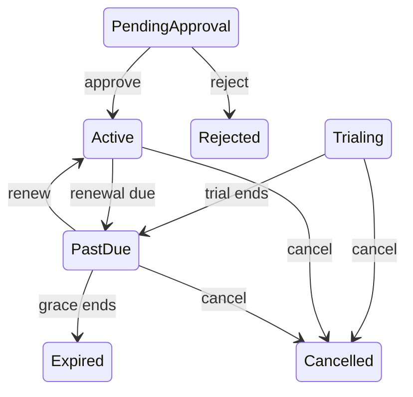
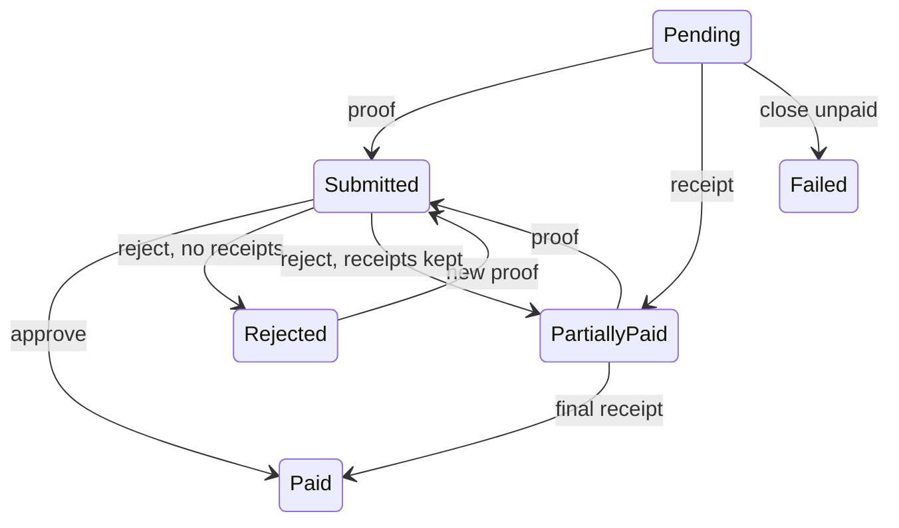
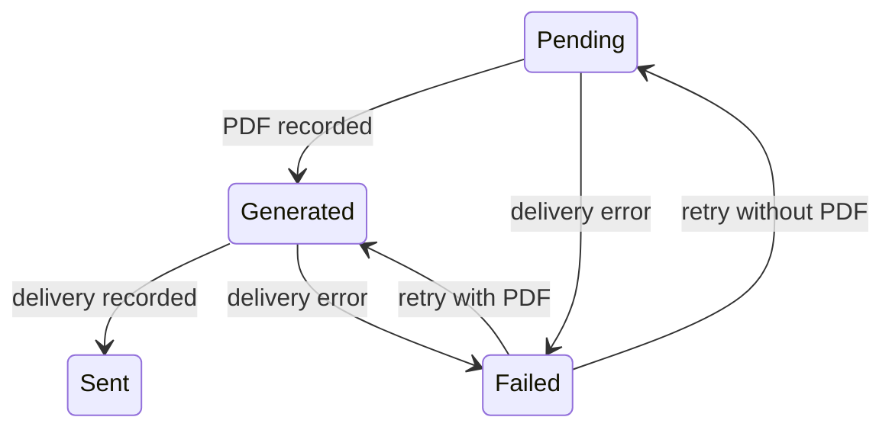

# Subscriptions billing

Subscriptions records money and subscriber lifecycle changes in one financial model, with immutable ledger history, invoice snapshots and plan-based access.

## At a glance

| Area | Types / source under `src/Modules/Subscriptions/Subscriptions/` |
|---|---|
| Pure money policies | `Domains/Subscriptions/Billing/`: `Currency`, `TaxCalculator`, `PricingPolicy`, `BillingPeriod`, `CouponPricing` |
| Settlement and documents | `Domains/Subscriptions/Services/`: `PaymentSettlementService`, `InvoiceIssuer`, `InvoiceDocument`, `PdfConfiguration` |
| Financial history | `Domains/Ledger/`: `LedgerEntry`, `LedgerEntryRecordedEvent`, `IBillingDashboardCache` |
| Access and usage | `PlanEntitlementService`, `UsageService`, `IEntitlementService`, `IQuotaService` |
| Orchestration | `RenewalOrchestrator`, `DunningProcessor`, recurring jobs and `InvoiceDeliveryJob` |

The [module overview](../Modules/Subscriptions.md) owns the endpoint inventory, public contracts, discovery order and integration events. Routes abbreviated below are beneath `/api/v1`. [Online payments](Online-Payments.md) covers adapters and inbox settlement; [request lifecycle](../Architecture/Request-Lifecycle.md) covers commit, event dispatch and concurrency translation.

## How it works

### Lifecycle


*Figure: The seven SubscriptionStatus values follow SubscriptionStateMachine; admin reactivation is a separate exception described below.*

- One enum, `Subscriptions.Contracts.Subscriptions.Enums.SubscriptionStatus`, with stable numbers
  (PendingApproval=0, Active=1, PastDue=2, Expired=3, Cancelled=4, Rejected=5, Trialing=6 appended). Stored by **name** in the database.
- Allowed transitions live in `SubscriptionStateMachine`.
- **At most one open subscription per subscriber** (PendingApproval/Trialing/Active/PastDue): filtered unique index
  `ux_subscriptions_subscriber_open`. A unique violation (PostgreSQL `23505`) becomes a **409** in
  `SubscriptionsDbContext.SaveChangesAsync`. Approval never cancels another subscription.

### Currency and decimals

Billing money is stored as `numeric(19,4)` (see ADR-0017 for migration locking and the lossy `Down`) and rounded in the domain per ISO 4217 currency: 0 decimals (JPY, KRW), 2 (USD,
SAR, EGP), 3 (KWD, BHD, OMR, JOD, TND), 4 (CLF, UYW). `Currency` is the one helper (`Round`, `HasValidScale`,
`ToMinorUnits`, `FromMinorUnits`, `Format`); plans and coupons require a real ISO code and an amount that fits it; provider amounts use currency-aware conversion, with Stripe-specific representability checks in its adapter. See ADR
[0017](../Decisions/0017-money-precision-and-per-currency-rounding.md). Never `Round(x, 2)` or `ToString("F2")` money.

### Sandbox and live gateways

[Online payments](Online-Payments.md#sandbox-and-live) defines gateway mode validation, project sandbox setup and production opt-in. Checkout creation never authorizes settlement based on a browser redirect.

### Tax (`Subscriptions:Tax`)

Defaults and seller options are listed under [Configuration](#configuration).

`TaxCalculator` is the only place tax is computed (currency exponent, midpoint away from zero; parts always sum):

- Inclusive: `net = round(gross / (1 + r))`, `tax = gross - net`.
- Exclusive: `net = price`, `tax = round(net * r)`, `gross = net + tax`.

Payments are always **gross** (what the subscriber transfers). Invoices snapshot net/tax/gross/rate/PricesIncludeTax at
issue time; changing the configuration never changes an issued invoice. Rates print without truncation (`7.5%`).

### Prices (`PricingPolicy`)

- Effective plan price at a moment = the scheduled price once its effective date passed, then `DiscountPercent`.
  **`Plan.DiscountPercent` is applied to charges.**
- Renewal price follows the plan only when the plan is still compatible (same currency and billing cycle, not deleted);
  otherwise the subscription keeps its own price snapshot.
- Renewal bill = period price + deferred upgrade proration, converted to gross.

### Billing periods (`BillingPeriod`)

- Period = `[CurrentPeriodStart, RenewalDate)`. Renewal dates are computed from the activation date (the anchor), so
  month-end clamping never drifts: Jan 31 → Feb 28/29 → Mar 31 → Apr 30.
- `Renew()` starts the new period at the **previous renewal date**, not "now": a late payment or a slow admin never
  shifts the cycle.
- All day math is `decimal` on the actual period length (no `double`, no 30-day months).

### Renewal boundary (`RenewalOrchestrator`)

Hourly job `process-past-due` (`ProcessPastDueSubscriptionsJob`) processes every Active subscription whose renewal date
passed, each in its own scope, in this order:

1. end-of-period cancellation → Cancelled (nothing is billed);
2. scheduled downgrade → applied (status-guarded: Active only);
3. still Active → PastDue + a **Renewal** payment priced at the effective price (+ deferred proration, which is then
   cleared).

`process-expired` expires PastDue subscriptions after the grace period, **except** when a renewal proof is Submitted
(under review). The former `process-scheduled-cancellations` / `process-scheduled-downgrades` jobs were merged into the
orchestrator; their recurring ids are removed at startup.

Renewal approval binds to the renewal **payment** and approves its amount (never the live plan price).

### Payments and approvals


*Figure: PaymentStatus describes the debt, not a checkout attempt; the six states also allow receipts on Submitted or Rejected payments and closure of any still-owed payment.*

`SubscriptionPayment` permits receipts from Pending, Submitted, Rejected or PartiallyPaid; a completing receipt can reach Paid from any of those. `MarkFailed` closes any awaiting-payment state. Complimentary activation creates a Paid zero-amount payment directly. Failed and Paid payments do not accept new proofs.

- Each payment has a purpose: `Activation`, `Renewal`, `Proration`.
- Proof uploads (activation, renewal, proration) share `ProofSubmissionService`.
- Admin approve/reject commands carry `PaymentId`. Without it, the single submitted payment of that purpose is used;
  several submitted → **400**, none → **409**.
- Critical admin commands accept `Version` (optimistic concurrency → 409): subscription version for activation/renewal
  review, payment version for proration review, refund version for refund review, original invoice version for credit
  notes. Read DTOs expose `Version`.

### Upgrades (immediate, prorated)

`POST /subscriptions/{id}/upgrade`

- Same currency and billing cycle only (400 otherwise). A pending scheduled downgrade is cancelled.
- Proration = price difference × remaining share of the **current** period.
- Trusted subscriber (≥ `TrustMinCycles` paid activation/renewal payments) and proration ≤
  `ProratedDeferralThresholdPercent` of the current price → **deferred**: added to the next renewal bill.
- Otherwise a **Proration** payment and its invoice are created with the upgrade (same transaction):
  1. subscriber uploads proof: `POST /subscriptions/{id}/proration/proof` (form: `file`, `paymentId`, `paymentMethodId`);
  2. admin: `POST /admin/subscriptions/{id}/proration/approve` `{ paymentId, version? }` or
     `/proration/reject` `{ paymentId, reason, version? }` (subscriber may re-upload until the SLA).
- `process-upgrade-sla-expiry`: after `UpgradeSlaHours`, a proration payment that is still **Pending or Rejected** is
  closed (Failed), the subscription reverts to the original plan, and **only that payment's invoice** gets a credit note.
  Submitted proofs (awaiting review) and paid invoices are never touched. Past-due subscriptions are left for an admin.
- A new upgrade is refused while a previous upgrade is still unpaid.

### Downgrades

`POST /subscriptions/{id}/schedule-downgrade` schedules a change for the renewal date. A subscription has many
`ScheduledPlanChange` rows over time; at most one is Pending (`ux_scheduled_plan_changes_subscription_pending`).

### Invoices and credit notes


*Figure: InvoiceStatus tracks document delivery, with Pending, Generated, Sent and Failed; it does not represent whether money is owed or paid.*

`SubscriptionInvoice.MarkGenerated`, `MarkSent`, `MarkFailed` and `ResetForRetry` implement this lifecycle. A forced resend can revisit delivery after Sent. Financial snapshot fields remain immutable while PDF/delivery metadata changes.

`InvoiceDocument` renders with QuestPDF, isolated to Subscriptions by `ThirdPartyIsolationTests`. `PdfConfiguration` reads `Subscriptions:Pdf:License` (Community by default; Professional and Enterprise are supported). Choose the license appropriate for the deployed product and consult [Third-party licenses](../Reference/Third-Party-Licenses.md); a misspelled value fails startup.

- The invoice row (number, description, buyer snapshot from `ISubscriberInfoProvider`, seller snapshot, plan, period,
  tax snapshot) is inserted in the **same transaction** as the approval / renewal / upgrade.
- Numbers: `{Prefix}-{yyyy}-{seq:D6}` (e.g. `INV-2026-000042`), gapless per year from `invoice_number_counters`
  (`SELECT ... FOR UPDATE` in the issuing transaction; a rollback releases the number). Credit notes use the same
  sequence. `Subscriptions:Invoice:NumberPrefix` max 20 characters.
- PDF + email run afterwards in `InvoiceDeliveryJob` (Hangfire retries, guarded by invoice id). Legal and financial PDF contents render
  from the issue snapshot; tagline, website and support email use current branding. `process-invoice-retry` re-enqueues deliveries that were never queued or failed.
- Issued invoices are immutable. Corrections are credit notes (`Type = CreditNote`, negative amounts,
  `OriginalInvoiceId`): `POST /admin/invoices/{id}/credit-note` `{ reason, amount?, version? }`, up to the creditable
  remainder. One invoice per payment (`ux_subscription_invoices_payment`).

### Refunds

`POST /subscriptions/{id}/refund` (cancelled annual subscriptions):

- refundable = Σ Paid payments − Σ (Approved + Processed) refunds; nothing refundable → 409;
- based on money received for the current period and when service actually ended (`EndDate`, else `CancelledAt`):
  full refund within `RefundFullWindowDays` of the period start, prorated (unused days / period days) within
  `RefundProratedWindowDays`; always capped at refundable;
- the cap is re-checked on approval; marking a refund processed issues credit notes for the refunded amount;
- one non-rejected refund per subscription (index includes Processed), so a second refund is impossible.
- refunds of money received ONLINE go back through the payment gateway at `MarkRefundProcessed`, and refunds the
  provider reports on its own (dashboard) are booked from its webhook, never above the money received and once per
  provider refund id; see [Online-Payments.md](Online-Payments.md#refunds).

### Settlement (one completion path)

`PaymentSettlementService` is the ONLY way a payment completes, shared by proof approvals (activation, renewal,
proration) and manual payments: `EnsureSettleable` (status for the purpose: Activation → PendingApproval,
Renewal → PastDue, Proration → Active; same currency) → the caller marks the payment Paid → `SettleAsync`
(activate / renew + transition log, subscriber snapshot refresh, invoice issued or the existing proration invoice
found, ledger Payment entry for the amount received by this step) → after commit `AfterCommitAsync` (cache eviction,
invoice delivery). Everything before the commit is one transaction.

### Ledger (immutable money ledger)

`ledger_entries` (`Domains/Ledger/Models/LedgerEntry`) is the single source for billing KPIs and exports.

| Type | Written by | Amount |
|------|-----------|--------|
| `Payment` | proof approval (activation/renewal/proration), each manual receipt, approved-application activation | `+` amount received by that step (an approval after partial receipts books only the outstanding rest) |
| `Refund` | `MarkRefundProcessed` | `-` refunded amount (the credit notes it issues are documentation and are NOT booked again) |
| `CreditNote` | standalone `IssueCreditNote` | `-` credit note total |
| `Adjustment` | comp (complimentary activation) | `0` (any sign allowed for future manual adjustments) |

Each row snapshots currency, subscription/subscriber, payment/invoice/refund ids, actor, plan id/name, payment method
and reference. Amounts are gross, `numeric(19,4)`, signed; the sum per currency is the net money.

- **Same transaction**: the entry is added to the same `SubscriptionsDbContext` before the one `SaveChanges` of the
  money event, so a failed approval (stale version, invoice failure, ...) leaves no ledger row (integration-tested).
- **Append-only in code**: no setters or mutators; `ILedgerRepository` has only `Add`; every property is
  `PropertySaveBehavior.Throw` after save; `SubscriptionsDbContext` refuses Modified/Deleted `LedgerEntry` (and
  `SubscriptionPaymentReceipt`) entries before SaveChanges. Corrections = a new compensating entry.
- **Database boundary**: EF save guards do not block raw SQL or bulk update/delete APIs. A product requiring database-enforced append-only history must add and operate its own database permissions or trigger; this is not a shipped trigger.

No backfill: the template starts empty. A project adopting this on existing data must backfill Payment entries from
Paid payments and Refund entries from Processed refunds first, or the KPIs undercount history.

### Online payments (gateway + webhook)

A subscriber can pay a pending activation / renewal / proration payment through a payment provider instead of
uploading a proof. The provider's signed webhook settles it through the same path as a manual receipt. Flow, config,
failure handling and how to add a real provider: [Online-Payments.md](Online-Payments.md).

### Manual / partial payments

`POST /admin/subscriptions/{id}/payments/manual` `{ amount, method, reference?, receivedAt?, note?, paymentId?, version? }`
(`billing.approve`) records money received offline against the payment owed in the current status (activation /
renewal / proration; `paymentId` disambiguates).

- Each call adds an insert-only `subscription_payment_receipts` row and a ledger Payment entry for that amount.
- Below the amount due: payment `PartiallyPaid` (`AmountReceived`, `OutstandingAmount = Amount - AmountReceived`).
  A partially paid payment is still owed (`IsAwaitingPayment`), may still get a proof (approval books only the
  outstanding rest), a rejected proof returns it to `PartiallyPaid`, and the expiry job does not expire a PastDue
  subscription with a partially paid renewal (an admin decides, like for a submitted proof).
- The receipt that reaches the amount due settles the payment exactly like a proof approval (activation/renewal,
  invoice for the full amount, ledger) in the same transaction.
- Overpayment: 400 unless `Subscriptions:ManualPayments:AllowOverpaymentCredit = true`; then the excess stays recorded
  as received money (settle it with a refund; it is not applied automatically).
- The subscription row is always touched, so `version` (subscription) is enforced and concurrent receipts serialize.
- Self-approval (admin = subscriber) is refused for every admin money action.

### Admin lifecycle actions

| Endpoint (`billing.approve`) | Rule |
|---|---|
| `POST /admin/subscriptions/{id}/extend` `{ days 1-366, reason, version? }` | Active: renewal date + days (a scheduled end-of-period cancellation, a pending downgrade and a comp end move with it). PastDue: grace period + days. Other statuses 409. Transition log + audit. |
| `POST /admin/subscriptions/{id}/reactivate` `{ reason, complimentary?, months?, version? }` | Cancelled/Expired that ended within `Subscriptions:ReactivationWindowDays` (default 30): → PendingApproval with a NEW activation payment at the current plan price (`PricingPolicy.RenewalPeriodPrice`), approved through the normal proof/manual path with a fresh billing anchor; or, `complimentary`, straight to Active for `months`. Another open subscription of the subscriber → 409 (unique index). |
| `POST /admin/subscriptions/{id}/comp` `{ planId, months 1-36, reason, version? }` | PendingApproval (or reactivatable Cancelled/Expired) → Active on `planId` for `months` months; owed payments are waived (Failed); a Paid 0-amount activation payment gets a 0-total invoice and a ledger Adjustment of 0. `ComplimentaryUntil` marks the period (excluded from MRR, cleared at the next renewal boundary, which bills normally). |

Reopening Cancelled/Expired is an admin exception outside the state-machine table
(`SubscriptionStateMachine.CanReactivate`); the regular transitions stay terminal.

### Duplicate proof detection

On every proof upload `ProofSubmissionService` reads the attachment's SHA-256 (`AttachmentDto.ContentHash`, via
`GetAttachmentByIdQuery`), stores it as `SubscriptionPayment.ProofContentHash` and looks for another payment with the
same hash. A match sets `DuplicateProof` + `DuplicateOfPaymentId` and logs a warning; it never blocks. The flag is
shown in the pending queue (`duplicateProofOnly` filter), the Subscriber-360 and the approval audit (`after_json`).
A missing hash (older files, Attachment unavailable) only skips the check.

### Admin console (read side)

| Endpoint | Permission | Notes |
|---|---|---|
| `GET /admin/subscriptions` | `billing.read` | Filters: `status`, `planId`, `currency`, `search` (ILIKE on the subscriber name/email snapshot + plan name, or an exact subscription/subscriber id), `renewalFrom/To` [from, to), `minAmount/maxAmount` (price snapshot); shared paging + `sortColumn` (any scalar, e.g. `RenewalDate`, `Price`, `SubscriberDisplayName`). All in SQL. |
| `GET /admin/subscriptions/{id}` | `billing.read` | Subscriber-360: subscription, payments (receipts, proof attachment id, content hash, duplicate flag), invoices, credit notes, refunds, transition log, scheduled changes, ledger + totals per currency, plan limits (`GetActivePlanLimitsQuery`). Metered usage is tracked by this module; the self-service usage endpoint is described below. |
| `GET /admin/payments/pending` | `billing.read` | Queue rows now carry subscriber name/email, plan, `ageHours`, duplicate flag, received/outstanding. Filters: `method`, `paymentMethodId`, `purpose`, `submittedFrom/To`, `minAmount/maxAmount`, `search`, `duplicateProofOnly`. |
| `GET /admin/billing/ledger` | `billing.read` | Paged; `from/to`, `type`, `subscriberId`, `subscriptionId`, `currency`. |
| `GET /admin/billing/dashboard` | `billing.read` | See below. |

Subscriber search uses denormalized `subscriptions.subscriber_display_name` / `subscriber_email`, refreshed from
`ISubscriberInfoProvider` on create and on every activation/renewal/comp/reactivation. They are display/search
copies, never authoritative. For large tables consider a `pg_trgm` GIN index on both columns (contains-search
cannot use the plain b-tree index).

### Billing dashboard

`GET /admin/billing/dashboard?from=&to=` - range [from, to) UTC, default the current calendar month.

- MRR/ARR per currency: Σ price / cycle months over Active, non-complimentary subscriptions (price in the configured
  tax basis); ARR = MRR × 12. Currencies are never summed together.
- Counts by status, past-due count, proof queue size + oldest age (hours), churn (Cancelled + Expired with an end date
  in range), new subscriptions (activated in range).
- Revenue per currency from the LEDGER: gross (Payment), refunds, credit notes, adjustments, net (= signed sum),
  grouped also by plan and by payment method (`Unspecified` when the entry has none, e.g. refunds).
- Cached per range by `IBillingDashboardCache` for `Subscriptions:BillingDashboardCacheMinutes` (default 5, 0
  disables it). Invalidation is explicit: `BillingDashboardCacheInvalidationHandler` drops EVERY cached range after a
  ledger entry, a payment review change or a subscription status change commits.
  - Every key embeds a generation token (`subscriptions:billing-dashboard:generation`, in Redis, so all replicas
    agree); invalidating writes a new token. The TTL stays as the safety net.
  - Ledger writes are covered in one place: `ILedgerRepository.Add` stages a `LedgerEntryRecordedEvent` on the same
    save, so it fires only when the entry commits (credit notes and provider refunds included).
  - A cache failure is logged and never fails the request or the money event.
- `/dashboard/stats` (host) adds MRR, queue size and past-due count when the caller holds `billing.read`.

### Admin notifications

"New payment proof", "refund requested" and the daily digest go to `Subscriptions:AdminNotifications:Emails` when
set; otherwise to the active users of `Subscriptions:AdminNotifications:Roles` (default `Admin`, `Finance`),
resolved through `UserDirectory.Contracts` with `GetUsersInRoleQuery`. Never to `Email:FromAddress` (the sender). Nobody
resolved → a warning is logged and nothing is sent.

Daily job `admin-billing-digest` (`AdminBillingDigestJob`, cron `Subscriptions:AdminNotifications:DigestCron`,
default `0 7 * * *` UTC; email template `AdminBillingDigest`): proofs awaiting review, how many are older than
`DigestStaleProofHours` (default 24), the oldest proof age, past-due and partially paid counts. Nothing to report = no
email. It runs through `IUnitOfWorkRunner` like every job.

### Permissions

Admin billing endpoints require permission policies (`Shared.Core.Authorization.Permissions`, registered by Identity),
not roles:

| Permission | Endpoints |
|---|---|
| `billing.read` | pending subscriptions/payments, past-due, payment by id, admin payment proof, admin invoices list, refund requests list, admin subscription search + 360, ledger, billing dashboard |
| `billing.approve` | approve/reject activation, renewal, proration; manual payment; extend; reactivate; comp; admin cancel; invoice retry/resend |
| `billing.refund` | refund review, mark refund processed, credit note |
| `plans.manage` | plan CRUD, plan features, feature definitions/catalog, admin plan reads, price change schedule/cancel/force |
| `payment-settings.manage` | payment methods (incl. the admin list) and payment instructions |
| `audit.read` | `GET /superadmin/subscriptions/audit` (was SuperAdmin-only) |
| `billing.export` | reserved for exports (none yet) |
| `billing.coupons.manage` | coupon CRUD (`/admin/coupons`); Finance, Admin, SuperAdmin |

`GET /invoices/{id}/pdf` treats a caller with the `billing.read` permission claim (or the Admin/SuperAdmin role) as
staff.

### Audit

Every admin financial action writes `admin_action_audit_logs` (with `amount`, `currency`, `before_json`,
`after_json`) in the same unit of work: plan CRUD and price changes, plan features, payment methods and instructions,
approvals/rejections (activation, renewal, proration; `after_json` includes `DuplicateProof`), manual payments,
extend, reactivate, comp, admin cancel, refund review/processing, invoice retry/resend/credit note.

### Persistence

The committed migrations in `src/Modules/Subscriptions/Subscriptions/Data/Migrations/` already include ledger, receipts, subscriber snapshots, trials, coupons, metering and saved payment methods. Use `Data/Configurations/` for current column/index mappings. Do not generate a new migration to enable already-mapped billing features.

### Free trials

- `Plan.TrialDays` (0 = no trial, max 365). `POST /api/v1/subscriptions/trial {planId}` starts a **Trialing**
  subscription at once: full access, no payment, no approval. `SubscriptionActivatedIntegrationEvent` is raised, so
  Tenancy treats the subscriber as active. Trialing counts as the subscriber's one open subscription.
- **One trial per subscriber, ever**: `Subscription.TrialStartedAt` is kept after the trial; a second attempt is a 409
  with `errorCode = trial_already_used` (`plan_has_no_trial` when the plan offers none).
- The trial end is the renewal date. `RenewalOrchestrator` handles it at the boundary (`TrialEnded`): the first paid
  period is billed as a **Renewal** payment (effective price, less a coupon), the subscription goes PastDue with
  `Subscriptions:Trials:PostTrialGraceDays` (3) to pay, and the billing anchor restarts at the trial end. Paying
  runs the normal renewal approval (→ Active); not paying expires it. A trial is cancelled immediately (nothing paid).
- `process-trial-reminders` (daily 09:30 UTC, `Trials:ReminderCron`) sends the `TrialEnding` email
  `Trials:ReminderDaysBeforeEnd` (3) days before the end. `TrialReminderSentAt` is saved before notification submission, suppressing repeat attempts but leaving a crash window in which the reminder is recorded without being sent.

### Coupons

- `Coupon` (code unique and case-insensitive, `Percent` or `FixedAmount`, duration `Once` / `Repeating(n)` /
  `Forever`, `MaxRedemptions`, `ExpiresAt`, allowed plan ids) and `CouponRedemption` (unique per coupon + subscriber).
  Terms are immutable after creation. Admin CRUD: `/api/v1/admin/coupons` (`billing.coupons.manage`). A coupon that
  was redeemed can only be deactivated.
- Redeem: with the subscription (`CreateSubscriptionCommand.CouponCode`, discounts the activation bill) or later on
  the running subscription (`POST /subscriptions/me/coupons/redeem`, `.WithIdempotency()`, discounts the next bills).
  Failures carry `errorCode`: `coupon_inactive`, `coupon_expired`, `coupon_exhausted`, `coupon_plan_not_allowed`,
  `coupon_currency_mismatch`.
- Pricing: the coupon applies to the period price after the plan `DiscountPercent`, before tax, never to the deferred
  proration, and never below one currency minor unit per charge (`CouponPricing.MinimumChargeFor`). `Subscription.Price` stays the list price; the discounted amount is on
  the payment (`CouponCode`, `CouponDiscountAmount`) and snapshotted on the invoice. The subscription snapshots the
  coupon terms and counts down `CouponPeriodsRemaining` per discounted bill.
- The last redemption is serialized by the coupon aggregate's optimistic `Version` (the loser gets a 409).
  A redemption is not given back if the subscription is later rejected.

### Dunning

`process-dunning` (hourly :20, `Dunning:Cron`) reminds subscribers whose renewal is PastDue: at
`Subscriptions:Dunning:ScheduleDays` (default `[1,3,5]`) after past due, each with a fresh hosted checkout link
(first enabled gateway; the renewal page when none works), plus a **final** notice
`FinalNoticeDaysBeforeGraceEnd` (1) day before the grace period ends. Each step is a `dunning_notices` row, unique per
payment + step, written before the email, so it never re-sends. Several steps due at once (job was down): only the
latest is sent, the rest are recorded as superseded. A renewal whose proof is under review is not nagged.
With `Dunning:AutoRetry:Enabled` each step first tries one automatic card charge (see
[Saved cards and automatic retries](#saved-cards-and-automatic-retries)).

### Saved cards and automatic retries

Off by default (`Subscriptions:Dunning:AutoRetry:Enabled`). Design and reasons: ADR
[0018](../Decisions/0018-off-session-dunning-retries-on-saved-cards.md).

- **Saving (opt-in).** Only when the operator enabled auto-retry AND the subscriber sent `saveCard: true` on the
  online-payment request AND the gateway supports it (Stripe, Fake), the hosted checkout asks to keep the card
  (`setup_future_usage=off_session`) and reuses the subscriber's existing provider customer. After the payment settles,
  the first card becomes the default `saved_payment_methods` row (provider references, brand, last4, expiry,
  `consented_at`). Dunning's own links never save a card.
- **Managing.** `GET /api/v1/subscriptions/saved-payment-methods`, `POST .../{id}/default`, `DELETE .../{id}`. The
  subscriber (tenant billing permission in multi-tenant mode) only; all three reject API keys, and the two mutations also reject impersonation. Removing revokes
  locally, then detaches at the provider.
- **Retrying.** Before a step's email: one off-session charge of the default card. `payment_attempts` is unique per
  payment + step; the provider idempotency key is `dunning:{paymentId}:{step}`. Success settles through the webhook
  path (invoice, ledger) and sends no reminder. 3-D Secure needed, declined, expired card or provider outage: the usual
  email with a fresh checkout link, the reason in the email (en/ar), and, only when a retry was really attempted, an
  in-app notice (`billing.payment-failed`). An earlier step whose charge may still be completing is reconciled first and
  blocks a new charge; the reminder then has no checkout link. A charge that succeeded but could not be settled raises an
  `OffSessionChargeUnsettled` admin audit entry (ADR 0018). The dunning notice records the retry outcome.
- **Fake gateway outcomes** (dev/tests): a saved method reference containing `declined`, `action` or `transient`
  fails that way; anything else succeeds.

### Entitlements

`PlanEntitlementService` replaces Shared.Core's permissive `IEntitlementService`. It reads the subscription's snapshotted features/limits for Active, PastDue or Trialing, memoizes within the request and uses `EntitlementCache` between requests. `EntitlementCacheInvalidationHandler` invalidates after lifecycle and plan-change domain events. A feature gate uses `.RequireFeature(key)`; when enforcement is enabled, denial returns 403 `feature_not_in_plan`. Plan features are distinct from Tenancy runtime feature flags.

### Metering and quotas

- Ports in `Shared.Core.Entitlements`: `IUsageMeter` (`RecordAsync`, `GetUsageAsync`) and `IQuotaService`
  (`TryConsumeAsync`), with permissive defaults. Endpoint filter `.RequireQuota("key", qty)` answers **429** with
  `errorCode = quota_exceeded` (usage is counted per attempt).
- `PlanFeature.Limit` + `ResetPeriod` (`Monthly` = calendar month UTC, `Never`) make a feature metered; the snapshot
  value is `"<limit>/<Period>"` (still enabled for `HasFeature`).
- Counting: Redis `INCRBY` per subscriber + feature + period (in-process store without Redis). A check adds first and
  rolls back when over the limit, so racing requests cannot both take the last unit. `flush-usage-counters` (hourly :05)
  upserts `usage_records`; a counter Redis lost resumes from there.
- Fails **open** when the store is down (warning log + `metering.store.failures` metric). Like `RequireFeature`, a
  quota is only enforced with `Subscriptions:Entitlements:Enforce=true`; otherwise usage is counted and never denied.
- `GET /api/v1/subscriptions/me/usage` lists every metered feature of the plan with used / limit / next reset.
- **Who pays.** Entitlement and metering reads use `ISubscriberIdProvider.GetPayingSubscriberId()`: in multi-tenant
  mode the current tenant, for ANY member and for background work (no billing permission needed). Only managing the
  subscription (`GetCurrentSubscriberId()`: checkout, invoices, refunds) requires `tenant.billing.manage`. Before this
  split, a feature gate or quota on a member route threw 403 for every member without the billing permission. In
  single-tenant mode the payer is the signed-in user, or the `ActingUser` of background work.
- Well-known keys (`EntitlementKeys`): `bulk_import`, `bulk_export` (features) and `data_transfer_rows` (metered,
  e.g. `100000/Monthly`), used by the DataTransfer module.

## Configuration

Defaults come from `src/Modules/Subscriptions/Subscriptions/Options/SubscriptionOptions.cs`, `PdfConfiguration` and `src/Api/appsettings.json`. Core cache/lifecycle options are also listed in the [module overview](../Modules/Subscriptions.md#configuration); gateway and webhook settings are in [Online payments](Online-Payments.md#configuration).

| Key | Default | Meaning |
|---|---|---|
| `Subscriptions:Pdf:License` | `Community` | QuestPDF license type; Professional or Enterprise when applicable |
| `Subscriptions:Tax:PricesIncludeTax` | true | Plan prices are gross; false adds tax to net prices |
| `Subscriptions:Tax:Rate` | 0.15 | Fraction in [0,1], snapshotted at issue |
| `Subscriptions:Invoice:CompanyName` | `StarterKit` | Seller name |
| `Subscriptions:Invoice:Tagline` | null | Optional PDF tagline |
| `Subscriptions:Invoice:Website` | `example.com` | Seller website |
| `Subscriptions:Invoice:SupportEmail` | `support@example.com` | Support contact |
| `Subscriptions:Invoice:Address` | null | Seller address snapshot |
| `Subscriptions:Invoice:TaxId` | null | Seller tax id snapshot |
| `Subscriptions:Invoice:NumberPrefix` | `INV` | Invoice/credit-note prefix, at most 20 characters |
| `Subscriptions:ProratedDeferralThresholdPercent` | 15 | Trusted subscriber proration deferral threshold |
| `Subscriptions:TrustMinCycles` | 2 | Paid activation/renewal cycles for trust |

### Configuration (new keys)

| Key | Default | Meaning |
|-----|---------|---------|
| `Subscriptions:ReactivationWindowDays` | `30` | How long after the end a subscription can be reactivated / comped. |
| `Subscriptions:BillingDashboardCacheMinutes` | `5` | Dashboard cache TTL per range (0 = no cache). |
| `Subscriptions:ManualPayments:AllowOverpaymentCredit` | `false` | Accept manual receipts above the outstanding amount. |
| `Subscriptions:AdminNotifications:Emails` | (empty) | Explicit admin recipients (array). |
| `Subscriptions:AdminNotifications:Roles` | `["Admin","Finance"]` | Roles resolved when `Emails` is empty. |
| `Subscriptions:AdminNotifications:DigestStaleProofHours` | `24` | "Stale proof" threshold of the digest. |
| `Subscriptions:AdminNotifications:DigestCron` | `0 7 * * *` | Digest schedule (UTC). |


### Config keys

| Key | Default | Meaning |
|---|---|---|
| `Subscriptions:Trials:ReminderDaysBeforeEnd` | 3 | Trial ending reminder lead time |
| `Subscriptions:Trials:PostTrialGraceDays` | 3 | Time to pay first renewal |
| `Subscriptions:Trials:ReminderCron` | `30 9 * * *` | Daily trial reminder schedule, UTC |
| `Subscriptions:Dunning:Enabled` | true | Overdue reminder processing |
| `Subscriptions:Dunning:ScheduleDays` | `[1,3,5]` effective | Days after past due; null/empty option uses fallback |
| `Subscriptions:Dunning:FinalNoticeDaysBeforeGraceEnd` | 1 | Final reminder before expiry |
| `Subscriptions:Dunning:Cron` | `20 * * * *` | Hourly at :20, UTC |
| `Subscriptions:Dunning:AutoRetry:Enabled` | false | Enable opt-in saved-card collection |
| `Subscriptions:Entitlements:Enforce` | false | Enable feature and quota denials |
| `Subscriptions:Entitlements:CacheSeconds` | 60 | Entitlement TTL; events invalidate sooner |
| `Subscriptions:Metering:FlushCron` | `5 * * * *` | Persist counters hourly at :05, UTC |
| `Subscriptions:Metering:MonthlyCounterTtlDays` | 62 | Redis monthly counter retention |

## Usage

The currency rule from `src/Modules/Subscriptions/Subscriptions/Domains/Subscriptions/Billing/Currency.cs`:

```csharp
public static decimal Round(decimal amount, string? code) =>
    decimal.Round(amount, Exponent(code), MidpointRounding.AwayFromZero);
```

Reuse the domain policies for new billing paths. Cross-module callers use the public commands/queries through `ISender`; never reproduce ledger or settlement logic in another module.

## Failure modes and guarantees

- Open-subscription uniqueness and optimistic versions reject races with 409. Critical updates accept `long? Version` and call `ExpectVersion`; the shared interceptor owns increments.
- Money and ledger entries commit together. PDF storage and notification delivery follow the commit and can fail independently. `InvoiceDeliveryJob` persists its PDF key before sending and skips an already sent invoice unless forced; it has three Hangfire retries and `ProcessInvoiceRetryJob` recovers failed/lost enqueues. A crash between an external send and recording Sent can still duplicate a notification.
- `.WithIdempotency()` is declared on subscription/trial creation, proof uploads, manual payment, refund request, upgrade, coupon redemption and credit-note creation. Optional keys replay eligible responses, return 409 `idempotency_in_progress` or 422 `idempotency_key_reused`, and fail open on Redis outage. It does not replace database uniqueness or provider deduplication. See [request lifecycle](../Architecture/Request-Lifecycle.md#endpoint-filters).
- Feature denial is 403 `feature_not_in_plan`; quota denial is 429 `quota_exceeded`. Enforcement defaults off; metering-store errors fail open and dashboard-cache errors never fail money writes.
- Dunning records notices before delivery, avoiding repeated reminders but leaving a commit-to-send loss window. Saved-card charges use durable attempts and provider keys; ambiguous outcomes are reconciled before another charge.

## Guardrails

- `Subscriptions.Tests`: tax, billing periods, pricing, refunds, credit notes, invoice numbers, state machine,
  domain lifecycle, dashboard math (MRR mix, currencies, net), partial payments/overpayment, ledger entry rules,
  duplicate-proof flag, extend/comp/reactivate rules.
- `Subscriptions.IntegrationTests` (Testcontainers PostgreSQL, real module wiring): concurrent create/approval, gapless
  numbers under 20 parallel approvals, refund cap and double refund, upgrade → proof → approval, SLA revert,
  renewal orchestrator ordering, repeated downgrades, PDF snapshot after a plan rename; `AdminBillingTests`: SQL-side
  search + paging, Subscriber-360, ledger written in the same transaction (none on failure, append-only), manual
  partial payments to activation/renewal, comp/reactivate/extend, duplicate proofs, pending-queue filters, dashboard
  over a seeded ledger + caching, admin notification routing, digest job.


`CurrencyTests`, `CouponPricingTests`, `PdfLicenseConfigurationTests`, `InvoiceDocumentTests`, `BillingDashboardCacheTests`, `EntitlementCacheTests`, `DunningStepsTests`, `TrialAndCouponLifecycleTests` and `SavedMethodsAndAutoRetryTests` cover the specialized rules. `ThirdPartyIsolationTests`, `ModuleBoundaryTests` and `BackgroundJobEventDispatchTests` enforce library, module and job boundaries.

## Related

[Subscriptions module](../Modules/Subscriptions.md), [Online payments](Online-Payments.md), [Payment methods frontend guide](PaymentMethods-Frontend-Integration.md), [ADR-0017](../Decisions/0017-money-precision-and-per-currency-rounding.md), [ADR-0018](../Decisions/0018-off-session-dunning-retries-on-saved-cards.md), and [`/starterkit:add-feature`](../../tools/claude/starterkit-plugin/skills/add-feature/SKILL.md).
