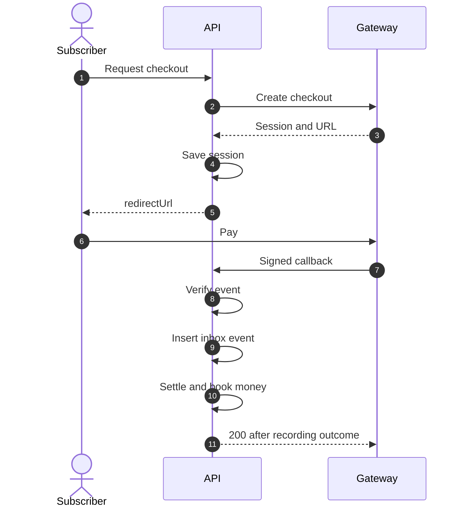
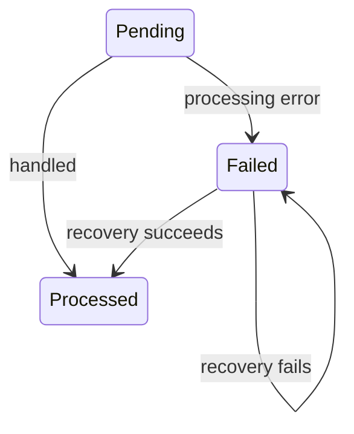
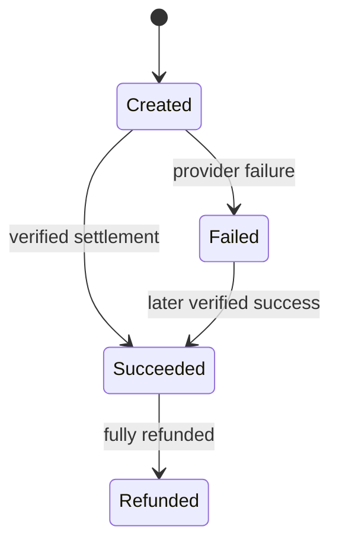

# Online payments

Subscriptions creates provider-hosted checkouts and settles verified callbacks through a durable inbox, sharing the invoice and ledger rules used by manual payments.

## At a glance

| Component | Source under `src/Modules/Subscriptions/Subscriptions/` |
|---|---|
| Provider port and adapters | `Domains/OnlinePayments/Gateways/`: `IPaymentGateway`, `FakePaymentGateway`, `StripePaymentGateway`, `PaymobPaymentGateway` |
| Checkout | `Domains/OnlinePayments/Features/CreateOnlineCheckout/` |
| Inbound callback | `Domains/OnlinePayments/Features/ReceivePaymentWebhook/` |
| Inbox settlement | `Domains/OnlinePayments/Services/InboundWebhookProcessor.cs` |
| Recovery | `Domains/OnlinePayments/Jobs/RetryFailedPaymentWebhooksJob.cs` |
| Persistence | `Data/Configurations/InboundWebhookEventConfiguration.cs`, `OnlinePaymentSessionConfiguration.cs`, `OnlinePaymentRefundConfiguration.cs` |

`IPaymentGateway` is internal to Subscriptions. Other modules use its public contracts through `ISender`; they do not call gateway adapters. [Billing](Billing.md) owns money, lifecycle and settlement rules; the [module overview](../Modules/Subscriptions.md) lists all endpoints.

## How it works

### Checkout and settlement


*Figure: The provider callback settles money; browser return URLs are navigation signals and cannot prove payment.*

`POST /api/v1/subscriptions/{subscriptionId:guid}/online-payment` requires authentication, the current subscriber's billing access and the `create` rate policy. JSON fields are `provider`, `successUrl`, `cancelUrl`, optional `paymentId`, and `saveCard` (default false). The handler resolves the single owed activation/renewal/proration payment, or the explicit payment id, and charges its **outstanding** amount. It saves an `OnlinePaymentSession` linking provider/reference to payment and returns `subscriptionId`, `paymentId`, `provider`, `sessionId`, `redirectUrl`, `amount`, `currency`.

Return URLs must be absolute HTTP(S) and match `Subscriptions:OnlinePaymentReturnOrigins`, falling back to `Cors:AllowedOrigins`; an empty effective list accepts any HTTP(S) origin. Configure the allowlist for each frontend. A gateway must be registered and enabled. Unsupported exact amounts return 409 `amount_not_supported` before checkout creation. `saveCard=true` takes effect only when auto-retry is enabled and the adapter supports off-session charging; see [saved cards](Billing.md#saved-cards-and-automatic-retries).

### Verified webhook inbox

`POST /api/v1/webhooks/payments/{provider}` declares `AllowAnonymous()` and the IP-partitioned `webhook` rate policy. Its authenticity boundary is the provider signature, not user authentication. The endpoint reads the original body with a 262144-byte cap; oversized bodies return 400.

1. Resolve the enabled provider, verify the signature, parse and normalize. Unknown/disabled provider is 404; signature failure is 401; malformed/negative/invalid-currency-scale amounts are 400. These failures store nothing.
2. Insert the verified raw JSON and normalized fields into `subscriptions.inbound_webhook_events` using `ON CONFLICT (provider, event_id) DO NOTHING`. The unique index prevents duplicate inbox rows.
3. Process new events and duplicate rows that are not already `Processed`. Once stored, processing uses `CancellationToken.None`, so a disconnected callback request does not abandon settlement. A completed duplicate returns `data.duplicate=true` without settling again.
4. In its transaction, apply the event and record `Processed`, or roll back the money changes and record `Failed`. After commit, settlement evicts caches, enqueues invoice delivery and records an opted-in saved method where available.

| Normalized event | Effect |
|---|---|
| `PaymentSucceeded` | Validate and settle receipt/invoice/ledger; session becomes Succeeded |
| `PaymentFailed` | Created session becomes Failed; payment remains owed for another checkout |
| `Refunded` | Book one provider refund, credit notes and negative ledger entry |
| `Other` | Store and mark processed without changing billing |


*Figure: InboundWebhookStatus has Pending, Processed and Failed; retry exhaustion leaves a Failed row for investigation.*

The inbox is a durable record, not a bus consumer. Normal application failures during the settlement transaction are recorded and acknowledged with 200 so provider retries do not amplify them. Failure to store the event, begin a transaction, record a failure or complete after-commit work can still surface an HTTP error; a universal 200 is not guaranteed.

### Session status


*Figure: OnlinePaymentSessionStatus records an attempt, independently of PaymentStatus; a partial refund leaves the session Succeeded.*

`OnlinePaymentSession.MarkFailed` only changes Created, so a late failure cannot regress a successful session. `MarkSucceeded` can record a later successful outcome. A second success for a Succeeded session is a no-op apart from remembering the payment reference. Domain [payment states](Billing.md#payments-and-approvals) describe the debt rather than the hosted attempt.

### Settlement checks

`PaymentSucceeded` is permanently rejected when the reference is unknown, amount/currency differs from the session, outstanding debt changed, payment is no longer owed, or `EnsureSettleable` rejects subscription status/currency. A provider can have collected money even though settlement was rejected; reconcile/refund that money manually. `WebhookRejectedException` and other deterministic `CustomException` failures exhaust attempts immediately. Database/concurrency failures remain eligible for recovery.

The retry job `retry-failed-payment-webhooks` runs every five minutes by default. It selects Failed rows below `MaxAttempts` after linear backoff (`attempts × RetryBackoffMinutes`) and Pending rows abandoned for at least five minutes, taking at most 50 per run. Each event runs through `IUnitOfWorkRunner`; processed rows are skipped. `GET /api/v1/admin/subscriptions/webhook-events/failed?provider=&pageNumber=&pageSize=` requires `billing.read` and exposes attempts, last error and payment references. There is no administrative re-drive endpoint.

### Refunds

Refund bookkeeping is idempotent per `(provider, provider_refund_id)` in `online_payment_refunds`, separately from webhook event-id deduplication.

**Provider-initiated refund.** The adapter reports the individual refund id and amount, not a cumulative total. Processing requires a settled session, positive amount, matching currency, and aggregate refunds no greater than the session's received amount. Session locking serializes the cap. An already-booked refund id is a no-op. `IRefundBooking` issues credit notes against newest invoices, then `LedgerEntry.ForProviderRefund` records one negative Refund entry. A full refund marks the session Refunded; partial refunds leave it Succeeded. Subscription refund calculations subtract these amounts too.

**Admin-approved refund.** `MarkRefundProcessed` checks the expected refund version before any provider call, then calls `IPaymentGateway.RefundAsync` against newest settled sessions without exceeding their remaining balance. Successful provider refund ids are persisted before final booking, replacing the administrator's external reference. A webhook echo is recognized by refund id; if it booked first, the request adopts the recorded refund and books only the remainder. Credit notes document refunded money and do not add a second ledger debit.

The provider idempotency key is `refund-{refundRequest.Id:N}-{session.Id:N}`: it stays fixed across retries and never includes amount or progress. Stripe/Fake support provider refund idempotency; Paymob does not. A durable processing claim prevents concurrent calls. After an ambiguous prior attempt, a gateway without refund deduplication requires webhook reconciliation before another request can refund again; do not treat a network error as proof no money moved. A gateway exception returns 502 `payment_gateway_error`; an Approved request may already have durable provider progress even though final bookkeeping did not complete. Offline money still requires the administrator's external transfer. See [Billing refunds](Billing.md#refunds).

### Stripe adapter

`StripePaymentGateway` uses Stripe.net and a hosted Checkout Session in `payment` mode. `client_reference_id` is the payment id. `StripeAmounts` handles provider-specific minor units: zero-decimal currencies, three-decimal minor units constrained to multiples of ten, and the legacy ISK/UGX and whole-unit HUF/TWD rules. An amount the provider cannot represent exactly is refused rather than rounded into a different charge.

`Stripe-Signature` signs `t.rawBody` with HMAC-SHA256. `EventUtility.ValidateSignature` applies `WebhookToleranceSeconds` against `TimeProvider`; missing/malformed signatures and stale timestamps return 401. Verified JSON is mapped directly rather than through the SDK's pinned event API version.

| Stripe event | Mapping |
|---|---|
| `checkout.session.completed`, `checkout.session.async_payment_succeeded` with `payment_status=paid` | PaymentSucceeded; retain PaymentIntent reference |
| `checkout.session.expired`, `checkout.session.async_payment_failed` | PaymentFailed |
| `payment_intent.succeeded`, `payment_intent.payment_failed` | Success/failure only for this application's off-session metadata; other intents map to Other |
| `refund.created`, `refund.updated` with `status=succeeded` | Refunded, keyed by refund id and linked through PaymentIntent |
| `charge.refunded`, unsupported events | Other |

`charge.refunded` carries cumulative totals rather than one refund id; booking it alongside refund events would duplicate a refund. A checkout card decline does not end the session, so ordinary `payment_intent.payment_failed` is ignored. Refund API calls use the retained PaymentIntent. The named `stripe` client has timeouts/circuit breaking with resilience retries disabled; provider idempotency is handled explicitly where supported.

### Paymob adapter

`PaymobPaymentGateway` uses the named `paymob` client, with hidden POST retries disabled. Checkout calls `POST /v1/intention/` using `Authorization: Token <ApiKey>`, currency-aware minor units and a unique `special_reference` per attempt. The intention's **order id** becomes the session reference; redirect uses `/unifiedcheckout/?publicKey=...&clientSecret=...`. Configure the transaction-processed callback at `https://api.example.com/api/v1/webhooks/payments/Paymob`, or set `NotificationUrl`. Required `billing_data` placeholders are filled with `NA`; the hosted page collects buyer data.

Paymob signs fields rather than raw JSON. `?hmac=` is hex HMAC-SHA512 of these 20 fields concatenated in lexicographic key order (`HmacFields` in the adapter): `amount_cents`, `created_at`, `currency`, `error_occured`, `has_parent_transaction`, `id`, `integration_id`, `is_3d_secure`, `is_auth`, `is_capture`, `is_refunded`, `is_standalone_payment`, `is_voided`, `order.id`, `owner`, `pending`, `source_data.pan`, `source_data.sub_type`, `source_data.type`, `success`. Booleans use lowercase `true`/`false`; comparison is constant-time. Only signed fields determine the session, money and ids; unsigned `parent_transaction` is not trusted.

| Callback | Mapping |
|---|---|
| Successful, not pending/voided/refunded/child and eligible captured payment | PaymentSucceeded; remember transaction id |
| Unsuccessful, not pending | PaymentFailed |
| Successful refunded child transaction | Refunded; child transaction id is refund id |
| Pending, voided, auth-only or refunded parent update | Other |

Event ids are `txn:<id>:<state flags>`, so pending callbacks cannot hide a later final state. Refunds call `POST /api/acceptance/void_refund/refund` with `transaction_id` and `amount_cents`.

### Fake adapter

Fake is for development/tests; it is registered but not enabled in shipped base settings. A callback body has `id`, `type`, `reference`, `amount`, `currency`, with optional `refund_id`. Types `payment.succeeded`, `payment.failed`, `refund.created` map to their normalized events; others map to Other. `X-Fake-Signature` is hex HMAC-SHA256 of the raw body with the configured secret. It supports deterministic saved-method outcomes for tests; see [Billing](Billing.md#saved-cards-and-automatic-retries).

## Configuration

Source: `SubscriptionOptions.cs`, registration in `SubscriptionsModule.cs`, gateway adapters and `src/Api/appsettings*.json`. Table defaults below are option fallbacks; shipped Stripe/Paymob entries contain disabled gateways and `CHANGE_ME` credential placeholders. Paymob's shipped `BaseUrl` selects the adapter's standard provider API origin; real provider hosts are kept in source/config rather than copied into example deployment URLs here.

| Key | Default | Meaning |
|---|---|---|
| `Subscriptions:PaymentGateways:<Name>:Enabled` | false | Must have a registered adapter too |
| `Subscriptions:PaymentGateways:<Name>:Mode` | `Sandbox` | Sandbox or Live |
| `Subscriptions:PaymentGateways:<Name>:AllowSandboxInProduction` | false | Explicit demo-stack opt-in |
| `Subscriptions:PaymentGateways:<Name>:Secret` | null | Required inbound signing secret when enabled |
| `Subscriptions:PaymentGateways:<Name>:ApiKey` | null | Required outbound key for Stripe/Paymob |
| `Subscriptions:PaymentGateways:<Name>:BaseUrl` | null | Fake checkout origin / Paymob regional API override; Paymob adapter has its standard origin fallback |
| `Subscriptions:PaymentGateways:<Name>:PublicKey` | null | Required for Paymob unified checkout |
| `Subscriptions:PaymentGateways:<Name>:IntegrationIds` | `[]` | At least one Paymob integration id when enabled |
| `Subscriptions:PaymentGateways:<Name>:NotificationUrl` | null option; Paymob shipped API callback placeholder | Optional Paymob callback override |
| `Subscriptions:PaymentGateways:<Name>:WebhookToleranceSeconds` | 300 | Stripe signature age tolerance |
| `Subscriptions:OnlinePaymentReturnOrigins` | `[]` | Falls back to `Cors:AllowedOrigins` |
| `Subscriptions:PaymentWebhooks:MaxAttempts` | 5 | Inline + retry processing attempt limit |
| `Subscriptions:PaymentWebhooks:RetryBackoffMinutes` | 2 | Linear retry multiplier |
| `Subscriptions:PaymentWebhooks:RetryCron` | `*/5 * * * *` | UTC recovery schedule |
| `Subscriptions:Dunning:AutoRetry:Enabled` | false | Offer opted-in saved-card retries |

### Sandbox and live

The host rejects recognizable test keys in Live mode and live keys in Sandbox mode, including Stripe `sk_`/`rk_` prefixes and Paymob secret/public key prefixes. Production rejects an enabled Sandbox gateway, including Fake, unless `AllowSandboxInProduction=true`. Enabling a live gateway without setting `Mode=Live` leaves the Sandbox default and can fail startup. Mode describes credentials/environment; it is not inferred from a browser request. Paymob uses the same standard API host for both modes.

Obtain project-specific test API/webhook keys in the provider dashboard. For Stripe, configure the checkout/refund events above plus off-session intent events when auto-retry is enabled; a local provider forwarding tool supplies its own webhook signing secret. For Paymob, configure test keys, integration ids and transaction callback. Keep real values in user-secrets, environment variables or Docker secrets. Switch mode and keys together after verifying the complete callback flow.

## Usage

The port's actual checkout signature from `src/Modules/Subscriptions/Subscriptions/Domains/OnlinePayments/Gateways/IPaymentGateway.cs`:

```csharp
Task<CheckoutSession> CreateCheckoutAsync(CheckoutRequest request, CancellationToken ct);
```

To add a provider, implement the internal port beside the existing adapters, register it in `SubscriptionsModule`, add a gateway configuration entry and adapter tests. Implement `Name`, checkout, signature parsing and refunds; return parse failures for malformed input instead of throwing. Preserve exact currency amounts and provider ids. Set capability flags accurately before supporting saved methods or repeatable refunds. Outbound clients need bounded timeouts and deliberate retry behavior. Reuse the provider-neutral settlement/inbox path rather than writing invoices or ledger entries inside an adapter. Follow [`/starterkit:add-feature`](../../tools/claude/starterkit-plugin/skills/add-feature/SKILL.md).

## Failure modes and guarantees

`WithIdempotency()` is opt-in on money-related routes such as manual receipts, proof uploads and refund requests; [Billing](Billing.md#failure-modes-and-guarantees) lists them. **Checkout creation does not declare it.** Sending an `Idempotency-Key` to checkout does not deduplicate hosted sessions. Inbox uniqueness, payment-state checks and provider refund/charge keys are separate guarantees; Redis replay never replaces them.

The inbox persists verified JSON for recovery without original headers. Store/settlement work and provider calls are separate boundaries. A cancelled request, HTTP error or browser return cannot establish whether money moved. Failed inbox rows and ambiguous refunds need reconciliation. Adapter tests use fixtures/stubbed HTTP handlers; they do not establish connectivity or credentials for a deployment.

## Guardrails

`FakePaymentGatewayTests`, `StripePaymentGatewayTests`, `PaymobPaymentGatewayTests`, `StripeAmountsTests`, `StripeOffSessionGatewayTests`, `CreateOnlineCheckoutCommandValidatorTests` and `SavedMethodsUnitTests` cover adapters and return URLs. `OnlinePaymentTests`, `OnlineRefundTests` and `SavedMethodsAndAutoRetryTests` exercise PostgreSQL settlement, deduplication and refund races. `AdminEndpointAuthorizationTests`, `ModuleBoundaryTests` and `BackgroundJobEventDispatchTests` enforce boundaries.

## Related

[Billing](Billing.md), [Subscriptions module](../Modules/Subscriptions.md), [Payment methods frontend guide](PaymentMethods-Frontend-Integration.md), [Request lifecycle](../Architecture/Request-Lifecycle.md), [ADR-0017](../Decisions/0017-money-precision-and-per-currency-rounding.md), and [ADR-0018](../Decisions/0018-off-session-dunning-retries-on-saved-cards.md).
