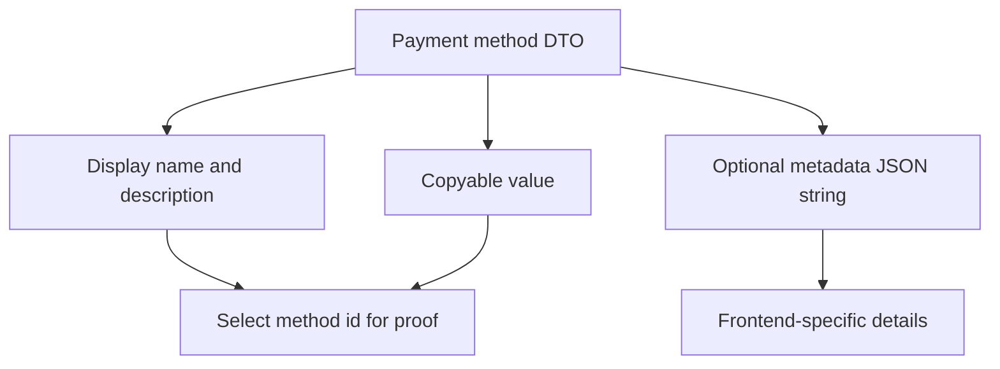

# Integrate payment methods in a frontend

Build customer payment choices and an administrative editor against Subscriptions' payment-method and support-instruction endpoints.

## Goal

Display active payment destinations, let administrators manage them, and submit the chosen method id with a payment proof. These are configured offline payment destinations, separate from provider-hosted checkout and saved cards in [Online payments](Online-Payments.md).

## Prerequisites

- Use the API's `/api/v1` base path and parse its `ApiResponse` envelope (`isSuccess`, `data`, errors); see [Errors and responses](../Architecture/Errors-and-Responses.md).
- Administrative calls require an authenticated caller with `payment-settings.manage`, declared as `RequirePermission(Permissions.PaymentSettingsManage)`; an Admin role name alone is not the endpoint contract.
- Source of truth: `src/Modules/Subscriptions/Subscriptions/Domains/PaymentSettings/Features/` and `Subscriptions.Contracts/Subscriptions/Commands/`. `PaymentMethodDto` and `PaymentInstructionsDto` are both declared in `Subscriptions.Contracts/Subscriptions/DTOs/PaymentInstructionsDto.cs`.

## Steps

### 1. Load customer choices and support contacts

Fetch the two resources independently. Read methods from `data`, rather than treating the entire response as an array. Handle missing instructions separately from an empty method list.

| Method | Route | Authorization | Result |
|---|---|---|---|
| GET | `/api/v1/payment-methods` | `AllowAnonymous()` | Non-deleted, active methods, ascending `sortOrder` |
| GET | `/api/v1/payment-instructions` | `AllowAnonymous()` | `supportWhatsApp`, `supportEmail`; missing configuration follows the endpoint's NotFound response path |

Every method has these fields:

| Field | Meaning |
|---|---|
| `id` | Method id to retain for proof submission |
| `type` | Free string describing the destination; not an enum of supported gateways |
| `displayName` | Card title |
| `value` | Main copyable destination, such as account identifier or wallet id |
| `description` | Nullable explanatory text |
| `metadata` | Nullable string containing JSON, not a nested JSON object in this response |
| `sortOrder` | Ascending display order; lower values first |
| `isActive` | Public results are active; admin results may be inactive |
| `version` | Optimistic version to retain when opening an edit form |

### 2. Render destination details

Use `displayName`, `value` and `description` for a generic card with a copy action. Treat values as text. Parse non-null `metadata` defensively and tolerate missing/unknown properties. Always retain the generic fallback for types added by administrators.


*Figure: The frontend can enrich a generic destination card while keeping the method id as the proof-submission reference.*

`BankTransfer` appears in the seed and tests. The earlier UI examples also used wallet labels such as Vodafone Cash and InstaPay; these remain product-defined strings, not backend enum members. Bank-specific form fields (bank name, account holder, account number, IBAN and SWIFT) can be encoded inside `metadata` by an agreed frontend schema. The server validates that metadata is JSON but defines none of those nested field names. Keep `value` usable even when that metadata schema is absent. Wallet-like destinations can use `metadata=null` and show only name/value.

### 3. Load the administrative list

| Method | Route | Authorization | Result |
|---|---|---|---|
| GET | `/api/v1/admin/payment-methods` | `payment-settings.manage` | Active and inactive, non-deleted methods, ascending `sortOrder` |

Show inactive methods explicitly. Populate edits from this list, retaining `id` and `version`, top-level fields, and any recognized metadata. There is no payment-method detail GET route; the Location returned on create identifies the resource but is not a supported detail endpoint.

### 4. Create or edit a method

| Method | Route | Result |
|---|---|---|
| POST | `/api/v1/admin/payment-methods` | 201 Created, `data.id` and Location |
| PUT | `/api/v1/admin/payment-methods/{id:guid}` | 200 OK |
| DELETE | `/api/v1/admin/payment-methods/{id:guid}` | 200 OK |

All three require `payment-settings.manage`. The PUT route id overrides the command's id; use the selected method's id in the URL. Deletion has no version field. Prefer deactivation when a destination should disappear from customer choices while remaining in the administrative list.

| JSON field | POST | PUT | Validation / meaning |
|---|---|---|---|
| `type` | Required | Required | Non-empty, at most 50 characters |
| `displayName` | Required | Required | Non-empty, at most 200 characters |
| `value` | Required | Required | Non-empty, at most 200 characters |
| `description` | Nullable | Nullable | At most 500 characters |
| `metadata` | Nullable JSON string | Nullable JSON string | Serialize the details once into a string; invalid JSON is rejected |
| `sortOrder` | Required | Required | Non-negative integer |
| `isActive` | Not in create command | Boolean | New methods start active |
| `version` | Not in create command | Optional nullable integer | Send the read version to reject stale edits with 409 |

The real edit contract from `src/Modules/Subscriptions/Subscriptions.Contracts/Subscriptions/Commands/UpdatePaymentMethodCommand.cs`:

```csharp
public record UpdatePaymentMethodCommand(
    Guid Id,
    string Type,
    string DisplayName,
    string Value,
    string? Description,
    string? Metadata,
    int SortOrder,
    bool IsActive,
    long? Version = null) : ICommand<Unit>;
```

On 409, refresh the list and let the operator reconcile changes before resubmitting. Preserve unknown metadata fields when editing an existing product-specific schema. Changing a configured method does not rewrite the snapshot already recorded on a submitted payment.

### 5. Save support contacts

`PUT /api/v1/admin/payment-instructions` requires `payment-settings.manage` and returns 200. Its entire body contract is `supportWhatsApp` (non-empty, at most 50 characters) and `supportEmail` (non-empty email address, at most 256 characters). It creates or updates the instructions row; it does not add payment destinations. No `version` field is declared for this command. Refresh the anonymous instructions resource after saving.

### 6. Submit the selected method with proof

Proof routes require authentication and subscriber billing access, use the `upload` rate policy, and opt into `WithIdempotency()`:

| Purpose | POST route | Multipart fields |
|---|---|---|
| Activation | `/api/v1/subscriptions/{subscriptionId:guid}/proof` | `file`, `paymentMethodId`, optional `paymentId` |
| Renewal | `/api/v1/subscriptions/{subscriptionId:guid}/renewal/proof` | `file`, `paymentMethodId`, optional `paymentId` |
| Proration | `/api/v1/subscriptions/{subscriptionId:guid}/proration/proof` | `file`, `paymentMethodId`, required `paymentId` |

Use the selected destination's `id`, not its `type` or `value`. The server snapshots method details on submission; see [Billing](Billing.md#payments-and-approvals). A proof upload does not itself settle the payment. For an uncertain retry, retain the same optional `Idempotency-Key` and body; a changed body with that key returns 422 `idempotency_key_reused`.

## Verify

1. Confirm the anonymous list excludes inactive/deleted methods and preserves ascending `sortOrder`.
2. Confirm the administrative list includes inactive methods and requires the permission policy.
3. Create a method; verify 201 and `data.id`. Edit using its read `version`; confirm a stale version returns 409.
4. Deactivate it and refresh both lists. Verify it remains in the admin list and leaves the public list.
5. Test null metadata, valid product-specific metadata and an unfamiliar `type`; all must render a usable generic card. Verify invalid JSON is rejected on write.
6. Save support contacts, reload them independently and submit a proof with a real method id in the appropriate billing flow.

`PaymentMethodSnapshotTests` and `PaymentMethodSnapshotDtoJsonTests` cover preserved payment details; `AdminEndpointAuthorizationTests` guards declared authorization. Endpoint validators enforce the field constraints above. These are source checks and repository test coverage, not a claim that a separate frontend has been exercised.

## Pitfalls

- Unwrap `data` before mapping arrays or reading support contacts. Do not assume raw JSON arrays from successful GETs.
- `metadata` is a JSON string and its nested schema belongs to the product. Avoid depending on undocumented bank-field names or rendering unsanitized HTML.
- `type` is a destination label, not a gateway selection. Online checkout takes a separate `provider` field.
- Retain `version` on edit; omitting it loses client-observed stale-edit protection.
- Missing instructions do not mean the payment-method request failed. Render fallback support behavior independently.
- Offline configuration and anonymous display do not authorize billing changes; subscriber proof routes still enforce ownership/billing access.

## Related

[Billing](Billing.md), [Online payments](Online-Payments.md), [Subscriptions module](../Modules/Subscriptions.md), [Errors and responses](../Architecture/Errors-and-Responses.md), and [`/starterkit:add-feature`](../../tools/claude/starterkit-plugin/skills/add-feature/SKILL.md).
