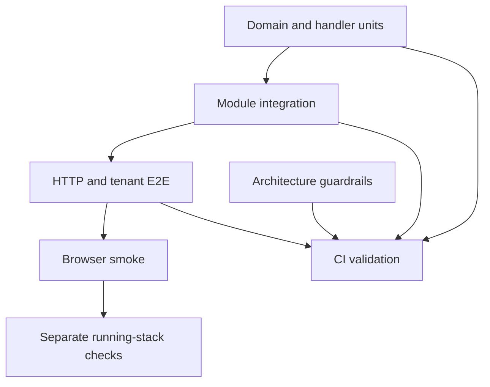

# Testing strategy

Tests validate domain behavior, persistence, HTTP contracts and architectural boundaries at distinct levels with explicit infrastructure requirements.

## At a glance

| Level | Project(s) | Speed / infra | What belongs here |
|---|---|---|---|
| **Unit: domain** | `src/Modules/<M>/<M>.Tests/Domain` | ms, none | Factories, invariants, every state-machine transition (Theory over status × action), events raised |
| **Unit: features** | `<M>.Tests/Features`, `Services` | ms, none | Validators (en + ar messages, resx key parity), handler branches with Moq (not found, forbidden, conflict), services, mappers |
| **Integration** | `Identity.IntegrationTests`, `Subscriptions.IntegrationTests`, `Tenancy.IntegrationTests`, `DataTransfer.IntegrationTests`, `Webhooks.IntegrationTests` (plus optional sample integration tests); Attachment's in `Attachment.Tests/Integration` (incl. two-tenant RLS as a non-superuser) and Notification's in `Notification.Tests/Persistence` | s, Docker | Real `Add<M>Module` + Testcontainers `postgres:16-alpine` + real migrations: SQL filters, paging, unique indexes, optimistic concurrency, soft delete, tenant isolation, outbox rows, jobs, seeder idempotency |
| **Shared kernel** | `src/Shared/Shared.Core.Tests` | ms to s | Interceptors, versioning (`Concurrency/*` on PostgreSQL), outbox, multi-tenancy, caching, paging, health checks |
| **Architecture** | `src/Api.Tests/Architecture` | s, none | Module boundaries, naming, messaging, tenancy, background-job dispatch, explicit auth on every endpoint, client-generated child keys (`ClientGeneratedKeyTests`) |
| **HTTP E2E** | `src/Api.E2ETests` | s, Docker | The real API over HTTP: routing, auth (401/403), envelopes, cross-module flows, `PendingModelChangesTests`, `TenantRowLevelSecurityCoverageTests` (forced RLS on every tenant table of the real migrations) |
| **Multi-tenant E2E** | `src/Api.E2ETests/MultiTenancy` | s, Docker | `MultiTenantE2EFixture`: tenant A can never read or modify tenant B |
| **Orchestration** | `src/Aspire/AppHost.Tests` | Model checks without Docker; live startup needs Docker and opt-in | AppHost model/settings; live startup |
| **Browser smoke** | `tests/e2e` (Playwright, TS) | min, running stack | A handful of critical journeys, with Mailhog helpers for emails |
| **HTTP load** | `tests/load` (k6, JS) | min, Docker | Throughput/latency budgets of the hot paths against a real container: [Load testing](Load-Testing.md) (`make loadtest`, nightly `load-test.yml`) |
| **Opt-in live** | `FcmLiveTests` (`FCM_CREDENTIALS_FILE` + `FCM_TEST_TOKEN`), `ClamAvContainerTests` (`STARTERKIT_CLAMAV_TESTS=1`) | min, real service / heavy image | Real external engines: skipped unless the variable is set, so the main CI build stays fast. ClamAV runs in its own workflow (`clamav-live.yml`: nightly + PRs touching the scanner) |

Stack: **xUnit v3, FluentAssertions 7, Moq 4, Testcontainers, Microsoft.AspNetCore.Mvc.Testing**. Don't introduce
other assertion or mocking libraries.

## How it works


*Figure: Fast behavior and architecture checks complement PostgreSQL-backed tests and separately orchestrated browser checks.*

Module tests are real projects such as `Identity.Tests`, `Tenancy.Tests`, `Attachment.Tests`,
`Subscriptions.Tests`, `Notification.Tests`, `Webhooks.Tests` and `DataTransfer.Tests`. Cross-cutting tests live
in `Shared.Core.Tests`; host guardrails in `Api.Tests`; HTTP tests in `Api.E2ETests`; AppHost tests in
`AppHost.Tests`. The optional sample has its own tests but is not required for the examples below.

`E2ETestFixture` exposes the single-tenant API factory and authenticated clients. `MultiTenantE2EFixture`
uses the multi-tenant host for tenant-isolation scenarios. `PostgresContainerFixture` constructs Testcontainers
with `postgres:16-alpine`; integration collections similarly run real PostgreSQL rather than an in-memory EF
substitute. Docker must be available for tests using those fixtures. Fresh ids isolate test data; collections
share containers, not the assumption that tests run in a fixed order.

### What every feature needs

| Change | Minimum tests |
|---|---|
| New aggregate method or invariant | Domain unit tests: happy path, each guard, events raised |
| New command | Validator tests; handler tests for success + not found + forbidden + conflict; integration test if it touches SQL, uniqueness, concurrency or tenancy |
| New query | Integration test for filters, sorting, paging and tenant/branch/soft-delete filtering |
| New endpoint | E2E: 401 anonymous, 403 wrong role or permission, happy path |
| Critical update | Integration: stale `Version` throws `ConcurrencyConflictException` and changes nothing; current version bumps by one |
| Integration event | Aggregate raises it; outbox row written after commit; consumer is idempotent (duplicate = no-op) |
| Background job | Integration: only eligible rows processed; one failure doesn't stop the batch; events published |
| Tenant data | Multi-tenant E2E or integration: cross-tenant read and write impossible |
| New module, event or permission | Architecture test registries updated (event list, outbox list); modules are discovered (`ModuleDiscoveryTests`) |

### Conventions

- Name tests `Scenario_Expectation`, for example `Update_WithStaleVersion_IsRejected_AndNothingChanges`.
- Use Arrange / Act / Assert with one behaviour per test. Theories for matrices.
- Build data through **real** factories and commands. `TestSupport` builders walk real state machines; no
  reflection.
- Integration tests share one container per collection. Isolate by using fresh ids and unique values (SKUs,
  emails).
- Assert outcomes **and** side effects: DB state, events, outbox rows, version, "nothing changed" on failure.
- Fake time with `TimeProvider`; never `Thread.Sleep` or `Task.Delay` in tests.
- Set up tenant-dependent tests with `TenantContext.SingleTenant` for Default-tenant behavior or a disposable `TenantScope.Begin(...)` for a specific tenant; see `src/Shared/Shared.Core.Tests/MultiTenancy/TenantTestDb.cs` and `TenantDataIsolationTests.cs` in the same directory.
- Tests may call `IgnoreQueryFilters()` to inspect raw data. Production code may not.

## Usage

### Running

```bash
dotnet test StarterKit.slnx                                          # all (Docker running)
dotnet test src/Api.Tests                                            # guardrails, fast
dotnet test src/Modules/Identity/Identity.Tests --filter "FullyQualifiedName~ApiKeyModelTests"
dotnet test src/Api.E2ETests --filter "FullyQualifiedName~PendingModelChangesTests"
dotnet test StarterKit.slnx --collect:"XPlat Code Coverage"         # coverlet
cd tests/e2e && npm ci && npx playwright test                       # against a running stack
```

CI (`hybrid-ci-cd.yml`) runs `PendingModelChangesTests` and then the whole solution on every push and PR. A red
architecture test is a design problem, not a flaky test. Fix the code, or change the rule deliberately with an ADR.

Use `--filter "FullyQualifiedName~..."` with an actual class or method to narrow a run; the Identity command
above runs one class. For new test templates and fixture setup use
`/starterkit:write-tests`.

## Failure modes and guarantees

A passing unit test cannot establish PostgreSQL RLS or SQL behavior. A passing HTTP test cannot certify Nginx,
provider credentials or production backup recovery. Opt-in live tests are skipped without their environment
switches; inspect skip counts and do not report skipped providers as verified. Keep failing behavior at the
lowest meaningful level and add integration/E2E coverage for boundaries and side effects.

## Guardrails

The architecture suite is `dotnet test src/Api.Tests`; database-backed guards run in `Api.E2ETests`.

| Test class | Enforced boundary |
|---|---|
| `ModuleDiscoveryTests` | Manifest discovery and module order |
| `ModuleBoundaryTests` | Contracts-only module dependencies and provider-neutral user access |
| `NamingConventionTests` | Feature/event/endpoint naming and placement |
| `ThirdPartyIsolationTests` | External library adapters stay in owning projects |
| `MessagingArchitectureTests` | Integration contracts, URNs and outbox registration |
| `SagaArchitectureTests` | Durable saga registration and module-owned persistence |
| `BackgroundJobEventDispatchTests` | Background writes dispatch committed domain events |
| `TenantIsolationArchitectureTests` | Tenant ownership, named filters and tenant inclusion in unique indexes; review enforces tenant-first order |
| `AdminEndpointAuthorizationTests` | Every endpoint declares authorization; privileged policies are registered |
| `ClientGeneratedKeyTests` | Aggregate child Guid keys are not store-generated |
| `AuditTrailArchitectureTests` | Auditable entities map their audit trail |
| `RequestHandlerCoverageTests` | Concrete mediator request handlers cover request types |
| `PendingModelChangesTests` | EF model and migrations match (HTTP E2E project) |
| `TenantRowLevelSecurityCoverageTests` | Real tenant tables have forced RLS and isolation policy (HTTP E2E project) |

## Related

[Database conventions](../Architecture/DatabaseConventions.md), [developer observability](../Architecture/Observability.md),
[DataTransfer baseline](../Modules/DataTransfer.md#performance-baseline), [load testing](Load-Testing.md),
[CI/CD](../deployment/CI-CD.md), and `/starterkit:write-tests`.
