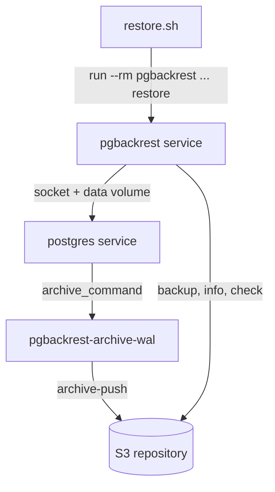

# Database backups and restore (pgBackRest)

PostgreSQL archives its WAL and takes physical backups to S3 with pgBackRest, so the cluster can be restored to the
latest state or to a point in time.

## Goal

Produce inspectable off-host backups and rehearse recovery without confusing a logical pre-deploy dump with a
physical cluster backup or a complete backup of application secrets and attachments.

## Prerequisites

Configure S3 access, bucket and region (`S3_BACKUP_BUCKET`, `AWS_*` in `.env.prod`) and the database credentials.
Work from the deployment checkout (`DEPLOY_DIR`); the examples assume the default `starterkit` stanza.

## Steps

1. Set `S3_BACKUP_BUCKET` and the `AWS_*` values, then deploy (the deploy builds the PostgreSQL image).
2. Run `deployment/postgres/scripts/init-pgbackrest.sh` once: it creates the stanza, runs `check` (proves WAL
   archiving reaches the repository) and takes the first full backup.
3. Enable the schedule, monitor backup age and rehearse restoration on an isolated server.

### How it is wired


*Figure: Both services run the same infra/postgres image; PostgreSQL pushes WAL, the backup service takes and restores backups.*

- **Image:** `infra/postgres` builds `postgres:16-alpine` plus pgBackRest for both the `postgres` and the
  `pgbackrest` service, so they run the same pgBackRest version and configuration
  ([infra/postgres/README.md](../../infra/postgres/README.md)). Both services set `init: true`: pgBackRest's
  asynchronous archiving forks a process that would otherwise be re-parented to the postmaster, which then restarts
  the whole server when that process exits with an error.
- **Configuration:** `infra/postgres/pgbackrest.conf.template` is baked into the image and rendered at container
  start from `.env.prod` (`{{S3_BACKUP_BUCKET}}`, `{{AWS_*}}`, `{{POSTGRES_USER}}`, `{{POSTGRES_DB}}`) into
  `/etc/pgbackrest/pgbackrest.conf`, mode 0640. pgBackRest connects through the shared Unix socket, so the database
  password is not in the file. Rebuild after editing the template (`docker compose build postgres`).
- **WAL archiving:** `archive_command = pgbackrest-archive-wal %p`. Without `S3_BACKUP_BUCKET` there is no
  repository, so segments are reported as archived and recycled (the volume cannot fill up). With it, every segment
  is pushed; a failure keeps the segment and retries, and `archive-push-queue-max` (1 GiB) caps how much WAL piles up
  while S3 is unreachable. Pushes fail until the stanza exists, so run the init script right after the first deploy.
- **User:** pgBackRest runs as `postgres`, the owner of the data directory, so a restored cluster has the ownership
  PostgreSQL expects. The helper scripts use `docker compose exec -u postgres pgbackrest ...`.
- **Repository:** `repo1-type=s3`, path `/pgbackrest`, TLS verified. Retention (4 full, 8 differential) and LZ4
  compression are set in the template.
- **Stanza:** the template hard-codes `[starterkit]`; workflows use `APP_NAME` (default `starterkit`). Keep them
  aligned.
- **Scripts:** `deployment/postgres/scripts/`: `init-pgbackrest.sh`, `backup-full|diff|incr|info|health.sh`,
  `restore.sh`, `restore-verbose.sh` and `backup-cron.sh`.

### Schedule

`.github/workflows/database-backup.yml` runs on the self-hosted runner. It sends optional Telegram notifications.

| When | Type |
|---|---|
| Sunday 02:00 UTC | Full |
| Monday-Saturday 02:00 UTC | Differential |
| Manual (`workflow_dispatch`) | Any |

If you don't use GitHub Actions, the cron alternative is:

```bash
0 2 * * 0    cd /opt/starterkit && ./deployment/postgres/scripts/backup-full.sh   >> /var/log/pgbackrest/cron.log 2>&1
0 2 * * 1-6  cd /opt/starterkit && ./deployment/postgres/scripts/backup-diff.sh   >> /var/log/pgbackrest/cron.log 2>&1
*/30 * * * * cd /opt/starterkit && ./deployment/postgres/scripts/backup-health.sh >> /var/log/pgbackrest/health.log 2>&1
```

`deployment/pre-deploy-backup.sh` is a separate helper. The hybrid deploy workflow takes a **logical** `pg_dump` into
`/backup` before replacing an existing deployment ([rollback](CI-CD.md#rollback-behavior)); it does not take a
pgBackRest physical backup at that step.

### Manual backup and inspection

```bash
cd /opt/starterkit      # DEPLOY_DIR
docker compose -f docker-compose.yml --env-file .env.prod exec -u postgres pgbackrest \
  pgbackrest --stanza=starterkit --type=full backup       # or diff / incr

docker compose -f docker-compose.yml --env-file .env.prod exec -u postgres pgbackrest pgbackrest --stanza=starterkit info
docker compose -f docker-compose.yml --env-file .env.prod exec -u postgres pgbackrest pgbackrest --stanza=starterkit check
```

Backups run with the archive check on: a backup without its WAL cannot be restored consistently.

### Restore

`restore.sh` overwrites the database. It validates the request and the backup **before** stopping anything, stops
the API, the worker and PostgreSQL, runs a delta restore (no manual wipe of the data directory), starts PostgreSQL,
applies migrations with the migrator and restarts the API and worker.

```bash
./deployment/postgres/scripts/restore.sh latest                              # latest backup + all archived WAL
./deployment/postgres/scripts/restore.sh time "2026-02-07 14:30:00+00"       # point-in-time recovery, then promote
./deployment/postgres/scripts/restore.sh immediate                           # end of the latest backup
./deployment/postgres/scripts/restore.sh set 20260207-020000F                # a specific backup label (see info)
RESTART_APP=0 ./deployment/postgres/scripts/restore.sh latest                # leave the API stopped to inspect first
```

`ASSUME_YES=1` skips the confirmation prompt and `LOG_LEVEL=detail` (or `restore-verbose.sh`) shows pgBackRest's
detailed output. If the restore itself fails, the script leaves PostgreSQL and the writers stopped on purpose: the
data directory may be partly restored, so fix the cause and run it again rather than starting PostgreSQL.

## Verify

Use `info` to inspect backup labels, age and status and `check` to prove WAL archiving end to end. Rehearse the
point-in-time target you need as well as latest recovery on an isolated server, and verify application data and
tenant isolation afterwards; a public-schema table count alone is insufficient for module-owned schemas. Record the
measured recovery time and data-loss window, and practise at least quarterly.

### What backups do not cover

- Physical backups cover the configured PostgreSQL cluster. Inventory every dedicated tenant database or server; a
  `pg_dump` of the shared database does not cover them.
- Back up blob storage, secrets and Data Protection keys or certificates separately.

## Pitfalls

### Troubleshooting

| Symptom | Check |
|---|---|
| Backup or `check` fails at start | `docker compose ... logs pgbackrest`; never print the rendered configuration: it contains S3 credentials. |
| Cannot connect to PostgreSQL | `docker compose ... exec -u postgres pgbackrest psql -h /var/run/postgresql -U <POSTGRES_USER> -d <POSTGRES_DB> -c "select 1"` (shared socket volume) |
| S3 errors | Bucket name and region in `.env.prod`; IAM permissions for `s3:ListBucket`, `GetObject`, `PutObject` and `DeleteObject` on `arn:aws:s3:::<bucket>/pgbackrest/*` |
| `archive command failed` in the PostgreSQL log | The stanza does not exist yet (run `init-pgbackrest.sh`) or S3 is unreachable; `select * from pg_stat_archiver` shows the last failure |
| `archive_command ... must contain pgbackrest` | The stanza check requires the word: keep the `pgbackrest-archive-wal` name |

### Security

- The rendered configuration holds the S3 credentials; it is mode 0640 and owned by `postgres` inside the container.
  Restrict host and container access.
- Encryption at rest (`repo1-cipher-type`) is off by default. Enable it for regulated data, and store the passphrase
  as a secret.
- Restrict the bucket with a dedicated IAM principal and block public access.

Reference: <https://pgbackrest.org/user-guide.html>

## Related

[CI/CD rollback](CI-CD.md#rollback-behavior), [migrations](Database-Migrations.md), [secrets](Secrets.md),
[Docker Compose](Docker-Compose.md), [dedicated databases](../MultiTenancy/Isolation-and-Dedicated-Databases.md),
and `/starterkit:add-migration`.
