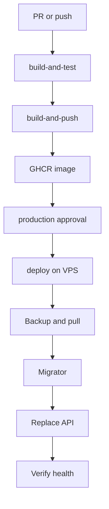

# CI/CD with GitHub Actions

Hosted runners validate and package changes; a production environment gate controls deployment on the VPS runner.

## At a glance

| Workflow | Jobs / responsibility | Trigger and runner |
|---|---|---|
| `hybrid-ci-cd.yml` (Hybrid CI/CD) | `build-and-test`, `build-and-push`, `deploy` | Push master/develop excluding markdown/wiki/docs paths, PR to master, manual; hosted build, `[self-hosted, deploy-only]` deploy |
| `rollback.yml` (Rollback Production Deployment) | `rollback`: logical database restore | Manual `confirmation=ROLLBACK`, optional `backup_file`; self-hosted, `production` environment |
| `templates.yml` (Templates) | `pack`, matrix `verify`, `publish` | PR to master, `templates-v*` tag push, manual; hosted; package, generated-product validation, tag publication |
| `docs.yml` (Docs site) | `build`, `deploy` | Master PR/push for wiki/site/checker/workflow paths, manual; hosted; Pages deployment only on master push |
| `quality.yml` (Quality) | `docs`, `format`, `plugin` | Master/develop push, every PR, manual; hosted; documentation links, changed-C# whitespace, plugin manifests/skills/hooks |
| `database-backup.yml` | `backup` | Sunday 02:00 UTC full, Monday–Saturday 02:00 differential, manual full/diff/incr; self-hosted |
| `health-monitoring.yml` | Public and VPS health/resource checks | Every six hours or manual; hosted and self-hosted |
| `test-runner.yml` | Runner smoke and deploy prerequisite checks | Manual; self-hosted |
| `load-test.yml` | k6 regression run | Nightly 03:30 UTC, relevant PR paths, manual; hosted Docker |
| `datatransfer-perf.yml` | Import/export engine baseline | Nightly and relevant PR paths, manual; hosted Docker |
| `clamav-live.yml` | Real `ClamAvContainerTests` | Nightly 02:30 UTC, scanner-related PR paths, manual; hosted Docker |
| `claude.yml` | Claude assistant | An `@claude` mention in issue/PR comments; hosted |
| `claude-code-review.yml` | Claude PR review | Manual PR number; hosted |

## How it works

*Figure: Only eligible master or manual runs publish and deploy; production reviewers gate the VPS job.*

`build-and-test` restores and builds Release, runs `PendingModelChangesTests`, then tests `StarterKit.slnx` and
uploads test results. PRs and develop pushes stop there. `build-and-push` requires a successful or skipped test
job and master or manual execution; GHCR receives metadata-derived tags and the image digest is an output.
Manual `skip_tests` can skip tests; keep the default false. The manual `environment` input offers staging, but
the deploy job itself declares **production**; it does not select a staging target from that input.

### Production deployment

The deploy checks required repository variables and runner prerequisites, checks out deployment configuration,
logs into GHCR and creates `/backup/pre_deploy_*.sql.gz` with `pg_dump` if PostgreSQL already exists (keeps five).
It pulls API and migrator. First startup uses Compose dependencies; later startup explicitly runs the migrator
before `up -d --no-deps api`. A failure there leaves the existing API running.

Supporting services are started with an explicit list excluding migrator and `--no-deps`, avoiding a second
migration run. Cleanup, local `/health` and `/alive`, public readiness, summaries and optional Telegram notices
follow. The workflow selects **only `docker-compose.yml`** with `.env.prod`; it does not include optional overlays.
The step named zero-downtime does not implement a second listener/traffic switch; see [Compose limits](Docker-Compose.md#combination-constraints).

### Rollback behavior

`rollback.yml` requires the literal `ROLLBACK` and a production environment approval if reviewers are configured.
It selects the specified `/backup` file or the latest pre-deploy dump, makes a safety dump, stops API,
restores through `psql`, starts the stack and verifies health. It **does not select a previous image tag**.
Restoring a dump can discard writes made after the backup and is separate from reverting application code.

`deployment/rollback.sh` is an older image helper: it exports `IMAGE_TAG` and loads `.env`, whereas the current
base reads `DOCKER_IMAGE_TAG` and CI uses `.env.prod`. Do not treat that helper as a working image rollback.
Select a known compatible `DOCKER_IMAGE_TAG` in the deployment configuration and review database compatibility
before replacement; migrations do not automatically reverse when an image is changed.

### Template, quality and documentation pipelines

`templates.yml` packs the templates, installs the package and generates its matrix of product/module variants.
Verification checks leftover markers/names, builds, runs architecture, module and HTTP E2E tests and checks docs.
`publish` runs only for a `templates-v*` tag, after pack and verification; generated-template correctness is
separate from host tests.

`quality.yml` runs even for docs-only changes. The formatter ratchets only changed C# files; plugin validation
checks JSON, skill frontmatter and hook syntax. `docs.yml` checks wiki links, syncs wiki into the Astro build and
uploads an artifact. Its `deploy` job uses `github-pages`, not `production`, and runs only on a master push.

## Configuration

### GitHub setup

1. Create Settings → Environments → `production` with required reviewers. A workflow environment declaration
   alone does not enable manual approval. Configure GitHub Pages for the docs deployment separately.
2. Register a host runner with `deploy-only`; configure package read access for its GHCR login.
3. Set these repository variables explicitly. Although top-level expressions have defaults, deploy validates
   the raw variable values and fails if any is missing.

   | Variable | Expression fallback | Meaning |
   |---|---|---|
   | `APP_NAME` | `starterkit` | Container prefix / backup stanza used by workflows |
   | `DEPLOY_DIR` | `/opt/starterkit` | Deployment checkout, `.env.prod`, secrets |
   | `PUBLIC_API_URL` | `https://api.example.com` | Public readiness URL |
   | `POSTGRES_USER` | `starterkit_user` | Database user |
   | `POSTGRES_DB` | `starterkit` | Database name |
   | `BACKUP_BUCKET` | `your-backup-bucket` | Workflow backup bucket setting |

4. `GITHUB_TOKEN` is supplied by Actions; image publishing requests package-write permission. Optional secrets
   are `TELEGRAM_BOT_TOKEN`, `TELEGRAM_CHAT_ID` and `CLAUDE_CODE_OAUTH_TOKEN`. Application runtime secrets live in
   server files, not in these notification credentials. See [Secrets](Secrets.md).

## Usage

Review a workflow's jobs and conditions before Run workflow. Inspect migration output and readiness before
declaring a release successful. For a red pending-model test, create the owning module migration using
`/starterkit:add-migration`. Keep server-touching work on the deploy runner and non-sensitive settings in the
shared variable block. Never print credentials or bypass build/test failures in routine releases.

## Failure modes and guarantees

Approval cannot protect a server with an untrusted runner workflow or compromised Docker access. A green
hosted build does not validate server secrets, backup recovery, TLS or optional overlay selection. Documentation
and template pipelines validate different artifacts; passing one does not replace the others.

## Guardrails

`PendingModelChangesTests` guards schema/model drift; the whole solution and architecture suite run in the
hybrid build. `templates.yml`, `quality.yml` and `docs.yml` enforce generated-product and documentation checks.

## Related

[Runner](Self-Hosted-Runner.md), [migrations](Database-Migrations.md), [backups](Backups.md),
[load testing](../Testing/Load-Testing.md), [new products](../Getting-Started/New-Project.md), and
`/starterkit:add-migration`.
