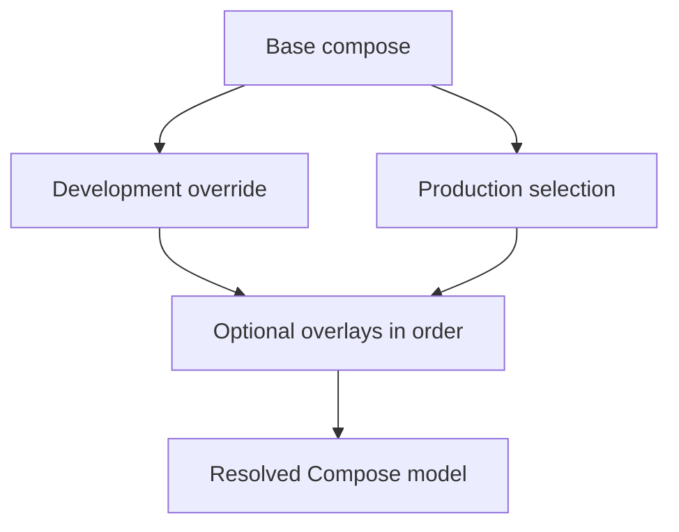

# Docker Compose

StarterKit composes the runtime from a base file and optional overlays, with a separate standalone file for disposable load tests.

## At a glance

| File | Role | Services |
|---|---|---|
| `docker-compose.yml` | **Base / production core** | `postgres`, `pgbackrest`, `redis`, `seq`, `migrator`, `api` (image from GHCR), Docker secrets, networks `backend`/`database` |
| `docker-compose.override.yml` | **Dev** (merged automatically) | Dev ports and settings for postgres/redis/seq/api (builds `src/Api/Dockerfile`), `pgadmin`, `redis-commander`, `mailhog` |
| `docker-compose.observability.yml` | Observability overlay | `otel-collector`, `prometheus`, `grafana`, `tempo`, `loki`, `node-exporter`, `cadvisor`, `postgres-exporter`, `redis-exporter`, `jaeger` (`--profile jaeger`) |
| `docker-compose.override.observability.yml` | Dev tweaks for the overlay | Dev ports; enables Jaeger without the profile |
| `docker-compose.observability-lite.yml` | Observability-lite overlay (use instead of the full one) | `prometheus` scraping the API `/metrics` + `grafana`; clears the OTLP endpoint; logs/traces stay in Seq ([Lite profile](Observability.md#lite-profile-prometheus--grafana-only)) |
| `docker-compose.override.observability-lite.yml` | Dev tweaks for the lite overlay | Ports on all interfaces, anonymous Grafana |
| `docker-compose.observability-lite-worker.yml` | Lite + worker combination | Clears the worker's OTLP endpoint (the worker `extends` the base `api`) |
| `docker-compose.rabbitmq.yml` | Messaging overlay | `rabbitmq` + switches the API and the migrator to `Messaging:Transport=RabbitMq` (needs `secrets/rabbitmq_password.txt`) |
| `docker-compose.rabbitmq-worker.yml` | Combination overlay | Required when `docker-compose.rabbitmq.yml` and `docker-compose.worker.yml` are both on: switches the worker to RabbitMQ too |
| `docker-compose.clamav.yml` | Malware-scanning overlay | `clamav` (clamd, ~1.5 GB RAM, healthy after 1-2 min) + turns on upload scanning with `RequireVirusScanning=true` ([details](../Attachment/Security.md#malware-scanning)) |
| `docker-compose.worker.yml` | Worker overlay | Moves `data-transfer` processing from `api` to `worker`; same image, no published worker ports. |
| `docker-compose.agents.yml` | AI agents overlay (optional) | Turns on the Agentic module with an OpenAI-compatible provider: secret `secrets/agentic_openai_api_key.txt`, `AGENTIC_MODEL_ID` (and `AGENTIC_ENDPOINT` for Azure OpenAI or a self-hosted server) in `.env` ([operations](Agentic-Operations.md)) |
| `docker-compose.apns.yml` | Direct iOS push | APNs key `secrets/apns_auth_key.p8`; API `Push:Apns:Enabled=true`, with `APNS_KEY_ID`, `APNS_TEAM_ID` and `APNS_BUNDLE_ID`. |
| `docker-compose.loadtest.yml` | Standalone load-test stack | PostgreSQL, Redis, API and profile-gated k6; never merge with the base file. |
| `docker-compose.dataprotection.yml` | Security overlay (**recommended in production**) | Encrypts the Data Protection key ring with `secrets/dataprotection_cert.pfx`; the API refuses to start without it |
| `docker-compose.push.yml` | Push overlay (optional) | Real push notifications through FCM with `secrets/fcm_service_account.json` (read by path); without it pushes are logged by the NoOp provider ([guide](../Modules/Notification-Realtime-and-Push.md#fcm--apns-setup)) |

## How it works

Combine the inventory above with repeated `-f` flags. Without `-f`, Compose automatically merges
`docker-compose.yml` and `docker-compose.override.yml` for development. With explicit file selection,
include every required development/combination overlay yourself.


*Figure: Explicit file order selects the runtime model; the load-test file is independent.*

## Usage

```bash
# Development (base + override, merged automatically). Fill .env from .env.example first.
docker compose up -d
docker compose logs -f api

# Development + observability
docker compose -f docker-compose.yml -f docker-compose.override.yml \
  -f docker-compose.observability.yml -f docker-compose.override.observability.yml up -d

# Development + observability-lite (Prometheus + Grafana; or: make obs-lite-up)
docker compose -f docker-compose.yml -f docker-compose.override.yml   -f docker-compose.observability-lite.yml -f docker-compose.override.observability-lite.yml up -d

# Production core (server: run in DEPLOY_DIR with .env.prod)
docker compose -f docker-compose.yml --env-file .env.prod up -d

# Production + recommended overlays
docker compose -f docker-compose.yml -f docker-compose.dataprotection.yml -f docker-compose.clamav.yml \
  -f docker-compose.observability.yml --env-file .env.prod up -d

# Durable messaging with RabbitMQ (alternative: Messaging:Transport=PostgreSql, no extra service)
docker compose -f docker-compose.yml -f docker-compose.rabbitmq.yml --env-file .env.prod up -d
docker compose -f docker-compose.yml -f docker-compose.clamav.yml --env-file .env.prod up -d   # + ClamAV upload scanning
```

`make help` lists shortcuts (`make dev`, `make logs-api`, `make obs-lite-up`, ...).

## Ports

Host ports come from `.env`; the compose fallback is used when a variable is unset. `.env.example` deliberately
offsets PostgreSQL, Redis and Seq in development so they don't clash with locally installed services. Never use 8888
for the API: the OTel collector publishes it.

| Service | `.env.example` | Compose fallback |
|---|---|---|
| API (`/health`, `/alive`; Swagger/Scalar enabled in dev) | `API_PORT=5000` | 5000 |
| PostgreSQL | `POSTGRES_PORT=5433` | 5432 |
| Redis | `REDIS_PORT=6380` | 6379 |
| Seq | `SEQ_PORT=5342` | 5341 |
| pgAdmin | `PGADMIN_PORT=5050` | 5050 |
| Redis Commander | `REDIS_COMMANDER_PORT=8081` | 8081 |
| Mailhog UI / SMTP | `MAILHOG_UI_PORT=8025` / `MAILHOG_SMTP_PORT=1025` | 8025 / 1025 |
| Grafana / Prometheus / Jaeger | full overlay: 3000 / 9090 / 16686; lite uses `GRAFANA_PORT` / `PROMETHEUS_PORT` | |

The base file publishes the API, PostgreSQL, Redis and Seq on `BIND_ADDRESS` (default `127.0.0.1`). Docker's port
publishing bypasses the host firewall (UFW), so binding to all interfaces would expose the database and Redis to the
internet; the host Nginx reaches the API on loopback, and administrators reach the rest through an SSH tunnel
(`ssh -L 5432:127.0.0.1:5432 deploy@YOUR_SERVER_IP`). Set `BIND_ADDRESS` only for a private network you trust. The
lite telemetry overlay also binds to loopback; the full overlay publishes on all interfaces, so restrict it before
using it on a public host. The dev-only tools (pgAdmin, Redis Commander, Mailhog) publish on all interfaces.

The base file builds the PostgreSQL image locally from `infra/postgres` (`postgres:16-alpine` plus pgBackRest) for the
`postgres` and `pgbackrest` services; deploys run `docker compose build postgres` before starting them
([Backups](Backups.md)).

## Configuration

| Key | Base default | Meaning |
|---|---|---|
| `DOCKER_IMAGE` / `DOCKER_IMAGE_TAG` | Required interpolation | Shared API/migrator image and version |
| `ASPNETCORE_ENVIRONMENT` | Literal `Docker` in the service | Loads Docker application settings; not interpolated from `.env.prod` |
| `MESSAGING_TRANSPORT` | `PostgreSql` | Durable transport; RabbitMQ overlay overrides it |
| `API_PORT` | `5000` | API host publication; internal listener stays 80 |
| `BIND_ADDRESS` | `127.0.0.1` | Host address the API, PostgreSQL, Redis and Seq ports are published on |
| `COMPOSE_PROJECT_NAME` | `starterkit` for explicit resource names | Container/network/volume prefix |

- Non-secret settings come from `.env` (dev) or `.env.prod` (server). The templates are `.env.example` and
  `deployment/.env.production.example`.
- Secrets are Docker secrets from `./secrets/*.txt`, mounted at `/run/secrets/`. See [Secrets.md](Secrets.md).
- `MESSAGING_TRANSPORT` defaults to `PostgreSql`. `InMemory` is not durable and the API **refuses to boot** with it
  outside Development, Testing, Test and E2E (`ProductionConfigurationGuard`). Use the RabbitMQ overlay for a broker.
- The base file has a one-shot `migrator` service (same image, `--migrate-only`); `api` waits for it with
  `service_completed_successfully`. See [Database-Migrations.md](Database-Migrations.md).
- The `api` container healthcheck probes `/alive` (liveness). Deploy gates call `/health` for readiness. An exited-successfully migrator is expected, not an unhealthy service.

### Combination constraints

Compose 2.24+ is required for `!reset`. The base API and worker both have fixed container names; `--scale`
requires removing that constraint in the deployment configuration, and API replicas also need distinct published
ports and matching Nginx upstreams. `API_REPLICAS` is not read by the base file.

The worker uses `extends` from the base API, so API overlays do not automatically reach it. Add the RabbitMQ-worker
companion when combining worker and RabbitMQ, and the lite-worker companion for lite telemetry. Push, APNs,
Data Protection and scanner settings must also be evaluated for worker needs; their shipped overlays target API.
Direct APNs routes native iOS APNs tokens through Apple while other tokens use the configured FCM/NoOp fallback; it can coexist with the FCM overlay.

The Makefile still contains older shortcuts that reference a missing `docker-compose.prod.yml` or a missing
`nginx` service. Use the explicit combinations here; `make nginx-dev` does not create a container absent from
the Compose model. `infra/nginx/` supplies configuration artifacts, not a selected service.

## Failure modes and guarantees

| Problem | Fix |
|---|---|
| Port already in use | Change the `*_PORT` value in `.env` |
| API unhealthy at start | `docker compose logs api`, then check the connection string, migrations and missing secrets (`[secrets]` lines) |
| PostgreSQL password mismatch after changing the secret | The volume keeps the old password. Change it in SQL, or drop the volume (destroys data). See [../Reference/Troubleshooting-PostgreSQL-Authentication.md](../Reference/Troubleshooting-PostgreSQL-Authentication.md). |
| Production run picks up dev settings | You forgot `-f docker-compose.yml` (without it the override is merged) |

## Guardrails

`ProductionConfigurationGuardTests` checks production transport/profile restrictions. Compose resolution, port exposure and overlay coverage require operational review.

## Related

[Observability.md](Observability.md) · [Nginx.md](Nginx.md) · [Production-Testing.md](Production-Testing.md) ·
[Deploy-to-VPS.md](Deploy-to-VPS.md) · [DataTransfer workers](../Modules/DataTransfer.md#running-the-workers) · `/starterkit:add-background-job`
