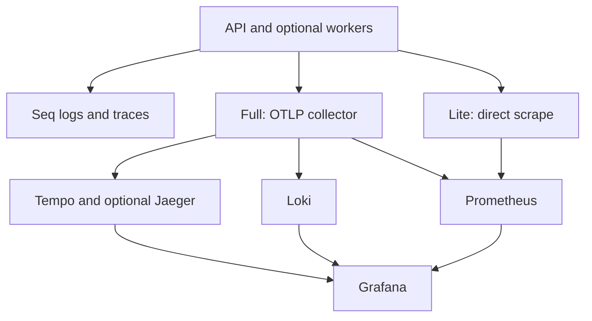

# Operate observability

Compose provides full and lite telemetry stacks for diagnosing releases, evaluating alerts and inspecting application signals.

## At a glance

| Selection | Metrics | Logs / traces | Resource limits |
|---|---|---|---|
| Base | API `/metrics` exporter available | Seq via `ConnectionStrings:seq` | Base service limits |
| Full `docker-compose.observability.yml` | Collector export/scrape and remote write to Prometheus | Loki, Tempo, optional Jaeger, plus Seq | About 5 GB across declared telemetry containers |
| Lite `docker-compose.observability-lite.yml` | Prometheus scrapes API/worker directly | Seq | Prometheus 512 MB + Grafana 256 MB limits |

These are limits, not measured reservations or a capacity guarantee. Application instrumentation, meter names,
health semantics and exporter selection are canonical in [developer observability](../Architecture/Observability.md).

## How it works


*Figure: Full and lite are alternative deployments; lite keeps logs and traces in Seq and scrapes application metrics directly.*

### Full stack

The collector receives OTLP gRPC on 4317 and HTTP on 4318, batches signals and exports traces to Tempo/Jaeger,
logs to Loki's OTLP endpoint, and metrics both to its Prometheus exporter on 8889 and Prometheus remote write.
Collector self metrics are on 8888, health on 13133, profiling on 1888; zpages is configured internally on 55679
but not published by the full Compose file. The current processor list is `batch`, not a configured memory
limiter or tail sampler. Review duplicate metric ingestion when remote write and scraping are both enabled.

`infra/observability/configs/prometheus.yaml` actively scrapes collector 8888/8889 and Prometheus itself:
global interval five seconds, collector ten seconds. Node Exporter, cAdvisor, PostgreSQL exporter and Redis
exporter containers are declared, but their jobs are not active in this scrape configuration. Starting an exporter
does not prove its metrics are collected. The PostgreSQL exporter is only on `backend`, while PostgreSQL is on
`database`; its reachability needs review as well as credentials.

Tempo's configured block retention is **one hour** for demonstration. Loki's schema index period of 24 hours is
not a seven-day retention policy. Review storage and retention before operating either as a production archive.
Jaeger is gated by `--profile jaeger`; the dev observability override enables it without that profile. The
collector still has a Jaeger destination when that service is absent, so inspect exporter failures. There is no
Zipkin service/exporter in this stack.

### Lite profile (Prometheus + Grafana only)

Lite uses `prometheus-lite.yaml` DNS service discovery for `api` and `worker` on the backend network and
scrapes each discovered listener's `/metrics`. It clears `OTEL_EXPORTER_OTLP_ENDPOINT` on API/migrator to avoid
exporting to an absent collector. Add `docker-compose.observability-lite-worker.yml` with the worker overlay to
clear its endpoint too; the worker extends the base API rather than the final overlaid API.

Lite provisions only Prometheus with uid `prometheus-uid`. It shares Prometheus/Grafana volume names with full:
select one overlay at a time. Container-name and port constraints still apply when configuring replicas; DNS
discovery support alone does not make the shipped API/worker services scalable.

### Dashboards and correlation

Full Grafana provisioning declares Prometheus, Tempo, Loki and Jaeger data sources; lite declares Prometheus only.
The dashboard provider watches `/var/lib/grafana/dashboards` in folder `StarterKit`, refreshes every ten seconds
and allows UI updates. The repository currently contains no dashboard JSON files in its dashboards directory.
Do not expect a prebuilt API dashboard: provision reviewed dashboards or use Explore, preserving
`prometheus-uid` for metrics panels shared between profiles.

Loki has a derived field linking a matching trace id to Tempo; Tempo has a Prometheus service-map reference.
These declarations are not proof that logs match the extraction expression or service-graph metrics are present.
Start investigations from a response trace id in Seq; use actual exported series/labels in Explore rather than
generic `http_requests_total` examples. Outbox series used by the shipped alerts are listed below.

### Prometheus alerts

Both profiles load `infra/observability/configs/alerts.yaml`. No Alertmanager is included: inspect Prometheus
`/alerts` and configure notification delivery separately if someone must be paged.

| Rule | Severity / hold | Trigger and response |
|---|---|---|
| `OutboxDeadLetters` | critical / 5m | Dead-letter gauge > 0 by context; inspect/fix/requeue outbox rows |
| `OutboxBacklogGrowing` | warning / 15m | Pending > 10 and positive 15-minute slope; check sweep and bus |
| `OutboxMetricsMissing` | warning / 5m | Both gauges absent for 15m; inspect sweep and telemetry pipeline |
| `MessageConsumerFaults` | critical / 1m | Receive errors increased in 15m; inspect endpoint error queues after retries |
| `PushDeliveryFailing` | warning / 10m | Transient/rejected device sends > 20%, with > 20 sends in 15m |
| `PushRejectedByProvider` | warning / 15m | More than ten rejected device sends in 30m; inspect provider credentials/payload |
| `RealtimeSendErrors` | warning / 10m | More than five failed real-time sends in 10m; inspect Redis/backplane |
| `AgentRunFailureRateHigh` | warning / 15m | Over 25% of finished agent runs failed in 30m, with more than ten runs |
| `AgentModelUnavailable` | critical / 5m | More than two runs of one agent gave up on the model provider in 15m |
| `AgentToolOutcomeUnknown` | warning / 0m | A non-idempotent tool was interrupted: a person must check the record |
| `AgentRunsStalling` | warning / 10m | The sweep queued more than five stalled runs again in 30m |
| `AgentRunQueueBacklog` | warning / 10m | A queued run waited over 10 minutes for an `agentic` worker |
| `AgentApprovalBacklog` | warning / 30m | A proposed action has waited over a day for a decision |

Outbox success means publication, not consumer success. See [messaging operations](../Architecture/Messaging.md#operations),
[notification operations](../Modules/Notification-Realtime-and-Push.md#operations) and
[agent operations](Agentic-Operations.md). Missing/no-traffic series
can leave ratio alerts inactive; absence of a firing rule is not evidence of delivery.

## Configuration

| Source/key | Default | Meaning |
|---|---|---|
| `PROMETHEUS_RETENTION` | `30d` | Compose TSDB retention |
| `GRAFANA_ADMIN_USER` | `admin` | Initial Grafana user |
| `GRAFANA_ADMIN_PASSWORD` | Supplied by environment | Required deployment credential; no assumed admin/admin pair |
| `GRAFANA_ROOT_URL` | `http://localhost:3000` | Set to actual URL, including reverse-proxy subpath |
| `PROMETHEUS_PORT` / `GRAFANA_PORT` | 9090 / 3000 in lite | Lite loopback publications; full uses literal ports |
| `OTEL_EXPORTER_OTLP_ENDPOINT` | Base targets collector 4317 | Standard application destination; cleared by lite |

Full Compose publishes telemetry ports on all interfaces: Grafana 3000, Prometheus 9090, Jaeger 16686,
Tempo 3200/9095, Loki 3100, Node Exporter 9100, cAdvisor 8080, PostgreSQL exporter 9187 and Redis exporter 9121,
plus collector ports above. Lite binds its UI ports to loopback; its dev override broadens access and enables
anonymous Grafana. Review exposure, TLS, authentication and telemetry access before deploying.

## Usage

```bash
# Full, including the collector's Jaeger destination
docker compose -f docker-compose.yml -f docker-compose.observability.yml --profile jaeger --env-file .env.prod up -d

# Lite production
docker compose -f docker-compose.yml -f docker-compose.observability-lite.yml --env-file .env.prod up -d

# Lite development (base + dev overrides)
make obs-lite-up
make obs-lite-down
```

For full development include `docker-compose.override.yml` and `docker-compose.override.observability.yml`
explicitly. For worker/lite combinations see [Compose](Docker-Compose.md). The same optional full stack is
available in [Aspire](../Infrastructure/Aspire.md) through `Observability:FullStack=true`.

Inspect collector logs and health, Prometheus `/targets` and `/alerts`, and Grafana data-source status after
generating traffic. For missing metrics, trace the selected path (application exporter → collector or direct
scrape → Prometheus) before editing dashboards. Check actual meter subscriptions: the current host does not
subscribe to the DataTransfer meter, as documented in [custom metrics](../Architecture/Observability.md#custom-metrics).

## Failure modes and guarantees

Exporter retries can lose telemetry; these signals are not transactional audit records. Seq failure does not
fail API readiness. Keep retention/resource settings explicit, monitor collector self metrics and scrape health,
and control signal cardinality. Compression, sampling, collector memory limiting, OTLP TLS and remote storage
are deployment decisions, not all enabled features of the shipped configuration.

## Guardrails

`OtlpExporterPlanTests`, `ObservabilityRegistrationTests` and `RequestTelemetryBehaviorTests` cover application
registration. `AppHostModelTests` covers Aspire configuration. None validates Compose collector compatibility,
dashboards, exporter reachability, retention or alert notification delivery; verify those in the selected runtime.

## Related

[Developer observability](../Architecture/Observability.md), [Seq security](Seq-Security.md), [Nginx](Nginx.md),
[Redis](../Infrastructure/Redis.md), [DataTransfer](../Modules/DataTransfer.md), and `/starterkit:add-background-job`.
