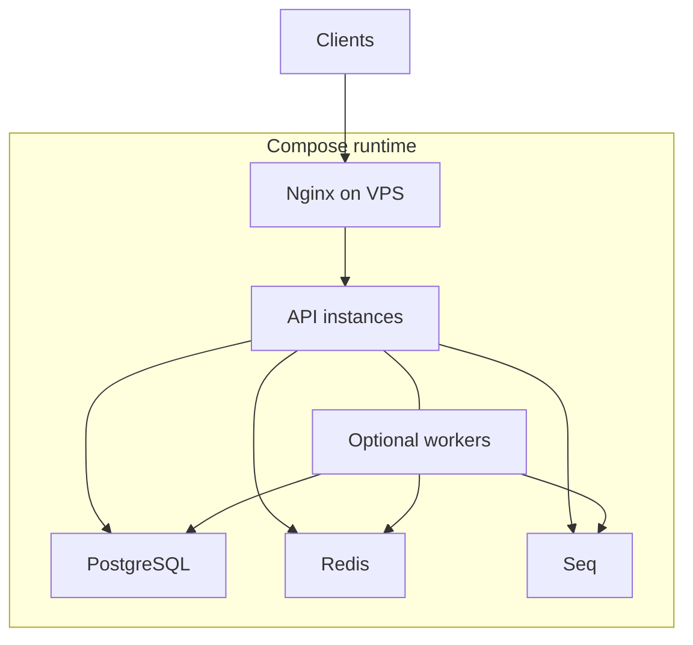

# Deployment and operations

StarterKit deploys the API and supporting services with Docker Compose behind host Nginx, with deployment approval and database migration separated from runtime startup.

## At a glance

| Responsibility | Source / entry point |
|---|---|
| Image build and release | `.github/workflows/hybrid-ci-cd.yml`, GHCR |
| Runtime topology | `docker-compose.yml` and optional overlays |
| Ingress | `deployment/nginx/` on the VPS host |
| Database changes | Same image, `--migrate-only`, before API replacement |
| Operations | `deployment/`, `.github/workflows/`, `infra/observability/` |

## How it works

*Figure: API and optional worker instances share infrastructure; the shipped ingress targets one API listener.*

The same image can serve HTTP and Hangfire work or isolate the `data-transfer` queue with the worker overlay.
The base file fixes `container_name` and publishes one `API_PORT`; `API_REPLICAS` does not configure replicas.
The host upstream contains only `localhost:5000`. Multiple API replicas require a deliberate port/name/upstream
configuration; neither the Compose rolling-update stanza nor the deploy step's name guarantees zero downtime.
See [Compose](Docker-Compose.md) and [Nginx](Nginx.md).

### Release flow

`hybrid-ci-cd.yml` builds/tests on hosted runners, builds a GHCR image for master or manual releases, then runs
`deploy` on `[self-hosted, deploy-only]` in the `production` environment. Required reviewers must be configured
in GitHub for approval to block deployment. The deploy takes a logical backup, pulls both API and migrator,
runs migrations before replacing an existing API, starts supporting services and verifies readiness and liveness.
The first deployment relies on Compose dependencies. Details and rollback limits are in [CI/CD](CI-CD.md).

## Configuration

Use `.env.example` for development and `deployment/.env.production.example` as the starting inventory for
`.env.prod`. Inspect the resolved Compose configuration: an environment-file variable has no effect unless
the selected files interpolate it. Application passwords normally come from `./secrets/*.txt`.

## Usage

| Page | Operational task |
|---|---|
| [Deploy to a VPS](Deploy-to-VPS.md) | Provision DNS, ingress, TLS and the first deployment |
| [Docker Compose](Docker-Compose.md) | Choose every base file, overlay and combination |
| [CI/CD](CI-CD.md) | Configure approval, workflows and release variables |
| [Self-hosted runner](Self-Hosted-Runner.md) | Install and maintain the deploy runner |
| [Secrets](Secrets.md) | Create, mount and rotate credentials |
| [Database migrations](Database-Migrations.md) | Apply shared/dedicated migrations with separate privileges |
| [Backups](Backups.md) | Inspect scheduled backups and plan recovery |
| [Nginx](Nginx.md) | Configure TLS, proxying, limits and protected tools |
| [Observability](Observability.md) | Select full or lite telemetry and operate alerts |
| [Seq security](Seq-Security.md) | Configure first-run authentication and restrict ingress |
| [Production testing](Production-Testing.md) | Exercise the production configuration locally |

`deployment/deploy.sh`, `rollback.sh`, `pre-deploy-backup.sh`, `secrets-setup.sh`, `secure-seq.sh`,
`deployment/scripts/` and `deployment/postgres/scripts/` contain the operational helpers. Read the relevant
runbook before executing one: the image rollback helper and physical restore wiring have known mismatches.

## Failure modes and guarantees

Migration failure blocks a new API start. A successful `/alive` says the process is alive; `/health` evaluates
registered readiness dependencies. Neither proves backup recoverability, dedicated database availability or
external-provider delivery. Existing volumes preserve passwords and Seq users across recreation.

### Production checklist

- DNS points to `YOUR_SERVER_IP`; restrict SSH and expose only intended HTTP/TLS ingress.
- Replace placeholders, protect secret files, use durable messaging and encrypted Data Protection keys.
- Review published Docker ports explicitly; base and full telemetry mappings are not loopback-only.
- Issue TLS, test renewal and security headers, and restrict administrative tools.
- Complete a backup and restore rehearsal, including dedicated tenant databases and off-database secrets.
- Configure required reviewers, verify the runner, and check `/health` and `/alive` through Nginx.

## Guardrails

`ProductionConfigurationGuardTests`, `MigrationLockTests`, `PendingModelChangesTests` and
`TenantRowLevelSecurityCoverageTests` cover application configuration and database assumptions. They do not
certify server firewall rules, TLS, backup tooling or uninterrupted replacement.

## Related

[Database conventions](../Architecture/DatabaseConventions.md), [developer observability](../Architecture/Observability.md),
[DataTransfer workers](../Modules/DataTransfer.md#running-the-workers), and
[`/starterkit:update-docs`](../../tools/claude/starterkit-plugin/skills/update-docs/SKILL.md).
