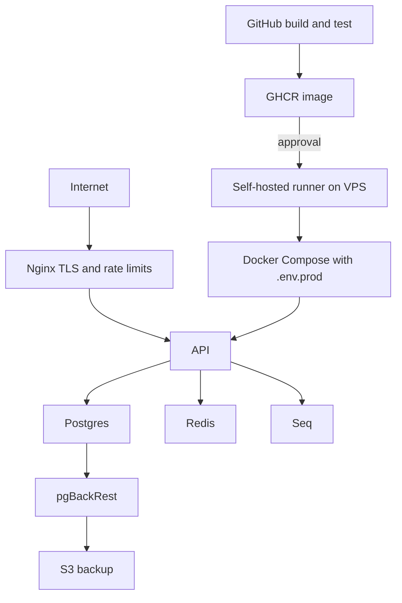

# Deployment and operations

StarterKit runs as one Docker Compose stack on a VPS behind host Nginx with Let's Encrypt. GitHub Actions builds and
tests, pushes the image to GHCR, and deploys after manual approval through a self-hosted runner on the server.

*Figure: Approved images run behind Nginx with database backup and supporting services.*

| Page | Use it when you need to |
|---|---|
| [Deploy-to-VPS.md](Deploy-to-VPS.md) | Provision a server: DNS, Nginx, Docker, TLS, first start, routine operations |
| [CI-CD.md](CI-CD.md) | Understand or change the workflows; set up the GitHub environment, variables and secrets |
| [Self-Hosted-Runner.md](Self-Hosted-Runner.md) | Install, run and maintain the `deploy-only` runner |
| [Secrets.md](Secrets.md) | Create, mount and rotate secrets (Docker secrets → configuration mapping) |
| [Backups.md](Backups.md) | Run pgBackRest backups to S3, restore, practise recovery |
| [Docker-Compose.md](Docker-Compose.md) | See which compose files exist, how to combine them, and the ports |
| [Nginx.md](Nginx.md) | Reverse proxy, TLS, rate limiting and admin IP allow-lists (`deployment/nginx/`) |
| [Observability.md](Observability.md) | Run the Grafana / Prometheus / Tempo / Loki / Jaeger stack |
| [Seq-Security.md](Seq-Security.md) | Lock down Seq (authentication, network exposure) |
| [Production-Testing.md](Production-Testing.md) | Run the production stack locally before a release |

Scripts are in `deployment/`:
- `deploy.sh`: zero-downtime deploy
- `rollback.sh`
- `pre-deploy-backup.sh`
- `secrets-setup.sh`
- `secure-seq.sh`
- `scripts/`: `backup-db`, `restore-db`, `health-check`
- `postgres/scripts/`: pgBackRest helpers

## Production checklist

- [ ] DNS A record points to `YOUR_SERVER_IP`; the firewall allows only 22 (restricted), 80 and 443.
- [ ] `.env.prod` is complete, with no `CHANGE_ME`; `secrets/*.txt` exist with mode 600.
- [ ] `Messaging:Transport` is `PostgreSql` or `RabbitMq`, never `InMemory`.
- [ ] The `docker-compose.dataprotection.yml` overlay is enabled, and the PFX is backed up.
- [ ] TLS is issued, auto-renewal is tested, and SSL Labs gives grade A or better.
- [ ] Swagger, Scalar, Seq, Hangfire and Grafana are IP-restricted or authenticated.
- [ ] The pgBackRest stanza is initialised, the first full backup succeeded, and a restore has been tested.
- [ ] The `production` environment has required reviewers; the runner is online.
- [ ] `/health` and `/alive` return 200 through Nginx; health monitoring is enabled.
