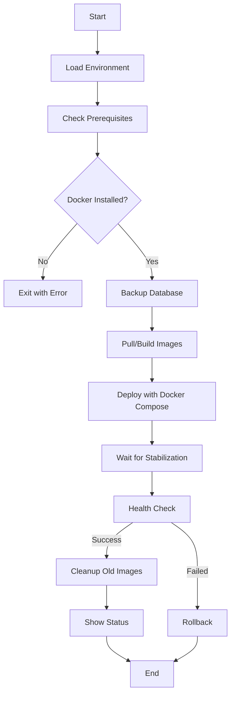

# 🚀 VPS Deployment Guide for StarterKit

**Senior Perspective Guide**: What you need to know about deploying StarterKit to a VPS

---

## 📋 Table of Contents

1. [Overview](#overview)
2. [What Gets Deployed to VPS](#what-gets-deployed-to-vps)
3. [Deployment Architecture](#deployment-architecture)
4. [Step-by-Step Deployment](#step-by-step-deployment)
5. [Using Makefile Commands](#using-makefile-commands)
6. [Understanding deploy.sh](#understanding-deploysh)
7. [Do's and Don'ts](#dos-and-donts)
8. [Troubleshooting](#troubleshooting)

---

## Overview

### What is This?

StarterKit is a **Dockerized modular monolith** application that deploys to a VPS using:
- **Docker Compose** for orchestration
- **Nginx on host** for reverse proxy (not in Docker)
- **Automated deployment scripts** for zero-downtime updates

### Key Decisions Made

✅ **Hybrid Architecture**: Nginx runs on VPS host, app runs in Docker  
✅ **Docker Compose** (not Kubernetes) for simplicity  
✅ **Manual VPS** (not PaaS) for cost and control  
✅ **Rolling updates** for zero-downtime deployments

---

## What Gets Deployed to VPS

### Files You Transfer

```
/opt/starterkit/                    # Application root on VPS
├── docker-compose.yml           # ✅ YES - Main compose file
├── docker-compose.override.yml  # ❌ NO - Only for local dev
├── .env.production              # ✅ YES - Production env vars (you create on VPS)
├── deployment/                  # ✅ YES - All deployment scripts
│   ├── deploy.sh                # Main deployment automation
│   ├── rollback.sh              # Emergency rollback
│   ├── pre-deploy-backup.sh     # Backup before deploy
│   ├── secrets-setup.sh         # Setup secrets
│   ├── nginx/                   # Nginx configs
│   └── scripts/                 # Helper scripts
├── src/                         # ✅ YES - Application source code
├── Makefile                     # ✅ YES - Command shortcuts
└── README.md                    # ✅ YES - Documentation
```

### What NOT to Transfer

```
❌ bin/                          # Build artifacts (regenerated)
❌ obj/                          # Build cache
❌ .git/                         # Git history (clone instead)
❌ postgres/                     # Local DB data
❌ redis/                        # Local cache data
❌ .env                          # Local dev environment
❌ docker-compose.override.yml   # Local dev overrides
```

---

## Deployment Architecture

### Hybrid Setup Explained

```
Internet
   ↓
[VPS Host - Ubuntu 22.04]
   ↓
[Nginx on Host :80/:443] ← Reverse proxy, SSL termination
   ↓
[Docker Network: backend]
   ↓
   ├─ [API Container :5000] ← .NET 9 Web API
   ├─ [API Container :5001] ← Second instance (load balanced)
   ├─ [PostgreSQL :5432]    ← Database (internal only)
   ├─ [Redis :6379]         ← Cache (internal only)
   ├─ [Seq :5341]           ← Logs (internal only)
   └─ [Grafana :3000]       ← Monitoring (internal only)
```

### Why This Architecture?

| Decision | Reason |
|----------|--------|
| **Nginx on host** | Better SSL management, systemd integration, native performance |
| **App in Docker** | Easy updates, isolation, resource control, portability |
| **Docker Compose** | Simpler than K8s for single-server, easier to maintain |
| **Internal networks** | Security - DB/Cache not exposed to internet |
| **2 API instances** | Zero-downtime rolling updates, load balancing |

---

## Step-by-Step Deployment

### Phase 1: Prepare Your VPS

#### 1.1 Provision VPS (AWS EC2, DigitalOcean, etc.)

**Minimum Requirements**:
- **Instance**: 2 vCPU, 4GB RAM (e.g., AWS t3.medium)
- **OS**: Ubuntu 22.04 LTS
- **Storage**: 30GB SSD
- **Firewall**: Ports 22 (SSH), 80 (HTTP), 443 (HTTPS) open

#### 1.2 Initial Server Setup

```bash
# Connect to VPS
ssh ubuntu@YOUR_VPS_IP

# Update system
sudo apt update && sudo apt upgrade -y

# Set hostname
sudo hostnamectl set-hostname starterkit-production

# Configure swap (for 4GB RAM instance)
sudo fallocate -l 2G /swapfile
sudo chmod 600 /swapfile
sudo mkswap /swapfile
sudo swapon /swapfile
echo '/swapfile none swap sw 0 0' | sudo tee -a /etc/fstab

# Enable firewall
sudo ufw allow 22/tcp
sudo ufw allow 80/tcp
sudo ufw allow 443/tcp
sudo ufw --force enable
```

#### 1.3 Use Makefile for Automated Setup

**From your local machine**:

```bash
# Set your VPS IP
export VPS_IP=3.15.123.45

# Run automated VPS setup
make vps-setup
```

This installs:
- Docker & Docker Compose
- Nginx
- Creates `/opt/starterkit` directory

**Then reconnect** to apply Docker group:
```bash
ssh ubuntu@$VPS_IP
exit  # Logout and login again
```

---

### Phase 2: Configure Environment

#### 2.1 Create Production Environment File

```bash
# SSH into VPS
ssh ubuntu@$VPS_IP

# Navigate to app directory
cd /opt/starterkit

# Copy example environment file
cp deployment/.env.production.example .env.production

# Edit with production values
nano .env.production
```

#### 2.2 Critical Environment Variables

**Required Changes** (replace `<CHANGE_ME>`):

```bash
# Database
POSTGRES_USER=starterkit_user
POSTGRES_PASSWORD=<STRONG_PASSWORD_32_CHARS>  # Generate: openssl rand -base64 32
POSTGRES_DB=starterkit

# Redis
REDIS_PASSWORD=<STRONG_PASSWORD_32_CHARS>

# Security
JWT_SECRET_KEY=<STRONG_SECRET_64_CHARS>       # Minimum 32 characters

# Environment
ASPNETCORE_ENVIRONMENT=Production
COMPOSE_PROJECT_NAME=starterkit

# Monitoring (optional, change from defaults)
GRAFANA_ADMIN_PASSWORD=<STRONG_PASSWORD>
```

**Store passwords securely** (1Password, AWS Secrets Manager, etc.)

#### 2.3 Verify Configuration

```bash
# Check .env file exists
ls -la .env.production

# Secure permissions
chmod 600 .env.production
```

---

### Phase 3: Deploy Application

#### Option A: Deploy from Local Machine (Recommended)

**Use Makefile** for automated deployment:

```bash
# From your local machine, set VPS IP
export VPS_IP=3.15.123.45

# Deploy everything
make deploy-vps

# Or with SSH key
VPS_IP=3.15.123.45 SSH_KEY=~/.ssh/starterkit.pem make deploy-vps-with-key
```

**What this does**:
1. Syncs code to VPS (rsync)
2. Runs `deployment/deploy.sh` remotely
3. Builds Docker images
4. Starts containers
5. Runs health checks

#### Option B: Deploy Directly on VPS

```bash
# SSH to VPS
ssh ubuntu@$VPS_IP

# Navigate to app directory
cd /opt/starterkit

# Run deployment script
chmod +x deployment/deploy.sh
./deployment/deploy.sh
```

**What deploy.sh does** (see [Understanding deploy.sh](#understanding-deploysh)):
- ✅ Checks prerequisites
- ✅ Creates database backup
- ✅ Pulls Docker images (if from registry) or builds them
- ✅ Starts services with Docker Compose
- ✅ Waits for containers to stabilize
- ✅ Runs health checks
- ✅ Cleans up old images
- ✅ Auto-rollback on failure

---

### Phase 4: Configure Nginx

#### 4.1 Setup Nginx (Automated)

```bash
# From local machine
make vps-nginx-setup VPS_IP=3.15.123.45

# Or manually on VPS
ssh ubuntu@$VPS_IP
cd /opt/starterkit

# Copy Nginx configurations
sudo cp deployment/nginx/nginx.conf /etc/nginx/nginx.conf
sudo cp deployment/nginx/conf.d/app-production.conf /etc/nginx/sites-available/starterkit

# Enable site
sudo ln -sf /etc/nginx/sites-available/starterkit /etc/nginx/sites-enabled/
sudo rm -f /etc/nginx/sites-enabled/default

# Test configuration
sudo nginx -t

# Restart Nginx
sudo systemctl restart nginx
sudo systemctl enable nginx
```

#### 4.2 Verify HTTP Access

```bash
# From local machine
curl http://YOUR_VPS_IP/health

# Expected response:
{"status":"Healthy"}
```

---

### Phase 5: Setup SSL (Optional but Recommended)

#### 5.1 Using Makefile (After DNS Points to VPS)

```bash
# From local machine
VPS_IP=3.15.123.45 DOMAIN=api.example.com make vps-ssl
```

#### 5.2 Manual SSL Setup

```bash
# SSH to VPS
ssh ubuntu@$VPS_IP

# Install Certbot
sudo apt install -y certbot python3-certbot-nginx

# Obtain certificate (interactive)
sudo certbot --nginx -d yourdomain.com

# Test auto-renewal
sudo certbot renew --dry-run
```

**Certbot automatically**:
- Obtains SSL certificate from Let's Encrypt
- Configures Nginx for HTTPS
- Sets up auto-renewal (every 60 days)

#### 5.3 Verify HTTPS

```bash
curl https://yourdomain.com/health
```

---

## Using Makefile Commands

### Development Commands (Local)

```bash
make help          # Show all commands
make build         # Build images
make up            # Start services
make down          # Stop services
make logs          # View logs
make health        # Check health
```

### VPS Deployment Commands (Remote)

```bash
# One-time setup
VPS_IP=x.x.x.x make vps-setup        # Initial VPS configuration

# Deployment
VPS_IP=x.x.x.x make deploy-vps       # Deploy code to VPS
VPS_IP=x.x.x.x make vps-nginx-setup  # Configure Nginx
VPS_IP=x.x.x.x DOMAIN=example.com make vps-ssl  # Setup SSL

# Operations
VPS_IP=x.x.x.x make vps-status       # Check services
VPS_IP=x.x.x.x make vps-logs         # View logs
VPS_IP=x.x.x.x make vps-restart      # Restart services
VPS_IP=x.x.x.x make vps-backup       # Backup database
VPS_IP=x.x.x.x make vps-shell        # SSH to VPS
```

### Environment Variables

```bash
# Set in shell or add to ~/.bashrc
export VPS_IP=3.15.123.45
export SSH_KEY=~/.ssh/starterkit-production.pem
export DOMAIN=api.example.com

# Then use shorter commands
make deploy-vps
make vps-status
```

---

## Understanding deploy.sh

### What is deploy.sh?

The **main deployment automation script** that orchestrates the entire deployment process.

**Location**: `deployment/deploy.sh`

### Script Flow



### Key Functions in deploy.sh

#### 1. `check_prerequisites()`
```bash
# Verifies:
- Docker installed
- Docker Compose installed
- docker-compose.yml exists
- .env file exists
```

#### 2. `backup()`
```bash
# Creates pre-deployment backup:
- Backs up .env file
- Dumps PostgreSQL database
- Compresses backup (gzip)
- Keeps last 10 backups only
```

#### 3. `pull_image()` or Build
```bash
# Option A: Pull from registry (CI/CD)
docker compose pull api

# Option B: Build locally (manual deploy)
docker compose build --no-cache
```

#### 4. `deploy()`
```bash
# Rolling update:
docker compose up -d --no-build --remove-orphans

# This:
- Starts new containers
- Waits for health checks
- Stops old containers
- Zero downtime
```

#### 5. `health_check()`
```bash
# Polls health endpoint:
curl -f http://localhost:5000/health

# Retries: 30 attempts, 2 seconds apart
# Total wait: 60 seconds max
```

#### 6. `cleanup()`
```bash
# Removes:
- Dangling images (docker image prune)
- Old images (keeps last 3 versions)
```

#### 7. `rollback()`
```bash
# On failure:
- Calls rollback.sh
- Restores previous version
- Restores database backup (if needed)
```

### Environment Variables Used

| Variable | Default | Purpose |
|----------|---------|---------|
| `PROJECT_DIR` | `/opt/starterkit` | App installation path |
| `BACKUP_DIR` | `/opt/starterkit/backups` | Backup storage |
| `COMPOSE_FILE` | `docker-compose.yml` | Main compose file |
| `IMAGE_TAG` | `latest` | Docker image version |
| `GITHUB_TOKEN` | - | For pulling from GHCR |

### Logs and Monitoring

```bash
# Deployment log location
/opt/starterkit/deployment.log

# View during deployment
tail -f /opt/starterkit/deployment.log

# Check last deployment
cat /opt/starterkit/deployment.log | tail -100
```

---

## Do's and Don'ts

### ✅ DO's

1. **DO use `.env.production` on VPS**
   - Never commit this file
   - Different from local `.env`
   - Contains production secrets

2. **DO backup before deploying**
   ```bash
   make vps-backup VPS_IP=x.x.x.x
   ```

3. **DO use strong passwords**
   ```bash
   # Generate secure password
   openssl rand -base64 32
   ```

4. **DO configure firewall**
   ```bash
   sudo ufw status
   # Only 22, 80, 443 should be open
   ```

5. **DO monitor after deployment**
   ```bash
   make vps-logs VPS_IP=x.x.x.x
   make vps-status VPS_IP=x.x.x.x
   ```

6. **DO use domain names for production**
   - Easier SSL setup
   - Better for APIs
   - Professional

7. **DO setup automated backups**
   ```bash
   # Add to crontab on VPS
   0 2 * * * /opt/starterkit/deployment/scripts/backup-db.sh auto
   ```

### ❌ DON'Ts

1. **DON'T transfer docker-compose.override.yml to VPS**
   - Contains local development settings
   - Port mappings for development tools
   - Can cause conflicts

2. **DON'T expose database ports externally**
   - Keep PostgreSQL internal (Docker network only)
   - Access via SSH tunnel if needed
   ```bash
   # Wrong in production
   ports:
     - "5432:5432"  # ❌ Don't do this

   # Correct
   # No ports section = internal only ✅
   ```

3. **DON'T use default passwords**
   ```bash
   # ❌ BAD
   POSTGRES_PASSWORD=postgres
   
   # ✅ GOOD
   POSTGRES_PASSWORD=CHANGE_ME_STRONG_PASSWORD
   ```

4. **DON'T skip health checks**
   - Always verify services after deployment
   - Check logs for errors
   ```bash
   ./deployment/scripts/health-check.sh
   ```

5. **DON'T deploy without testing**
   - Test locally first
   - Run `make build && make up`
   - Verify all features work

6. **DON'T ignore disk space**
   ```bash
   # Check regularly
   df -h
   docker system df
   
   # Clean if needed
   docker system prune -a
   ```

7. **DON'T forget to update Nginx after code changes**
   - If API routes change
   - If new features need proxy rules
   ```bash
   sudo nginx -t && sudo systemctl reload nginx
   ```

---

## Deployment Workflows

### Initial Deployment (First Time)

```bash
# 1. Setup VPS infrastructure
export VPS_IP=3.15.123.45
make vps-setup

# 2. Transfer code
make deploy-vps

# 3. Configure environment on VPS
ssh ubuntu@$VPS_IP
cd /opt/starterkit
cp deployment/.env.production.example .env.production
nano .env.production  # Edit secrets
exit

# 4. Deploy application
make deploy-vps

# 5. Setup Nginx
make vps-nginx-setup

# 6. Verify
make vps-status

# 7. Setup SSL (if domain ready)
DOMAIN=api.example.com make vps-ssl

# 8. Setup backups
ssh ubuntu@$VPS_IP
crontab -e
# Add: 0 2 * * * /opt/starterkit/deployment/scripts/backup-db.sh auto
```

### Update Deployment (Code Changes)

```bash
# 1. Commit changes locally
git add .
git commit -m "feat: new feature"
git push origin main

# 2. Deploy to VPS
make deploy-vps VPS_IP=x.x.x.x

# 3. Verify
make vps-status VPS_IP=x.x.x.x
curl http://YOUR_VPS_IP/health

# 4. Check logs if issues
make vps-logs VPS_IP=x.x.x.x
```

### Emergency Rollback

```bash
# If deployment fails, deploy.sh auto-rolls back
# Or manually:
ssh ubuntu@$VPS_IP
cd /opt/starterkit
./deployment/rollback.sh
```

---

## Troubleshooting

### Issue: "Connection refused" to VPS

```bash
# Check SSH
ssh -v ubuntu@$VPS_IP

# Check firewall
ssh ubuntu@$VPS_IP
sudo ufw status
```

### Issue: Docker containers not starting

```bash
# Check logs
make vps-logs VPS_IP=x.x.x.x

# Check resources
ssh ubuntu@$VPS_IP
docker stats
free -h
df -h
```

### Issue: Nginx 502 Bad Gateway

```bash
# Check if API containers running
ssh ubuntu@$VPS_IP
docker ps | grep api

# Check API health
curl http://localhost:5000/health
curl http://localhost:5001/health

# Check Nginx logs
sudo tail -f /var/log/nginx/error.log
```

### Issue: Database connection errors

```bash
# Check PostgreSQL container
docker ps | grep postgres

# Check database logs
docker logs starterkit-postgres

# Test connection
docker exec -it starterkit-postgres psql -U starterkit_user -d starterkit
```

### Issue: Out of memory

```bash
# Check memory usage
free -h
docker stats

# Restart heavy services
docker compose restart api api2

# Add swap if not configured (see Phase 1)
```

### Issue: Deployment fails during rsync

```bash
# Check SSH key permissions
chmod 400 ~/.ssh/starterkit-production.pem

# Check rsync is installed
which rsync

# Manual sync
rsync -avz --exclude 'bin/' --exclude 'obj/' \
  ./ ubuntu@$VPS_IP:/opt/starterkit/
```

---

## Best Practices for Production

### Security

1. **Use SSH keys** (not passwords)
2. **Change all default credentials**
3. **Enable UFW firewall**
4. **Setup fail2ban** (SSH brute force protection)
5. **Regular security updates**
   ```bash
   sudo apt update && sudo apt upgrade -y
   ```

### Monitoring

1. **Setup log aggregation** (Seq already included)
2. **Configure Grafana dashboards**
3. **Setup alerts** (disk space, memory, errors)
4. **Monitor Docker stats**
   ```bash
   docker stats --no-stream
   ```

### Backups

1. **Automated daily backups** (cron job)
2. **Test restores regularly**
3. **Offsite backup storage** (S3, etc.)
4. **Keep last 30 days minimum**

### Updates

1. **Staging environment** (test before prod)
2. **Maintenance windows** (communicate downtime)
3. **Rollback plan ready**
4. **Changelog tracking**

---

## Quick Reference

### Essential Commands

```bash
# Deploy
VPS_IP=x.x.x.x make deploy-vps

# Status
VPS_IP=x.x.x.x make vps-status

# Logs
VPS_IP=x.x.x.x make vps-logs

# Backup
VPS_IP=x.x.x.x make vps-backup

# Restart
VPS_IP=x.x.x.x make vps-restart

# SSH
VPS_IP=x.x.x.x make vps-shell
```

### Service URLs

```bash
# API
http://YOUR_VPS_IP/health
http://YOUR_VPS_IP/swagger

# Monitoring (internal, SSH tunnel)
ssh -L 3000:localhost:3000 ubuntu@$VPS_IP  # Grafana
ssh -L 5341:localhost:5341 ubuntu@$VPS_IP  # Seq
ssh -L 9090:localhost:9090 ubuntu@$VPS_IP  # Prometheus
```

### Important Paths

```bash
/opt/starterkit/                  # Application root
/opt/starterkit/.env.production   # Environment config
/opt/starterkit/deployment.log    # Deployment log
/backup/                       # Database backups
/etc/nginx/                    # Nginx config
/var/log/nginx/                # Nginx logs
```

---

## Summary for Seniors

### The Big Picture

1. **You DON'T need to manually transfer `docker-compose.yml`** - Makefile does it via rsync
2. **Nginx runs on VPS host**, not in Docker - better for SSL/performance
3. **Docker Compose orchestrates the app stack** - API, DB, Cache, Monitoring
4. **deploy.sh automates everything** - backup, deploy, health check, rollback
5. **Makefile provides shortcuts** - run from local machine, SSH handled for you

### Key Files

- `docker-compose.yml` - Core services definition
- `deployment/deploy.sh` - Main deployment automation
- `deployment/.env.production.example` - Template for production env
- `deployment/nginx/` - Nginx configs for VPS
- `Makefile` - Command shortcuts

### Deployment Flow

```
Local Machine → rsync → VPS → deploy.sh → Docker Compose → Running Containers
```

### Decision: Transfer vs Clone

**Option A: Transfer files** (Makefile `deploy-vps`)
- ✅ Simple, no Git on VPS needed
- ✅ Fast (rsync only changed files)
- ❌ No version history on VPS

**Option B: Clone repository** (manual)
- ✅ Version control on VPS
- ✅ Easy rollback (`git checkout`)
- ❌ Need Git credentials on VPS
- ❌ Manual sync process

**Recommendation**: Use **Makefile transfer** (Option A) for production, **Git clone** for staging/development VPS.

---

## Next Steps

1. **Review**: [Production-Deployment-Complete-Guide.md](./Production-Deployment-Complete-Guide.md)
2. **Checklist**: [DEPLOYMENT-CHECKLIST.md](../deployment/DEPLOYMENT-CHECKLIST.md)
3. **CI/CD**: [README.CICD.md](./README.CICD.md)
4. **Monitoring**: [README.Observability.md](./README.Observability.md)

---

**Questions? Check existing documentation or ask the team.**

**Last Updated**: 2026-01-24  
**Version**: 1.0
